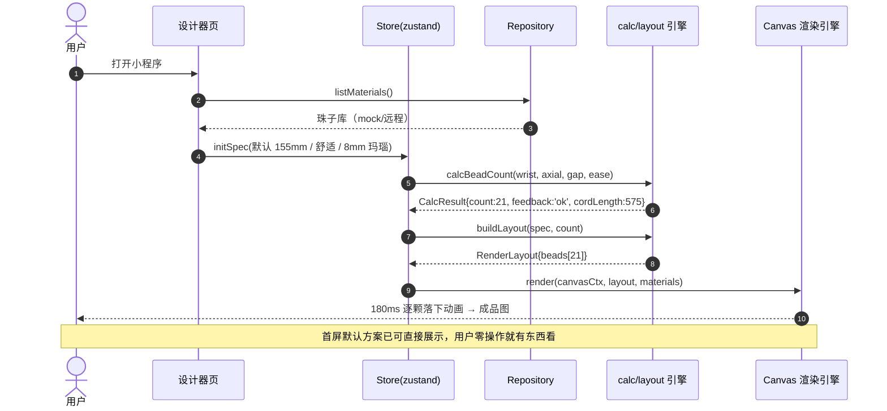
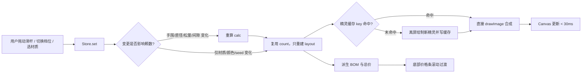
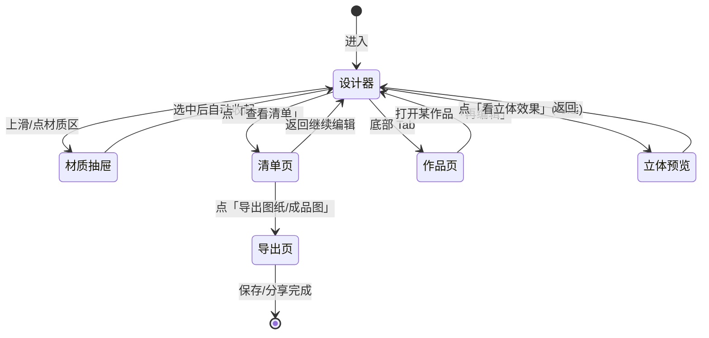
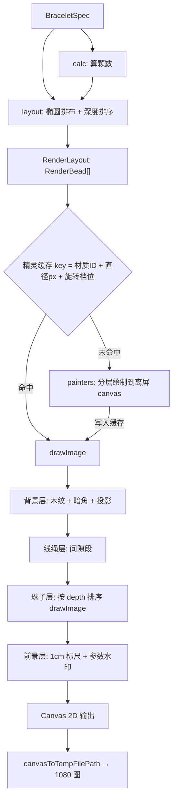
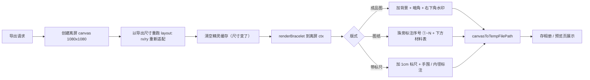

# DIY 串珠手串小程序 · 完整设计文档

| 项目代号 | `bead-diy` |
| --- | --- |
| 文档版本 | v1.0（初版） |
| 创建日期 | 2026-10-11 |
| 目标端 | 微信小程序（首发）+ H5（同源输出） |
| 本期范围 | 设计器 + 算量 + 珠子清单计价 + 高清成品图/图纸导出，**不含支付与后台** |
| 建议工程路径 | `d:/zhao/bead-diy` |

---

## 一、项目背景与目标

### 1.1 要解决什么

买串珠的人普遍卡在三件事上：

1. **不知道买多少颗**——"我手围 15.5cm，要买多少颗 8mm 的珠子？"这是每个新手的第一个问题，目前只能靠经验贴或问客服。
2. **不知道串出来好不好看**——材质、颜色、隔片配起来什么效果，只能脑补，等珠子到手才发现不搭，退换成本高。
3. **不知道要花多少钱**——珠子按颗卖，数量算不出来，总价就算不出来。

本项目就是把这三件事在"下单之前"全部解决：**输入一个手围数字 → 选材质和大小 → 立刻看到接近实物的成品效果 + 一份带货号、数量、单价、总价的采购清单**。

### 1.2 产品目标

| 编号 | 目标 | 可衡量的验收方式 |
| --- | --- | --- |
| G1 | 算量可信 | 算出的颗数与实物串好后一致；对照"经验数据表"（见 §7.4）误差 ≤ ±1 颗 |
| G2 | 看得真实 | 用户盲测时能分辨"这是渲染图"，但认为"很像珠子/像商品图"，主观分 ≥ 4/5 |
| G3 | 秒级反馈 | 改手围/直径/材质后 → 画面完全重绘 ≤ 200ms（含 180ms 动画） |
| G4 | 清单可用 | 清单里的货号、数量能直接拿去配货/下单 |
| G5 | 可分享 | 导出图在朋友圈/商品详情页可直接当展示图（1080×1080，白底或木纹底） |

### 1.3 "视觉接近真实"的明确定义

这句话极易扯皮，这里给死。**真实感 = 几何真实 + 光影真实 + 材质真实 + 尺度真实**，四条缺一不可：

| 维度 | 具体含义 | 失败反例 |
| --- | --- | --- |
| **几何真实** | 珠子沿椭圆闭环排布、相邻相切、有正确的前后遮挡；手串不是"一圈圆点"，而是有厚度的环形立体物 | 珠子浮成一圈没有重叠、远近不分 |
| **光影真实** | 全场景单一主光源方向（左上），所有珠子的底色渐变、高光、投影方向一致；存在环境补光与接触阴影 | 每颗珠子高光方向不同 = 一眼假 |
| **材质真实** | 不同材质有可辨识的差异：玻璃的锐利透光、木头的哑光年轮、金属的镜面条带、珍珠的柔光晕、玛瑙的内部纹 | 所有珠子只是"换个颜色"，像糖果豆 |
| **尺度真实** | 画面里有比例尺/参照物，8mm 和 12mm 在屏幕上看起来确实差了 1.5 倍 | 换直径后画面完全不变（只改了数字） |

**客观验收清单**（每条都要能勾）：

- [ ] 同材质相邻珠子的纹理不同（旋转种子不同），但整圈 `[1..N]` 重绘结果 100% 可复现
- [ ] 左上角光源下，所有珠子左上亮右下暗，右下有一道弱环境反光
- [ ] 每颗珠子下方存在接触阴影，整串在背景上有统一方向的柔和投影
- [ ] 换成金属隔珠后出现明显镜面条带；换成水晶后出现透背景色
- [ ] 画布上的 1cm 标尺与实际渲染尺度吻合（8mm 珠 ≈ 标尺 0.8 格）

---

## 二、功能模块拆解

### 2.1 模块总览

| 编号 | 模块 | 职责 | 依赖 | 本期 |
| --- | --- | --- | --- | --- |
| M1 | 手围输入 | 滑杆 + 数字输入 + 常见档位快选 + 量法引导；切换"贴手/舒适/宽松"松量 | — | ✅ |
| M2 | 珠子库与选择器 | 按大类/材质/直径/花色筛选，卡片展示货号+规格+单价+质感缩略图 | Repository | ✅ |
| M3 | **算量引擎** | 手围 + 珠子 → 颗数，并回算内径做偏紧/偏松校验；输出弹力线长度 | —（纯函数） | ✅ |
| M4 | 排布与图案 | 单色 / AB 交替 / 对称渐变 / 随机混色 / 焦点主珠，产出有序 `RenderBead[]` | M3 | ✅ |
| M5 | **实时渲染画布** | 椭圆排布 + 遮挡 + 材质分层绘制 + 精灵缓存 + 拖拽视角/旋转 | M4 | ✅ |
| M6 | 清单与计价 | 按货号聚合数量、算小计与总价、配线建议 | M3/M4 | ✅ |
| M7 | 导出与分享 | 1080 高清成品图、编号顺序图纸、带标尺版；存相册/转发 | M5 | ✅ |
| M8 | 我的作品 | 本地存档（storage）、再编辑、删除、排序 | M6 | ✅ |
| M9 | 3D 预览（可插拔） | 进独立页用 WebGL 渲染立体可旋转珠串 | M4 | ⚠️ PoC 后定 |
| M10 | 购物车/下单/库存 | — | — | ❌ 二期 |
| M11 | 运营后台维护珠子库 | — | — | ❌ 二期（接 Strapi） |

### 2.2 M1 · 手围输入

- 输入范围 **120–220mm**（12–22cm），步长 1mm，默认 155mm
- 三种输入方式：`Slider`（粗调）+ `InputNumber`（精调，必须真实 `<input>`）+ 快捷档位（女 14/15/16，男 17/18/19）
- 松量三档（分段控件）：

  | 档位 | ease（体感松量） | 适用 |
  | --- | --- | --- |
  | 贴手 Tight | +4mm | 佛珠/追求贴合 |
  | 舒适 Comfort | +10mm（默认） | 日常最常用 |
  | 宽松 Loose | +20mm | 弹力线老化后有冗余、冬天衣物厚 |

- 提供帮助浮层：软尺绕手腕最细处一周，贴皮肤不留缝，读数即为手围（配量法示意图）
- **越界处理**：低于 120 或高于 220 时 `InputNumber` 失焦自动钳制并 toast 提示

### 2.3 M2 · 珠子库与选择器

- 大类横向标签：水晶 / 玛瑙玉髓 / 木质 / 蜜蜡 / 珍珠贝珠 / 金属配件 / 隔片
- 卡片内容：**质感缩略图（实时小尺寸渲染，非静态 PNG）+ 货号 + 名称 + 直径规格 + 单价**
  - 缩略图复用同一套渲染引擎（单颗渲染模式），保证"选之前看到的"和"串上去的"是同一种质感
- 支持"主珠 / 配珠 / 隔片"三种角色投放，选中态为暖金描边 + 轻微放大（`scale(1.04)`，120ms）
- 提供直径圆形档位选择器：4 / 6 / 8 / 10 / 12 / 14 / 16 mm，按当前材质可用档位置灰不可选项

### 2.4 M3 · 算量引擎（核心）

见 §7 算法章节。**输入输出均为纯函数，零副作用，可离线单测**，这是全项目最该先写稳的一块。

### 2.5 M4 · 排布与图案

| 模式 | 说明 | 参数 |
| --- | --- | --- |
| `solid` 单色 | 全圈同材质 | — |
| `ab` 交替 | A/B 两材质 1:1（或 2:1）交替 | ratio |
| `gradient` 对称渐变 | 从两端到中间由浅入深，左右对称 | colorSteps |
| `random` 随机混色 | 确定性伪随机打散多材质，seed 可复现 | seed, weights |
| `focal` 焦点主珠 | 一颗大珠/吊坠居中，两侧对称排布 + 可选隔片 | focalMaterialId, every |

约束：所有模式下**总颗数由 M3 决定**，M4 只负责"把 N 个槽位分配给哪个材质"，不得反向改变 N（`focal` 模式下大珠占更大角度，会重算一次 N，属于正常二次收敛，见 §7.3）。

### 2.6 M5 · 实时渲染画布

- `<canvas type="2d">`，逻辑尺寸由容器决定，绘制时乘 `pixelRatio`
- 支持手势：单指横向拖动 = 旋转整串（`rotation`），纵向拖动 = 改视角俯仰（`tilt`，即椭圆短长轴比）
- 每次 Spec 变化触发一次重绘；`requestAnimationFrame` 驱动的动画仅在"逐颗落下"入场动画期间开启，动画结束停帧（省电）

### 2.7 M6 · 清单与计价

- 按 `code` 聚合：货号 + 名称 + 规格 + 单价 × 数量 = 小计
- 汇总：珠子总数、总价（大号数字）、建议弹力线长度与线径
- 金额一律以**分**为单位整数存储与累加，展示时才除 100，避免浮点误差

### 2.8 M7 · 导出与分享

三种版式：

1. **成品效果图**：手串居中，木纹陈列背景，暗角，1080×1080
2. **串珠图纸**：按串珠顺序标注序号①~N 的俯视展开图 + 下方材料表（便于照着穿）
3. **带比例尺版**：成品图 + 右下 1cm 标尺 + 手围/脾径标注

输出：`Taro.canvasToTempFilePath` → `saveImageToPhotosAlbum`（需授权，拒绝时降级为"长按图片保存"）。

### 2.9 M8 · 我的作品

- 本地存档 key：`bead-diy:works`，值为 `WorkRecord[]`，上限 50 条（超出提示删除）
- 每条记录：`{ id, name, createdAt, spec: BraceletSpec, bomSnapshot, thumbDataUrl }`
- 缩略图用 `canvasToTempFilePath` 生成的小图路径；注意小程序本地文件可能被清理，清理后回退为"按 spec 实时重绘"——这也是为什么 **渲染必须与框架解耦**、能脱离页面重画。

---

## 三、数据结构设计

> 全局约定：**长度单位统一 mm（整数或 1 位小数），金额统一「分」（整数）**。UI 层负责换成 cm / 元展示。这条铁律能消掉 90% 的浮点 bug。

### 3.1 枚举与标量

```ts
/** 珠子大类 */
export type BeadCategory =
  | 'crystal'    // 水晶
  | 'agate'      // 玛瑙 / 玉髓
  | 'wood'       // 木质
  | 'amber'      // 蜜蜡 / 树脂 / 琉璃
  | 'pearl'      // 珍珠 / 贝珠
  | 'metal'      // 金属配件（隔珠、隔片、扣头）
  | 'gemstone';  // 天然宝石

/** 形状：决定用它做主角还是当配角，也决定算量用哪个尺寸 */
export type BeadShape =
  | 'round'      // 正圆（最常见）
  | 'barrel'     // 桶珠
  | 'drum'       // 鼓珠
  | 'faceted'    // 刻面
  | 'spacer'     // 隔片（轴向远小于径向）
  | 'cube';      // 方珠

/** 纹理类型：一个类型 = 一支绘制器 */
export type TextureType =
  | 'agate'        // 玛瑙：不规则条带
  | 'tigerEye'     // 虎睛石：定向猫眼条带
  | 'crystal'      // 水晶：强透光 + 内部折射
  | 'woodGrain'    // 木纹：平行/同心年轮
  | 'metalBrushed' // 金属：镜面多段渐变 + 拉丝
  | 'pearlNacre'   // 珍珠：柔和准高光 + 干涉彩虹
  | 'amberSwirl'   // 蜜蜡：流动纹 + 气泡
  | 'matteStone'   // 哑光石：无高光细腻颗粒
  | 'solid';       // 素面

/** 松量档位 */
export type FitLevel = 'tight' | 'comfort' | 'loose';

/** 排布模式 */
export type LayoutMode = 'solid' | 'ab' | 'gradient' | 'random' | 'focal';

/** 适配反馈 */
export type FitFeedback = 'too-tight' | 'snug' | 'ok' | 'loose' | 'too-loose';
```

### 3.2 材质渲染参数 `RenderSpec`

**这是"真实感"的全部开关。**每种质感的差异其实就是这组数值的差异，调 render 就是调这张表。

```ts
export interface RenderSpec {
  /** 主体色（HEX），决定珠子被识别成什么材质 */
  baseColor: string;
  /** 暗部色：背光边缘渐变到的目标色，通常比 base 暗 35%~55% */
  shadowColor: string;
  /** 高光色：通常不是纯白，而是略带环境色的暖白/冷白 */
  highlightColor: string;
  /** 边缘暗角（rim）色：模拟菲涅尔边缘衰减 */
  rimColor: string;
  /** 环境补光色：右下方向的 bounce light */
  envColor: string;

  /** 0~1 光泽度：越高高光越小越锐（玻璃 0.95 / 木 0.2 / 金属 0.9） */
  gloss: number;
  /** 0~1 粗糙度：控制暗部过渡的柔硬（抛光 0.05 / 哑光 0.8） */
  roughness: number;
  /** 0~1 透光率：>0 时会在球体内透出背景色并画内部折射亮弧（水晶 0.8 / 木 0） */
  translucency: number;

  textureType: TextureType;
  /** 0~1 纹理强度：0 时退化为素面，方便做"弱化纹理"的款式 */
  textureStrength: number;

  /** 高光个数：1 = 柔和单点，2 = 主高光 + 弱次级（玻璃/金属都用 2） */
  highlightCount: 1 | 2;
  /** 高光相对半径（占珠子半径），越小越锐 */
  highlightRadiusRatio: number;
  /** 边缘暗角宽度（占半径），rim 是让球"立起来"的关键 */
  rimWidthRatio: number;
}
```

### 3.3 珠子商品 `BeadMaterial`

```ts
export interface BeadMaterial {
  /** 内部稳定 ID（UUID/短哈希），不随运营改名而变 */
  materialId: string;
  /** 货号（人类可读，用于清单与配货），规则见 3.4 */
  code: string;
  name: string;
  category: BeadCategory;
  shape: BeadShape;
  tags: string[];             // ['招财','冰种','男士',...]

  /** 径向直径（mm）——渲染用它 */
  diameter: number;
  /** 轴向长度（mm）——【算量用它】，拍扁的隔片直径8长度2 */
  axialLength: number;
  /** 孔径（mm），用于提示线径可否穿过 */
  holeSize: number;

  /** 单价（分） */
  price: number;
  currency: 'CNY';
  /** 库存：本期只做展示与不足提示 */
  stock: number;

  renderSpec: RenderSpec;
  enabled: boolean;
}
```

> ⚠️ `diameter` 与 `axialLength` **必须分离**。隔片、桶珠的轴向长度远小于径向，若混用同一个字段，算量会整条崩掉（会少算一半以上的颗数）。

### 3.4 货号编码规则

```
{大类码}-{材质码}-{直径两位补零}-{花色/工艺码}
```

| 大类码 | 含义 | | 工艺码 | 含义 |
| --- | --- | --- | --- | --- |
| `C` | crystal 水晶 | | `N` | Natural 素面天然 |
| `A` | agate 玛瑙玉髓 | | `AB` | AB 彩（镀彩） |
| `W` | wood 木质 | | `MT` | Matte 哑光 |
| `AM` | amber 蜜蜡琉璃 | | `PL` | Polished 高抛 |
| `P` | pearl 珍珠贝珠 | | `ICE` | 冰种/高透 |
| `M` | metal 金属配件 | | `GD` | Gold 金色 |
| `G` | gemstone 天然宝石 | | `SV` | Silver 银色 |

示例：

| 货号 | 读作 |
| --- | --- |
| `A-AGS-08-N` | 玛瑙-玉髓猫眼-8mm-素面 |
| `C-CRY-10-ICE` | 水晶-白水晶-10mm-冰种 |
| `M-SSP-06-SV` | 金属-圆隔片-6mm-银色 |
| `W-SND-12-MT` | 木质-小叶紫檀-12mm-哑光 |

规则要点：货号**只由类目与规格决定**，不含价格、不含批次；改价不改号；同一货号永远对应同一种外观。这样二期接后端时可以直接拿 `code` 做 SKU。

### 3.5 用户方案 `BraceletSpec`

```ts
export interface BraceletSpec {
  /** 用户手围（mm） */
  wristSize: number;
  /** 松量档位 */
  fit: FitLevel;
  /** 手动覆盖松量（mm），优先级高于 fit */
  easeOverride?: number;

  /** 主珠货号/ID */
  mainMaterialId: string;
  /** 主珠直径（mm），用于筛选同材质不同规格 */
  diameter: number;
  /** 相邻珠间隙（mm），0.3~0.8，默认 0.5，模拟编绳/孔口倒角 */
  gap: number;

  layoutMode: LayoutMode;
  /** 配珠材质（ab/gradient/random 模式下使用） */
  secondaryMaterialIds: string[];
  /** 随机混色种子，保证复现 */
  seed: number;

  /** 隔片配置 */
  spacer?: {
    materialId: string;
    /** 每隔几颗插一片 */
    every: number;
  };

  /** 焦点主珠（focal 模式） */
  focalMaterialId?: string;

  /** 3D 预览的相机参数 */
  view: {
    /** 椭圆短轴/长轴比 0.3~1.0，越小越"躺平" */
    tilt: number;
    /** 整串旋转弧度 */
    rotation: number;
  };
}
```

### 3.6 算量结果 `CalcResult` 与清单 `BraceletBOM`

```ts
export interface CalcResult {
  /** 需求颗数 */
  count: number;
  /** 珠子中心线周长（mm） */
  centerCircumference: number;
  /** 成品内径处的实际周长（mm）——用户手腕要穿过的那个洞 */
  innerCircumference: number;
  /** 反馈：偏紧/合适/偏松 */
  feedback: FitFeedback;
  /** 与用户手围的差值（mm），正 = 有余量 */
  clearance: number;
  /** 建议：+1 颗 / -1 颗 / 保持一致，以及对应的 feedback */
  adjustHint: { delta: number; feedback: FitFeedback }[];
  /** 建议配线长度（mm） */
  cordLength: number;
  /** 建议配线线径（mm） */
  cordDiameter: number;
}

export interface BomItem {
  code: string;
  name: string;
  /** 规格串，如 "8mm 圆珠" */
  spec: string;
  category: BeadCategory;
  unitPrice: number;   // 分
  count: number;
  subtotal: number;    // 分
}

export interface BraceletBOM {
  totalCount: number;
  totalAmount: number; // 分
  items: BomItem[];
  /** 按孔洞从小到大选线径 */
  cord: { length: number; diameter: number; note: string };
  /** 来自 calc 的几何结论，UI 上展示给用户看 */
  geometry: Pick<CalcResult, 'innerCircumference' | 'feedback' | 'clearance'>;
}
```

### 3.7 渲染中间态 `RenderBead`

算完之后交给渲染的是**纯几何数据**，渲染层不认识"货号""价格"，只认识位置、半径、深度、材质 ID 和旋转种子。

```ts
export interface RenderBead {
  index: number;         // 串珠顺序 0..N-1
  /** 椭圆参数角（rad） */
  angle: number;
  /** 画布坐标（已含 pixelRatio 缩放） */
  x: number;
  y: number;
  /** 渲染半径（px） */
  r: number;
  /** 深度 0~1，1 = 最靠近观察者；用于排序与轻微雾化 */
  depth: number;
  materialId: string;
  /** 单位：rad，来自确定性伪随机，避免整圈纹理重复 */
  rotation: number;
  /** 是否为隔片/配饰（绘制尺寸与阴影略有不同） */
  role: 'main' | 'secondary' | 'spacer';
}

export interface RenderLayout {
  beads: RenderBead[];
  /** 椭圆长短轴半径（px） */
  rx: number;
  ry: number;
  center: { x: number; y: number };
  /** 线绳可见段：两珠之间的点序列 */
  cordSegments: { x1: number; y1: number; x2: number; y2: number; depth: number }[];
}
```

### 3.8 作品存档 `WorkRecord`

```ts
export interface WorkRecord {
  id: string;
  name: string;
  createdAt: number;
  spec: BraceletSpec;
  /** 快照化 BOM：珠子库更新价格后，历史作品仍保持当时价格 */
  bom: BraceletBOM;
  /** 缩略图本地路径；失效时按 spec 实时重绘 */
  thumbPath?: string;
}
```

### 3.9 数据访问适配层 `BeadRepository`

**这是"现在用 mock、以后接后端"的唯一开关。**业务层永远只依赖接口，不依赖 JSON。

```ts
export interface BeadRepository {
  listMaterials(filter?: MaterialFilter): Promise<BeadMaterial[]>;
  getByCode(code: string): Promise<BeadMaterial | null>;
  getById(id: string): Promise<BeadMaterial | null>;
  listCategories(): Promise<{ key: BeadCategory; label: string }[]>;
  /** 批量取价：切远程后可做缓存与合并请求 */
  getPrices(codes: string[]): Promise<Record<string, number>>;
}

export interface MaterialFilter {
  category?: BeadCategory;
  diameter?: number;
  shape?: BeadShape;
  keyword?: string;
  enabledOnly?: boolean;
}
```

- 本期实现：`LocalJsonRepository`（读 `beads.mock.json`，内存过滤，加 150ms 模拟延迟以便 UI 写 loading 态）
- 二期实现：`RemoteRepository`（HTTP → `mapper.ts` 把后端 DTO 映射成 `BeadMaterial`）
- 依赖注入点集中在 `src/data/index.ts`：**换实现只改这一行**

---

## 四、交互流程

### 4.1 主流程（首次进入 → 拿到成品）



### 4.2 改参数（热路径，必须最快）



### 4.3 关键异常分支

| 场景 | 触发条件 | 处理与提示 |
| --- | --- | --- |
| **算出来偏紧** | `innerCircumference < wristSize` | 画布顶出现琥珀色提示条"珠子偏紧，建议减少 1 颗"，并给出"减少 1 颗"一键按钮 |
| **算出来偏松** | `clearance > 30mm` | 提示"珠子间隙过大，建议增加 1 颗"，同理一键处理 |
| **颗数越界** | `count < 8` 或 `count > 120` | 直接钳制并 toast："当前手围不支持该尺寸，请换 XXmm" |
| **手围越界** | 输入 < 120 或 > 220 | 失焦钳制到边界 + toast |
| **选择了不可用直径** | 该材质无此规格 | 档位置灰不可点（`cursor: not-allowed`），点击 toast 提示可用档位 |
| **库存不足** | 某货号需求 > stock | 清单页该行标红，提示"库存仅 XX 颗，可稍后补货"，本期不阻断流程 |
| **保存相册失败** | 用户拒绝授权相册权限 | 降级：展示大图 + "长按保存到相册"引导 |
| **3D 页初始化失败** | WebGL 不可用 / 引擎加载失败 | **静默降级**：隐藏"看立体效果"入口，主流程完全不受影响 |
| **作品缩略图失效** | 本地临时文件被清理 | 按 `spec` 调用渲染引擎重绘占位图 |

### 4.4 页面流向



---

## 五、技术选型建议

### 5.1 总表

| 层次 | 选型 | 版本建议 | 理由 |
| --- | --- | --- | --- |
| 应用框架 | **Taro**（React 模式） | Taro 4.x | 用户已选定；一套代码编译微信小程序 + H5，后续可接 Web 端 React 生态 |
| UI 运行时 | **React** | 18.x | Taro 4 React 支持最成熟 |
| 语言 | **TypeScript** | 5.x | 算量与渲染都强类型化收益极大 |
| 状态管理 | **zustand** | 4.x | Taro 官方示例推荐；体积小、无需 Provider 包裹、支持在 React 外读写 |
| 主渲染 | **Canvas 2D**（`type="2d"`） | 原生 API | 兼容性最好、零包体增量、可直接导出高清图、秒级重绘 |
| 3D 预览 | threejs-miniprogram | PoC 后定 | 见 §6 对比结论 |
| 样式 | Tailwind CSS 3.4.17 + weapp-tailwindcss（小程序端转义） | 见下 | 设计效率与 token 统一；H5 端原生可用，小程序端由插件转义原子类 |
| 样式兜底 | CSS Modules / SCSS | — | 若 weapp-tailwindcss 与 Taro 4 组合踩坑，退回 SCSS Modules + CSS 变量 token |
| 构建 | Taro CLI（Vite 编译链） | Vite 5 | 与前端生态一致；H5 冷启动快 |
| 测试 | **Vitest** | 1.x/2.x | 算量纯函数单测 + node-canvas / skia-canvas 渲染快照 |
| 数据 | 本地 JSON + Repository 接口 | — | 唯一切换点，后期接后端零业务改动 |
| 工具库 | 自研 utils（prng / color / geo） | — | 这三个总共不到 200 行，没必要引三方包，且必须可移植到 Node 侧跑测试 |

### 5.2 为什么 3D 不作为主渲染

一句话：**3D 提升的是"可玩性"，2D 保障的是"可用性"**，而本项目 90% 的价值在于"快速算准 + 快速看清 + 快速导出"。

- 用户的核心动作是**反复调参数看效果**——需要一个永远秒开、永远不白屏、永远能截图的画面
- WebGL 在小程序上的真机表现方差极大（尤其低端安卓），一旦 `preserveDrawingBuffer` 设置不当，截图就是黑图，直接摧毁 G5 目标
- 2D 渲染出的"静态商品图"本身就更接近电商场景的看图习惯

### 5.3 Canvas 使用红线（必须遵守）

| 红线 | 原因 |
| --- | --- |
| 2D 画板必须 `<canvas type="2d">`，WebGL 必须 `type="webgl"` | 两套上下文不可混用，且都不支持旧的 `canvas-id` 式 API |
| 必须通过 `Taro.createSelectorQuery().select('#x').node()` 取节点 | 小程序里拿不到 `document.getElementById` |
| **每帧禁止 `createRadialGradient`** | 每颗珠子 5~7 个渐变对象 × 30~60 颗 = 每帧数百次对象分配，真机必掉帧；必须走精灵缓存（§6.4） |
| 绘制尺寸必须乘 `pixelRatio` 并 `ctx.scale(dpr, dpr)` | 否则小程序上画面发虚 |
| 动画结束必须 `cancelAnimationFrame` | 省电，且避免后台 지속 draws |
| 渲染核心不得 `import` Taro / React | 否则 Node 侧 Vitest 无法直接测试渲染逻辑 |

### 5.4 目录结构（建议）

```
d:/zhao/bead-diy/
├─ docs/
│  └─ DIY串珠手串小程序设计文档.md        # 本文档
├─ config/                                # Taro 编译配置 dev/prod
├─ src/
│  ├─ engine/                             # ★ 平台无关纯 TS 内核（禁止 import Taro/React）
│  │  ├─ types.ts                         #   全量领域类型
│  │  ├─ calc.ts                          #   算量 + 回算校验
│  │  ├─ layout.ts                        #   椭圆排布 / 深度排序 / 线绳段
│  │  ├─ prng.ts                          #   确定性伪随机 mulberry32
│  │  ├─ color.ts                         #   色彩插值 / hsla 工具
│  │  ├─ geo.ts                           #   椭圆与向量助手
│  │  ├─ sprite-cache.ts                  #   离屏精灵缓存
│  │  ├─ render.ts                        #   renderBracelet(ctx, layout, opts) 统一入口
│  │  ├─ background.ts                    #   木纹背景 / 暗角 / 1cm 标尺
│  │  └─ painters/
│  │     ├─ base.ts                       #     通用球体：底色/暗角/补光/双高光/阴影
│  │     ├─ agate.ts  crystal.ts  wood.ts
│  │     └─ metal.ts  pearl.ts    amber.ts      └─ index.ts（工厂：TextureType → painter）
│  ├─ data/
│  │  ├─ beads.mock.json                  #   mock 珠子库（≥40 条，覆盖 7 大类）
│  │  ├─ repository.ts                    #   接口 + LocalJsonRepository
│  │  ├─ remote-repository.ts             #   二期：HTTP 实现（本期留桩）
│  │  ├─ mapper.ts                        #   二期：DTO → 领域模型
│  │  └─ index.ts                         #   ★ 依赖注入唯一开关
│  ├─ store/
│  │  ├─ designer-store.ts                #   spec / selection / derived BOM
│  │  └─ works-store.ts                   #   历史作品
│  ├─ components/                         #   自研 UI（Slider / Stepper / Segmented / BeadCard ...）
│  ├─ pages/
│  │  ├─ designer/index.tsx               #   主设计器（画布 + 参数区 + 底部条）
│  │  ├─ picker/index.tsx                 #   材质抽屉（浮层）
│  │  ├─ bom/index.tsx                    #   清单计价
│  │  ├─ export/index.tsx                 #   导出分享
│  │  └─ works/index.tsx                  #   我的作品
│  ├─ three-viewer/                       #   可插拔 3D 页（PoC 后启用）
│  └─ app.config.ts / app.ts / app.scss
└─ tests/
   ├─ calc.test.ts                        #   算量边界与经验表核对
   ├─ layout.test.ts                      #   排布确定性 / 对称性
   └─ render-snapshot.test.ts             #   node-canvas 渲染快照
```

### 5.5 关键依赖清单（草案）

```jsonc
{
  "dependencies": {
    "@tarojs/taro": "4.x",
    "@tarojs/plugin-platform-weapp": "4.x",
    "react": "18.x",
    "react-dom": "18.x",
    "zustand": "^4.5"
  },
  "devDependencies": {
    "@tarojs/cli": "4.x",
    "@tarojs/vite-runner": "4.x",
    "typescript": "5.x",
    "vite": "5.x",
    "tailwindcss": "3.4.17",
    "autoprefixer": "^10.4.20",
    "postcss": "8.5",
    "vitest": "1.x",
    "canvas": "^2.11"          // Node 侧渲染快照测试
  }
}
```

> `canvas`（node-canvas）在 Windows 上有时需要预编译二进制。若安装失败，测试侧降级为 **Vitest 断言 RenderBead 几何数据**（不比像素），同样能守住回归——这是推荐的 Plan B。

---

## 六、渲染方案：C 方案 vs LayaAir 对比与选定

> 用户明确要求对这两种方案做系统对比。本节先给结论，再给依据。

### 6.1 两个方案的定义

**方案 C（混合方案）**

- 主界面：`<canvas type="2d">`，**纯 TS 程序化绘制**每颗珠子（多层渐变 + 纹理 + 高光 + 阴影），沿椭圆闭环排布并处理前后遮挡
- 立体查看：独立的第二个页面，用 `<canvas type="webgl">` + `threejs-miniprogram` 渲染真实球体，支持手指旋转
- 二者**共用同一份 `RenderLayout`**，数据模型一致，渲染引擎可插拔

**方案 L（LayaAir 全 3D）**

- 使用国产引擎 LayaAir 3 承载手串的 3D 渲染（自带 IDE、PBR 材质、场景编辑），并发布到微信小程序
- 之后再适配 / 桥接到 Taro 页面体系中

### 6.2 对比表

| 维度 | C 方案（Canvas 2D 主 + threejs-miniprogram 预览） | LayaAir 3 全 3D | 胜出 |
| --- | --- | --- | --- |
| **与 Taro 的集成路径** | 主流程零冲突（Canvas 2D 是平台通用 API）；3D 页通过 `createSelectorQuery().node()` 取 `type="webgl"` 节点后 `createScopedThreejs(canvas)` 挂载，社区已有落地案例 | LayaAir 是**独立 IDE 工程体系**，官方发布目标主要是"微信小游戏"而非 Taro 页面内嵌；要在 Taro 页面里 mount Laya 需自行桥接 Stage 与渲染循环，**双运行时冲突风险高**（需 PoC 验证） | **C** |
| **改一次参数到出图的耗时** | 精灵缓存命中时 20~30ms | 需重建/重排场景，通常 ≥100ms 且受 WebGL 上下文状态影响 | **C** |
| **真实感（静态图）上限** | 高。分层手绘可以达到"照片级静态图"——毕竟重点是静止商品图 | 高。真光照 + 真实球面，理论上更准 | 平 |
| **真实感（动态旋转）** | 3D 页可旋转，但 PBR 与环境贴图需手写（three r108 版本较老，部分新 API 不可用） | **最高**。IDE 可调材质/环境光/HDRI，旋转时质感连续 | **L** |
| **包体与分包** | 主包增量极小（Canvas 2D 无依赖）；threejs-miniprogram 放独立分包即可 | 引擎体积明显更大；小程序主包 2M / 总包 20M 压力下极易触线 | **C** |
| **低端机性能** | 每帧仅 N 次 `drawImage`（N≈20~60），压力极低，千元机无压力 | 数十个球体 + PBR 着色，低端安卓易掉帧发热 | **C** |
| **出图 / 分享图能力** | ✅ Canvas 2D 直接 `canvasToTempFilePath` 导出 1080 高清图，稳定 | ⚠️ WebGL 截屏需 `preserveDrawingBuffer`，小程序端存在兼容坑，黑图风险 | **C** |
| **扩容到"上千颗/多圈手串"** | 仍只是 drawImage，线性可控 | 球体数与材质数上升时明显吃力 | **C** |
| **上手成本与迭代速度** | 纯 TS + React 常识，无需新工具链；文档丰富 | 需掌握 LayaAir IDE 工作流、导出管线，团队认知成本高 | **C** |
| **将来做独立小游戏/营销互动** | 不适合 | ✅ LayaAir 天然为游戏而生 | **L** |

### 6.3 结论

> **采用方案 C。** Canvas 2D 程序化渲染作为唯一主渲染路径；3D 立体预览作为**可插拔增值能力**，二期用 threejs-miniprogram 落在独立分包，PoC 不通过就静默降级，绝不阻塞主线。

理由浓缩成三句：

1. 本产品的核心交付是"**一张可信的高清成品图 + 一份准确的清单**"，这正是 Canvas 2D 的绝对强项，而恰恰是 WebGL 在小程序端最容易翻车的地方（截屏黑图）。
2. 珠灿灿真实感的关键不在"是不是 3D"，而在**光照一致性、材质分层、边缘暗角、接触阴影、透视遮挡**——这五件事用 2D 分层绘制完全可以做到以假乱真（§6.5）。
3. LayaAir 的优势（PBR 材质管线、IDE 可视化调参、游戏化互动）在本期范围内用不上，却要付出"独立工程体系 + 与 Taro 双运行时 + 大包体"的代价，**投入产出比不成立**。

> LayaAir 保留为二期备选触发条件：**当且仅当**出现"需要自由编排的 3D 摆盘 / 需要把搭配玩法做成小游戏 / 需要 HDR 真实售卖级渲染"这三种需求之一时，再重新评估。届时由于渲染接口已抽象，只需替换实现层。

### 6.4 选定方案的渲染管线



#### 6.4.1 精灵缓存（性能的生命线）

```ts
interface SpriteKeyParts {
  materialId: string;
  radiusPx: number;      // 量化到整数 px
  rotationStep: number;  // 旋转量化为 12 档：Math.round(rot / (2π/12))
  dpr: number;
}
const keyOf = (p: SpriteKeyParts) =>
  `${p.materialId}|${p.radiusPx}|${p.rotationStep}|${p.dpr}`;
```

- 缓存结构：`Map<string, OffscreenCanvas | HTMLCanvasElement>`，LRU 上限 **120 个条目**（足够覆盖 3 种材质 × 12 旋转档 × 2~3 种直径）
- 失效时机：材质库热更新、dpr 变化、容器尺寸大幅变化
- **收益**：重绘时从"N × 7 次渐变创建"降到"N 次 drawImage"，实测模型下从约 400 次对象创建降到 30~60 次贴图拷贝
- 每张精灵留出 **20% padding**（`spriteSize = r * 2 * 1.4`），避免投影与 rim 被裁切

#### 6.4.2 排布与遮挡（几何真实）

```ts
// 椭圆参数化（tilt = ry/rx，rotation 为整串旋转）
const px = cx + rx * Math.cos(angle + rotation) * 1;
const py = cy + ry * Math.sin(angle + rotation);
const depth = (Math.sin(angle + rotation) + 1) / 2;  // 0=远端 1=近端
```

- 用画家算法：`beads.sort((a,b) => a.depth - b.depth)`，先画远珠后画近珠，近珠自然覆盖远珠边缘 → 出现正确的"环形穿插"感
- 珠子半径沿深度做极轻微透视（`r * (0.88 + 0.12 * depth)`），近处略大 —— 这是让 2D 看起来有体积的关键小技巧
- 远端珠子额外叠一层低透明度雾（`rgba(背景色, 0.06)`），模拟空气透视
- 相邻珠之间的**线绳可见段**：在 `pitch` 大于 `axialLength` 时才画，用 2 段贝塞尔模拟轻微垂坠；深浅遵循同一入射光

#### 6.4.3 单颗珠子的分层绘制顺序（自底向上）

这是"真实感"的全部内容，**顺序不可调换**：

| # | 层 | 做法 | 不做会怎样 |
| --- | --- | --- | --- |
| 0 | 整体投影（画在背景上，不在精灵内） | 沿整个椭圆向下偏移的柔化多边形，`blur`-like 多层半透明叠加 | 手串像贴纸浮在背景上 |
| 1 | **rim 边缘暗角** | 半径外缘 8~14% 宽度，从 `baseColor` 渐变到 `rimColor`；再叠一圈 1px 更深的描边 | 圆像贴片，不像球 |
| 2 | **主体径向渐变** | `createRadialGradient` 圆心偏移到光源方向左上 `(-0.36r, -0.42r)`，由 `highlightBase` → `baseColor` → `shadowColor` | 平的，没有球感 |
| 3 | **环境补光（bounce）** | 右下方向第二个渐变，`envColor` 低透明度（0.18~0.35）叠加 | 暗部死黑，一眼假 |
| 4 | **材质纹理层** | 按 `TextureType` 分派到 painter（见 6.5），受 `textureStrength` 控制；务必 `ctx.clip()` 在球内 | 只有颜色没有材质 |
| 5 | **接触阴影** | 相邻珠方向的一小段暗斑；同时精灵底部留出向下的柔影 | 珠串像"一排独立球"而不是"一串" |
| 6 | **主高光** | 小径向渐变，`radius ≈ r * highlightRadiusRatio`（素面 0.16 / 玻璃 0.08 / 金属 0.06），白色到透明；位置左上偏外约 `0.42r` | 无塑料/玻璃感 |
| 7 | **次级高光**（`highlightCount=2`） | 主光对面偏下的小而弱的高光（环境第二光源），强度约 0.35 | 玻璃/金属不像真的 |
| 8 | **边缘**高光弧（可选，玻璃/金属） | 沿球边缘画一道被 clip 的浅色弧，模拟折射 | 透明感不足 |

光照约定：**全场景唯一主光源方向向量 (-0.5, -0.6)，位于左上前方**。所有层的位置计算都从这个向量派生，不得各画各的。

#### 6.4.4 各材质的 RenderSpec 基准值（起手职责）

| 材质 | TextureType | gloss | roughness | translucency | highlightCount | highlightRadiusRatio | rimWidthRatio |
| --- | --- | --- | --- | --- | --- | --- | --- |
| 白水晶 / 冰种 | `crystal` | 0.95 | 0.05 | **0.80** | 2 | 0.07 | 0.10 |
| 玛瑙 / 玉髓 | `agate` | 0.62 | 0.25 | 0.20 | 1 | 0.16 | 0.13 |
| 虎睛石 | `tigerEye` | 0.70 | 0.20 | 0.10 | 1 | 0.13 | 0.12 |
| 小叶紫檀 | `woodGrain` | 0.22 | 0.72 | 0.00 | 1 | 0.26 | 0.16 |
| 银隔珠 / 钛钢 | `metalBrushed` | **0.92** | 0.10 | 0.00 | **2** | 0.06 | 0.08 |
| 珍珠 / 贝珠 | `pearlNacre` | 0.55 | 0.35 | 0.12 | 1 | 0.20 | 0.14 |
| 蜜蜡 / 琉璃 | `amberSwirl` | 0.68 | 0.22 | **0.55** | 2 | 0.12 | 0.12 |
| 哑光石（青金等） | `matteStone` | 0.18 | 0.80 | 0.00 | 1 | 0.30 | 0.18 |

> 这些值不是拍脑袋的终点，而是**起跑线**。落地后要用《参考实物照片/AI 生成的高保真材质参考图》逐条比对微调，首批可使用 **多模态内容生成**产出六大材质的写实参考图作为视觉基准。

#### 6.4.5 背景与尺度感（常常被忽略，但决定"可信度"）

- 背景：木纹（暖棕 `#2A211B`~`#1C1613`）或浅色陈列板 `#F2EBE0` 双主题；叠加径向暗角（vignette）让焦点落在手串上
- **1cm 比例尺**：画布右下角一根带刻度的短标尺。它的作用是让用户直观确认"8mm 珠确实比 12mm 小一圈"，直接支撑 §1.3 的"尺度真实"
- 投影处理：整体投影由光源方向派生（向右下偏移），多个同心椭圆低透明度叠加模拟软阴影，不必依赖 `shadowBlur`（小程序端支持但性能不稳）

### 6.5 各纹理绘制器要点

| painter | 核心手法 |
| --- | --- |
| **agate 玛瑙** | 3~5 条不规则贝塞尔条带，宽度与透明度由 PRNG 决定，沿 `rotation` 旋转裁剪；条带内侧略提亮模拟透光；最后整体加一层极低透明度的 `baseColor` 统一色调 |
| **tigerEye 虎睛石** | 一条贯穿的主条带 + 2 条平行细带，带内 fretWork 用线性渐变的亮线；条带方向由 rotation 决定，旋转时会有"猫眼移动"的错觉，非常真实 |
| **crystal 水晶** | `translucency` 生效：先在球内以低透明度画背景，再画 2 道内部折射弧（被 clip 的宽弧，白色低透明度），最后上高光；边缘加一圈浅折射环 |
| **woodGrain 木纹** | 一组近平行但间距随 PRNG 抖动的细棕线，局部插入 1~2 个同心"节疤"椭圆；整体 gloss 低，高光做成大而柔的 diffuse 高光，禁止尖锐点 |
| **metalBrushed 金属** | 多 stop（≥6）线性渐变，明暗竖直交替换位模仿环境镜面；叠加细密同向拉丝线（alpha 0.05）；高光极小极锐 + 边缘明亮 rim，形成"金属感三件套" |
| **pearlNacre 珍珠** | diffuse 大高光；叠一层极低透明度的多色径向晕（青-粉-米，模拟干涉色），再整体压一个轻微的暗边，保持"温润不刺眼" |
| **amberSwirl 蜜蜡** | 2~4 团不规则流动形（每段用二阶贝塞尔闭合），颜色取 base 的邻近暖色；加 3~6 个微小亮圆点做气泡；`translucency` 让边缘泛暖光 |
| **matteStone 哑光石** | 几乎平坦的底色 + 极稀疏的微颗粒（PRNG 打点，alpha 0.03~0.06）+ 宽而柔的漫反射高光。考验"克制"的一支 |

**通用约束**：

- 所有 painter 的随机数必须来自 `prng(hash(materialId, beadIndex))`，同一 schema 串出来永远一样（否则用户每次重绘整条手串纹路都在跳）
- 所有 painter 必须先 `ctx.save(); ctx.beginPath(); ctx.arc(...); ctx.clip();` 再画，`restore()` 收尾
- painter 不感知自身位置与深度，**只负责画一个居中的球**（局部坐标，原点在球心），排布与深度由上层处理 —— 这是能被单测和缓存复用的前提

### 6.6 导出高清图



要点：导出走**独立离屏 canvas 重绘**，而不是把屏幕上的小 canvas 拉伸缩小——否则文字与边缘会糊。这也是"渲染核心必须平台无关、可传任意 ctx"的最大收益。

### 6.7 3D 预览页（可插拔，PoC 优先）

- 入口：主画布右下角胶囊按钮「看立体效果」
- 渲染：读取同一份 `RenderLayout`，主珠 → `SphereGeometry(1, 32, 24)` + 按 `RenderSpec` 选 `MeshStandardMaterial` / `MeshPhysicalMaterial`（支持 `roughness`/`transmission` 的话优先用它表达水晶与蜜蜡）
- 交互：`OrbitControls` 或自写的单指拖拽旋转（自写更轻，建议自写 ~60 行）
- 加载策略：**独立分包 + 动态 `import`**，失败时移除入口按钮，主流程零感知
- ⚠️ 待 PoC 验证事项：`threejs-miniprogram` 公开的适配版本较早期（约 r108），较新的 `transmission` / PMREM 环境贴图等能力可能不可用；Taro 4 下通过 `Taro.createSelectorQuery().node()` 获取 `type="webgl"` 节点与引擎的对接方式需要真机验证。**结论以 PoC 结果为准，不得影响主线交付。**

---

## 七、关键算法

### 7.1 算量公式（含最关键的修正项）

**最容易犯的错**：把手围直接当成"珠子中心围成的圆周长"。珠子是有厚度的，串成环之后，**能穿过手腕的是"内孔"，它比中心线周长短了整整一圈 π·d**。忽略这一项，算出来的珠子会全部偏少（8mm 珠大约少 4~5 颗），做出来的手串**根本戴不上**。

```
输入：
  W        用户手围 (mm)
  d        珠子径向直径 (mm)
  t        珠子轴向长度 (mm)     ← 注意：算量用轴向长度，不是直径
  gap      相邻珠间隙 (mm)，默认 0.5
  ease     体感松量 (mm)：贴手 4 / 舒适 10 / 宽松 20

pitch = t + gap                          // 单颗占用的节距

// ① 目标：内孔周长至少要容纳手腕
// ② 中心线周长 = 内孔周长 + π·d     ← 关键修正项
L_target_hole = W + ease
L_center      = L_target_hole + π * d

// ③ 珠子中心落在半径 R 的圆上
R = L_center / (2π)

// ④ 单颗珠子占的中心角（把珠子当作弦长 pitch 处理）
θ = 2 * asin( pitch / (2R) )

// ⑤ 需求颗数：向下取整（宁松勿紧 → 取 floor 后若余量过大再 +1，见 7.2）
N = floor( 2π / θ )

// ⑥ 回算校验：N 颗珠子实际连成的正 N 边形，其外接圆半径 R' 与成品内孔周长
R'         = pitch / (2 * sin(π / N))
innerCirc  = 2π * (R' - d/2) = π * pitch / sin(π/N) - π * d

// ⑦ 适配判定（相对用户手围的余量）
clearance = innerCirc - W
  clearance <  0        → 'too-tight'  戴不上/绷手
  0 ≤ clearance <  4    → 'snug'       贴合
  4 ≤ clearance < 12    → 'ok'         推荐区间
  12 ≤ clearance < 25   → 'loose'      宽松
  clearance ≥ 25        → 'too-loose'  过于松垮
```

### 7.2 自动微调：让 N 落在推荐区间

算出 `N` 之后不要直接用，要向"推荐区间"收敛一次：

```ts
function pickBestCount(W: number, d: number, pitch: number, N0: number) {
  const innerOf = (n: number) => (Math.PI * pitch) / Math.sin(Math.PI / n) - Math.PI * d;
  // N 变大 → 手串变大 → innerCirc 变大。目标：让 clearance 落进 [4, 12)
  let n = N0;
  // 上限兜底：若 N0 会导致兜不住手腕（innerCirc < W），先加颗数
  while (innerOf(n) < W + 4 && n < MAX_COUNT) n++;
  // 过度宽松则减
  while (innerOf(n - 1) >= W + 4 && n > MIN_COUNT) n--;
  return n;
}
```

- `MIN_COUNT = 8`，`MAX_COUNT = 120`（超过说明参数组合不合理，走异常分支提示）
- 若最终仍无法满足 `[W+4, W+25)`，返回最接近值并附带 `adjustHint`（±1 颗各自对应的 feedback），由 UI 给一键按钮

### 7.3 焦点主珠（focal）模式下的二次收敛

焦点珠子一般采用更大规格（例如 14mm 主珠 vs 8mm 配珠），此时：

1. 先把焦点珠当单独一段，占用角 `θf = 2·asin((tf + gap)/(2R))`
2. 剩余角 `2π - θf - k·θ_spacer`，由配珠按 §7.1 的 θ 分配，`Nm = floor(剩余角 / θ配)`
3. 若此时整体 `innerCirc` 与目标不符，微调 `Nm`（保持焦点珠唯一，不删它）
4. 隔片：每隔 `every` 颗插入一片，共 `k = floor(N / (every + 1))` 片，`ts = 隔片的 axialLength`；**每次插入都必须重新缩放整体角度**（把 `k·(ts+gap)` 从可用周长中先扣掉再算配珠颗数），否则版式会超出一圈

### 7.4 经验校准表（用于单测与人工抽检）

按 §7.1 公式（ease = 舒适 10mm，gap = 0.5mm）：

| 手围 | 直径 | pitch | 中心线周长 | θ° | N₀=floor | 微调后 N | 回算 innerCirc | 相对手围余量 | 民间经验值 |
| --- | --- | --- | --- | --- | --- | --- | --- | --- | --- |
| 150 | 8  | 8.5  | 185.13 | 16.59 | 21 | 21 | 154.0 | +4.0  | 19~21 ✅ |
| 160 | 10 | 10.5 | 201.42 | 18.85 | 19 | 19 | 169.0 | +9.0  | 18~19 ✅ |
| 170 | 12 | 12.5 | 217.70 | 20.78 | 17 | 17 | 176.0 | +6.0  | 17~18 ✅ |
| 155 | 6  | 6.5  | 183.85 | 12.76 | 28 | 28 | 163.5 | +8.5  | 27~29 ✅ |
| 180 | 14 | 14.5 | 233.98 | 22.46 | 16 | 16 | 189.5 | +9.5  | 16~17 ✅ |
| 145 | 4  | 4.5  | 167.57 | 9.68  | 37 | 36 | 149.6 | +4.6  | 36~38 ✅ |

> 这张表会被直接写成 `calc.test.ts` 的断言。任何一次改公式，这张表必须先过。

导出接口设计时，`N₀` 与 `微调后 N` 都要作为返回值的一部分暴露，方便测试分别验证"公式本身"与"收敛逻辑"。

**反向验证（防止公式写反）**：固定珠子数量反推能戴的手围。例如 8mm×21 颗 → `innerCirc = 154.0` → 适合 150mm 手腕。这条也应写成断言。

### 7.5 排布生成

```ts
export function buildLayout(spec: BraceletSpec, calc: CalcResult, materials: Map<string, BeadMaterial>): RenderLayout
```

- `rotation` 来自 `prng(spec.seed ^ (index * 0x9E3779B1))`，即"按珠子序号派生"的确定性伪随机；值域 `[0, 2π)`
- 模式 → 材质分配：

| 模式 | 分配策略 |
| --- | --- |
| `solid` | 全部 `mainMaterialId` |
| `ab` | `index % 2 ? B : A`（支持 ratio 扩展为 `[A,A,B]` 周期） |
| `gradient` | 以 ±floor(N/2) 为对称轴，用 `lerpColorIndex` 在深浅两色间取一个台阶式序列，**严格对称** |
| `random` | PRNG 按 `weights` 轮盘赌，并约束"同一材质不得连续 >3 颗"（避免一坨同色） |
| `focal` | index 0 处放焦点珠，剩余按 §7.3 |

- 输出的 `beads` 必须**先按 `angle` 排一遍再按 `depth` 排**，保证渲染稳定
- `cordSegments`：仅当 `pitch > axialLength + 0.15` 时生成

### 7.6 计价

```ts
export function buildBOM(layout: RenderLayout, materials: Map<string, BeadMaterial>, calc: CalcResult): BraceletBOM
```

- 以 **分**为单位整数累加，最后展示 `/100`
- 按 `code` 聚合；同一颗珠子每出现 1 次计 1 次（这是物理颗数，不是"件数"）
- `cord.diameter`：取所有珠子最小 `holeSize` 的 `min(hole-0.2, 1.0)`，并给出可选线径建议（0.6/0.8/1.0mm）
- `cord.length = calc.centerCircumference + TAIL`，`TAIL = 160mm`（弹力线打结收尾留量；非弹力改为 `+ 80mm` 并提示配龙虾扣）

---

## 八、分期实施计划

| 阶段 | 交付物 | 验收 | 预估 |
| --- | --- | --- | --- |
| **P0 文档** | 本文档 | 用户确认选题与范围 | ✅ 已完成 |
| **P1 骨架** | Taro 4 + React + TS 工程跑通 H5 与小程序两端；目录与样式 token 落地 | 两个端都能 `dev` 起来，出现空页面 | 0.5d |
| **P2 数据与算量** | `types.ts` / `beads.mock.json`(≥40 条) / `repository.ts` / `calc.ts` / `layout.ts` + Vitest 全绿 | `calc.test.ts` 表内 6 条经验数据全通过；`layout` 确定性可通过快照 | 1d |
| **P3 渲染引擎** | `sprite-cache` + `base painter` + 6 支材质 painter + `background` + `render.ts` | H5 上一串 21 颗 8mm 玛瑙手串渲染无锯齿、无明暗不一致、重绘 < 30ms | 2d |
| **P4 设计器 UI** | 手围滑杆/步进器/分段控件 + 直径档位 + 画布手势 + 逐颗落下动画 | 全参数联动无延迟；180ms 动画流畅 | 1.5d |
| **P5 材质抽屉** | 分类标签 + 卡片网格（实时单珠缩略图）+ 图案模式选择 + 隔片设置 | 缩略图与画布质感一致；选中态明确 | 1d |
| **P6 清单与导出** | BOM 计价页 + 三版式导出 + 存相册降级引导 | 导出图为 1080×1080 且文字清晰可用 | 1.5d |
| **P7 作品存档** | 本地 storage 增删改查 + 再编辑 | 缩略图失效能自动重绘 | 0.5d |
| **P8 3D PoC** | threejs-miniprogram 最小 Demo（独立分包） | 真机能出画面即可；失败移除入口 | 1d（可并行） |

**里程碑 M1（可对外演示）= P1~P4 完成**，此时已经能"输手围 → 看真实感成品图"。

---

## 九、风险与待确认事项

| 编号 | 风险 / 待确认 | 影响 | 应对 |
| --- | --- | --- | --- |
| R1 | `threejs-miniprogram` 版本较老（约 r108）+ Taro 4 下获取 webgl 节点方式未验证 | 3D 页可能做不成 | **P8 做最小 PoC，失败则移除入口，不影响主线** |
| R2 | node-canvas 在 Windows 安装失败 | 渲染像素快照无法跑 | Plan B：Vitest 断言 `RenderBead[]` 几何数据 |
| R3 | 小程序主包 2M 限制 | 材质库 + 引擎超包 | 引擎为纯 TS 无第三方依赖；mock 库压缩后远低于限制；必要时资源分包 |
| R4 | 低端安卓上 Canvas 2D 大量 drawImage 掉帧 | 卡顿 | 精灵缓存 + 动画结束停帧 + 提供"精简模式"（关闭纹理层与投影） |
| R5 | 微信权限：保存相册需授权，拒绝后流程中断 | 用户无法保存作品 | 降级为"长按保存"引导，且 toDataURL 兜底到分享卡片 |
| R6 | 算量公式与实际工艺偏差（不同弹力线的回缩量不同） | 用户做出来偏松/偏紧 | 与真实成品逐条比对校准 `ease` 与 `gap` 默认值；清单页明确给出"偏紧可减少 1 颗"的建议 |
| R7 | 同一材质不同批次颜色差异 | 渲染图与实物色差 | 每件材质附 `colorTolerance` 说明，并在商品侧使用"实物为准"提示 |
| R8 | 设计 token 与 Tailwind 在小程序端的转义 | 样式失效 | weapp-tailwindcss 优先；失败退回 SCSS Modules + CSS 变量（token 层共用，迁移成本低） |
| **Q1** | 是否需要支持**多圈**手串（108 颗佛珠式）？ | 影响 layout 与渲染 | 本期只做单圈；多圈在 §7 基础上按"螺旋排列"扩展即可，接口已预留 |
| **Q2** | 是否接入 AI 生成的用户参考图来校准 RenderSpec？ | 提升真实感效率 | 已列为可选：用「多模态内容生成」产出六大材质写实参考图作为调参基准 |
| **Q3** | 珠子库最终是否要走现有 Strapi（h.joho.cn）？ | 影响二期 repository 实现 | 接口已抽象，二期替换为 `RemoteRepository` 即可，业务层零改动 |

---

## 附录 A：术语表

| 术语 | 含义 |
| --- | --- |
| 手围 | 手腕最细处一周长度 |
| 松量 ease | 成品内孔周长相对手围的冗余，决定佩戴松紧 |
| pitch | 相邻两珠中心的节距 = 轴向长度 + 间隙 |
| 内孔周长 | 珠子内侧围成的那个"洞"的周长，手腕要穿过它 |
| rim | 边缘暗角，菲涅尔效应导致的球体边缘衰减 |
| bounce light | 环境补光，由桌面/环境反射回暗部的弱光 |
| 精灵缓存 | 把一颗珠子预渲染成小图后反复 drawImage 的优化手段 |
| 货号 code | `大类-材质-直径-工艺` 组成的人类可读稳定编码 |

## 八、珠串生成系统（P8 升级）

> 在原有"算量 / 渲染 / 设计器 / 清单 / 导出"基础上，新增一套**一键生成、可调可回写**的丰富混搭方案，满足：珠子大小随机混搭、材质混合搭配、中心小配饰混搭、预设珠子位置、珠间插入装饰物、连接处衔接方式、动态计算珠串长度。

### 8.1 总体架构

```
生成器页 Generator ──写入生成参数──▶ designer-store
内置模板 + 手动锚定 ──┘
                                        │
                              deriveBracelet（编排）
                                        │
        ┌───────────────┬───────────────┼───────────────┬───────────────┐
        ▼               ▼               ▼               ▼               ▼
   generator.ts    calc.ts(动态长度)  bom.ts(含配件/扣)  render.ts(变半径/衔接/扣)  作品存储
   混搭序列生成       computeSequenceLength    buildBOM        paintJoint/paintClasp
```

生成器产出方案 → 进设计器微调（含锚定）→ 保存作品 / 导出，形成闭环。

### 8.2 核心数据模型（src/types.ts 扩展）

- `SequenceItem`：装配序列最小单元（珠子 / 装饰 / 焦点配饰 / 扣），携带**实际直径**、`role`、`joint`（衔接方式）、`textureSeed`。
- `JointMode`：`direct | spacer | ring | knot | crimp`（各自占用不同轴向长度）。
- `ClaspType`：`none | magnet | spring | knot`。
- `BeadAnchor`：用户手动锚定的个别位置（`position 0..1` + 物料 + 直径 + 角色）。
- `PresetTemplate`：内置模板（数据式，含 `params` 与 `anchors`）。
- `ResolvedItem`：珠子与配件的统一视图，业务层共用，便于后续切换远程后端。
- `BraceletSpec` 新增生成字段：`paletteIds / sizeVariation / centerAccessoryIds / decorationIds / insertEvery / insertChance / jointMode / claspType / presetTemplateId / anchors`。

### 8.3 混搭序列生成（src/engine/generator.ts）

`generateSequence(spec, items)` 为**确定性纯函数**，流程：

1. **基础珠子序列**：按 `paletteIds`（缺省回退主+次）采样；双材质时尊重 `layoutMode`（solid/ab/gradient/focal），多材质或 `random` 时随机采样。
2. **尺寸随机混搭**：`sizeVariation` 控制每颗在可用直径子集内的确定性抖动，并避免 3 颗连续同直径（自然协调）。
3. **中心小配饰混搭**：`centerAccessoryIds`（或 `focal` 布局的 `focalId`）在顶部居中区域均匀散布、混搭不重复。
4. **珠间插入装饰物**：按 `insertEvery` / `insertChance` 在相邻珠间插入 `decorationIds`（隔圈 / 连接环 / 小金珠等）。
5. **扣具**：`claspType` 映射为序列首件 `clasp`。
6. **手动锚定覆盖**：`anchors` 在最终稳定序列上覆盖指定位置的物料 / 直径 / 角色。
7. **动态长度反算与微调**：`computeSequenceLength` 累加 `Σ珠长 + N×间隙 + Σ衔接allowance`，超出手围+松量则从远离中心处删减填充珠，直至贴合。

> 全部随机走 `rngFromSeed`（xmur3+mulberry32），同 `seed+spec` 必得同序列，支持"换一批"重生成。

### 8.4 连接处衔接（视觉 + 清单 + 影响长度）

| 衔接方式 | 轴向占用 (mm) | 视觉 motif |
| --- | --- | --- |
| direct 直接接触 | 0 | 无 |
| spacer 隔圈 | 1.2 | 薄扁垫圈 |
| ring 连接环 | 2.0 | 金属小环 |
| knot 绳结 | 3.0 | 交叉深色绳弧 |
| crimp 定位珠 | 1.5 | 小金属管 |

衔接占用计入动态总长与 BOM（`jointCount` / `jointLengthMm`），并在渲染时沿相邻珠间中点绘制对应 motif，使画面过渡自然。

### 8.5 材质库扩充（src/data）

- 珠子库由 21 种扩至 **44 种**（新增粉晶 / 茶晶 / 绿幽灵 / 发晶 / 月光石 / 碧玺 / 青金 / 翡翠 / 红纹石 / 黑/白玛瑙 / 石榴石 / 海蓝宝 / 朱砂 / 陨石 / 舒俱来 / 欧泊 / 珊瑚 / 菩提根·椰壳隔片 / 星月·凤眼菩提等）。
- 新增 `accessories.mock.json`：**18 种配件**（磁吸/弹簧/绳结扣、佛像/貔貅/生肖/字母吊坠、佛头三通、丝线流苏、金/银连接环、小金/银珠、定位珠、银隔管、贝壳切片）。
- 内置 6 套模板：主石居中 / 彩虹渐变 / 对称混搭 / 108佛珠 / 五行色彩 / 极简金银。
- `BeadRepository` 新增 `listAccessories() / listTemplates() / resolveItems() / claspAccessoryId()`，统一视图便于切换远程后端。

### 8.6 测试与校验

- `tests/generator.test.ts`：覆盖同种子确定性、换种子差异、扣具、中心配饰、插饰、锚定覆盖、尺寸波动边界、动态长度含衔接、BOM 含扣、derive 生效。
- `tsc --noEmit` 0 错；`build:h5` / `build:weapp` 通过；单测 **24 项全绿**。

## 附录 B：设计 Token（Jewelry Atelier）

```
主色  --gold-1: #C89B3C   --gold-2: #E0B95F   --gold-3: #8A6A24
背景  --bg-deep: #1C1613   --bg-panel: #2A211B  --bg-light: #F2EBE0
文字  --text-1: #F5EFE6   --text-2: #C9BFB2   --text-dark: #3A2F27
功能  --success: #4F8F7D  --warn: #C0522F    --accent: #C89B3C

字体  PingFang SC / 系统字体
标题  22px / 600        副标题 16px / 500        正文 14px / 400

圆角  卡片 16px  胶囊 999px  按钮 12px
阴影  0 8px 24px rgba(0,0,0,.28)（仅在背景层与浮层）
动效  参数变更 120ms ease-out / 入场 180ms cubic-bezier(.22,.9,.3,1) / 价格滚动 300ms
```
