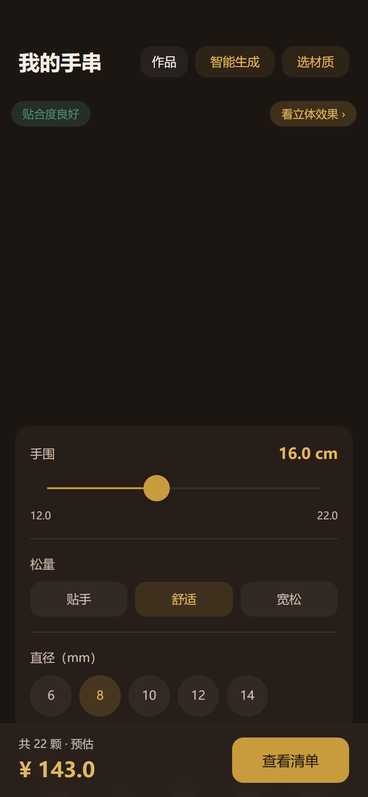
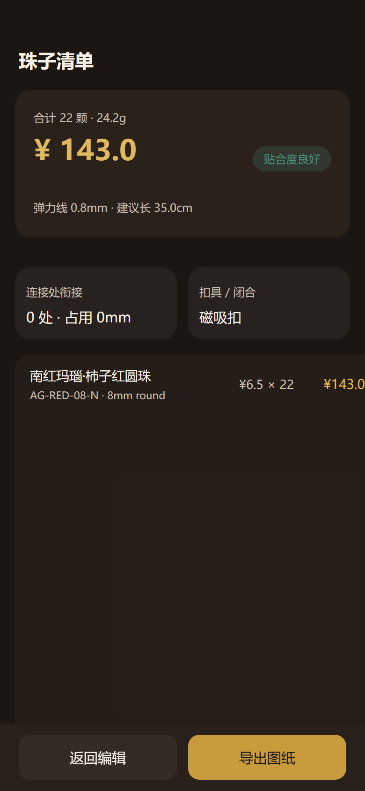
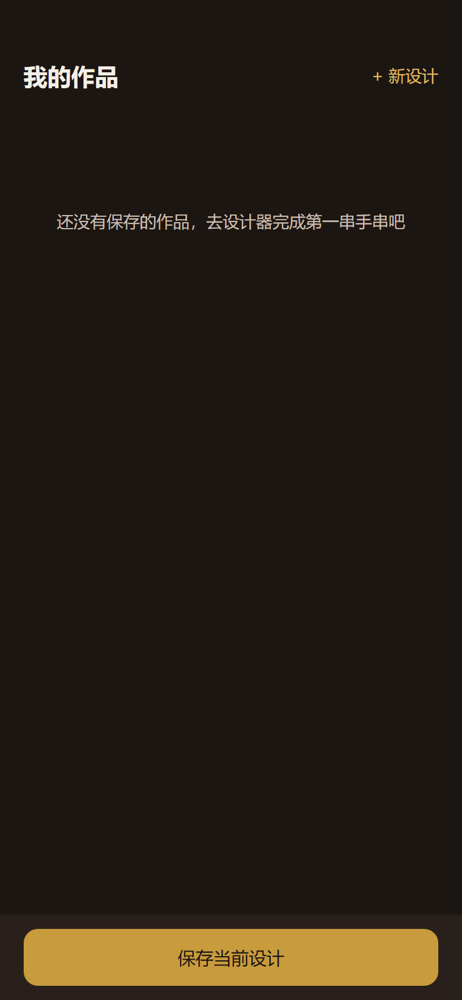
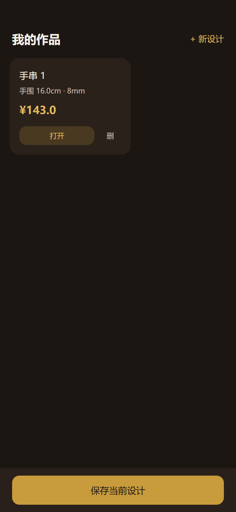

# bead-diy × Vendure DIY 插件 · P5 对接说明

> 日期：2026-10-12　|　范围：P5（远程数据层 + 同构算量 + 匿名保存）　|　状态：已联调验证

## 1. 概述

P5 阶段把小程序从「纯本地 mock」升级为「后端驱动」：

| 能力 | 说明 |
| --- | --- |
| 分类/素材走 shop-api | C 端新增 `diyCategories` Public 查询（7 平台分类 + spacer，共 8 个）；素材走 `diyMaterials` 查询（postgres 已灌 68 行 mock 素材，18 组，按 `attrs.group` 分组） |
| `@diy/calc` 同构 vendor | 手围算量（珠数/克重/弹力线长/贴合度）抽为同构包，小程序端 `src/vendor/diy-calc/` 与后端 `diy-plugin` 共用同一套算法，保证两端 BOM 一致 |
| 匿名保存 draft 方案 | `createDiyPlan(templateCode, spec)` 匿名创建草稿方案，返回 `id / status / bom`；作品页「保存当前设计」会把方案落到云端（`planId` 记入本地作品记录） |

## 2. 环境变量

| 变量 | 说明 |
| --- | --- |
| `TARO_APP_API_BASE` | shop-api 地址。构建期经 `config/index.ts` 的 `defineConstants` 注入为全局常量 `API_BASE_URL`（`src/api/client.ts` 消费）。默认 `http://localhost:3000/shop-api`。 |

注意：

- 该变量是**构建期**注入，改完需重新构建/重启 dev 才生效。
- 用 `.env` 文件传值时，**值含 `#` 必须加双引号**（`#` 后内容会被 dotenv 当注释截断）：
  `TARO_APP_API_BASE="https://api.example.com/shop-api#/shop-api"`

## 3. 后端准备

1. 启动 dev server（自动 seed 7 个平台分类 + bracelet-classic 模板）：

   ```powershell
   cd d:\zhao\vendure\packages\dev-server
   pnpm dev          # API 端口 3000，postgres 连接配置见同目录 .env
   ```

2. 灌素材（幂等）：

   ```powershell
   cd d:\zhao\vendure
   pnpm exec ts-node --transpile-only -P packages/diy-plugin/tsconfig.json packages/diy-plugin/scripts/populate-beads.ts
   ```

   首次执行约 `68 created`；重复执行 `0 created`（幂等）。素材按 `attrs.group` 分组（18 组），每组多档直径。

## 4. 验证步骤（2026-10-12 实测）

以下均为 `POST http://localhost:3000/shop-api`，`Content-Type: application/json`。

### 4.1 查素材（取一个主珠 SKU）

```json
{"query":"query { diyMaterials(filter:{onlyEnabled:true,take:200}) { total items { id code diameter attrs } } }"}
```

实测：`total = 68`；目标行 `{"id":"17","code":"AG-RED-08-N","diameter":8,"attrs":{"group":"agate-red",...}}`。

### 4.2 匿名创建方案

```json
{"query":"mutation($spec: JSON!){ createDiyPlan(templateCode:\"bracelet-classic\" spec:$spec){ id status bom } }","variables":{"spec":{"slots":{"main":{"materialId":"17"}},"params":{"wristSize":160,"fit":"comfort","gap":0.6},"seed":1}}}
```

实测返回（关键字段）：

```json
{"data":{"createDiyPlan":{"id":"1","status":"draft","bom":{
  "items":[{"materialId":"17","code":"AG-RED-08-N","name":"南红玛瑙·柿子红圆珠","spec":"8mm round","unitPrice":650,"qty":22,"subtotal":14300}],
  "totalCount":22,"totalAmount":14300,
  "cord":{"length":349.84,"diameter":0.8,"note":"弹力线，打结收尾留量 160mm"},
  "geometry":{"innerCircumference":164.71,"feedback":"ok","clearance":4.71}}}}}
```

即 22 颗 × 650 分 = **14300 分（¥143.0）**，与小程序端显示完全一致。

### 4.3 C 端分类冒烟

```json
{"query":"query { diyCategories { id code name } }"}
```

实测：返回 **8 个分类**（crystal/agate/wood/amber/pearl/metal/gemstone + spacer）。

### 4.4 双端 UI 验证

手机视口（390×844，dpr=2）截图见 `shots/2026-10-12-diy-p5/`：

- `01-designer.png` — 设计器：材质列表来自后端，算量「共 22 颗 · 预估 ¥143.0」与 4.2 一致，无报错弹层
- `02-bom.png` — 清单页：主珠行「南红玛瑙·柿子红圆珠 ¥6.5 × 22 = ¥143.0」、弹力线 0.8mm · 建议长 35.0cm
- `03-works.png` / `03-works-saved.png` — 作品页保存前后；保存后 toast 为**「已保存（含云端方案）」**（若显示「已本地保存」说明云端保存失败，需排查）

留证文件：`shots/2026-10-12-diy-p5/graphql-smoke-evidence.json`、`console-log.txt`（三页 console 无 error）。

## 5. 已知坑（P5 联调实录）

1. **局部变量不可命名为 `Taro`**：`babel-plugin-transform-taroapi` 会把名为 `Taro` 的标识符成员访问（如 `Taro.request`）盲改写为具名导入 `_request`；`src/api/client.ts` 只有动态 `import('@tarojs/taro')`、没有静态导入声明，改写后即 `ReferenceError: _request is not defined`。所以 client.ts 里局部变量用小写 `taro`。
2. **动态 import 的导出形状跨端不一致**：H5/weapp 构建期 `@tarojs/taro` 别名到平台 runtime 模块，`default` 对象不含全部 API（`request` 只在具名导出上）；node（单测）环境是 CJS interop，`default` 才是完整对象。client.ts 按 `mod.default?.request ? mod.default : mod` 兼容两端。
3. **H5 dev 依赖**：`@tarojs/plugin-framework-react` 的 optional peer `@pmmmwh/react-refresh-webpack-plugin` 与 `react-refresh` 未随安装落盘，dev:h5 启动会 MODULE_NOT_FOUND；且 `babel-preset-taro` 要求 `react-refresh ^0.14.0`，装高版本（0.19）会 invalid。本机已用 `npm i --no-save @pmmmwh/react-refresh-webpack-plugin@0.5.15 react-refresh@^0.14.0` 补齐（未写入 package.json）。
4. **devServer 配置**：`config/index.ts` 的 `h5.devServer.allowedHosts` 原为 `true`（webpack-dev-server v3 写法），新版校验不过，已改为 `'all'`。

## 6. P5 边界与 P6 待办

**P5 不做**（对应接口未接）：

- 登录/账号体系：方案仅匿名 draft，无用户归属
- 报价：`quoteDiyPlan` 未接，金额均为 BOM 静态合计
- 下单：`createOrderFromPlan` 未接，无支付/履约链路
- 方案列表查询：`myDiyPlans` 未接

**已知偏差**：

- 设计器 focalCount UI 允许选多颗焦点珠，后端 `bracelet-classic` 模板固定按 1 颗算（P6 对齐）
- 隔片开关等配件slot能力后端已备，UI 待接

## 7. 截图引用








