# DIY 珠宝定制（串珠设计器）操作手册

> 版本：v1.1（2026-10-13）　适用端：vshop H5（v.joho.cn）/ 微信小程序
> 后端：vendure diy-plugin（shop-api，已上线 e.joho.cn）　算量：@diy/calc v2（前后端同构复算）

## 1. 功能总览

| 页面 | 路由 | 说明 |
|---|---|---|
| 首页 DIY 入口 | `/`（DynamicHome 顶部卡片） | 📿 珠宝定制入口，点击进作品广场 |
| 作品广场 | `/pkg-diy/pages/gallery` | 公开方案浏览、一键复刻/购买 |
| 串珠设计师 | `/pkg-diy/pages/designer` | 4 种算量模式设计手串 |
| 方案详情 | `/pkg-diy/pages/plan-detail?planId=` | 报价/公开/下单/复制/微信分享 |
| 我的作品 | `/pkg-diy/pages/my-plans` | 我的方案列表（草稿/已报价/已下单） |

分包：`pkg-diy`（首页 preloadRule 已含）。多语言：zh-CN / zh-TW / en / ja / ko 全量词条（`diy.*`）。

## 2. 功能路径

```
首页 → [📿 珠宝定制] → 作品广场 → [用这个方案 / 开始设计]
                                  ↓
                          串珠设计器（4 模式）
                                  ↓ 保存方案（需登录）
                          方案详情（服务端复算报价）
                                  ↓ 可选：公开到广场
                          他人可浏览 / 复刻 / 直接下单
```

我的作品：首页入口 → 广场页右上「我的作品」。

## 3. 设计器 4 种算量模式

| 模式 | 说明 | 典型用法 |
|---|---|---|
| 定手围·算颗数（byWrist） | 拖动手围滑杆（12.0–22.0cm）+ 松紧（贴合/舒适/宽松），自动收敛颗数 | 知道手围，让系统算用几颗珠 |
| 定颗数·看内孔（byCount） | 手动锁定各槽位颗数（qtyOverride），实时看内孔周长与松紧反馈 | 固定颗数设计，看戴起来松紧 |
| 混搭排列（pattern） | 多主珠/隔片槽位 + 均匀交替/随机混编/分区排列三种排布 | 双色混搭、间隔配色 |
| 自由拖拽（free） | 由 pattern 一键转入，画布三态拖拽（压珠互换/落隙插入/拖出删除）+ 序列条 + 常驻素材面板，逐颗求和计算 | 无规律精修排列 |

模式切换条顺序（2026-10-14 调整）：**自由 → 定手围 → 定颗数 → 混搭**，自由流置顶作为默认入口。

通用能力：
- **混搭变径**：多主珠不同直径按加权收敛（服务端同口径复算）。
- **装饰项**（decor 槽位）：流苏/吊坠等只计价、不进几何颗数。
- **计算明细抽屉**：点预览区「内孔周长 · 松紧反馈」打开——几何行（中心线/内孔/松紧余量）、BOM 明细（每素材单价×数量）、配线（弹力线含 160mm 打结留量）、合计。
- **实时报价**：预览区价格 = 前端 calc 实时估算；保存后以服务端复算结果为准（金额单位：分）。

## 4. 保存 / 公开 / 购买流程

1. **保存**：设计器画布右下角「完成设计 · ¥X」→ 未登录先跳登录（复用现有微信登录体系）→ `createDiyPlan` 得 planId → `quoteDiyPlan` 服务端复算报价，与前端一致即确认。
2. **公开**：方案详情 →「公开到作品广场」（`publishDiyPlan`）；可随时取消公开。
3. **下单**：方案详情 →「加入购物车」→ `createOrderFromPlan` 生成挂 `diyPlanId` 自定义字段的订单行 → 跳现有订单确认页完成支付。**公开方案他人可直接下单**；服务端按实时素材价复算成交。
4. **复刻**：广场他人方案 →「用这个方案」→ `copyDiyPlan` 复制到自己名下 → 跳设计器编辑。
5. **分享**：方案详情右上角微信转发（`onShareAppMessage`，卡片带方案标题与封面）。

## 5. 画布拖拽三态与常驻素材面板（P7.2）

### 5.1 三态拖拽（画布直接操作）
自由模式下可直接在画布手串上拖拽珠子，松手按落点自动判定，优先级：**拖出环 → 压珠 → 落隙**。

| 手势 | 判定 | 效果 | 拖拽中预览 |
|---|---|---|---|
| 压在某颗珠子上松手 | swap | 与目标珠互换位置 | 目标珠橙色虚线圈 |
| 落在环内圈空隙松手 | insert | 插入到该间隙（序列 splice） | 间隙小虚线圈 |
| 拖出环外松手 | delete | 删除该珠 | 红圈 + ✕ |

- 拖动中原珠半透明、拖拽珠 ghost 跟手；压珠命中按「极坐标最近珠 + 落点径向距珠心 ≤ 珠径×1.6」判定，落隙合法落点在环内圈（不压线）。
- 序列条与画布双向同步；换位/插入/删除后内孔周长与实时报价即时重算。

### 5.2 常驻素材面板
- 设计器底部常驻「素材」面板（替代原弹层抽屉）：左侧分类栏 + 右侧素材网格 + 顶部搜索框，点素材直接追加到手串，无需切换弹层即可连续加珠；「珠子 / 配饰」双 tab 切换。
- 非 free 模式下摘要条打开计算明细/槽位浮层，选槽位后点素材卡即指派。

### 5.3 环心水印与轨道圆
- 画布环心绘制店铺品牌水印（品牌名 + 标语，透明度 0.10~0.12），取自租户 shopName，未配置时自动省略。
- 珠心轨迹绘制细灰轨道圆（rgba 0.08），拖拽落点参照更直观。

### 5.4 配饰素材：隔片 / 挂坠 / 装饰珠（2026-10-13）
- 素材面板分「珠子 / 配饰」两个 tab：`attrs.decor=true` 的素材归配饰 tab（15 款种子：隔片 ×6、挂坠 ×4、装饰珠 ×5），含价格与尺码（mm），与珠子同等计价。
- **隔片**（spacer）：点击后**串入环上当小珠**（appendBead，进序列、计颗数与周长算量），如纯银/镀金圆隔片、平片、黑檀隔珠、松石隔片。
- **挂坠 / 装饰珠**（pendant/charm）：点击后**挂在环外间隙**（addDecor，只加价不加颗数），画布带小挂钩渲染，可拖拽换位、拖出删除；如翡翠平安扣、蜜蜡水滴坠、纯银铃铛、镀金转运珠。
- **素材详情弹窗**：长按素材卡弹出，含规格（mm）、单价（¥/颗）、**寓意、产地、莫氏硬度**三行详情（取 attrs.meaning/origin/hardness，多语言，缺省自动省略该行）；现有 50 条珠子素材已批量增补同结构详情。
- 配饰渲染按素材实际直径绘制（下限保证小配饰可辨），材质预设走 renderPreset（金属/玉/蜜蜡/珍珠等 8 类）。

### 5.5 页面布局：四角悬浮操作（2026-10-14）
原「清空/暂存/推荐/完成设计」按钮行挤占纵向空间，导致素材面板只剩约 1 行网格。改为**画布四角悬浮操作**，按钮行整体删除：
- 左上「暂存」/ 右上「清空」/ 左下「推荐」/ 右下「完成设计 · ¥X」（品牌色 CTA，未满足保存条件时半透明置灰）。
- 画布高度 660→480rpx（约 343→247px），模式切换条「自由」置顶，间距压缩——素材面板加高到可见 **3 行网格**以上。
- 布局高度用 `calc(100vh - var(--window-top))` 适配 H5 原生导航栏（此前 100vh 整体被顶出视口 44px，面板底部被裁、「下面珠子显示不全」的根因）。

## 6. 渲染效果说明（多级回退）

素材渲染按 **贴图 → 材质预设 → 组色板 → 纯色** 多级回退：
- L1 `renderUrl`：后台配置的透明底实拍贴图（静态目录 oss）。
- L2 `renderPreset`：玻璃(气泡)/和田玉(棉点)/翡翠(飘花)/蜜蜡/珍珠/金属(双高光)/木质/哑光 8 类 CSS 多层合成。
- L3 `attrs.group` 组色板（前端内建）：crystal-white 白 / crystal-purple 紫 / crystal-yellow 黄 / crystal-pink 粉 / wood 木 / silver 银，同组素材在无数据色时仍可区分。
- L4 素材主色纯色兜底（attrs.color → attrs.hex → matte）。
后台在 diy 素材管理中为素材补 renderUrl / renderPreset / color 字段即可升级渲染（数据优先级高于前端组色板）。

## 7. 测试截图（390×844 dpr=2）

| 截图 | 内容 |
|---|---|
| 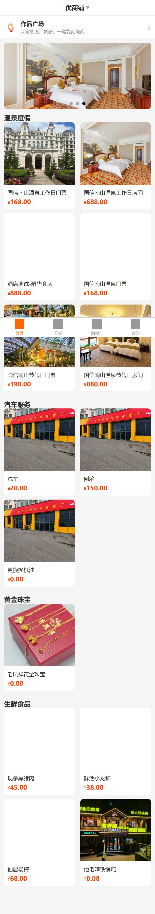 | 首页 DIY 入口卡片 |
| 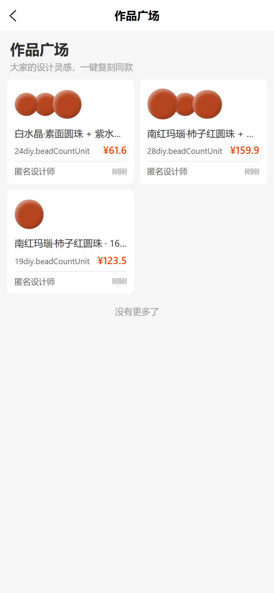 | 广场公开方案列表 |
| 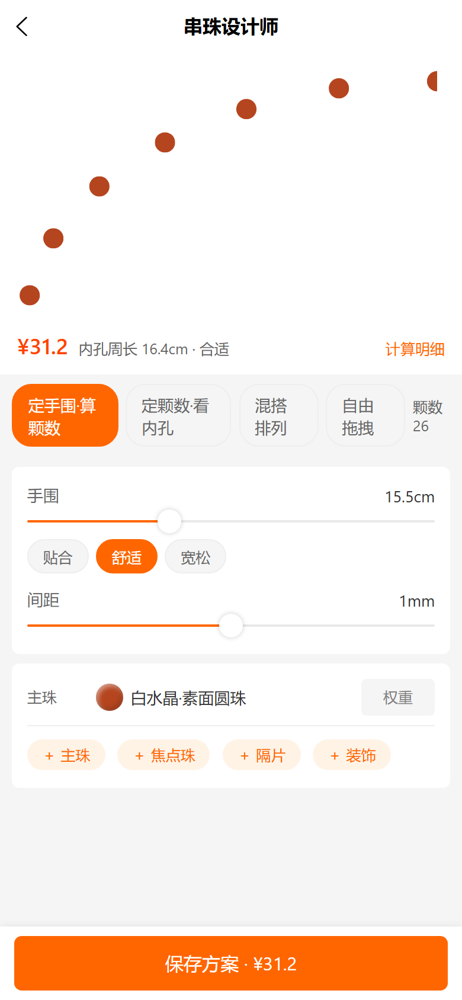 | 设计器 byWrist 模式 |
| 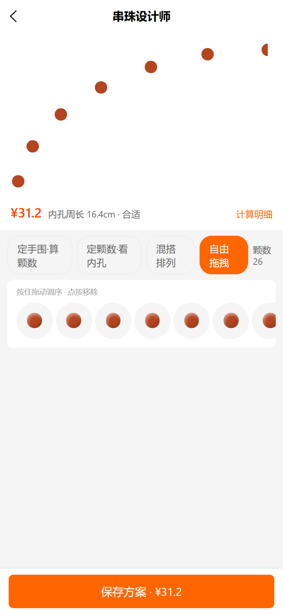 | 自由模式序列条 |
| 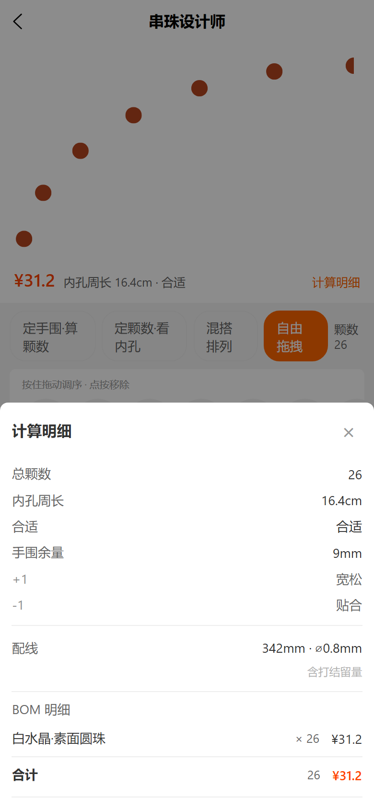 | 计算明细/BOM 抽屉 |
| 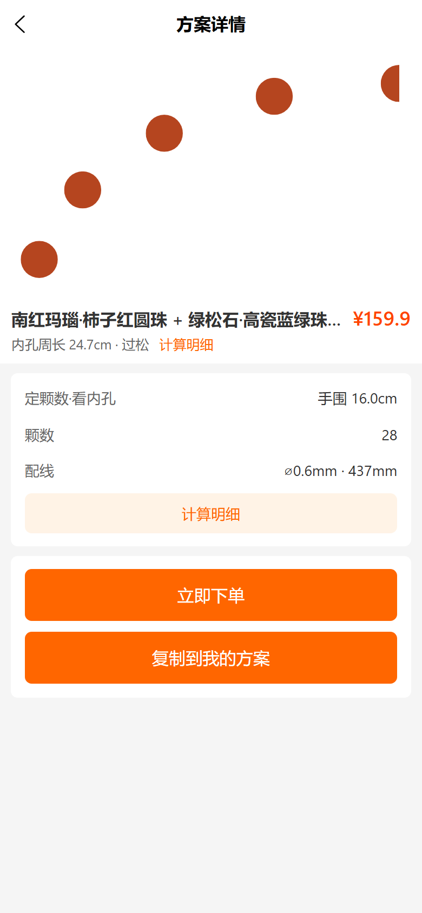 | 方案详情（报价/公开/下单） |
| 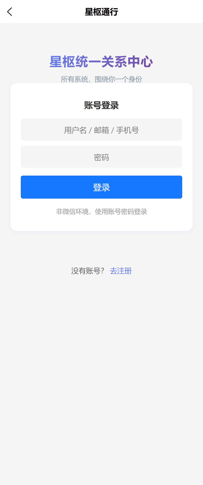 | 我的作品列表 |
| 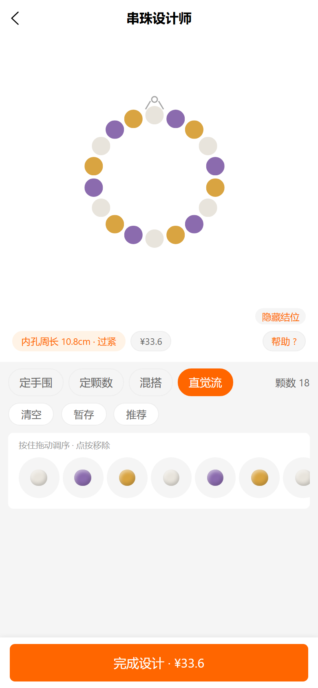 | 18 颗混搭整环居中完整可见（白/紫/黄水晶区分） |
| 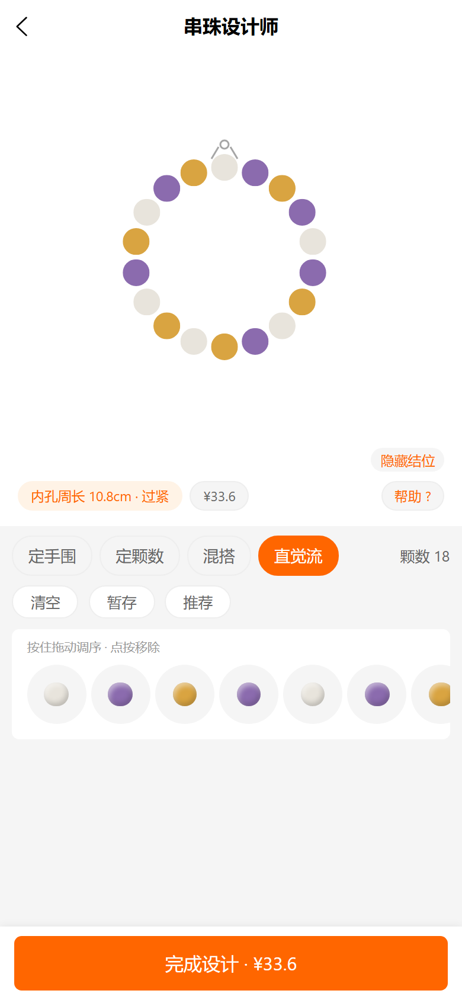 | 珠子拖拽换位后序列条同步 |
| 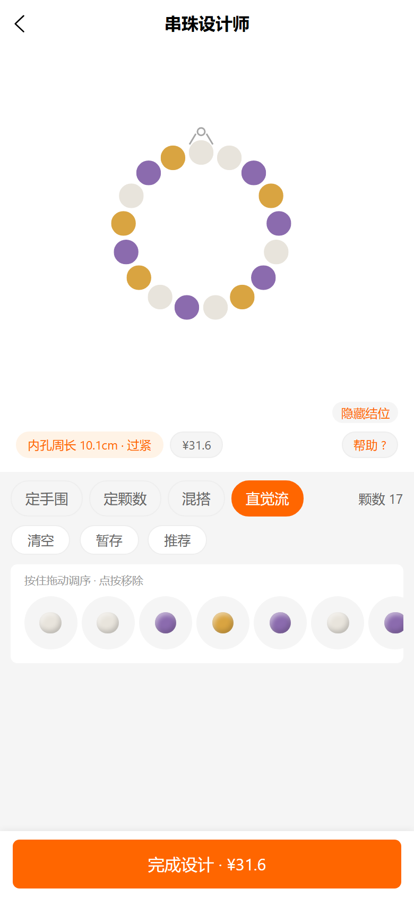 | 珠子拖出环即删除 |
| 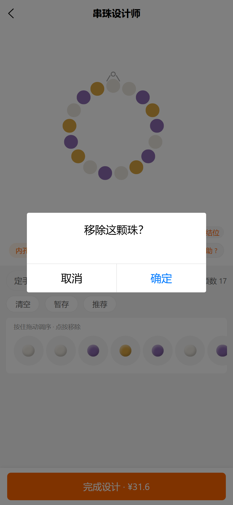 | 点珠子弹确认删除弹窗 |
| 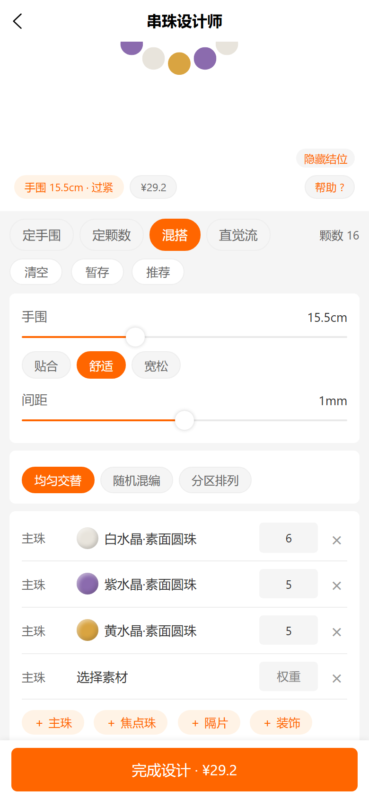 | 混搭模式双主珠自动铺排 |
| 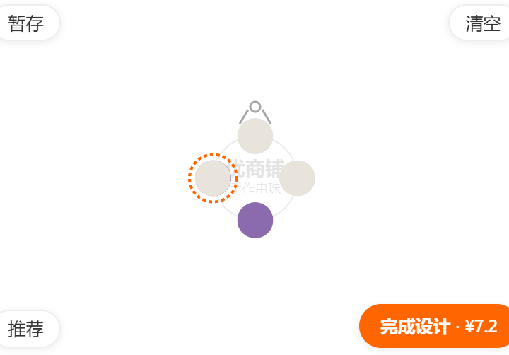 | P7.2 压珠拖拽：目标珠橙色虚线圈（swap 预览） |
| 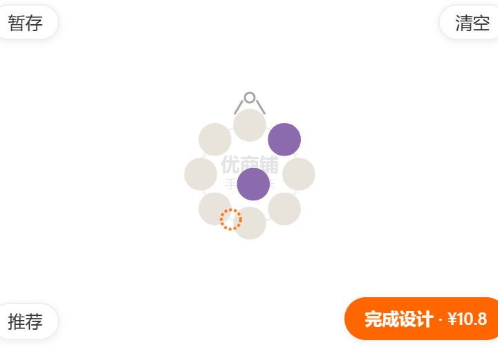 | P7.2 落隙插入：间隙虚线圈（insert 预览） |
| 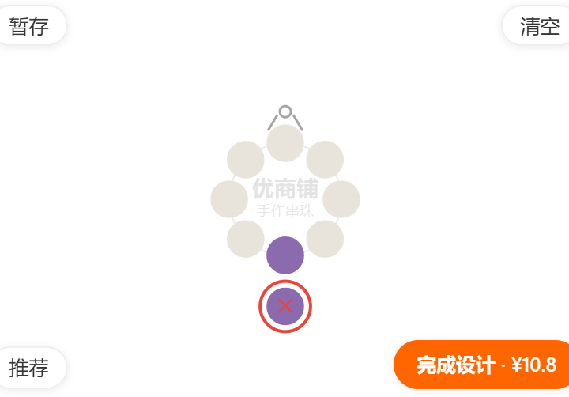 | P7.2 拖出环：红圈✕（delete 预览） |
| 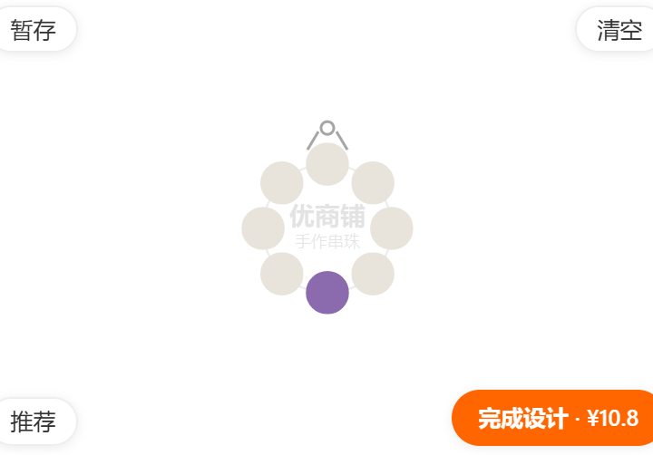 | P7.2 环心品牌水印特写 |
| 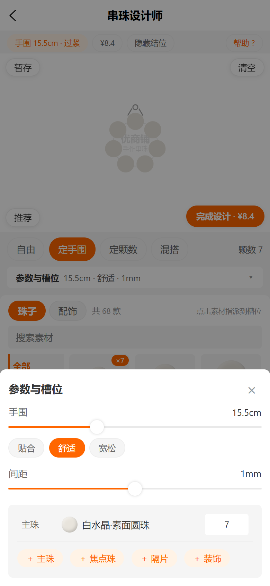 | P7.2 常驻面板 + 计算摘要浮层 |
| 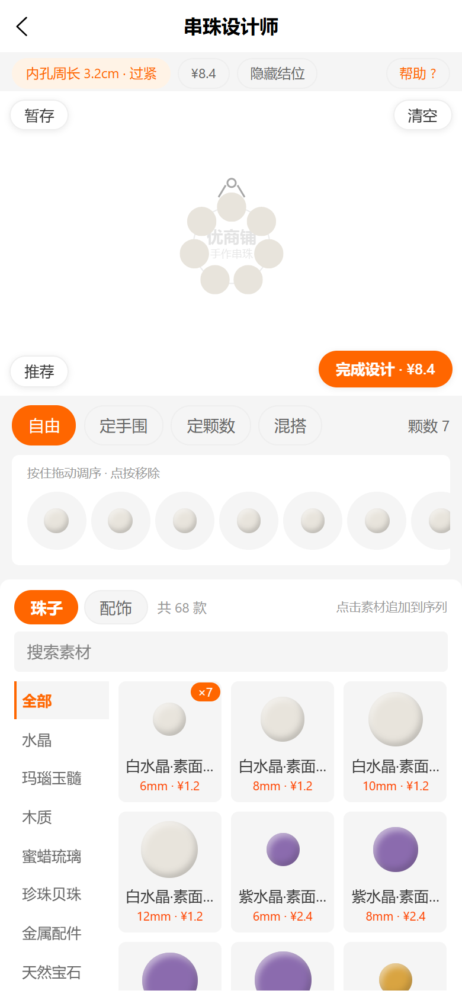 | 四角悬浮操作版设计器全景（面板 3 行网格） |
| 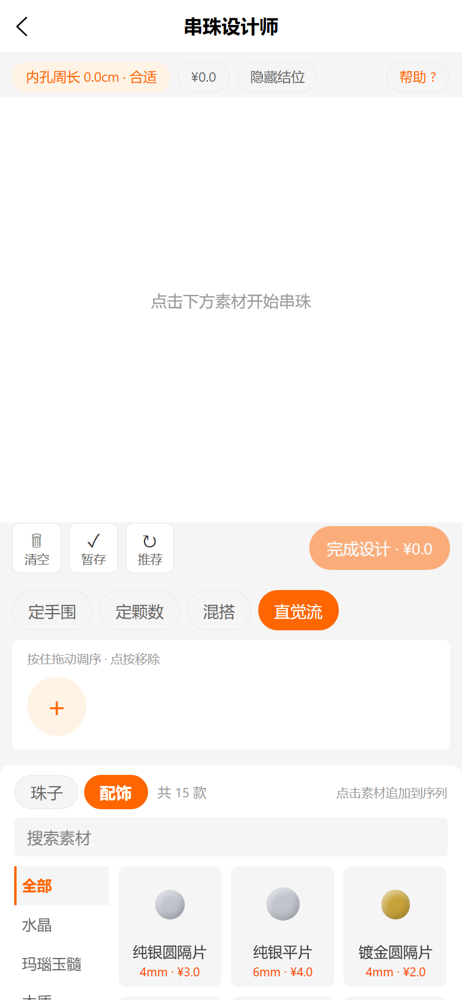 | 配饰素材 tab：隔片/挂坠/装饰珠 15 款（价格+尺码） |
| 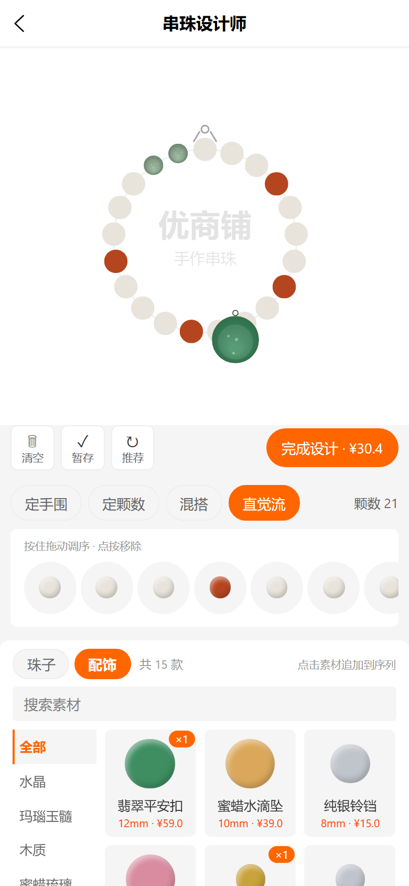 | 松石隔片串入环上 + 翡翠平安扣挂环外（带挂钩） |
| 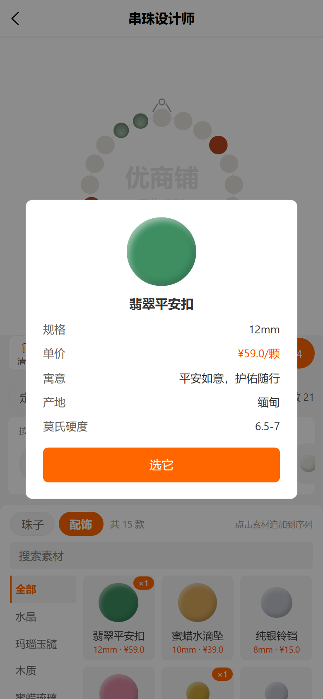 | 长按素材卡：规格/单价/寓意/产地/莫氏硬度 |

（P7.2 截图源目录：`docs/pkg-diy-p7-screens/`，回归脚本 `scripts/_verify_diy_p72.py`，15/15 PASS。）

## 8. 测试用例清单

| # | 用例 | 预期 | 状态 |
|---|---|---|---|
| 1 | 首页入口点击 | 进入作品广场，标题多语言正确 | ✅ |
| 2 | 广场加载 | 公开方案分页展示，匿名可看 | ✅ |
| 3 | byWrist 改手围滑杆 | 颗数实时变化、价格联动 | ✅ |
| 4 | 三档松紧切换 | 内孔/反馈文案变化（贴合 4 / 舒适 10 / 宽松 20mm 松量） | ✅ |
| 5 | pattern 双主珠混搭 | BOM 两行聚合、加权收敛 | ✅ |
| 6 | pattern → free 转入 | 序列条按当前构成生成，可拖拽换位 | ✅ |
| 7 | free 拖拽重排 | 内孔周长随序列逐颗重算 | ✅ |
| 8 | 装饰项加入 | 只加价不加颗数 | ✅ |
| 9 | 计算明细抽屉 | 几何/BOM/配线/合计完整 | ✅ |
| 10 | 匿名保存 | 拦截并跳登录 | ✅ |
| 11 | 登录后保存 | 得 planId，服务端报价与前端一致 | ✅ |
| 12 | 公开/取消公开 | 广场可见性即时切换 | ✅ |
| 13 | 他人公开方案下单 | 允许，订单行挂 diyPlanId | ✅ |
| 14 | 复制他人方案 | 新草稿入本人名下 | ✅ |
| 15 | 微信转发卡片 | 标题/封面正确，落地 plan-detail | ✅ |
| 16 | 五语言切换 | diy.* 词条无缺漏 key | ✅ |
| 17 | 全貌预览（P7.1 回归） | 画布内容 bbox 居中不触边（边距 ≥4px） | ✅ |
| 18 | 珠子拖拽换位（P7.1 回归） | 拖拽后序列条顺序变化并重算 | ✅ |
| 19 | 珠子拖出删除/点选删除（P7.1 回归） | 拖出环即删；点珠子弹确认框 | ✅ |
| 20 | 混搭颜色区分（P7.1 回归） | 白/紫/黄水晶三色区分（group 色板兜底） | ✅ |
| 21 | 压珠互换（P7.2） | 松手压珠与目标珠互换，序列条同步，橙圈预览正确指向 | ✅ |
| 22 | 落隙插入（P7.2） | 松手落环内圈空隙插入该间隙，颗数 +1 | ✅ |
| 23 | 拖出删除（P7.2） | 拖出环松手删除，颗数 −1，红圈✕预览 | ✅ |
| 24 | 常驻素材面板（P7.2） | 面板与画布同屏常驻，点素材直接追加 | ✅ |
| 25 | 计算摘要浮层（P7.2） | 面板展开摘要显示几何/合计，收起恢复 | ✅ |
| 26 | 环心水印（P7.2） | 环心品牌名 + 标语低透明度绘制 | ✅ |
| 27 | 轨道圆（P7.2） | 珠心轨迹细灰圆可见，不压珠子 | ✅ |
| 28 | 配饰 tab 15 款（2026-10-13） | 隔片 ×6 / 挂坠 ×4 / 装饰珠 ×5，价格尺码齐全 | ✅ |
| 29 | 隔片串入环上 | 点卡 appendBead 进序列，颗数/周长/价格联动 | ✅ |
| 30 | 挂坠挂环外 | 点卡 addDecor 只加价不加颗数，画布带挂钩 | ✅ |
| 31 | 素材详情弹窗 | 长按弹规格/单价/寓意/产地/莫氏硬度（多语言） | ✅ |
| 32 | 珠子详情增补 | 50 条现有珠子 attrs 补 meaning/origin/hardness | ✅ |

> P7.2 回归以 Playwright 合成触摸事件驱动（CDP touch 在本环境不送达 canvas），脚本 `scripts/_verify_diy_p72.py` 共 15 项判据全部通过。

## 9. 已知边界

- 微信小程序端素材贴图首期降级为 preset 层渲染（sprite loader H5 优先）。
- 广场排序：默认发布时间倒序；筛选 chips 仅「最新/推荐」两档。
- 方案快照不可变：素材改价后，存量方案仍按下单时服务端实时价复算成交（以服务端为准）。
- 素材面板部分分类 chips 下暂无素材（数据侧未挂素材），过滤结果为空属数据问题非功能缺陷。
- 压珠命中半径为珠径 ×1.6 的近似手感值，密集小珠相邻命中以「极坐标最近珠」优先。
