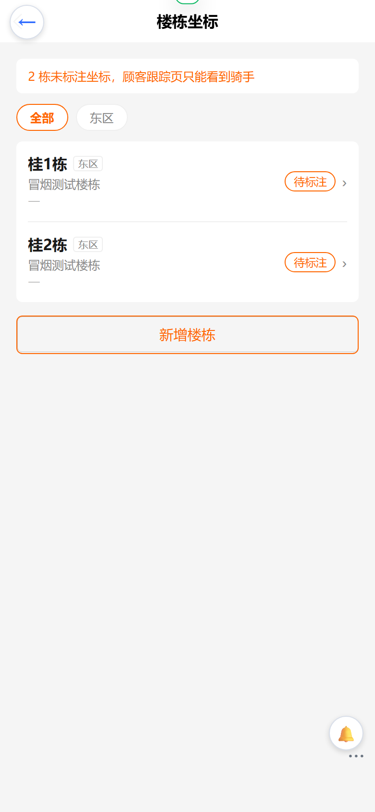
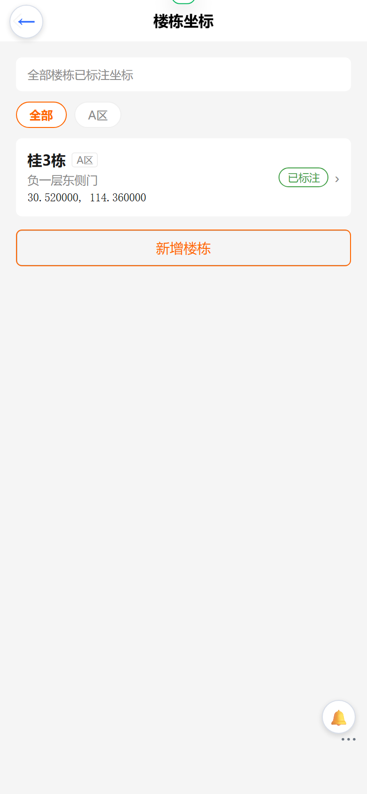
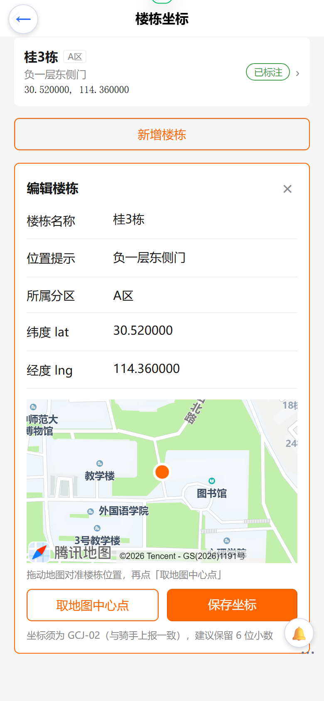
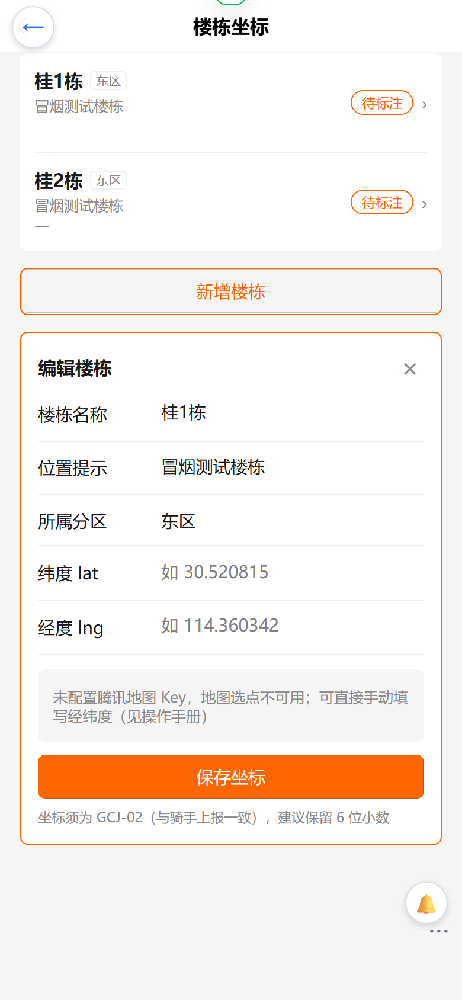

# 楼栋坐标维护（后台）操作手册

> 入口：管理后台 `https://e.joho.cn/guanli/` → 拾光达 → 楼栋坐标
> 权限：`CampusConfig`（与「拾光达配置」同级）
> 页面：`web-admin/src/pages/campus/buildings`，接口：`campusBuildings` / `campusUpdateBuilding` / `campusCreateBuilding`
> 关联功能：顾客端「骑手 GPS 跟踪」（`d:\zhao\waimai\docs\waimai-操作手册-骑手跟踪.md`）

## 1. 为什么需要维护

顾客跟踪页的目标楼栋点位、直线距离、预计送达（ETA）全部来自楼栋坐标。
楼栋未标注坐标时，顾客端只能看到骑手，没有距离与 ETA。

页面顶部会提示「N 栋未标注坐标，顾客跟踪页只能看到骑手」，按提示逐栋补齐即可。




## 2. 操作步骤

1. 进入「楼栋坐标」，默认按分区展示全部楼栋；顶部标签可按分区筛选。
2. 点击任一楼栋行进入编辑；或点「新增楼栋」。
3. 填写楼栋名称、位置提示，选择所属分区。
4. 两种方式填写坐标：
   - **地图取点（推荐）**：拖动地图把楼栋对准中心，点「取地图中心点」，经纬度自动回填；
   - **手动填写**：直接输入纬度 / 经度（支持 6 位小数）。
5. 点「保存坐标」，列表即时刷新徽标为「已标注」。



### 校验规则

| 规则 | 提示 |
|---|---|
| 名称不能为空 | 请填写楼栋名称 |
| 纬度、经度必须同时填写或同时留空 | 纬度与经度需同时填写 |
| 纬度范围 | 纬度需在 -90 ~ 90 之间 |
| 经度范围 | 经度需在 -180 ~ 180 之间 |

坐标系必须是 **GCJ-02**（腾讯/高德坐标），与骑手端上报一致；用 GPS 原始坐标或百度坐标会导致距离与 ETA 偏移。

## 3. 地图 Key

地图取点依赖腾讯位置服务 Key，配置在 `web-admin/.env.production`：

```ini
VITE_QQMAP_KEY=你的Key
```

- 域名白名单需包含后台域名 `e.joho.cn`（与顾客端 `www.yourbao.cn` 可共用同一个 Key）；
- 修改后需重新构建部署：`cd web-admin && node scripts/deploy.mjs`（Key 会烧入 `assets/index-*.js`）；
- 未配置 Key 时页面自动降级：不渲染地图，显示提示，仍可手动填写经纬度并保存。



## 4. 渠道隔离（重要）

楼栋按当前渠道（店铺）隔离：

- 后台列表只返回当前渠道楼栋；
- 顾客端选楼接口同样只返回本渠道楼栋；
- 跨渠道修改会返回「宿舍楼不存在」。

因此多店铺场景下，各店铺需分别维护自己的楼栋；平台级（`__default_channel__`）的楼栋不会被其他店铺看到。

## 5. 接口速查（无后台入口时可用 GraphQL 维护）

```graphql
# POST /admin-api，Header: Authorization: Bearer <admin-token>、vendure-token: <渠道 token>
query { campusZones { id name fee } }
query ($zoneId: ID) { campusBuildings(zoneId: $zoneId) { id name detail lat lng zoneId } }

mutation ($id: ID!, $input: CampusBuildingPatchInput!) {
  campusUpdateBuilding(id: $id, input: $input) { id name detail lat lng zoneId }
}
mutation ($name: String!, $zoneId: ID!, $detail: String, $lat: Float, $lng: Float) {
  campusCreateBuilding(name: $name, zoneId: $zoneId, detail: $detail, lat: $lat, lng: $lng) { id }
}
```

## 6. 验证记录（2026-10-21）

- 页面填写 `30.520815 / 114.360342` → 保存 → `campusBuildings` 回读一致（PASS）；
- 未标注 → 已标注徽标与顶部提示计数同步刷新（PASS）；
- 跨渠道修改（餐饮渠道 token 改默认渠道楼栋）→ `宿舍楼不存在`（PASS）；
- 未配置 Key 降级：无地图、提示可见、手填保存可用（PASS）；
- 手机视口截图 390×844 dpr=2，四态见第 1–3 节；
- 测试数据已还原：桂1栋 / 桂2栋坐标恢复为空。

> 生产 `桂3栋` 仍为冒烟坐标 `30.520000, 114.360000`，业务上线前请在后台按真实位置重新取点。
