# waimai 外卖（校园配送 + 骑手端）操作手册

上线日期：2026-10-06 ｜ H5 站点：**https://www.yourbao.cn/waimai/**
后端：Vendure（campus-delivery-plugin）｜ 验证：e2e 冒烟 S1-S8 全 PASS（见 `docs/verify/2026-10-waimai-e2e.md`）

## 1. 学生点单流程（五步）

| 步骤 | 页面 | 操作 |
| --- | --- | --- |
| ① 选店铺 | 首页 | 搜索或点店铺卡（商家自送 + 校内骑手接力，满20减4） |
| ② 点餐 | 店铺菜单 | 左侧分类选菜，右侧「+」加购 |
| ③ 结算 | 确认订单 | 选配送方式（校园配送）→ 分区（东区 ¥2.00）→ 宿舍楼 → 送达时段 → 支付方式 → 提交订单 |
| ④ 支付 | — | 到店支付（COD）/ 微信 JSAPI（生产配置后生效） |
| ⑤ 跟踪 | 订单跟踪 | 配送进度四步：商家接单 → 骑手取餐 → 配送中 → 已送达；可申请售后 / 再来一单 |

### 学生端截图

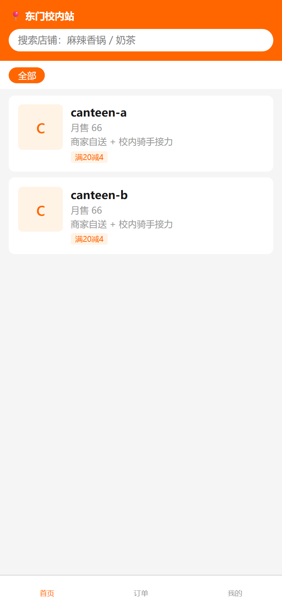
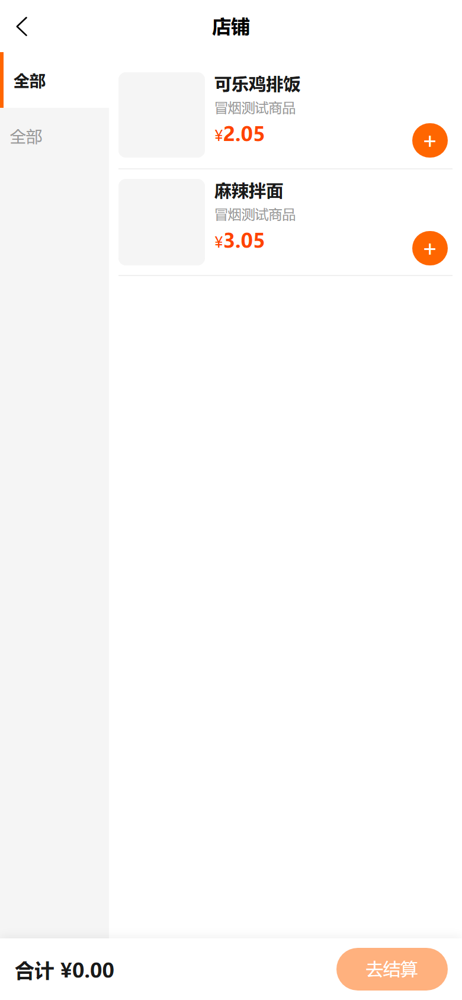
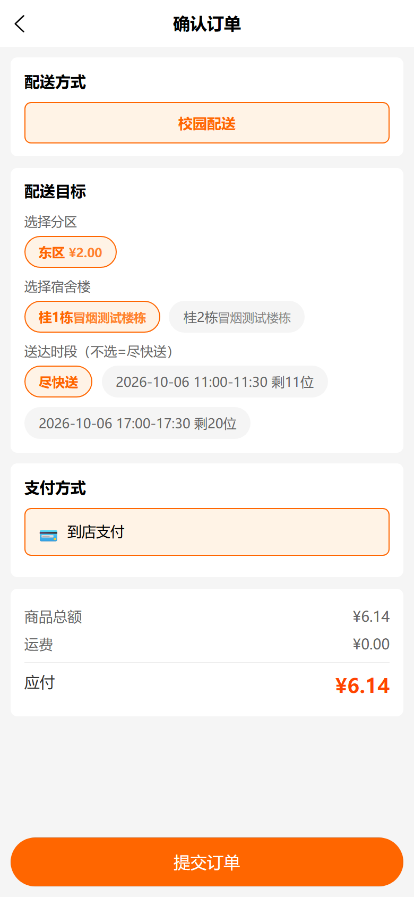
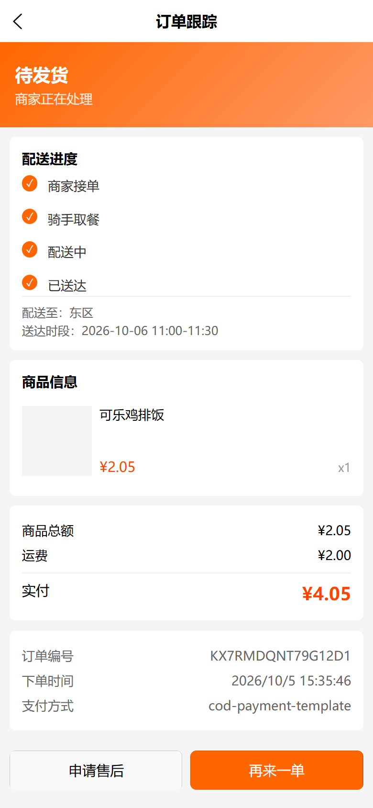

## 2. 骑手流程（入驻 → 接单 → 配送 → 送达）

| 步骤 | 页面 | 操作 |
| --- | --- | --- |
| ① 入驻 | 我的 → 骑手入驻 | 填真实姓名/学号/校区（+学生证照片选填）提交，管理员审核（一般 1 个工作日）。已通过则直接进大厅 |
| ② 接单大厅 | 骑手首页 | 打开「接单中」开关上线；大厅实时出单（跨店铺聚合，加急置顶、小费降序），点击抢单 |
| ③ 到店取货 | 配送中 | 到店后点「我已到店 · 开始取货」；未取货可转单 |
| ④ 送达 | 配送中 | 点「我已送达（拍照存证）」拍照提交 → 已送达 ✓ 分成实时入账 |
| ⑤ 异常/转单 | 配送中 | 已取货转单需拍照交接；联系不上学生走「异常上报」平台介入 |

骑手信用分规则：初始 100，送达 +2；拒单/超时未抢扣分；**低于 60 禁止抢单**（大厅可见但 grab 报 FORBIDDEN）。

### 骑手端截图

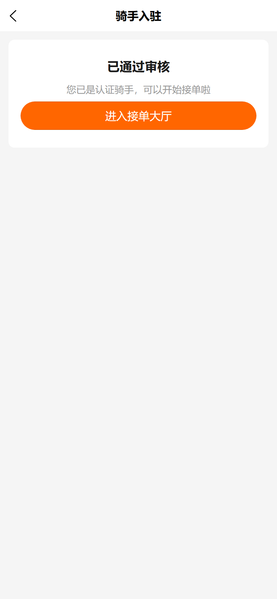
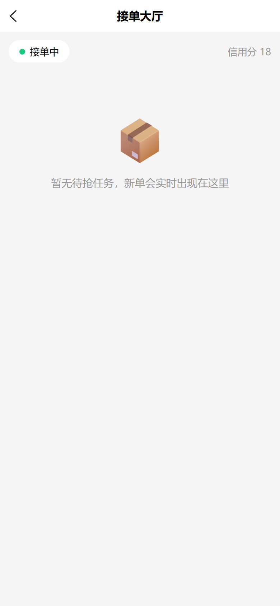
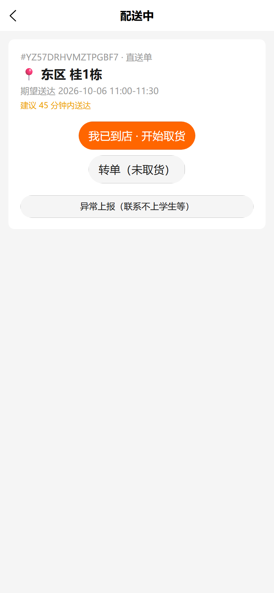
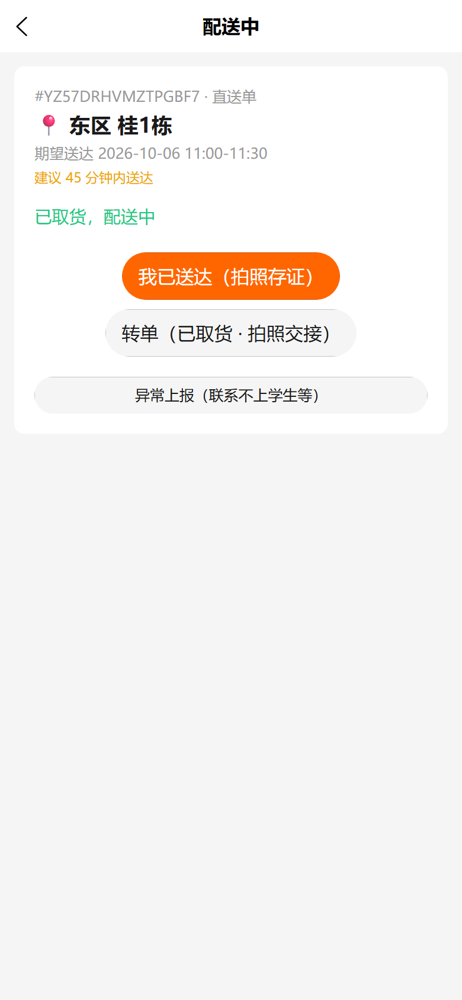
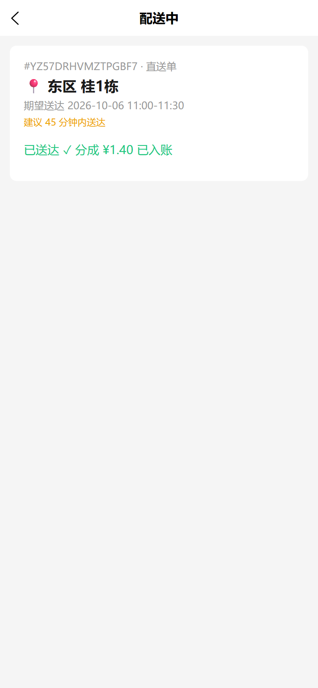
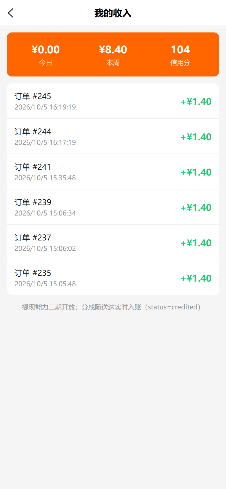

## 3. 管理员操作入口

| 事项 | 入口 |
| --- | --- |
| 骑手审核 | Vendure 管理台 → 客户 → 找到申请人 → customFields `riderStatus` 置 `approved`（或 GraphQL `campusSetRiderStatus(customerId, status)`，需 CampusAuditRider 权限） |
| 信用分调整 | admin-api `updateCustomer(input: { id, customFields: { riderCredit } })`（无专用界面） |
| 订单干预 | 管理台订单：cancelOrder / transitionOrderToState / settlePayment |
| 店铺上下架/暂停 | 渠道 customFields（waimaiStoreList 读 paused/promoText） |
| 骑手提现审核 | web-admin → 单 → 提现审核（四期，见 §8.1） |
| 造数（测试环境） | `node docs/verify/waimai-e2e-prepare.cjs`（幂等：店铺渠道/校区/时段/冒烟商品/账号） |

## 4. 部署与冒烟复跑

```bash
# H5 部署（本地构建 → scp → 服务器解压，绝不在服务器构建）
node d:\zhao\waimai\.secrets\deploy-waimai.mjs

# 生产冒烟（期望 E2E SMOKE PASS，幂等可重复跑；脚本会临时调低起送价并在结束时自动还原）
node d:\zhao\vshop\docs\verify\waimai-e2e-smoke.cjs
```

- 部署产物落点：服务器 `/opt/1panel/apps/openresty/openresty/www/sites/e.joho.cn/yourbao/waimai/`（容器内路径 `/www/sites/...`），静态替换即时生效无需 reload。
- nginx conf：`conf.d/www.yourbao.cn.conf`（改前备份 `.bak_waimai_20261006`）。
- 冒烟账号：`smoke-order@yourbao.cn` / `smoke-rider@yourbao.cn`（Wm@Smoke123）。

## 5. 校园配送二期（R2/R4/R5 + 起送价硬校验）

上线日期：2026-10-06。设计文档：`docs/superpowers/specs/2026-10-06-campus-delivery-phase2-design.md`。

### 5.1 路线速查（全端统一标准语句）

| 码 | 名称 | 说明 |
| --- | --- | --- |
| R1 | 商家自送+拾光达接力 | 商家送至校门口，拾光传信者接力送到手 |
| R2 | 快递到校+拾光达接力 | 快递到校后，拾光传信者代取并送达 |
| R3 | 档口+拾光达接力 | 档口现做，拾光传信者送至楼层 |
| R4 | 到店自取 | 凭取件码到店自取 |
| R5 | 校内拾光达 | 拾光传信者按下单需求跑腿代办 |

### 5.2 新增功能一览

| 功能 | 入口 | 说明 |
| --- | --- | --- |
| R5 校内拾光达（跑腿单） | 首页「校内拾光达」入口卡 → 发单页 | 服务类型（代取快递/带饭/帮买/其他）+ 起止点 + 物品描述 + 跑腿费（起步价可配）+ 小费滑杆；支付后自动进接单大厅 |
| 我的跑腿单 | 发单页右上「我的跑腿单」 | 跑腿单列表与状态跟踪 |
| R2 快递到校 | checkout 校园配送 tab 选 R2 | 快递段运费按商家标准；校内接力段 ¥0（接力费在发接力单时单独付） |
| R2 已到校确认 | R2 订单详情 | 快递到校后点「快递已到校」（二次确认，不可撤销）→ 自取或发接力 |
| R2 接力子卡 | R2 原单详情 | 实时反查关联 R5 接力单状态（接力中/已接单/已退款），退款后可重发 |
| R4 到店自取 | checkout「到店自取」 | 自提点=店铺地址；订单详情显示核销码，到店出示核销或自助核销 |
| 起送价硬校验 | 下单时（后端拦截） | 商品金额（含税）未达店铺起送价时拦截，提示「未满起送价 ¥X」；R5 跑腿单豁免 |

### 5.3 R2 学生操作流（快递到校）

```
checkout 选 R2 下单支付 → 等快递到校（订单卡显示「快递配送中」）
  → 点「快递已到校」→ 二次确认（确认后不可撤销）
  → 选择取件方式：
     ① 我去自取：凭取件通知到校内代收点自取，取到后「确认收货」完成订单
     ② 发 R5 接力：跳转发单页（自动预填 A 点=校内代收点、B 点=默认宿舍楼），
        支付接力费后进大厅等传信者代取送达
```

- 接力单退款语义：**只退接力单的跑腿费+小费，R2 原单不退**（快递已到校）；接力失败自动降级为自取，原单回到「请选择取件方式」可再次发接力。
- 确认到校为不可撤销操作，误触请走客服人工。

### 5.4 R5 发单流（校内拾光达）

首页点「校内拾光达」→ 发单页：选服务类型 → 填 A 点（取）/ B 点（送）→ 物品描述 → 跑腿费（不低于起步价）+ 小费（可选）→ 提交支付。运力紧张时提示「当前运力紧张，接单可能延迟」但不阻断发单；入厅后订单卡显示「平台调度中」，滞留超时自动加急置顶 → 强派 → 调度看板人工介入 → 自动退款（T0-T4 降级链路）。

### 5.5 后台配置项（web-admin 拾光达配置页）

| 配置 | 字段 | 说明 |
| --- | --- | --- |
| 跑腿起步价 | `errandBaseFee`（元输入，分存储） | R5 发单页跑腿费下限；未配置默认 ¥2 |
| 起送价 | `minOrderAmount`（分） | 商品单下单硬校验（含税口径）；留空=不校验；R5 跑腿单不受限 |
| 店铺地址 | `storeAddress` | 保存时自动绑定该店为 R4 自提点（名称=店铺名）；清空不影响已有自提点 |
| 启用路线 | `routesEnabled` | 勾选后 checkout 才显示对应路线选项 |
| R4 前置（Vendure 管理台） | — | 渠道需绑定 `store-pickup` 运费方式；商品变体配送档案需含 store-pickup。**推荐直接点配置页「初始化配送档案」按钮**（见 5.8） |

### 5.6 二期截图

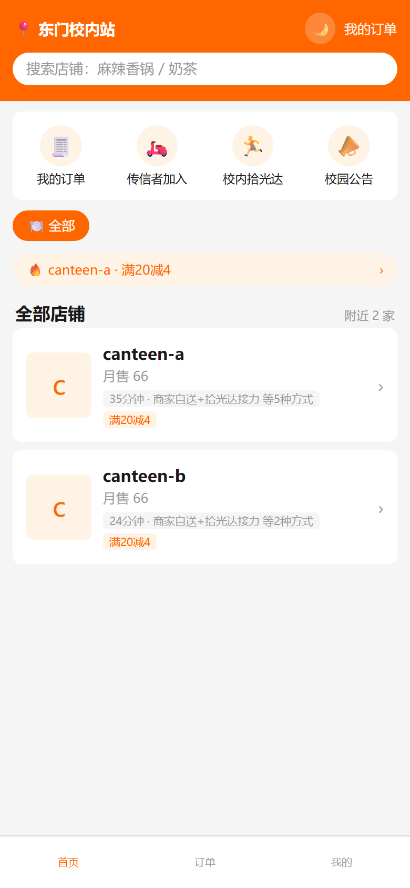
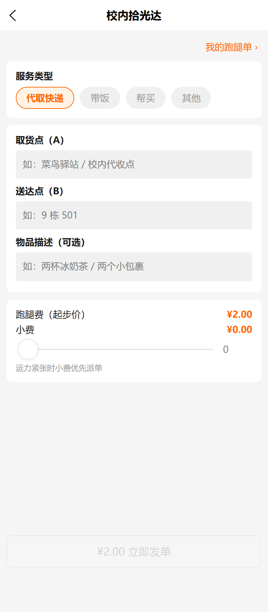
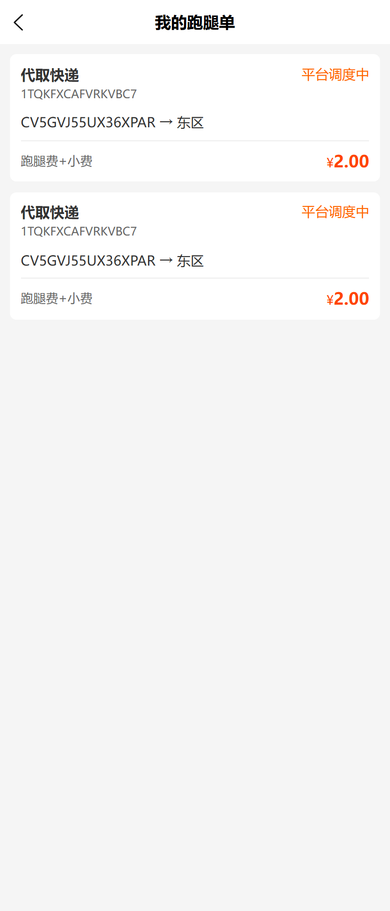
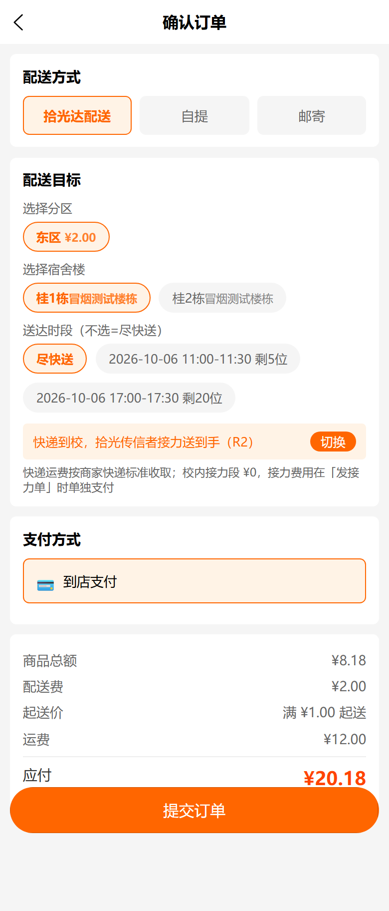
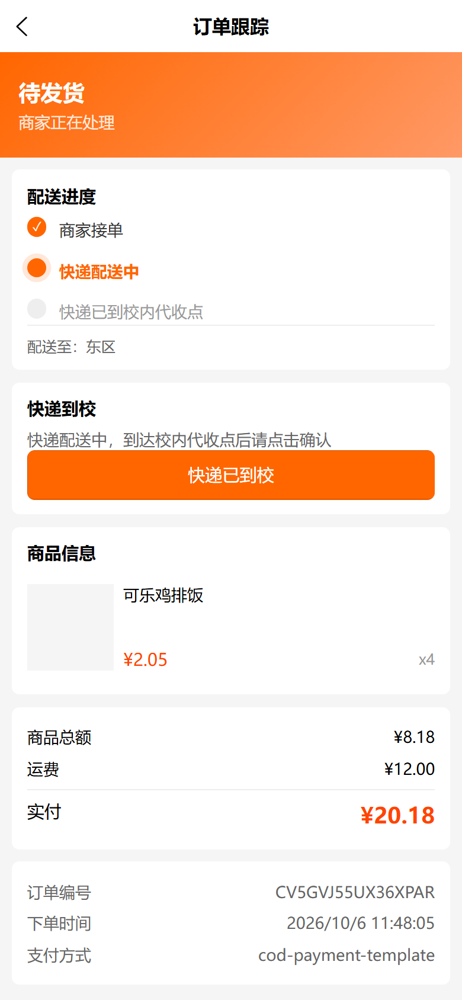
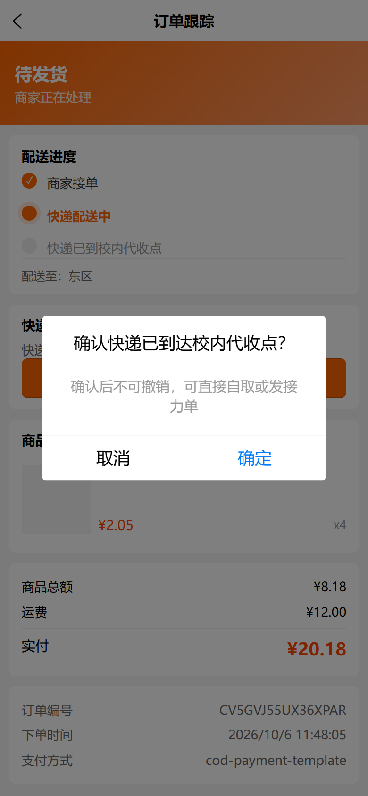
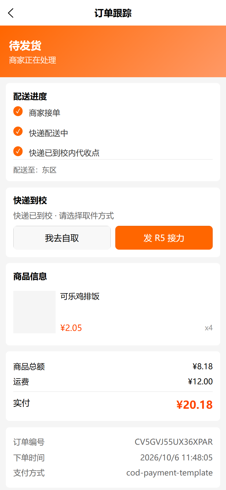
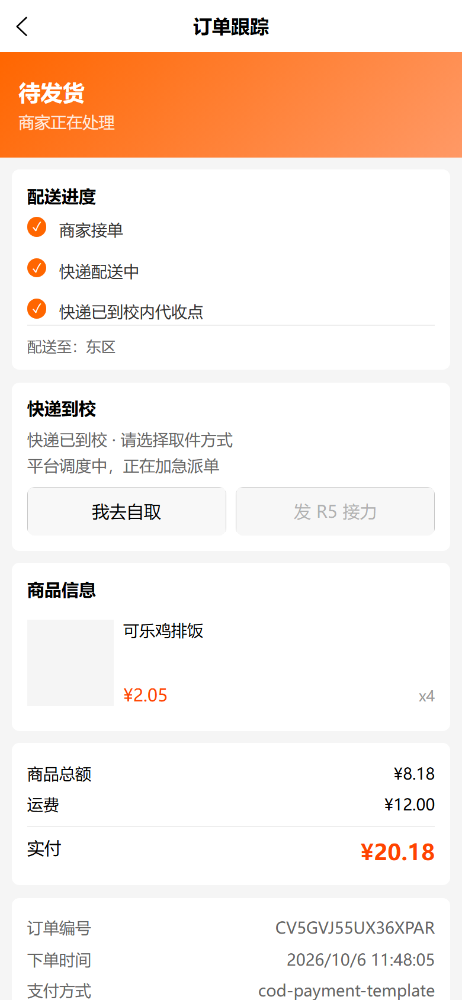
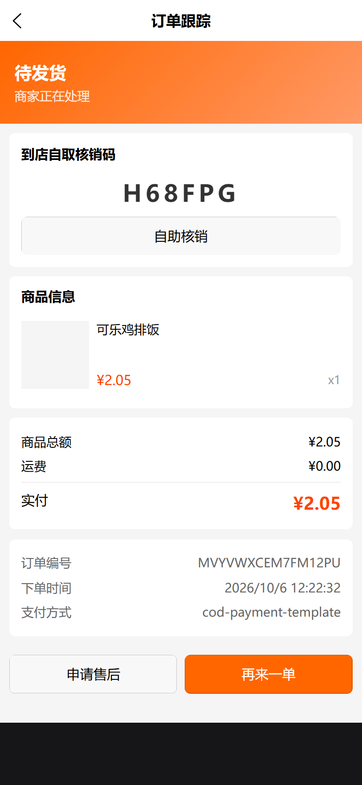
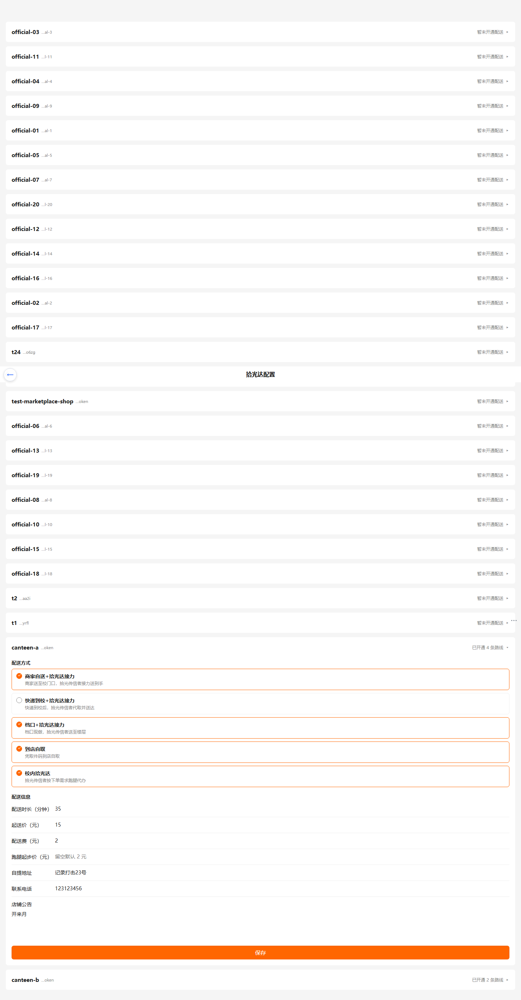

### 5.7 常见问题

- **接力单退款了，我的快递单钱退吗？** 不退。退款只退接力单的跑腿费+小费，快递原单照常（快递已到校），可在原单重新发接力或自取。
- **起送价按什么算？** 按商品含税金额（页面所见金额）；不含配送费。跑腿单（R5）不校验起送价。
- **「快递已到校」点错了怎么办？** 确认后不可撤销，联系客服人工处理。
- **R5 发单后没人接？** 走平台降级保护：5 分钟加急置顶 → 超时强派 → 调度人工介入 → 最终自动退款，无需手动催单。
- **R4 核销码找不到了？** 订单详情页随时可查，码一生对一单、已核销会显示「已核销」。

### 5.8 配送档案初始化（R2/R4 共用档案，三期）

R2（快递到校）与 R4（到店自取）依赖同一变体档案出配送方式（cjk 分箱按变体 `shippingProfileId` 单值分箱）。拾光达配置页每张店铺卡底部提供**「初始化配送档案」**按钮：

- 点击后自动 **get-or-create** 该渠道租户默认档案「拾光达默认配送档案」，合并 `store-pickup` + `courier-delivery` 两种方式（union 补齐，不删已有绑定），并把两种方式幂等绑定到渠道；
- 渠道内**未绑定档案的商品变体**自动补绑到该默认档案（已显式绑定的变体不触碰）；
- **幂等**，可重复点击；结果弹窗展示已绑定方式与补绑商品数；缺少方式时提示对应路线暂不可用。

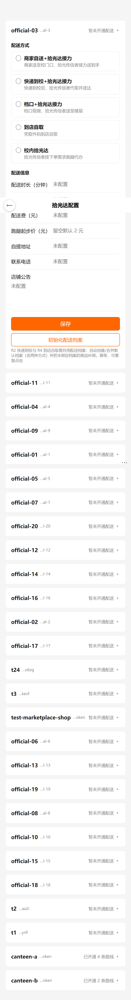
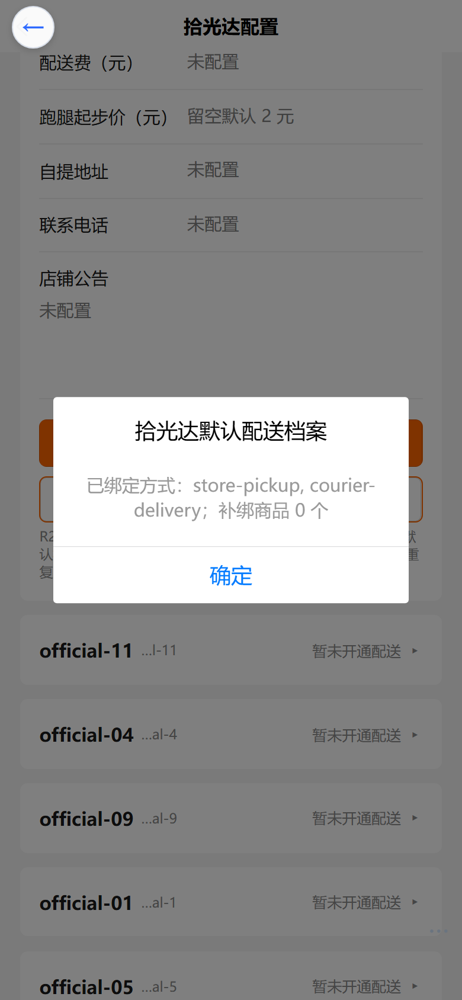


## 6. 评价系统（三期：先审后显）

订单完成（Delivered）后，学生可对商品发布图文评价；评价**先审后显**——`pending` 状态对 C 端不可见，管理员「通过」后才进入店铺评论流，并写回商品评分聚合（`reviewRating` / `reviewCount`，商品卡角标直接读）。

### 6.1 学生端（waimai H5）

**写评价**：订单详情页在订单完成后出现「写评价」入口 → 进入评价页（A 经典分节版式）：商品信息卡 + 5 星选择（触点折算档位，1-5 星文案联动）+ 标签快选（口味赞/分量足/配送快/包装好/性价比高）+ 文字评价 + 图片上传（最多 3 张）+ 匿名开关。发布后进入「审核中」。

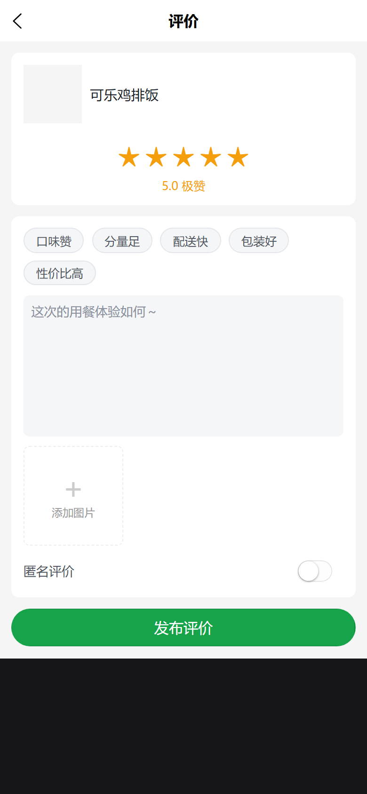

**我的评价**：「我的-我的评价」查看本人全部评价（状态徽标：审核中/已通过/未通过；展示商家回复；支持删除 = 软删，删除后评论流不可见、商品评分回落）。每笔订单每条明细仅可评价一次。


### 6.2 店铺评论 tab（menu）

店铺页「评论」tab（A 摘要卡版式）：综合评分摘要卡（大均分 + 1-5 星分布条 + 总条数 + 好评率）→ 筛选 chips（全部/有图/好评/差评）→ 评论列表（头像/昵称（匿名脱敏）、星级、内容、图片缩略（点击预览）、标签、商家回复气泡），触底自动加载更多。首次切到评论 tab 才拉取数据（首屏不浪费请求）。

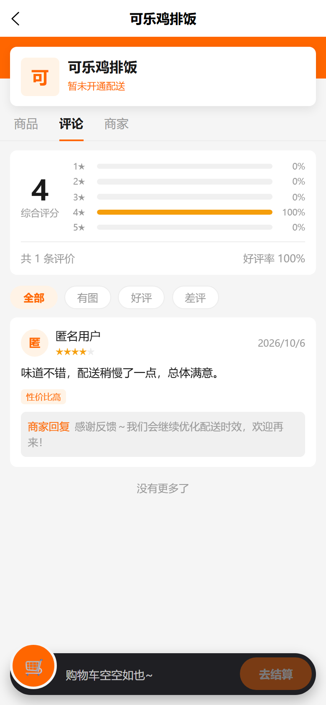

商品卡评分角标：商品有已审核评价后，商品卡显示「★ 4.8 N条评价」。

### 6.3 管理端审核（web-admin）

「单 - 评价管理」四 tab：**待审核**（默认）/ 已通过 / 已驳回 / 全部：

- **通过 / 驳回**：pending 评价可双向操作；驳回后可再改判「通过」（先审后显的唯一放行入口）；
- **回复**：已通过的主评可回复（弹窗输入），回复内容展示在 C 端评论流气泡与「我的评价」；
- 图片点击放大预览；软删评价不在列表出现。

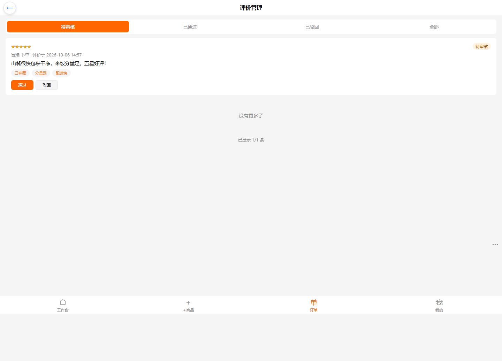
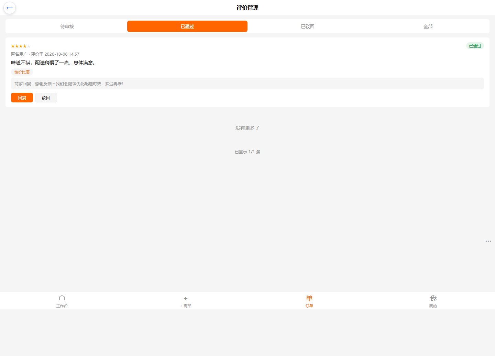

### 6.4 部署与冒烟复跑

```bash
# H5 部署（同外卖主链路，本地构建 → scp → 解压，即时生效）
node .secrets/deploy-waimai.mjs

# 生产 E2E 冒烟（24 断言：订单 Delivered → createReview pending → 双流不可见 →
# approve 可见+发奖（积分/定向券，幂等双闸）→ stats/hasImages/评分聚合 → 回复 →
# 追评（创建 pending → approve → 评论流气泡）→ myReviews → 软删回落 → 起送价还原）
node .secrets/review-e2e-verify.cjs   # 期望 REVIEW-E2E PASS，幂等可重复跑
```

冒烟走渠道 A（canteen-a-token）真实下单链路（临时调低起送价，结束自动还原 1500）；评价数据用软删收尾不留痕。


## 7. 已知限制 / 待办

- R5 载体变体（id=86）`trackInventory=false` 且已分配到店铺渠道——R5 发单购物车载体行依赖，勿回收/重开库存。
- 微信 JSAPI 支付需在生产配置商户参数后生效；当前冒烟走 COD 授权链路。
- 大厅单滞留 >5 分钟自动加急置顶；强派（T2/T3）调度已具备（DispatchJobService），默认关闭。
- 提现打款为线下转账（管理员审核通过后自行转账并标记「已打款」），无线上支付通道对接。
- 评价奖励的定向券依赖券模板 `distributionChannels` 含 `GRANT` 渠道；未配置的渠道 approve 只发积分（或均不发）。

## 8. 四期：增长闭环

上线日期：2026-10-06。设计文档：`docs/superpowers/specs/2026-10-06-phase4-growth-loop-design.md`。三个方向：骑手钱包与提现闭环、评价有礼 + 追评、经营看板增强。

### 8.1 骑手钱包与提现

**钱包（骑手端）**：「我的 → 骑手首页 → 收入卡 → 去提现」进入钱包页——余额卡（可提现大数字 + 冻结/累计收入副行）+「收入明细 / 提现记录」两个 tab（触底加载）。分成随送达实时入账（`status=credited`）。

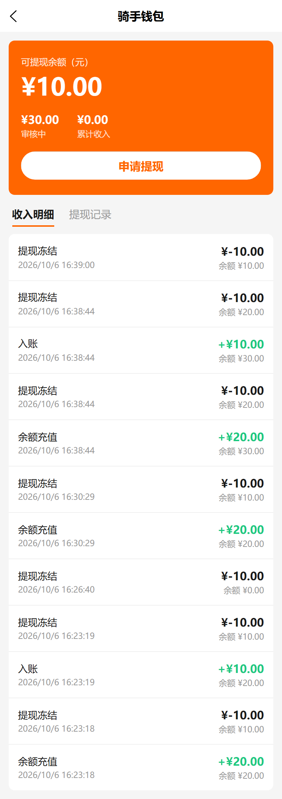

**申请提现**：金额输入（最低 ¥10，不可超可提现余额）+ 收款渠道 + 账号 → 提交后金额立即**冻结**（可提现减少、冻结增加），toast「申请已提交，等待审核」。

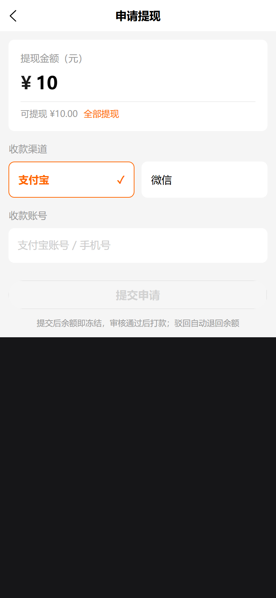
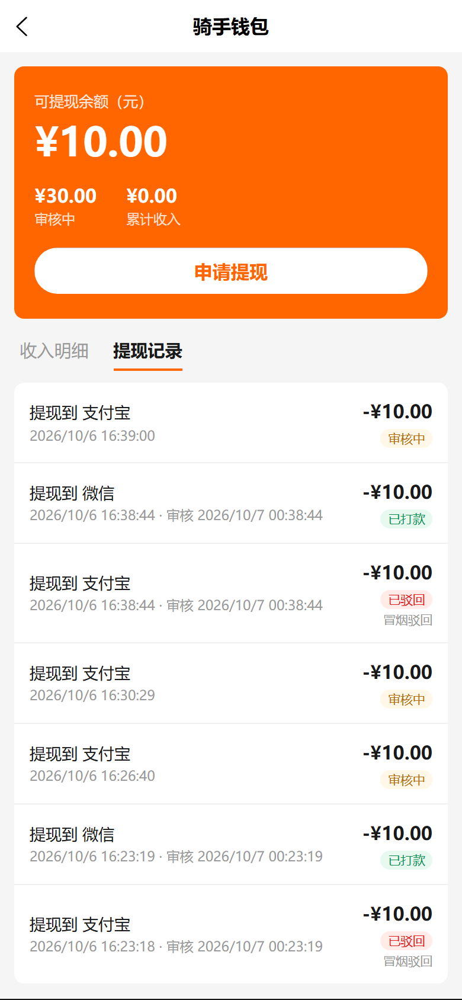

**管理员审核（web-admin）**：「单 → 提现审核」四 tab：**审核中**（默认）/ 已打款 / 已驳回 / 全部。

- **通过**：确认弹窗 → 状态置 PAID（线下已转账后操作）；
- **驳回**：填驳回原因 → 冻结金额全额退回可提现余额。

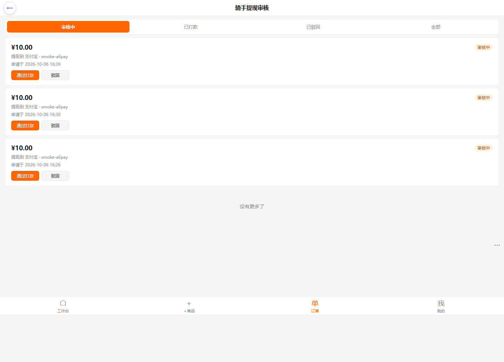

流程：`送达 → 分成入账 → 申请提现（冻结）→ 管理员通过（PAID）/ 驳回（退回）`。

E2E 冒烟（认证 → 入账 → 冻结 → 驳回退回 → 再申请 → 通过 PAID）：

```bash
node .secrets/rider-withdraw-e2e.cjs   # 期望 WITHDRAW-E2E PASS，幂等可重复跑
```

### 8.2 评价有礼 + 追评

**奖励规则**：主评**审核通过**时自动发奖（先审后显，发奖发生在放行时刻，防刷屏）：

- **积分**：渠道配置的评价奖励积分（当前 50 分），写入会员积分流水（remark 含「评价」）；
- **定向券**：渠道配置的券模板定向发放一张（模板须含 `GRANT` 发放渠道）；
- **幂等双闸**：`giftGranted` 标记 + `reviewedAt` 审核时间，重复 approve 不重复发奖；追评 approve 不发奖；未配置奖励的渠道只流转状态。

**追评**：主评通过后 **7 日内**可在「我的评价」对该订单主评**追评一次**（「追评」按钮），追评同样先审后显；通过后以气泡形式嵌在店铺评论 tab 的主评下方。已删主评不可追评，追评不允许再追评。


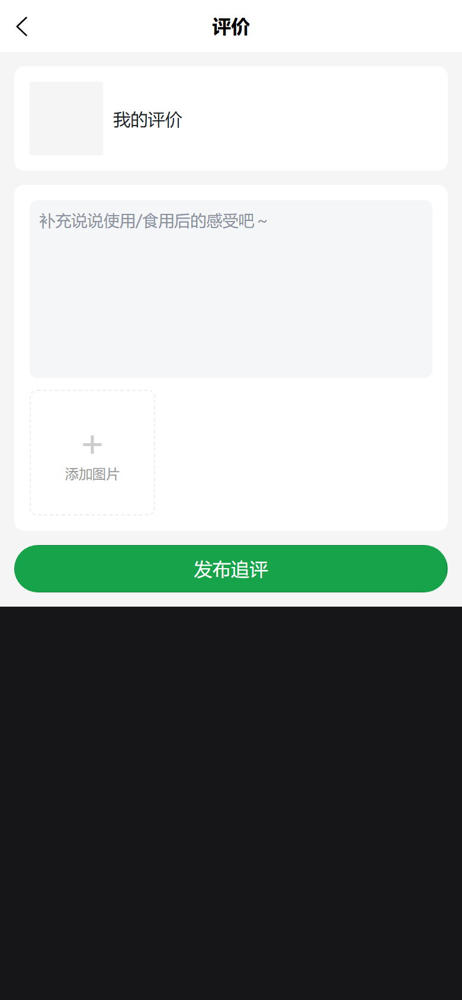
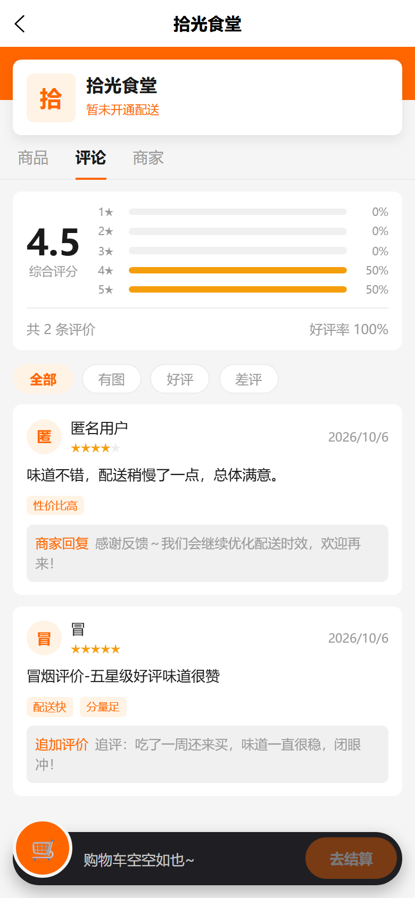

E2E 冒烟：`node .secrets/review-e2e-verify.cjs`（24/24 PASS，含发奖/幂等/追评链路，见 §6.4）。

### 8.3 经营看板增强（web-admin）

「数据 → 数据看板 → 经营数据」新增四期区块：

| 区块 | 口径 |
| --- | --- |
| 复购率 KPI | 窗口（近 7/30 天）内有效下单客户中 ≥2 单客户占比（%） |
| 评价均分 KPI | 全量已审核主评均分（不随窗口） |
| 热销商品榜 | 窗口内有效订单按商品**件数**排序 Top5，附金额 |
| 骑手效率榜 | 窗口内送达单按骑手聚合：完成单数 + 准时率（基于承诺送达时段，无时段的单不参与准时率分母） |
| 评价概览 | 均分 / 差评率（≤2 星）/ 待审核数 / 带图率 |

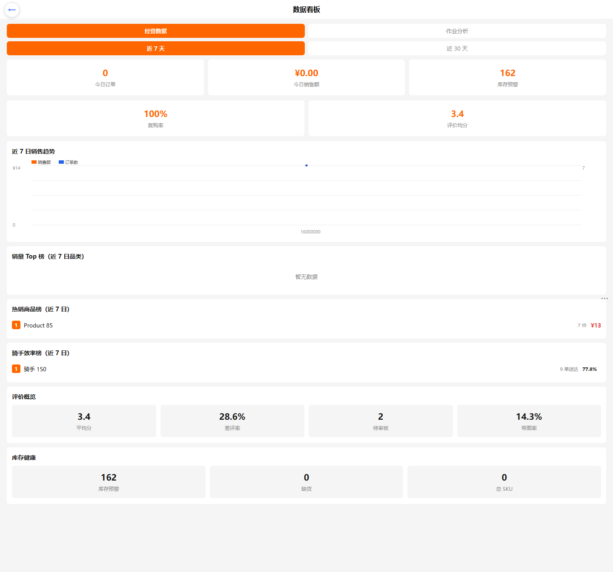

任一接口失败对应卡片显示「—」（不伪造 0）。部署：vendure 走服务器 `git pull + pm2 restart`；web-admin 走 `node scripts/deploy.mjs`（本地构建 scp）。

## 9. 个人中心（地址簿 + 资料编辑 + 发票 + 邀请）

上线日期：2026-10-07。后端为纯加法：campus-delivery-plugin customFields（Address `zoneId/buildingId/route`、Customer `avatarUrl/invoiceTitles`、Order `invoiceApplied/invoiceInfo`，物理列开机自动建）+ shop mutation `applyOrderInvoice`；前端新增 pkg-user 分包六页，地址簿复用 Vendure Address 原生 CRUD，零新实体。

### 9.1 版式 B「外卖资产区」与入口总览

我的 tab 自上而下：**橙头部**（头像圆 + 昵称 + 电话/「未绑定电话」+ 编辑资料入口；未登录显示「点击登录」）→ **资产区四宫格**（优惠券·即将上线灰态 / 常用地址 / 发票抬头 / 邀请好友）→ **订单四态快捷条**（待付款 / 待送达 / 待评价 / 退款售后，跳订单列表带状态筛选）→ **菜单组**（我的评价 / 我的跑腿单 / 联系客服 / 关于拾光达 / 成为传信者）→ 退出登录。

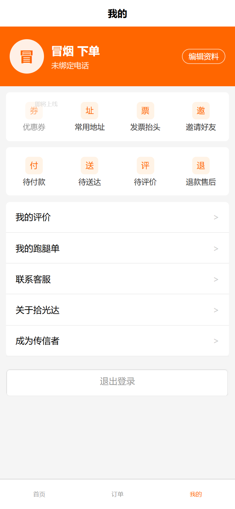

### 9.2 常用地址（下单自动带出）

「资产区 → 常用地址」进入地址簿，底部「新增地址」：

- **字段**：联系人（必填）、手机号（11 位校验）、分区 → 楼栋级联单选（数据源与下单页同源）、房号（选填，拼入楼栋明细）、存为默认地址开关；
- **列表操作**：点击进编辑、右侧「删除」（二次确认）、「设为默认」；默认地址带橙色「默认」徽标；
- **失效地址**：分区/楼栋被删除或停用后，地址置灰标「**待更新**」，不可设默认、不可供下单选用，仅可进编辑页修正（跨店铺的脏数据同理不生效）；
- **下单联动**：checkout 进入时若默认地址的分区/楼栋命中当前店铺配置，自动预选分区与楼栋（**送达时段不预存，仍需手选**），分区选择区上方显示默认地址摘要行，可点击改选。

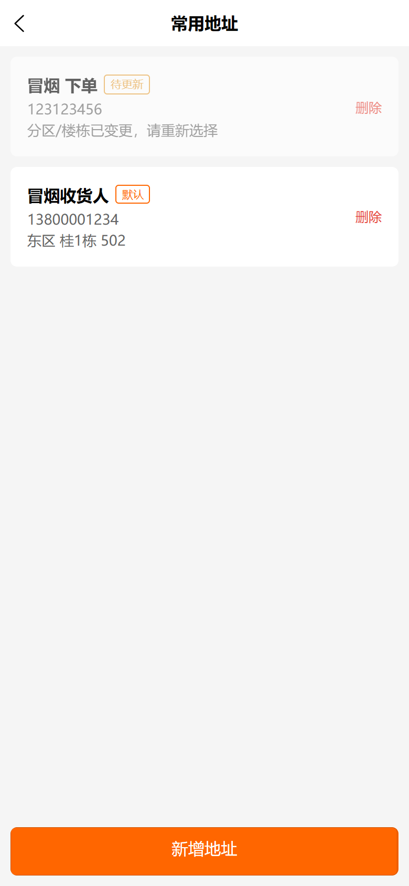

### 9.3 资料编辑

橙头部「编辑资料」进入：头像（点击换图，走既有上传通道）+ 昵称 + 电话，保存后返回即刷新。未上传头像时回显 SSO 头像/首字占位。

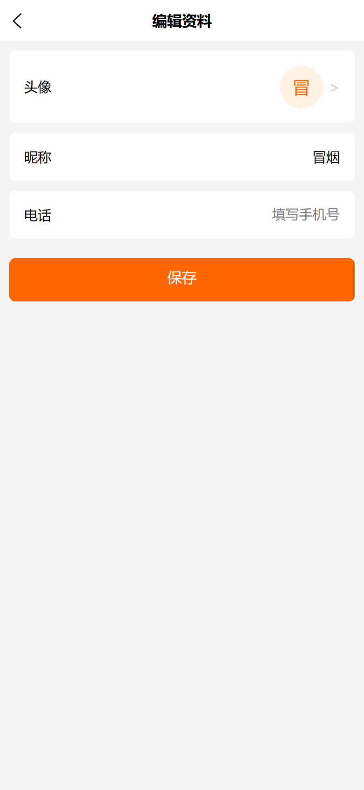

### 9.4 发票（抬头管理 + 订单开票申请）

- **抬头管理**：「资产区 → 发票抬头」，最多 **5 条**（超限前端拦截）；个人抬头必填名称+邮箱，企业抬头另需税号（15-20 位字母数字校验）；数组首位为默认。
- **订单开票**：订单详情页对**已支付且未申请过**的订单显示「开发票」按钮 → 底部弹层选抬头 + 接收邮箱（默认带抬头邮箱）→ 提交后按钮区转为「已提交开票申请」只读条（展示抬头快照摘要）。幂等：`invoiceApplied` 闸防重复申请，商家线下人工开票（B 端本期不流转）。

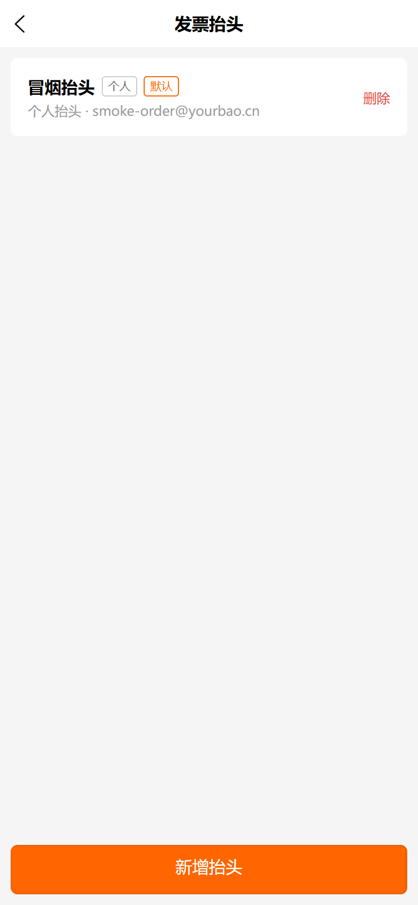

### 9.5 邀请好友与关于

- **邀请好友**：展示当前用户邀请码（SSO 侧生成写入）大字号卡片，「复制邀请链接」拼 `?invite_code=<码>` 复制分享；
- **关于拾光达**：版本号 + 客服电话（`VITE_SERVICE_PHONE` 环境变量，当前待运营提供，未配置显示「未配置」）+ 用户协议 / 隐私政策。

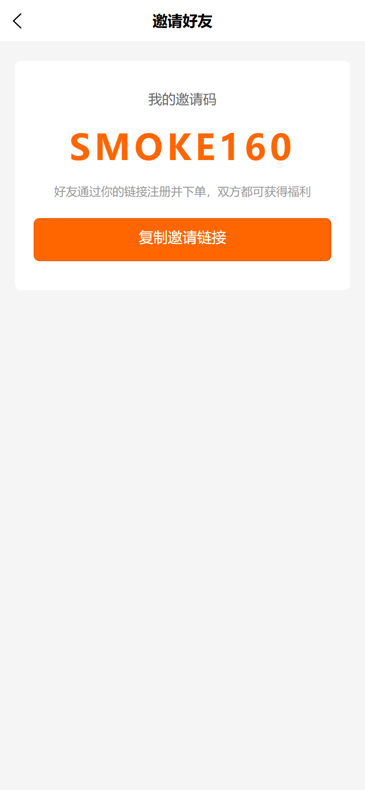
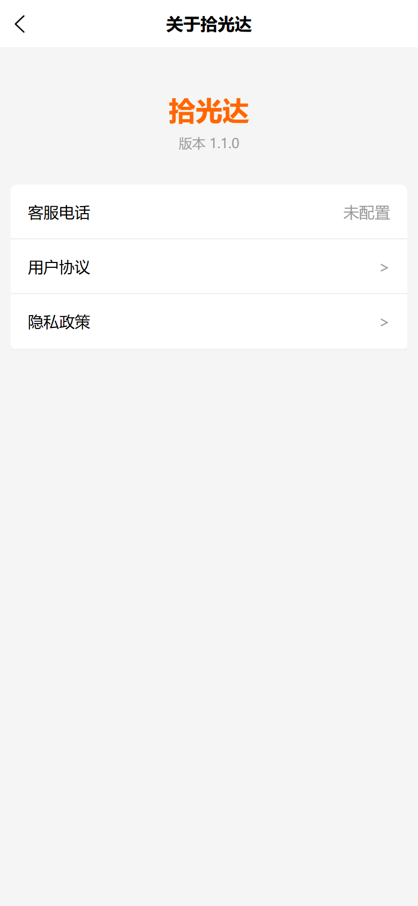

暗色主题下个人中心保持固定浅色版式（品牌橙头部不变，无样式破碎）：


### 9.6 冒烟复跑

```bash
python scripts/_smoke_profile.py   # waimai 仓库根执行，期望 E2E SMOKE PASS (10/10)，幂等可重复跑
```

覆盖：登录 → campusZones/Buildings → 地址创建（customFields 落库）→ 地址簿默认徽标渲染 → 发票抬头 JSON 写回 → 邀请码注入与页面渲染 → 已支付订单 `applyOrderInvoice` 首调成功（或幂等已申请）→ 重复申请被拒 `INVOICE_ALREADY_APPLIED` → 七张 390×844 dpr=2 截图。

已知限制：客服电话待运营提供后填 `.env.production` / `.env.development` 重新部署；发票为轻量版，B 端流转 / 第三方自动开票不在本期。

## 10. 优惠券（券 C 端闭环）

上线日期：2026-10-07。学生端全链路：领券中心领券 → 券包管理 → 下单自动试挂最优 → 支付核销。

### 10.1 功能入口与学生操作流

- **领券中心**：个人中心「资产区 → 优惠券」进入券包，点「去领券中心」；或券包页内直达。两个 tab：
  - **可领取**：已开始的券模板，点「立即领取」即入券包（每张券每人限领 1 张，重复领取被拦截 toast）；
  - **即将开始**：未开始的券模板（`couponCentreUpcoming`），可提前浏览、到点领取。
- **我的券包**：三个 tab——未使用（可「去使用」直达领券中心关联商品）/ 已使用 / 已过期，空态均有引导按钮。
- **商品专属券 chip**：店铺菜单页已绑券的商品行显示「领取」chip（商品维度专属券，与通用券分开展示），点击即领。
- **下单选券**：checkout 页「优惠券」行自动**试挂当前最优可用券**（无可用券显示默认文案）；点行弹选券弹层——可用券（勾选切换）/ 不可用券（灰态 + 原因：未达门槛等）；支持换券 / 不使用。
- **核销链路**：领取 UNUSED → 支付成功自动核销 USED → 角标 -1；退款 RETURNED；到期 EXPIRED。

**券优惠口径**（以 `coupon-promotion-condition.ts` 为唯一权威）：折扣券按折数（`discountValue=85` 即 8.5 折），优惠 = 商品小计 × (100−折数)/100；免邮券优惠 = 配送费；固定/满减券优惠 = min(面额， 商品小计)；门槛按**商品小计**判断（不含运费）。

### 10.2 截图

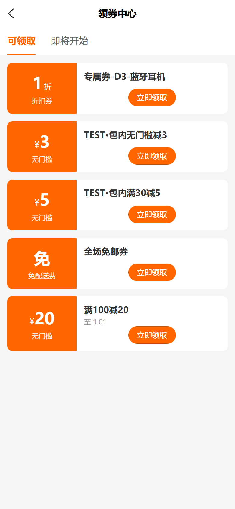
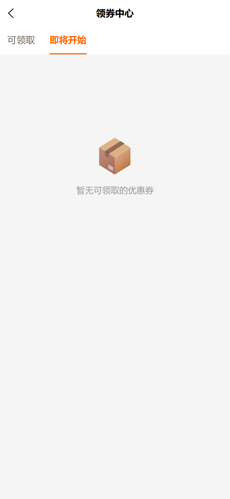
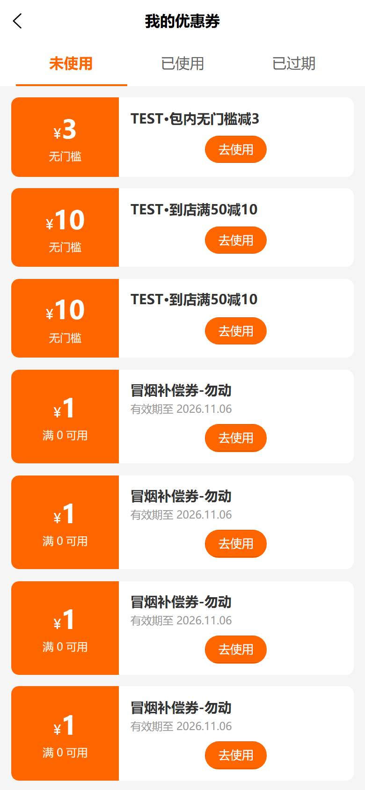
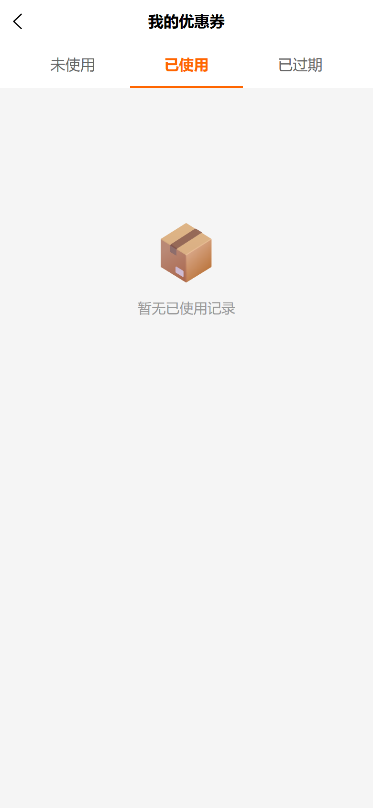
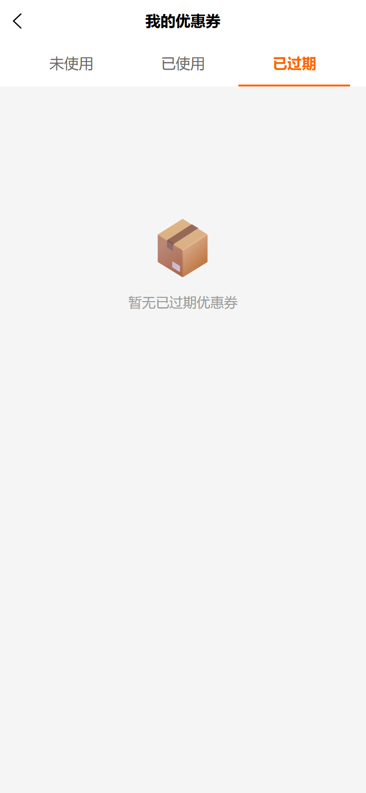
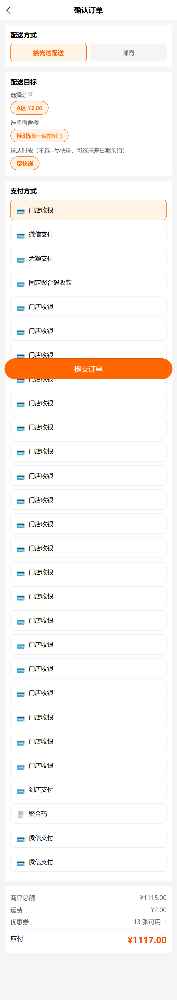
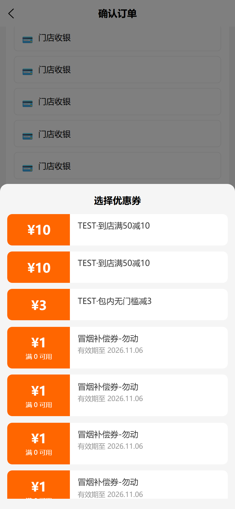
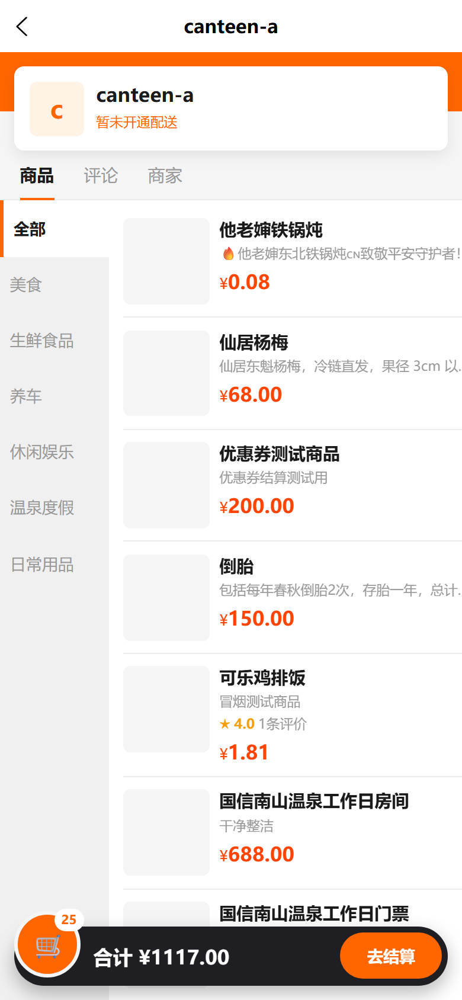
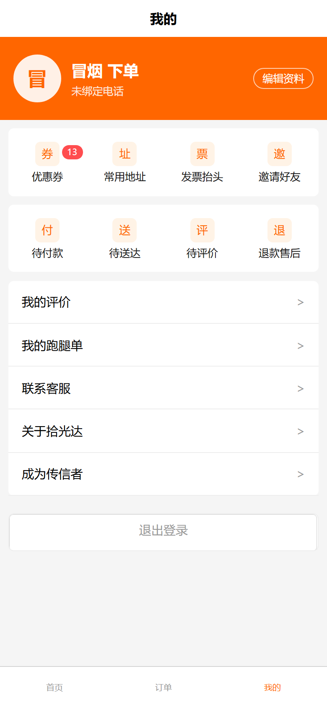

### 10.3 冒烟复跑

```bash
python scripts/_smoke_coupon.py   # waimai 仓库根执行，期望 E2E SMOKE PASS，幂等可重复跑
```

覆盖：登录 → 券中心双 tab → 券包三 tab → checkout 自动试挂 + 选券弹层 → 菜单 chip → profile 角标 → 清理购物车。生产冒烟（只领不下单）可用环境变量覆写 `SMOKE_BASE` / `SMOKE_CHANNEL` 跑同脚本。

## 11. 订单通知（微信公众号模板消息）

上线日期：2026-10-07。campus-notify 加法扩展：订单域 4 事件模板推送 + 待付款提醒/超时取消定时任务。

### 11.1 推送事件一览

| 事件 | 触发时机 | 说明 |
|------|----------|------|
| 下单成功 orderPlaced | 订单支付成功（转入 PaymentSettled/授权完成） | 推送店铺确认信息 |
| 待付款提醒 paymentPending | 订单停在待支付 **+10 分钟** | 定时任务扫描触发，提醒尽快支付 |
| 取消通知 orderCancelled | 商家/系统/超时取消订单 | **用户本人主动取消不推**（避免打扰） |
| 售后进度 afterSales | 售后审核通过 Approved / 已退款 Refunded / 退款失败 RefundFailed 三节点 | 其余售后状态不推 |

- **落地页跳转**：消息点击跳转 H5——由 campus 配置的 `h5BaseUrl` 拼接订单/售后详情路径（禁硬编码域名）。
- **待付款超时取消**：+15 分钟未支付自动取消（先释放库存分配再取消，到点复查订单状态，非待支付则幂等跳过；与既有 30 分钟 OrderTimeoutPlugin 共存，先到先得）。取消同样触发「取消通知」。
- **静默跳过**：用户无 openid、渠道未配置对应模板 ID 时静默跳过，不报错不重试。

### 11.2 运维配置（**上线必做**）

1. **微信公众号申领模板**：在公众号后台「广告与服务 → 模板消息」申领 4 个订单类模板，拿到 4 个模板 ID：
   - 下单成功通知 / 待付款提醒 / 订单取消通知 / 售后进度通知；
2. **web-admin 填配置**：登录 `https://e.joho.cn` → 校园配送 → 店铺配置页，每个店铺渠道填：
   - 4 个新模板 ID（下单成功 / 待付款提醒 / 取消通知 / 售后进度）——与既有 5 个模板字段（接单/骑手接单/出餐完成/送达/异常处理）并列；
   - `h5BaseUrl`（H5 站点域名，如 `https://www.yourbao.cn/waimai/index.html`）；
3. **验证**：配置后下一笔真实订单即走推送；也可用 pm2 日志关键字 `CampusNotify` / `PaymentTimeout` 观察发送调用（未配置模板时日志为静默跳过）。


## 12. 骑手提现与审核（2026-10-08 P2 收尾）

### 12.1 流程

1. **骑手端**（www.yourbao.cn/waimai/）：收入页「去提现」入口 → 骑手钱包（可提现/审核中/累计收入三数 + 收入明细/提现记录双 tab）→ 申请提现（≥¥10，支付宝/微信 + 收款账号）。**提交即冻结**（可提现减少、审核中增加）；同骑手存在审核中申请时不可重复申请（后端防重拦截，报「您有审核中的提现申请」）。
2. **管理后台**（e.joho.cn/guanli，订单 → 骑手提现审核）：待审核/已打款/已驳回/全部四 tab → **通过**（线下微信/支付宝转账完成后操作，标记已打款仅留痕，不再动账）或 **驳回**（必填备注，冻结金额自动退回骑手余额）。
3. **资金口径**：申请冻结 = deductBalance；驳回退回 = addBalance；资金固定默认渠道上下文，管理端跨渠道可审核；累计收入跨渠道汇总（2026-10-08 修复：此前按默认渠道过滤恒为 0）。

### 12.2 调度配置（campusConfig，admin-api `campusConfig` 查询 / web-admin 配置页可调）

- `autoAssignMinutes`（默认 10）：大厅 open 单滞留超时 → T2 强派最佳在线骑手（信用分高者优先）
- `autoRefundMinutes`（默认 30）：无人接超时 → T4 全额原路退款 + 订单取消 + no_rider 标记 + 定向补偿券
- `inProgressSlaMinutes`（默认 45）：配送中 SLA 告警阈值
- 大厅排序：滞留 >5min「加急」置顶 → 小费降序 → 入厅时间升序；前端自动加急徽标
- `paused`：运力总开关。2026-10-08 生产核验：全部渠道 paused=false、阈值均为默认值（10/30/45），调度默认开启无需配置

### 12.3 验证记录

- E2E：`node .secrets/rider-withdraw-e2e.cjs` → `RIDER-WITHDRAW-E2E PASS`（13 断言：注入余额/冻结/越界拒/驳回退回/**防重 duplicateBlock**/通过留痕/流水与记录可查；开头自动驳回遗留 PENDING 保证幂等）
- 冒烟：`waimai-e2e-smoke.cjs` S1-S8 PASS（2026-10-08 订单 342/343）
- 截图：`vshop/docs/screenshots/waimai/p2-cleanup/`（5 张 780×1688：收入页/钱包页/提现记录/申请页/web-admin 审核页，逐张目检合格）

## 13. 商家小票打印（C-Lodop，58mm 热敏，2026-10-20）

### 13.1 原理与前提

- 纯前端驱动：web-admin 工作台页通过 **C-Lodop** 浏览打印服务（跑在商家电脑 `http://localhost:8000`，备用 18000）静默打印到商家本机/局域网 WiFi 热敏打印机，免第三方账号、免计费。
- **前提（缺一不可）**：① 商家电脑安装并启动 C-Lodop 服务（官网下载 C-Lodop 云打印服务）；② 打印机与本机连通并设为默认打印机（驱动里测过自检页）；③ 工作台页保持开启（浏览器关闭即停自动打印）；④ 建议 Chrome/Edge（HTTPS 页加载 localhost 打印服务属浏览器豁免，Safari 等可能拦截）。

### 13.2 店铺配置（web-admin 拾光达配置页 → 「小票打印」）

| 打印时机 | 行为 |
| --- | --- |
| **关闭** | 不自动打印，仅可手动补打 |
| **支付后打印** | 工作台轮询（10s）发现新已支付单（30min 内）且未打印 → 自动出票 |
| **接单后打印** | 商家点「接单」成功后自动出票（打印失败不阻塞接单，可补打） |

- 配置存 `campus_fulfillment_config.printMode`，非法值一律按关闭处理。

### 13.3 工作台（商家接单页）

- 顶部打印状态条：显示当前自动打印模式；未检测到 C-Lodop → 黄条提示安装指引。
- 每张订单卡有「**补打**」按钮（全部 tab 含预约单可用，不受 30min 限制）；打印成功回写 `waimaiPrintedAt`（防重复自动打印 + 补打留痕）。
- 小票内容：店铺名/电话 → 单号/下单时间/路线/分区楼栋/送达时段 → 商品明细（名称×数量+金额）→ 商品小计/配送费/合计 → 尾注（暂不含整单备注：备注功能未上线）。

### 13.4 截图

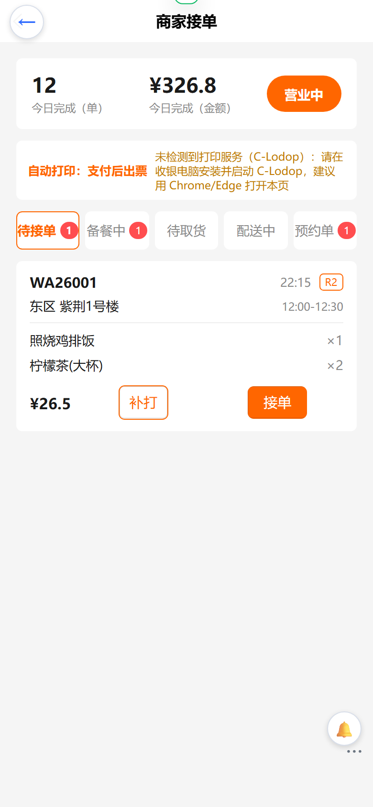

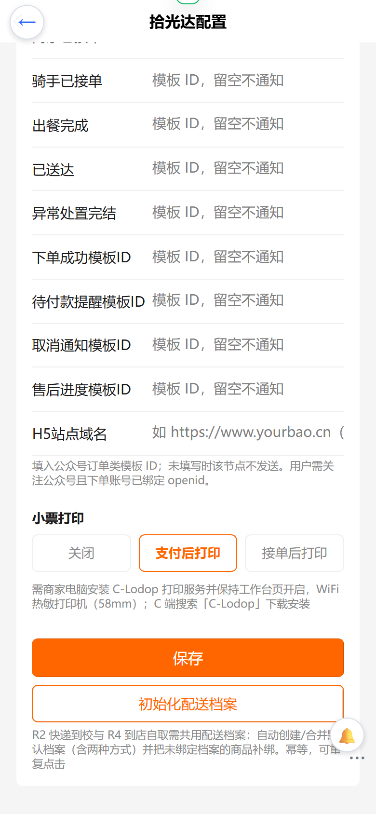


### 13.5 验证记录（2026-10-20）

- vendure `pnpm build` / web-admin `npm run build:h5` 均通过；plugin.ts 两段 schema 过 graphql parse 校验（admin 块含 `campusMerchantMarkPrinted`/`printMode` 新字段）。
- Playwright 移动视口（390×844 dpr=2）mock 自测：工作台打印状态条/补打按钮/接单按钮渲染 PASS；配置页三选一与提示文案 PASS；58mm 小票版式截图目检 PASS（219px 窄幅无溢出）。
- 真机打印需商家电脑装 C-Lodop 后自测：工作台点「补打」应出票；无 C-Lodop 时点补打 → toast「未检测到打印服务」（已验证失败路径）。
- **本机真机联调（2026-10-21 PASS）**：装 C-Lodop 6.647 Win64（Inno 静默参数 `/VERYSILENT /SUPPRESSMSGBOXES /NORESTART /SP-`，装后需手动启动 `CLodopService64.exe /install /start`，监听 8000/18000/8443/9200）→ 页面加载 CLodopfuncs.js 得 `LODOP.VERSION=6.6.4.7` → `SET_PRINTER_INDEXA('OneNote (Desktop)')` → `PRINT()` → Win32_PrintJob 队列实见任务 `waimai-WA26001`（Printing|OK），C-Lodop→spooler 链路闭环。注意：「Microsoft Print to PDF」验证会弹「位置不可用」（SYSTEM 会话默认保存路径 systemprofile\Desktop 不可用）——**这是 PDF 虚拟打印机特有问题，真实 WiFi 热敏打印机直接出纸不受影响**。

## 14. 订单备注（顾客给商家留言，2026-10-21）

P1 对标缺口。顾客在**确认订单页**（应付金额下方）可填「订单备注」（选填，≤200 字），随单写入 `Order customFields.note`（transition 前 `setOrderCustomFields` 持久化，空值清除残留）；商家工作台订单卡显示黄色备注条；58mm 小票在送达时段下方打印「备注：」行。


- 链路：C 端 checkout.vue `orderNote` → `setOrderCustomFields({note})`（api/mutations/checkout.ts）→ `Order customFields.note`（custom-fields.ts，synchronize 自动建列）→ 看板 `MerchantBoardOrder.note`（merchant-admin.service.ts）→ 工作台 `.note` 黄条 + `lodop.ts` 小票 noteHtml（虚线上方、商品表之前）。
- 约束：200 字前端截断（maxlength + slice 双保险）；i18n 双语已补（zh-Hans/en 各 2 条 checkout + 2 条 campusMerchant）；无备注的订单卡不渲染备注条、小票不打备注行。
- 商家无需任何配置，装好小票打印（§13）即自动带上备注。


- 验证（2026-10-21）：三端构建通过（campus-delivery-plugin / waimai / web-admin）；checkout 备注卡真实组件自测（输入 + 字数统计渲染 PASS）；`buildReceiptHtml` 真实函数输出含备注行（219px 窄幅无溢出）；工作台 mock 数据自测（有备注订单显示黄条、无备注不显示，对照 PASS）。
- 生产验证（2026-10-21 PASS）：三端部署上线；**注意两个生产坑**：① 主库 `synchronize: false`（dev-config.ts:253），新增 Order customField 后 `pm2 restart` **不会自动建列**，需手动 `ALTER TABLE "order" ADD COLUMN IF NOT EXISTS "customFieldsNote" varchar(255);`；② vendure 插件 **lib 编译产物必须随提交入库**（首提只 add 了 src → 服务器 lib 停旧版 schema 缺 note，补提 lib 后生效）。最终探针：`setOrderCustomFields(input:{customFields:{note:"probe"}})` 返回 `NO_ACTIVE_ORDER_ERROR`（过 schema 校验、无 session 预期错误）= note 上线确认。

## 15. 履约 P1 卡点修复（运单对账 / 出餐闸门 / 交接码 / 时间线纠偏，2026-10-23）

- **A 外部运单轮询对账**：`DeliveryProvider.queryStatus`（达达 `/api/order/status/query`、美团 `/api/order/query`）由网关 `syncDeliveryStatus` 驱动既有幂等状态机；调度 job 对 `hallStatus=third_party` 在途单每 5min 主动查一次（`customFields.thirdPartySyncAt` 限频），平台回调丢失也能自动推进。未实现 queryStatus 的平台静默跳过。
- **B 时间线纠偏**：`src/utils/timeline.ts` 按实际 `deliveryPlan` 判定段数；R1/R2 降级为 `campus_rider`（缺交接点/商户超时/外部失败）后只渲染「商家接单→传信者到店取餐→配送中→已送达」一段，不再显示永不完结的第二段。
- **C R2 出餐闸门**：R2 支付后先 `pending_merchant`，商家接单（accepted）→ 出餐完成（cookingDone）才转 `pending_dispatch` 由运营推送外部快递；商户接单超时 / 已接单久未出餐分别降级传信者到店取餐直送。
- **D 交接码**：第一段送达校园交接点入接力大厅时生成 4 位 `customFields.handoverCode`（+`handoverCodeAt`）。**商家工作台**订单卡显示「取餐交接码」，学生订单详情同步可见；骑手端开始取货必须输入该码，`campusStartTask(orderId, code)` 校验不符返回「交接码不正确」，防丢餐扯皮。骑手组卡批量开始取货时逐单弹码输入，取消则中止整组。
- 配置/运维：新增 Order customFields 三列（`customFieldsHandovercode` / `customFieldsHandovercodeat` / `customFieldsThirdpartysyncat`），生产已验证自动建列；外部平台凭据（`DADA_*` / `MEITUAN_*`）未配置时推送与轮询均静默跳过。
- 验证（2026-10-23）：campus 230 用例、gateway 32 用例全绿；三端本地构建通过；生产 `admin-api/shop-api 200`，日志确认「外部快递状态回调已接入订单履约」。

### 15.1 真机截图（390×844 dpr=2，真实链路：R1 建单 → 商家接单/出餐 → 送达交接点生成交接码 → 骑手抢单取货）

**① 骑手点「我已到店 · 开始取货」弹出取餐码校验层**（接力单必填 4 位码，错误会被后端拒绝）


**② 学生订单详情展示「取餐交接码」**（第一段送达交接点后生成，第二段骑手须核对）


**③ 商家工作台「配送中」页签订单卡展示取餐交接码**（交付给骑手核对）


- 复核要点：三处展示的码值一致（本次 9390）；订单号一致（本次 SKJ8MN47VQDQK4JJ）；时间线为两段（第一段「商户已送达交接点」已完成，第二段进行中）。
- 线上验证使用 `canteen-a-token` 渠道临时配置 R1 交接点「桂1栋驿站」，截图后已清空该配置，未留脏数据。

## 16. 超时赔付 + 工作台云打印增强（P0 收尾，2026-10-23）

### 16.1 超时赔付（后台配置 + 自动发券）

- **后端全链路**（vendure `bd6aad357`）：订单支付时固化「承诺送达时间」；实际送达超过 承诺时间 + 宽限分钟 即自动发赔付券，每单只赔一次；归因留痕（赔给谁、为什么赔可查）。
- **配置入口**：web-admin 拾光达配置页 → 展开店铺卡 → 「超时赔付」区：
  - 开关（默认**关**，灰度开启）；宽限分钟（默认 10）；赔付券模板 ID（**必须独立**，不要与无骑手补偿券共用）。
  - 未填券模板 ID 时只告警不真正发券，页面有黄条提醒，请补齐后再开启。
- 配置存 `campus_fulfillment_config.timeoutCompensation*` 三字段，旧表单保存不会清空已配值。


### 16.2 工作台云打印增强（商家接单页）

在 §13 小票打印基础上增强（`printMode` 非「关闭」时顶部显示打印条）：

- **连接探测**：进入工作台自动探测 C-Lodop，未连接显红态「打印服务未连接，本单未出票」；装好/启动服务后点「**重新连接**」即恢复，无需刷新页面。
- **未出票可见可补**：打印失败的单据在顶部汇总「{n} 单未出票」，点「**重试打印**」串行补打；新单超过 2 分钟仍未出票，订单卡上显示「未出票」徽标。
- **使用说明**：打印条右侧「使用说明」弹窗，四步指引（装 C-Lodop 设自启 → 打印机开机纸足 → Chrome/Edge 保持页面 → 点重新连接自动补打）。


### 16.3 验证记录（2026-10-23）

- web-admin 构建通过，新词条已打进产物（`index-Bo7Ux-3J.js` 含 timeoutCouponMissing/printRetryFailed）；vendure 已推送并部署（`/www/apps/vendure` reset 至 `bd6aad357` + pm2 restart，JobQueue 正常）。
- 线上回归：admin-api 200；部署的插件 lib 含 `timeoutCompensationEnabled`；站点 `index.html` 引用新 chunk，chunk 内含新词条。
- 手机视口截图（390×844 dpr=2，e.joho.cn/guanli 真实环境）：超时赔付配置区（开启态含宽限分钟/券模板/告警）PASS；工作台打印条未连接红态 + 重新连接 + 使用说明 PASS；说明弹窗 PASS。截图用 `test-marketplace-shop` 临时开 `printMode=onPaid`，**截后已恢复 off，无脏配置**。

## 17. 配送体系体检补齐（P1 三项 + P2 运营缺口，2026-10-23）

### 17.1 改址差额闭环（P1-1）

- 顾客改址产生 `diff` 后进「改址台账」，待收/待退两栏金额直接可读。
- 点「结清」可选 **补收 / 退款 / 免收**；退款走真实退款链路（订单支付方式原路退），必须填 **结清说明**，可填 **退款单号** 作为凭证；已结清记录保留操作人与时间。
- 订单详情页新增「改址记录」区：每次改址显示「原址 → 新址 / 差额 / 结清状态 / 时间」，改址按钮受 `CampusConfig` 权限控制（无权限用户不可见）。


### 17.2 结算页实时配送费（P1-2）

- 结算页分区改为展示与下单同口径的 **实时配送费**（`campusZones { price addFee }`），高峰/供需/手动倍率加价体现在分区 chip 上；运费行下方追加提示「含高峰/供需加价 ¥x」，避免「结算价 ≠ 实付价」。
- 订单详情分区 chip 同样取实时价，历史订单保留快照价。

### 17.3 履约参数与时段容量（P1-3）

配置页新增「履约参数（当前店铺）」：佣金率、自动派单开关与时限、配送中 SLA 告警、商家超时未接单转派时限、商家确认收货开关、无骑手补偿券模板；下方「送达时段容量」按店铺展示今日各时段容量与已锁定量。


### 17.4 楼栋与分区管理（P2-9）

- 楼栋坐标页「分区管理」面板：分区可 **改名 / 改基价（元）**，保存后仅影响此后新订单，历史订单保留快照。
- 楼栋编辑面板底部新增 **删除楼栋**：二次确认；若已有订单引用该楼栋则拒绝并提示引用单数（防脏数据）。


### 17.5 调度中心外部快递（P2-8）

- R2/R3 订单卡展示「路线 · 快递状态」与外部单号；大厅卡可 **推送快递**（达达/美团二选一，二次确认），进行中列表头支持 **批量推送**；已推送未完结单可 **取消外部快递**（R2 回待派单、R3 回大厅）。
- 已推送且在途的单再次推送会被后端幂等拦截，异常/已取消状态允许换家重推。

### 17.6 订单详情补配送信息 + 页面权限（P2-4/P2-5）

订单详情新增「校园配送信息」卡：履约路线、配送状态、送达时段、骑手、交接码、第三方单号与快递员姓名/电话（无值不显示空行）。


各校园页接入权限守卫：配置/楼栋/改址台账 → `CampusConfig`，调度/看板 → `CampusViewDispatch`，商家接单 → `CampusMerchant`；无权限进页面提示并自动返回。

### 17.7 验证记录（2026-10-23）

- 三仓均已提交推送并部署：vendure `521af5e18`（服务器 `git pull` + `pm2 restart vendure --update-env`，admin/shop API 200）、web-admin `788167a1`（`node scripts/deploy.mjs`，nginx reload OK）、waimai `2057519`（`node .secrets/deploy-waimai.mjs`，站点 200）。
- 线上 schema 已生效：`campusZones { price addFee breakdown }`、`campusSettleAddressChange(note)`、`campusUpdateZone`、`campusDeleteBuilding`、`campusAdminDispatchExternal`、`campusAdminCancelExternal`。
- 手机视口截图（390×844 dpr=2，e.joho.cn/guanli）：履约参数/时段容量 PASS、分区管理（改名/改价/保存）PASS、改址台账 PASS（当前无改址记录，空态正常）、调度中心 PASS、订单详情「校园配送信息」PASS（订单 415，R1，骑手 #188）、「代顾客修改地址」按权限显示 PASS。
- 已知数据限制：线上无 R2/R3 订单与改址记录，外部快递推送按钮与改址历史列表本次未取得真实数据截图；接入真实 R2/R3 单后按 §17.5/§17.1 复验即可。
- ~~未做（P3 数据卫生，按用户选择延后）~~：`thirdPartyFee` 字段清理、改址成功通知、跑腿报价与结算同口径一致性收口 —— **已于同日补齐，详见 §18**。

## 18. P3 数据卫生清理（2026-10-23）

### 18.1 thirdPartyFee 死字段清理

- 订单级「外部快递费用」快照字段（`customFields.thirdPartyFee`）全仓无查询/报表/对端消费，已删除字段定义与唯一写入点（外部推单成功时）。
- 启动迁移幂等执行 `ALTER TABLE "order" DROP COLUMN IF EXISTS "customFieldsthirdpartyfee"`：**历史值不可恢复**；门店级运费基数 `thirdPartyBaseFee`（R2 第三方到校基价）语义不同，完全保留不受影响。

### 18.2 改址成功通知

- 后台「校园配置 → 节点通知模板」新增 **改址成功模板ID**（`notifyTemplateAddressChanged`，留空不通知）。
- 运营在订单详情「代顾客修改地址」成功后，顾客收到公众号模板消息：订单号、商品摘要、新址（`分区·楼栋`），点击跳转 H5 订单详情。
- 幂等口径：`dedupe_key = campus:addressChanged:{orderId}:{改址台账记录id}`，同一订单多次改址各推一条，且不会吞掉退款到账等既有售后通知。


### 18.3 跑腿报价与结算同口径

- 发单页起步价（`ErrandService.getErrandBaseFee`）与结算实收（ShippingCalculator `campusErrandCalculator`）共用 `quoteDynamicBaseFee`：同一动态计价配置、同一加价规则、同一 `maxAddFee` 封顶。
- 新增 `errand-quote-consistency.spec.ts` 锁定回归：动态计价关闭时两处均 200 分；`manualMultiplier=1.5 + maxAddFee=100` 时两处均 300 分，且 metadata 拆解（baseFee 200 / addFee 100 / scope errand）一致。

### 18.4 验证记录（2026-10-23）

- 部署：vendure `72b932de7` 推送后服务器 `git pull` + `pm2 restart vendure --update-env`，shop-api 200；web-admin `node scripts/deploy.mjs`（nginx reload OK）。
- 数据库核对：`order` 表已无 `customFieldsthirdpartyfee` 列；`campus_fulfillment_config` 已新增 `notifyTemplateAddressChanged` 列。
- 线上 schema：`campusStoreConfigs { notifyTemplateAddressChanged }` 返回 null 正常；`campusUpdateStoreConfig(input.notifyTemplateAddressChanged)` 保存回读 PASS。
- 单测：插件全量 269 passed（含 `campus-notify` 11 条、`waimai-store`、`third-party-delivery`、新增 `errand-quote-consistency` 2 条）。
- 手机视口截图（390×844 dpr=2，e.joho.cn/guanli）：配置页「改址成功模板ID」可见可填 PASS。


## 19. 配送体系补漏（P4：资金/权限/闭环，2026-10-23）

### 19.1 支付成功后才进大厅（未支付不进厅、不可抢）

- 入厅闸门从「下单即入厅」改为 **支付成功（Authorized/Settled）后入厅**；未支付订单不再出现在调度大厅，也不会被骑手抢单。
- 幂等：同一订单 Authorized → Settled 两次事件只入厅一次（DB 重读 `hallStatus` 判重）；已取消订单即使收到支付事件也不入厅。
- 下单成功通知保持原有时点（下单即发），与入厅解耦。

### 19.2 取消/退款释放时段锁位

- 时段容量锁位改为「下单锁定、取消释放」：订单进入 `Cancelled`（含用户取消、退款、超时未支付关闭）时自动 `lockedCount - 1`，并用 `GREATEST(..., 0)` 兜底防负数。
- 之前只加不减会导致时段容量被历史取消单占满；现在运营「送达时段容量」看板的已锁定数可随取消回落到真实值。

### 19.3 调度权限拆分 + 跨店校验

- 新增权限 **`CampusDispatch`**（调度写操作）；`CampusViewDispatch` 仅保留看板只读。上线启动时自动给**已持有** `CampusViewDispatch` 的角色补授 `CampusDispatch`，不会因拆分失权。
- 派单 / 退回大厅 / 异常处置 / 外部快递推送与取消均要求 `CampusDispatch`；前端在仅有看板权限时显示黄条「当前账号仅有看板权限…」并隐藏写操作按钮。
- 三个调度写操作新增**订单所属渠道校验**：跨店订单直接拒绝（`订单不属于当前店铺`），防止多店铺场景误操作他家订单。

### 19.4 商家拒单/缺货（全额退款并取消）

商家接单页「待接单 / 备餐中」卡片新增 **拒单** 按钮（危险色，置于按钮链末尾防误触）：

1. 点「拒单」→ 选择原因：**商品售罄 / 临时打烊 / 超出配送范围 / 其他原因**；
2. 二次确认弹层显示订单号与「全额退款并取消，不可撤销」；
3. 确认后按 **已退总额只退剩余**（避免重复退款），取消订单并通知顾客（取消原因写入通知文案）。


### 19.5 改址联动（交接点快照 / 外部运单重推）

- **R1/R2**：顾客改址后按新楼栋坐标重算最近交接点，并回写订单 `handoverPoint*` 快照；餐已到交接点（`open`）或已被骑手取走（`grabbed/delivered`）时**不改快照**，避免把骑手指向错误位置。
- **R3 外部快递在途**（已接单/已取货）改址：自动取消外部运单并回到 `pending_dispatch` 等重新推送，同时保留 `deliveryPlan=external_courier` 以便重推成功；取消失败只告警不阻断改址。
- 未配置交接点或楼栋无坐标时保留旧快照，不做破坏性清空。

### 19.6 外部快递节点通知 + 赔付回扫窗口可配

- 外部快递 **接单 / 取货** 两个节点新增顾客通知（复用「骑手已接单」模板，`dedupe` 后缀区分节点，不会与出餐完成通知互相吞掉）。
- 超时赔付回扫窗口从固定 24h 改为**可配**（`timeoutCompensationWindowHours`，1–168 小时，默认 24）：长账期/补赔场景可放大窗口，配置入口在「超时赔付」区（履约参数与店铺卡均可改）。


### 19.7 验证记录（2026-10-23）

- 构建与单测：campus-delivery-plugin `npm run build` 通过；`npx vitest --config vitest.config.mts --run` **29 文件 / 269 用例全 PASS**；web-admin `npm run build:h5` + `node scripts/deploy.mjs` PASS。
- 部署：vendure `885e7915d` 推送后服务器 `git pull` + `pm2 restart vendure --update-env`，admin-api 200；web-admin `d73e935b` 部署，nginx reload OK。
- 数据库核对：`campus_fulfillment_config.timeoutCompensationWindowHours` 已建列（default 24）；`role.permissions` 中 `senior-admin` 已自动补授 `CampusDispatch`（与 `CampusViewDispatch` 同角色并存）。
- 线上 schema：`campusMerchantRejectOrder(orderId, reason)` 已注册；`campusStoreConfigs` / `campusUpdateStoreConfig` 含 `timeoutCompensationWindowHours`。
- 手机视口截图（390×844 dpr=2，e.joho.cn/guanli，canteen-a 渠道）：赔付回扫窗口可见可填 PASS；待接单卡片「拒单」按钮 + 原因浮层 + 二次确认弹层 PASS；调度中心页面正常、写操作按钮对 `CampusDispatch` 账号可见 PASS。
- 截图说明：为展示拒单按钮，临时将一笔历史订单的 `hallStatus` 置为 `pending_merchant` 并隐去骑手信息，**截后已还原**（`grabbed` + 原骑手），未触发退款、无脏数据。
- 数据限制：线上无 R2/R3 在途订单与改址记录，改址联动与外部快递节点通知本次未取得真实数据截图，接入真实数据后按 §19.5/§19.6 复验即可。

## 20. 配送体系二次体检（P0 五项：终态一致性 / 看板干净 / 统计口径，2026-10-24）

第二轮只读审计发现 17 项体系性遗漏（不含 P4 已修 8 项），本轮先修 P0 五项。核心问题：**骑手送达只写 `deliveryStatus`，不写 `hallStatus`**，导致送达后的订单在调度墙、商家台、统计里长期「滞留配送中」（线上实测 14 单）。

### 20.1 骑手送达同步写终态 `hallStatus=delivered`

- `RiderTaskService.deliver()` 在写入 `deliveryStatus=delivered` 的同时写 `hallStatus=delivered`（与 R2/R3 外部直送的终态一致）。
- 影响面：送达后订单立即退出调度看板「进行中」、商家工作台「配送中」、自动扫描（`DispatchJobService` 只扫活跃状态），不再被 SLA 超时告警反复计入。
- 前端/接口无需改动，`delivered` 已是既有终态枚举。

### 20.2 调度看板 / 商家工作台过滤终态单

- 调度中心看板：`cancelled` / `no_rider_final` / `delivered` 三类终态单不再进入「大厅待接 / 进行中 / 告警」；`exception_final`（已处置）仍进「异常处置记录」留痕。
- 兼容**历史脏数据**：即使 `hallStatus` 仍为 `grabbed`，只要 `deliveryStatus=delivered` 也不再进墙/进栏。
- 商家工作台：`deliveryStatus=delivered` 的单不再出现在「配送中」等流转栏（今日完成数与金额口径不变）。


### 20.3 第一段送达加前置状态校验

- `completeFirstLeg`（R1 商户送交接点 / 自营快递送达）新增状态前置校验：
  - `deliveryPlan=merchant` 必须处于 `merchant_delivering`；
  - `deliveryPlan=owned` 必须处于 `owned_dispatched`。
- 不符时返回「第一段已送达或订单状态已变更，请刷新后重试」。防止商家重复点击把已回大厅（`open`）或已送达的单**再次** `enterHallForHandover`：重置 `hallStatus`、清空骑手、重生成交接码。

### 20.4 配送统计只计校园履约单

- 「配送看板」SQL 增加 `hallStatus IS NOT NULL` 过滤：普通快递、自提等非校园履约单不再计入有效单量 / 准点率 / 环节耗时 / 店铺对比。
- 线上实测（近 7 天）：修复前口径 24 单，修复后 **4 单**（14 单校园履约 − 10 单取消）；与真实业务量一致。


### 20.5 时段更新加渠道归属校验

- `updateSlot` 查询条件增加 `channelId`：只能修改**本渠道**时段，跨租户传别人家时段 id 返回「时段不存在」。
- 与分区/楼栋/店铺配置的渠道隔离保持一致。

### 20.6 存量脏数据幂等回填

- 启动迁移 `p4OpsHardeningSql` 追加幂等 UPDATE：`deliveryStatus=delivered` 且 `hallStatus` 非终态（`delivered/cancelled/no_rider_final/exception_final`）的单统一回填 `hallStatus=delivered`。
- 线上执行结果：14 单 `grabbed + delivered` → **14 单 `delivered + delivered`**，与 20.1 后续新单口径一致。

### 20.7 验证记录（2026-10-24）

- 构建与单测：campus-delivery-plugin `npm run build` 通过；`npx vitest --config vitest.config.mts --run` **29 文件 / 276 用例全 PASS**（新增送达终态、看板终态过滤、第一段前置校验、统计口径、时段渠道隔离用例）。
- 部署：vendure `67fed74d9` 推送 → 服务器 `git fetch + reset --hard origin/master` + `pm2 restart vendure --update-env`，pm2 online，启动日志无迁移报错。
- 数据库核对：`grabbed + delivered` 脏数据 14 → 0；近 7 天校园履约 14 单、非取消 4 单，与看板「有效单量 4」一致。
- 手机视口截图（390×844 dpr=2，e.joho.cn/guanli）：调度中心「大厅待接 0 / 进行中 0 / 异常处置记录留痕」PASS；商家接单各栏无送达残留 PASS；配送看板有效单量 4、趋势图正常 PASS。
- 未修项（P1/P2 共 12 项）见本轮审计清单：催单门槛、异常超时升级、骑手钱包累计口径、信用分并发、改址楼栋跨店校验、通知去重键、多实例扫描幂等、拒单/退款行锁等，后续按优先级推进。

## 21. 配送体系 P1/P2 加固（2026-10-24）

上一轮 P0 五项之后，按优先级完成剩余 P1/P2 共 10 组修复，聚焦**资金安全、并发一致性、跨店权限、卡单闭环**。

### 21.1 资金安全：退款按订单串行化

- 商家拒单、T4 无人接自动退款：在「查已退总额 → 退差额 → 取消」复合动作外增加 PG 会话级咨询锁（key=`campus:refund:<orderId>`），同一订单的退款/取消只能串行执行。
- 商家端并发点击拒单：未抢到锁直接提示「该订单正在退款处理中，请稍后重试」；T4 与商家拒单并发：未抢到锁的扫描路径本轮跳过，下轮再试。
- 效果：杜绝「两边同时查已退=0 → 各退一笔」的双退风险。

### 21.2 骑手钱包累计收入口径

- 「累计收入」由 `SUM(amount + tip)` 改为 `SUM(amount)`：入账本来只加 `amount`（小费已含在分成金额内），原口径把小费重复展示。
- 已提现/可用余额不动，仅修正展示口径。

### 21.3 骑手信用分并发安全

- `RiderCreditService.adjust` 改为单条原子 SQL：`GREATEST(0, COALESCE(credit,100) + delta)`，保留 0 下限，不再「事务内读 → 事务外写」导致并发扣分互相覆盖。

### 21.4 跨店铺归属校验（改址 / 下单选址）

- 改址：分区必须属于当前店铺，楼栋必须属于所选分区且同店铺。
- C 端下单选址（`setDeliveryTarget`）：同样校验分区/楼栋渠道归属，防止把订单地址写到别家渠道。
- 时段更新：只能改本渠道时段（见 §20.5）。

### 21.5 手动强派资质校验

- 运营中心手动派单/改派前校验目标骑手：必须 `riderStatus=approved` 且信用分 ≥ 60，否则拒绝并提示原因。
- 避免把订单强派给停用/低信用骑手。

### 21.6 多实例调度扫描幂等

- 调度扫描（每分钟）增加 PG 咨询锁 `campus:dispatch:scan`：多副本/多进程部署时同一轮只有一个实例执行，抢不到锁的本轮跳过。
- 杜绝重复强派、重复扣分、重复退款；锁随扫描连接释放，进程崩溃由连接关闭兜底。

### 21.7 顾客催单放宽 + 调度墙告警

- 催单不再要求已有骑手：待接单、备餐中、大厅待接、配送中均可催（10 分钟限频不变）。
- 调度中心新增「顾客催单」告警（30 分钟内有效），运营可优先处理；已送达/取消/退款完结等终态拒绝催单。
- Web 管理端补充中英文案（`alertUrged`）。

### 21.8 异常上报超时升级

- 骑手上报异常时记录 `exceptionReportedAt`；调度扫描发现「异常上报超过 SLA（`inProgressSlaMinutes`，默认 45 分钟）仍未处置」→ 自动回大厅重派（等价运营「重派」），异常类型/照片/说明保留供追责，`campusCause=exception_timeout` 留痕。
- 同时把回厅时间刷新为当前，避免同轮 T4 立即按超时退款。
- 异常上报增加状态校验：仅「已接单/配送中」可上报。

### 21.9 通知去重键修正

- 「骑手已接单」通知的 `dedupe_key` 追加骑手 id + 时间戳：改派、回厅重抢后的新通知不再被首次接单的幂等键吞掉。
- 同一次发送内的重试仍保持同一键，不会产生重复消息。

### 21.10 时段时区与过期校验

- 可订时段列表改用**本地时区**日期比较（原 `toISOString()` 为 UTC，凌晨 0–8 点会算错一天）。
- 当天已结束时段的隐藏；下单时再次校验「历史日期 / 当天已结束」→ 提示「时段已过期，请重新选择」。


### 21.11 验证记录（2026-10-24）

- 构建：campus-delivery-plugin `npm run build` 通过；web-admin `deploy.mjs` 本地构建通过（产物校验 60.7MB）。
- 单测：**29 文件 / 287 用例全 PASS**（新增：退款锁 mock、信用分原子更新、强派资质、催单阶段、异常状态与升级、时段过期/跨店、通知后缀、异常超时扫描）。
- 部署：vendure `1978170a9` 线上重启 online；web-admin 产物已发布并 nginx reload。
- 迁移：启动幂等补列 `order.customFieldsExceptionreportedat` 已生成（生产库核对存在）。
- 手机视口（390×844 dpr=2）：调度中心正常渲染，异常处置记录留痕正常，PASS。
- 已知展示问题（非本次改动引入）：异常处置记录时间显示 `NaN:NaN`，历史数据缺少可解析时间字段，留待后续统一修时区/格式化。

## 22. 配送体系第三轮审计（P0/P1 八项加固，2026-10-24）

第三轮只读审计发现 13 项遗漏（P0 3 项 / P1 5 项 / P2 5 项），本轮修复 P0+P1 共 8 项，聚焦**容量口径、重复赔付/重复配送、退款与外部运单并发**。

### 22.1 时段锁位幂等（容量虚增修复）

- 原逻辑：订单一取消就 `lockedCount - 1`，但未支付取消、容量已满未锁位的单从未加过容量 → 每次取消都在**虚增**余量，可超卖。
- 现在：锁位成功时写 `slotLocked=true`（与容量递增同源）；取消时用单条 `UPDATE ... WHERE slotLocked=true RETURNING slotId` **原子认领**，只有真正锁过位的单才归还容量，同一单只归还一次。
- 迁移 `p4OpsHardeningSql` 新增 `customFieldsSlotlocked` 列（默认 false），并把**在途预约单**回填为已锁位（历史未落标记，避免其取消时无法归还）。

### 22.2 异常处置幂等 + 取消单拦截

- 异常处置（重派/退差价/补偿券/全额退）改为**原子认领**：先 `UPDATE ... RETURNING` 消费异常态，失败直接提示「该异常已处置，请刷新后重试」。并发双击/双运营操作只有一路生效，不再二次发券或二次小额退款。
- 已取消订单（`state=Cancelled`）直接拒绝处置。
- 处置动作抛错时**回滚认领**（恢复 `hallStatus/deliveryStatus=exception`），保留异常态供重试，避免「标记已处置但钱没退」。
- 重派后把 `hallEnteredAt` 刷新为当前时间，防止同一轮扫描按旧入厅时间立即触发 T4 自动退款。

### 22.3 退款串行化补齐（异常处置 / 改址差额）

- 上一轮退款锁只覆盖商家拒单与 T4；本轮把 **异常处置退差价/全额退**、**改址差额结清** 也纳入同一把订单级锁 `campus:refund:<orderId>`。
- 改址差额在锁内**复查台账 refundId**，防并发结清双退；抢不到锁提示「该订单正在退款处理中，请稍后重试」。

### 22.4 外部运单回调幂等与防回退

- 回调状态加入推进序 `pending < accepted < pickup < delivered`：同状态重复、旧状态乱序到达一律忽略。
- 送达回调若订单**已离开 `third_party`**（已进大厅 / 已被抢 / 已送达），只补终态与快递员信息，**不再二次 `enterHallForHandover`**——原逻辑会重置大厅、清空骑手、重生成交接码，造成重复配送与二次分成。

### 22.5 外部推送订单级锁

- `dispatchExternal` 增加订单级咨询锁 `campus:thirdparty:<orderId>`，幂等判断与下单在同一锁内；并发推送第二路提示「该订单正在推送外部快递，请稍后重试」，防产生两张外部运单（孤儿单 + 双倍运费）。

### 22.6 手动强派在线校验

- 强派前校验骑手心跳 `riderOnlineAt`：超过 5 分钟（与 `CapacityService` 在线窗口一致）直接拒绝「该骑手当前不在线，无法派单」，避免派给离线骑手后 15 分钟必然回厅。

### 22.7 调度扫描按渠道加锁 + 故障隔离

- 扫描锁从全局 `campus:dispatch:scan` 改为**按渠道** `campus:dispatch:scan:<channelId>`：多实例下各渠道可并行，单渠道慢不再拖住其他渠道。
- 单渠道扫描异常只记日志并继续后续渠道，不再中断整轮。


### 22.8 验证记录（2026-10-24）

- 构建与单测：campus-delivery-plugin `npm run build` 通过；`npx vitest --config vitest.config.mts --run` **29 文件 / 302 用例全 PASS**（新增：锁位标记与解锁幂等、强派离线拒绝、异常重复认领/取消单/失败回滚、外部回调幂等与防回退、按渠道扫描锁与渠道故障隔离）。
- 部署：vendure `158ed8b2a` 推送 → 服务器 `git fetch + reset --hard origin/master` + `pm2 restart vendure --update-env`，pm2 online，启动日志无迁移/插件报错。
- 数据库核对：`order.customFieldsSlotlocked` 列已建（boolean，默认 false）；历史 24 单带时段订单全部为终态（取消 11 / 无人接退款 9 / 已送达 4），在途回填 0 单，符合预期。
- 手机视口截图（390×844 dpr=2，e.joho.cn/guanli，canteen-a 渠道）：调度中心、履约参数与时段容量、配送看板均正常渲染，无控制台错误。

## 23. 配送体系第四轮审计（P2 五项收口，2026-10-24）

第三轮遗留的 5 项 P2 已全部修复，均为「不会立刻抛错但长期留脏数据/体验缺口」的问题。

### 23.1 骑手入驻状态保护

- 原逻辑：`applyRider` 无条件把 `riderStatus` 写回 `pending`——**已通过审核的骑手重新提交资料会被打回待审**（当天无法接单）；**已停用骑手也能自助复申请**绕过停用。
- 现在：已通过者仅更新资料、保留 `approved`；已停用者直接拒绝并提示联系管理员；仅 `none/pending` 才进入待审。

### 23.2 通知去重键细分（售后进度 / 重复异常）

- 售后进度通知固定键 `campus:afterSales:{orderId}`：同一售后单「审核通过 → 退款到账」只推第一条，后续节点被 SSO 幂等吞掉。现按 `toState` 加后缀，每个进度各推一条（发送重试仍幂等）。
- 异常处置通知同理：重派后再次异常处置原本会被首次通知的键吞掉；现以**本次异常上报时间**作后缀，每次处置都送达，同一报告的发送重试不重复。

### 23.3 统计/商家看板日界固定 UTC+8

- 原逻辑用服务器本地时区 `setHours(0,0,0,0)` 取「今日」；迁移到 UTC 机器或容器后「今日单量/今日营收/小时趋势」整体偏移 8 小时。
- 新增 `campus-time`（`startOfCampusDay` / `campusHour` / `campusDayKey`，固定 UTC+8 无夏令时），配送看板与商家接单台统一使用；当前服务器为 CST 时结果不变，换机器不再漂移。

### 23.4 骑手送达单条原子写

- 原逻辑两步：先原子认领 `deliveryStatus=delivered`，再单独一次更新 `hallStatus/照片/分成/位置清空`；两步之间宕机会留下「已送达但仍挂配送中」的半完成单（调度墙/骑手台状态不一致）。
- 现在认领与全部终态字段在**同一条 UPDATE** 内落库，仍以 `RETURNING id` 防并发双送达/双分成。

### 23.5 T2 强派按在途负载轮转

- 原逻辑所有超时无人接的单都派给排序第一的骑手（信用最高），一人被连续塞单、其余在线骑手闲置。
- 现在按「在途单数」轮转：负载更低者优先，平局仍按信用分/最近活跃排序；同一轮内派出一单即累加负载，多单自动分摊到不同骑手。


### 23.6 验证记录（2026-10-24）

- 构建与单测：`npm run build` 通过；全量 `npx vitest --config vitest.config.mts --run` **29 文件 / 309 用例全 PASS**（新增：入驻状态保护 3 例、送达单条原子写/并发拒绝 2 例、UTC+8 日界断言、T2 轮转与负载均衡 2 例、重复异常 dedupe 后缀）。
- 部署：vendure `4675a4341` 推送 → 服务器 `git reset --hard origin/master` + `pm2 restart vendure --update-env`，pm2 online，`shop-api` 正常应答，启动日志无报错。
- 手机视口截图（390×844 dpr=2，canteen-a 渠道）：骑手入驻审核、商家接单台、调度中心均正常渲染；控制台仅打印插件（CLodop 本地端口）CORS 提示，与本轮改动无关。

## 24. 配送体系第四轮审计（P1/P2 九项收口，2026-10-24）

本轮聚焦「并发与异常路径」：先读后写的状态覆盖、重复事件重放、外部运单取消失败后的资金风险。九项已全部修复并部署。

### 24.1 预约单放量不再被误判超时（P1）

- 原逻辑：预约单放量后，商家接单超时 / R2 出餐超时 / 自营池超时仍以 `createdAt` 计时。预约单可能几小时前就下单，**一放量即被判超时**：R1 直接转自营、R2 直接跳过商家确认进大厅。
- 现在：放量时写 `hallEnteredAt` 作为计时锚点，上述兜底统一按 `hallEnteredAt ?? createdAt` 起算；放量本身改为「仅 scheduled 态」条件写，与取消并发时不复活订单。

### 24.2 提现审核真原子（P1）

- 原逻辑：`repo.update(id, ...)` 只按主键更新，`affected` 恒为 1，不是原子认领。并发「通过 + 驳回」都可能成功 → 可能**又退款又标记已打款**。
- 现在：改为 `UPDATE ... WHERE id=? AND status='PENDING'`，`affected=0` 即已处理，直接报「该申请已处理」。驳回退回失败时按 `id + status='REJECTED'` 条件补偿回 PENDING，可安全重试。

### 24.3 外部运单取消失败不再回落重推（P1）

- 原逻辑：调度兜底发现外部快递久未送达 → 调平台取消，无论成功失败都回落本地（R2 重新待推送 / R3 回大厅）→ 旧运单仍在跑，新运单再推一次，**双运单双份运费**。
- 现在：取消未确认（返回非 ok / 抛错）时保持 `third_party` 不回落，写 `campusCause=external_cancel_failed` 并记错误日志，下一轮继续尝试取消，直到平台确认。仅「确认取消成功」或「本来就没有外部运单（skipped）」才回落。

### 24.4 改址时外部取消失败不再静默（P1）

- 原逻辑：改址流程调外部取消失败只打一条 warn，订单继续按**旧地址**配送，运营无感知。
- 现在：失败写 `campusCause=address_change_cancel_failed` 并记 error 日志（明确提示 still routed to old address / manual follow-up required）；调度中心该单会显示「改址取消失败，仍按旧地址配送，需人工跟进」，改址台账仍按原流程核对运费差额。

### 24.5 调度/商家状态写入改条件更新（P2）

- 调度扫描（商家接单超时、R2 出餐超时、商家送达超时、外部推送超时、自营池超时、自营送达超时）与商家端（接单/拒单/出餐）原本都是「先读后写」无条件 `update`。并发下用户取消已脱厅（`cancelled`），仍会被改回 `open/pending_merchant` 重新进大厅被抢。
- 现在统一走 `HallService.transitionFrom`（单条 `UPDATE ... WHERE hallStatus = ANY(from)` + `RETURNING id`）：不命中即跳过本轮，已取消/已送达单不再被复活；商家操作不命中则提示「订单状态已变更，请刷新」。扫描查询同时整体排除 `order.state = Cancelled`。

### 24.6 时段锁位幂等（P2）

- 原逻辑：支付事件重放/并发二次入厅会对同一单**重复递增 `lockedCount`**，取消只释放一次 → 时段容量永久少 1，最终显示「已满」但实际还有空位。
- 现在：先原子认领订单 `slotLocked(false→true)`，认领失败视为已锁位直接返回；容量满时回滚认领标记（避免未占位却释放名额）。取消/退款释放也按 `slotLocked(true→false)` 原子认领，同一单只归还一次。

### 24.7 分成落库兜底与 0 分成（P2）

- `deliver` 的 `RiderEarning.save` + `addBalance` 整体加 try/catch：落库失败时订单已送达、客户端重试会被状态机挡住，因此记 error 日志（含订单号与金额）供人工补账，不再静默丢失。
- 0 分成判据改为只看 `earning`（小费已计入分成）：修复 `earning=0 & tip>0` 仍写 0 元 pending、钱包补账永久报错的问题。

### 24.8 异常超时重派清痕迹（P2）

- 原逻辑：异常上报超时自动重派只回厅，`deliveryStatus` 仍为 `exception`、异常类型/照片/上报时间全部保留 → 新骑手端继续显示「异常单」，且本轮会再次命中超时规则。
- 现在：单条 CAS 完成「回厅 + 清空异常痕迹 + 重置 `hallEnteredAt`」，`campusCause=exception_timeout` 留痕供复盘。

### 24.9 超时赔付剔除已退款订单（P2）

- 原逻辑：赔付扫描只排除 `order.state = Cancelled`；「先退款、后取消」或退款流程中的订单仍会被发超时券。
- 现在：查询加 `NOT EXISTS` 子查询，支付单退款合计 ≥ 支付金额的订单一律不参与赔付。


### 24.10 验证记录（2026-10-24）

- 构建与单测：campus-delivery-plugin `npm run build` 通过；全量 `npx vitest --config vitest.config.mts --run` **29 文件 / 318 用例全 PASS**（新增：CAS 未命中跳过、外部取消失败保持 third_party、预约单按 hallEnteredAt 计时、锁位幂等与满员回滚、提现并发 affected=0、0 分成跳过入账、锁内复查已被抢单/取消、赔付 SQL 含退款排除）。
- 部署：vendure `8d916559d` 推送 → 服务器 `git fetch + reset --hard origin/master` + `pm2 restart vendure --update-env`，pm2 online，启动日志无报错，`shop-api` 正常应答。
- 手机视口截图（390×844 dpr=2，e.joho.cn/guanli，canteen-a 渠道）：骑手提现审核、调度中心、改址台账均正常渲染，无控制台错误。

## 25. 配送体系第五轮审计（P1 两项 + P2 七项收口，2026-10-24）

本轮只查「并发窗口 + 回调重放 + 外部平台异常」这三类容易漏的路径，全部修复已上线。

### 25.1 外部运单推送改为「落库成功才算推送」（P1）

- 原逻辑：先把订单写成 `third_party`，再调外部平台建运单。若期间用户取消 / 被改派，运单仍会建出来，形成「已取消单复活 / 孤儿运单双份运费」。
- 现在：调用平台建单成功后，用条件写（`UPDATE ... WHERE hallStatus IN ('pending_merchant','accepted','pending_dispatch','third_party') AND state <> 'Cancelled'`）落库；未命中立即调用平台 `cancelDelivery` 撤销运单，并向商家报「订单状态已变更（可能已取消），外部运单已撤销」。撤销失败记 error 日志供人工核对。

### 25.2 交接入厅 / 平台回调 / 自营接单 / 第一段完结全部条件写（P1）

- 交接入厅（`enterHallForHandover`）、平台回调（`onDeliveryStatus`）、自营骑手接单（`acceptOwned`）、R1/R2 第一段完结统一改为条件写；不命中只记 warn 或明确报错，**绝不把已取消单改回大厅被再次抢单**。
- 大厅列表与派单查询整体排除 `order.state = Cancelled`：已取消单即使 `hallStatus` 未及时清，也不会出现在骑手大厅、运营调度墙、顺路打包组内。

### 25.3 骑手「开始配送」条件写（P2）

- `start()` 由「先读后写」改为单条条件更新（`deliveryStatus='assigned'` + 本人 + `hallStatus='grabbed'` + 未取消）。订单已被取消或改派时直接提示「订单已被取消或改派，无法开始配送」，不再把别人的单改成 `in_progress`。

### 25.4 改址后外部运单用实时地址 + 在途骑手通知（P2）

- 外部平台运单地址不再用入厅时的旧快照，改为实时读取楼栋名 + `deliveryDetail`（回退 `streetLine1`）。
- 改址时若已有骑手在途，向该骑手推送订阅消息（订单号 + 新分区/新楼栋），减少「送到旧地址」。

### 25.5 超时赔付先抢闸再发券（P2）

- 原逻辑：先发券再写 `timeoutCompensatedAt`，并发（多实例/重试）可能重复发券。
- 现在：先条件抢占赔付闸（`timeoutcompensatedAt IS NULL`），抢到才发券；发券失败/服务不可用则释放闸位供下轮重试，避免「扣了闸却没赔」。

### 25.6 运营回厅 / 改派校验结果（P2）

- `backToHall` 未命中（订单已取消或已脱厅）时，调度中心明确报「订单已取消或已不在履约流程中，无法回大厅」；改派分支报「订单已取消，无法重新派送」，不再静默成功。

### 25.7 异常回滚与处置留痕条件写 + 未处置告警（P2）

- 异常处置的「回滚」与「留痕」均由 `repo.update` 改为条件写：仅 `exception_final`（留痕）/ 活单态（回滚）可写，已取消单不会被写回。
- 调度墙新增告警：`exception_final` 且 `deliveryStatus='exception'` 且无 `exceptionHandledAt` → 「异常处置未完成（已标记但未赔付/未留痕），请人工核对补处理」。用于覆盖「处置中途宕机/失败」的漏赔。

### 25.8 预约单不挤占调度扫描窗口（P2）

- 扫描排序改为「非预约单优先 + 预约单按 `scheduledFor` 升序」，`take(200)` 不再被大量未到点预约单占满导致 open 强派 / 超时退款被扫出窗口。

### 25.9 顺路打包条件写（P2）

- `packRoutes` 写 `routeGroupId` 改为条件写（仅 `hallStatus='open'` 且未取消），仅同步实际命中行到内存快照；日志输出命中数/组内总数，便于排查并发脱厅。

### 25.10 顺带修复：调度墙处置时间 NaN:NaN（2026-10-24）

- `datetime` 自定义字段按 `String` 标量返回时会退化成毫秒数，前端 `hhmm` 解析失败显示 `NaN:NaN`。`board()` 显式转 ISO 字符串，异常处置记录时间显示恢复正常（如 `08:35`）。


### 25.11 验证记录（2026-10-24）

- 构建与单测：campus-delivery-plugin `npm run build` 通过；全量 `npm run test` **30 文件 / 338 用例全 PASS**（新增：外部推送 CAS 未命中撤单、入厅/回调/自营接单/第一段 CAS 未命中拒绝、已取消单送达回调不复活、R3 异常回大厅刷新计时锚点、赔付抢闸与释放闸、打包条件写、处置时间 ISO）。
- 部署：vendure `c0796a2b9` + `ffe99450c` 推送 → 服务器 `git fetch + reset --hard origin/master` + `pm2 restart vendure --update-env`；`shop-api` 返回 200，启动日志无新增报错；`campusDispatchBoard` 返回 `handledAt` 为 ISO（`2026-10-07T00:35:14.972Z`）。
- 手机视口截图（390×844 dpr=2，e.joho.cn/guanli，canteen-a 渠道）：调度中心（异常处置记录时间恢复 `hh:mm`）、商家接单、改址台账均正常渲染，无接口报错（商家页仅本地打印控件 CORS 提示，与业务无关）。

## 26. 配送体系第六轮审计（P1 两项 + P2 三项收口，2026-10-24）

本轮专查「骑手提交流程 / 跨租户配置 / 赔付闸长期占用 / 定时任务出错隔离」四类残余风险，五项已修复上线。

### 26.1 骑手送达与异常上报加「已取消」守卫（P1）

- 原逻辑：`deliver()` 的原子更新只校验 `deliveryStatus='in_progress'`，`reportException()` 为「先读后写」。若用户下单后取消退款、而骑手端仍提交送达/异常，已取消单会被改成 `delivered` 并入账分成（钱已退 + 分成照发），异常上报也会把取消单拉回配送态。
- 现在：
  - `deliver()` 的 UPDATE 追加 `AND "state" <> 'Cancelled'`，未命中提示「订单已被取消或处理，无法送达」，不再写分成、不加信用分；
  - `reportException()` 改为单条条件写（本人 + `deliveryStatus IN ('assigned','in_progress')` + 未取消），未命中提示「订单已被取消或改派，无法上报异常」。

### 26.2 履约配置租户隔离（P1）

- 原逻辑：`campusStoreConfigs`（店铺配置列表）、`campusUpdateStoreConfig`（保存配置）、`campusEnsureDefaultShippingProfile`（补默认配送档案）仅校验 `CampusConfig` 权限。租户管理员持有该权限即可读取全部店铺配置、按任意 `channelId` 改写别家店铺的运费/模板/交接点，甚至给别家补绑配送档案。
- 现在：
  - 列表：平台超管看全部；租户管理员只返回本渠道（`ctx.channelId`）一条；
  - 保存配置 / 补默认档案：非平台超管只能操作本渠道，越权返回「无权操作其他店铺的履约配置」；
  - 平台超管仍可跨店铺运维（`Permission.SuperAdmin` 判定）。

### 26.3 超时赔付「空券」不再占死赔付闸（P2）

- 原逻辑：抢到赔付闸后调券端口发券，若端口返回空数组（未抛错），仍继续把空 `couponId` 写入订单 → 闸已占用、券未发出，该单永久漏赔。
- 现在：`couponId` 为空时立即释放赔付闸并记 warn，下一轮自动重试。

### 26.4 赔付闸过期回收（P2）

- 原逻辑：赔付闸（`timeoutCompensatedAt`）一旦写入只能人工清，若发券成功但留痕落库失败/进程中断，该单永久卡在「已认领、无券」。
- 现在：扫描与抢闸均接受「券 id 为空且认领超过 15 分钟」的僵死认领重新赔付；真实已赔付单（有券 id）依旧不再扫。

### 26.5 调度扫描逐单隔离（P2）

- 原逻辑：调度扫描（未取货回收 / 预约放量 / 商家超时入厅 / 强派 / 自动退款 / 路线兜底 / 异常超时 / 超时赔付）均为 `for` 循环串行 await，任一单抛错（DB 抖动、外部平台异常）会中断整轮，后续订单全部积压到下一分钟。
- 现在：所有逐单循环均加 try/catch，单笔失败只记 error 日志并跳过，同轮其余订单继续处理；渠道级锁与 `scanChannelWithLock` 故障隔离保持不变。

### 26.6 验证记录（2026-10-24）

- 构建与单测：campus-delivery-plugin `npm run build` 通过；全量 `npm run test` **31 文件 / 354 用例全 PASS**（新增：骑手送达 CAS 守卫、异常上报条件写与未命中拒绝、超时赔付空券放闸、赔付闸 15min 过期回收、调度单笔退款异常不阻断、履约配置租户隔离 6 例）。
- 部署：vendure `f193c916c`（+ 同批飞书管理群 `69ffb2e17`）推送 → 服务器 `git fetch + reset --hard origin/master` + `pm2 restart vendure --update-env`；`shop-api` 返回 200，启动日志无新增报错。
- 手机视口截图（390×844 dpr=2，e.joho.cn/guanli，canteen-a 渠道）：拾光达配置（「履约参数（当前店铺）· 按登录渠道生效」）、调度中心、商家接单均正常渲染，无接口报错（页面浮层「无访问权限」为本地打印控件 CLodop 的越权提示，与业务无关）。


## 27. 配送体系第七轮审计（P1 两项 + P2 两项收口，2026-10-24）

本轮复查「跨租户数据可见性 / 无界历史查询 / 定时任务并发」三类残余风险，四项已修复上线（另有 1 项 P3 竞态与 1 项需业务确认项本轮不修）。

### 27.1 配送看板按渠道隔离（P1）

- 原逻辑：`deliveryStats` 只按 `hallStatus IS NOT NULL` 取窗口内全部订单，无渠道过滤。任何持有看板权限的租户管理员都能看到**其他店铺**的「店铺准点对比」单量与准点率，构成跨租户数据泄漏。
- 现在：非平台超管（`Permission.SuperAdmin` 之外）查询强制追加 `channel.id = ctx.channelId`，只统计本渠道；平台超管仍可看全平台汇总。
- 前端无需改动：接口返回结构不变，店铺级账号打开「配送看板」即只见本店。

### 27.2 待付款任务管理渠道作用域（P1）

- 原逻辑：`paymentTimeoutTasks` / `paymentTimeoutStats` 仅要求 `ReadOrder`，`executePaymentTimeoutTask` / `resendPaymentTimeoutRemind` 仅要求 `UpdateOrder`，服务端也无渠道过滤。租户管理员可列举、手动执行甚至**取消其他店铺的待付款订单**（订单超时取消会释放库存并通知顾客）。
- 现在：
  - 列表：非平台超管自动过滤 `channelId = ctx.channelId`；
  - 统计四项 KPI 同样按渠道收口；
  - 手动执行 / 重发提醒先校验任务归属，越权返回「任务不属于当前店铺」；
  - 平台超管保持跨店运维能力。

### 27.3 商家工作台只拉活跃单（P2）

- 原逻辑：`board()` 按渠道拉取**全部** `hallStatus` 非空订单（含 `delivered` / `cancelled` / `exception_final` / `no_rider_final`），并连带 `lines + productVariant`。门店经营越久，历史单持续膨胀，接单台首屏越来越慢、内存压力持续增长。
- 现在：SQL 限定活跃状态集合（`pending_merchant / accepted / open / grabbed / pending_dispatch / third_party / owned_pool / owned_dispatched / merchant_delivering / scheduled`）；内存中的终态/已送达过滤保留作双保险。今日完成数仍走独立查询，不受影响。

### 27.4 待付款任务并发收口 + 库存幂等释放（P2）

- 原逻辑：
  - 同一任务可能被「定时队列 + 手动执行 + 5 分钟补偿扫描」三路同时命中，重复发提醒、重复 `cancelOrder`；
  - 取消路径先 `createReleasesForOrderLines` 再 `cancelOrder`，若取消失败进入重试，下一轮会**再次释放同一批分配**（重复生成 Release、重复回补可用库存）。
- 现在：
  - `runTask` 外层加任务级 PG 咨询锁 `campus:paytimeout:<taskId>`（会话级，锁内重新读取任务状态），抢不到锁的队列轮次静默跳过、手动执行返回 `PAYMENT_TIMEOUT_TASK_BUSY`；
  - 库存释放改用**幂等** `createOutstandingReleasesForOrderLines`（按 allocations + sales − releases 计算未释放余量），重试/并发不会重复释放；
  - `cancelOrder` 抛错时复查订单状态，若已 `Cancelled` 视为成功（不再无限重试），且跳过重复的「订单已自动取消」通知。


### 27.5 验证记录（2026-10-24）

- 构建与单测：campus-delivery-plugin `npm run build` 通过；全量 `npm run test` **31 文件 / 361 用例全 PASS**（新增：看板非超管渠道过滤、待付款任务列表渠道过滤/跨渠道执行与重发拒绝、任务锁抢不到拒绝、取消已完成视为成功且不重复通知）。
- 部署：vendure `4be57e67a` 推送 → 服务器 `git fetch + reset --hard origin/master` + `pm2 restart vendure --update-env`，pm2 online；`shop-api` 返回 200（`activeChannel` 正常应答）。
- 手机视口截图（390×844 dpr=2，e.joho.cn/guanli，canteen-a 渠道）：支付超时观测、配送看板、商家接单均正常渲染，无接口报错（页面浮层「无访问权限」为本地打印控件 CLodop 的越权提示，与业务无关）。

## 28. 配送体系第八轮审计（P1 两项 + P2 四项 + 调度扫描修复，2026-10-24）

### 28.1 改址差额口径修正 + 订单级改址锁（P1）

- **原问题**：差额基准恒取 `order.shippingWithTax`（下单快照、从不回写），A→B→A 连续改址会按同一旧价重复记差额；且改址无并发保护，双击/双标签页可双写台账并按旧价各算一次。
- **现在**：差额基准取**最近一次改址台账的 newFee**（无改址史才回退下单快照）；C 端自助改址与后台代改全程包在 PG 会话咨询锁 `campus:address:<orderId>` 内，锁内重读订单再校验/落库；抢不到锁返回「该订单正在处理其他改址，请稍后重试」。
- 运营口径：台账差额始终相对「上一笔改址后的生效运费」，结清只影响台账，不回写订单运费。

### 28.2 配送中/已送达禁止用户取消（P1）

- 新增订单取消守卫（`campusCancelGuardProcess`），仅拦截 **C 端 shop API** 发起的 `→ Cancelled`：
  - 已送达：提示「订单已送达，无法取消，请申请售后」；
  - `deliveryStatus = assigned / in_progress`、`thirdPartyState = accepted / pickup`、`hallStatus = grabbed / third_party / owned_dispatched / merchant_delivering`：提示「骑手已接单或配送中，无法取消，请联系客服或申请售后」。
- 后台与系统取消（商家拒单、调度强制取消/异常处置、支付超时关闭）不受影响。

### 28.3 退款支付单口径统一（P2）

- 商家拒单、调度 T4、异常处置、改址负差额 4 处退款统一只选 **state ∈ Settled/Authorized 且仍有余额** 的支付单；全额流程逐张退「剩余余额」，重试/并发天然幂等。
- 无可退余额时统一提示「订单无可退支付余额（可能未支付或已全额退款）」；超额提示「退款金额超过可退余额（订单可能已全额退款）」。

### 28.4 R1 商户自配送改址触达商户（P2）

- 改址成功后写入 `campusCause = address_changed`，并推送飞书事件 `campus_address_changed`（订单号 + 新旧「分区·楼栋」），避免商户仍按旧楼栋配送；推送失败不阻断改址。
- 有骑手单仍按原骑手通知链路触达，不重复打扰商户。

### 28.5 飞书回调 fail-closed + 多令牌（P2）

- 未配置 `FEISHU_VERIFY_TOKEN` 时业务事件一律 403；令牌不符也 403（日志只记事件类型与令牌长度，不打印原文）。
- 支持**逗号分隔多令牌**（事件订阅与卡片回调各一份），令牌兼容 `header.token` / `event.token`；`challenge` 握手先回显（不回显任何业务数据）。

### 28.6 后台配置入参校验（P2）

- 分区：名称非空、运费为非负整数（分）；
- 楼栋：名称非空、分区必须属于当前登录店铺、经纬度范围（±90 / ±180）；
- 时段：日期 `YYYY-MM-DD`、时刻 `HH:mm`、开始早于结束、容量 1–9999、分区归属校验、同店同日同分区同开始时间不允许重复。
- 前端原本无校验的脏输入现在会在接口层被拒绝并返回中文原因。

### 28.7 追加修复：调度扫描 orderBy 被 TypeORM 误判别名

- **原问题**（第五轮引入、线上潜伏）：扫描使用 `take + join` 会走 TypeORM 的 distinct 分页子查询，该路径把 CASE 表达式里的 `CASE WHEN order` 当作别名解析 → 每轮扫描**所有渠道**整轮失败（`"CASE WHEN order" alias was not found`），自动强派/回厅/退款兜底实际未执行。
- **现在**：改用 `limit`（查询已按 `channel.id` 过滤，一单只命中一行，不会产生重复行），ORDER BY 表达式正常生成 SQL；重启后日志该报错计数 0。

### 28.8 验证记录（2026-10-24）

- 构建与单测：campus-delivery-plugin `tsc` 构建通过；全量 **34 文件 / 385 用例全 PASS**（新增 `refund-payment` 4、`cancel-guard.process` 7、`campus-config-validation` 7；`dispatch-job` 48、`feishu` 26 全绿）。
- 部署：vendure `a8bad81b8 → 37546b731 → 7abe6cf3c` 推送 → 服务器 `git fetch + reset --hard origin/master` + `pm2 restart vendure --update-env`，pm2 online；`shop-api` 200。
- 线上探针（admin-api）：`campusCreateZone` 空名称 → 「分区名称不能为空」、负运费 → 「分区运费必须为非负整数（分）」、`campusCreateSlot` 非法日期 → 「日期格式必须为 YYYY-MM-DD」，均 `USER_INPUT_ERROR`（脏数据未落库）。
- 线上日志：重启后 9 分钟窗口内 `alias was not found` / `CampusDispatch scan failed` 均为 **0**。
- 手机视口截图（390×844 dpr=2，e.joho.cn/guanli，canteen-a 渠道）：
  - 校园配置页正常渲染（动态计价试算、履约参数按当前店铺生效）；
  - 改址台账（KPI 三卡 + 状态筛选，当前无改址记录，空态正常）；
  - 商家接单（活跃单视图，提示「未开启商家接单确认」为店铺当前配置，与本次修复无关）。
  - 页面浮层「无访问权限」为本地打印控件 CLodop 的跨域提示，与业务无关。


- 已知限制：取消守卫只在 C 端取消路径生效，未构造真实在途订单做线上取消拦截截图（由 7 个单测覆盖各状态组合）；接真实在途单后可按 §28.2 复验。


## 29. 配送体系第九轮审计（P1 权限 + P2 履约并发 + P3 回调/入参，2026-10-24）

### 29.1 C 端与骑手接口权限显式化（P1）

- **背景（Vendure 权限默认值）**：resolver 不写 `@Allow` 时，`auth-guard` 传给 `DefaultEntityAccessControlStrategy` 的权限列表为空，该策略 `permissions.length === 0 → return true`——**即「不写 @Allow」= 完全公开**，不是「默认需登录」。
- 本轮按语义显式分三类：
  - **Public（公开只读）**：`campusZones` / `campusBuildings` / `campusCapacityCheck` / `campusShopSlots` / `campusErrandVariant` / `waimaiStoreList`（下单前选楼、运力预检、跑腿估价）。
  - **Authenticated（需登录）**：骑手入驻/资料/钱包/余额流水/提现、任务列表与开始/送达/转单/异常上报/位置上报/催单、大厅抢单/拒单/收益、跑腿信息写入、R2 转寄、发票申请。
  - **Owner**：`campusSetDeliveryTarget` 写当前 activeOrder，游客会话同样可用。
- **线上探针**：匿名 `campusCapacityCheck` 正常返回；匿名 `myRiderProfile` 返回 `FORBIDDEN`（修复前可匿名读）。

### 29.2 送达 / 开始配送 / 位置 / 异常上报改条件写（P2）

- 送达：单条 `UPDATE` 同时写 `deliveryStatus=delivered`、`hallStatus=delivered`、照片、分成、清位置，并把条件锚定在 **当前骑手 + `deliveryStatus=in_progress` + `hallStatus=grabbed` + `state <> 'Cancelled'`**（原来只有 deliveryStatus 条件，改派窗口内旧骑手仍可完成送达并领分成）。
- 开始配送：条件锚定 `assigned + 当前骑手 + hallStatus=grabbed + 未取消`。
- 位置上报：条件锚定当前骑手 + `assigned/in_progress`；坐标先做范围校验（`|lat| <= 90`、`|lng| <= 180`）。
- 异常上报：条件锚定当前骑手 + `assigned/in_progress`；类型限 `merchant_issue / no_recipient / food_spilled / other` 四类白名单。
- 未命中统一提示「订单已被取消或改派，无法…」，不再出现「已取消单被改成送达/异常」。

### 29.3 骑手分成按订单所属渠道解析（P2）

- 分成比例取自**订单所属渠道**的履约配置（读不到才回退当前 ctx 渠道）：跨店订单此前用访问者渠道算比例，会按错误比例入账。
- 为此订单归属校验同时加载 `channels` 关系。

### 29.4 后台强制回厅需交接说明（P2）

- 订单已取货（`deliveryStatus=in_progress`）时，后台「回大厅」必须填写交接说明，否则提示「骑手已取货，强制回大厅需填写交接说明」。
- 说明以 `transferNote / transferAt / campusCause=admin_force_back` 与「回厅复位字段」**同一条条件 UPDATE 落库**，运营可在订单详情回溯是谁、何时、因何把已取餐订单退回大厅。
- 接口签名：`campusBackToHall(orderId: ID!, note: String)`（note 可空）。

### 29.5 取消脱厅原子化（P3）

- `exitHall` 由「先读 hallStatus 再 update」改为**单条条件 UPDATE**：仅活跃流转态改 `cancelled`，`grabbed` 单用 `CASE WHEN 旧 hallStatus='grabbed'` 连带清 `deliveryStaffId/deliveryStatus/assignedAt`。
- 消除与调度 T4 写 `no_rider_final` 的竞态（原先读到 grabbed 后、写入前被判终态，仍会被覆盖成 cancelled）。

### 29.6 外部快递回调防串（P3）

- 状态序补 `cancelled / exception` 为终态档：终态之后到达的任何回调一律忽略（原先 `cancelled` 无档位，迟到 `delivered` 可能把已回大厅的单再入厅）。
- 回调运单号与订单当前 `thirdPartyNo` 不一致时直接丢弃：换运力重推后，旧运单的迟到回调不得污染新运单状态。

### 29.7 在线骑手渠道过滤 + 时段锁位容量列比较（P3）

- 在线骑手池增加 `customer.channels` 渠道过滤：骑手资格本身按渠道生效，原先会把 A 店单派给 B 店骑手（其资格校验会直接拒绝，造成无效派单）。
- 时段锁位容量条件改为数据库列比较 `"lockedCount" < "capacity"`：不再用读取时的快照，管理员并发调低容量也不会超额。

### 29.8 入参校验与隐私收敛（P3）

- 骑手入驻：姓名/学号/校区 trim 后非空、各 ≤30 字；证件图地址 ≤500 字。
- 骑手状态：仅 `none / approved / suspended`，非 `approved` 时同时清 `riderOnlineAt`（停用即强制下线，不再出现在在线运力池）。
- 发票抬头：非空、≤500 字。
- 用户侧查骑手：`campusOrderRider` 只返回姓名/信用分/位置/预计时间，**手机号恒为 null**（脱敏）。

### 29.9 验证记录（2026-10-24）

- 构建与单测：`tsc` 构建通过；campus-delivery-plugin 全量 **34 文件 / 394 用例全 PASS**（较上轮 385 +9：后台回厅交接说明、位置上报条件写/坐标校验、旧运单号与终态回调、骑手入参/状态白名单；脱厅用例按条件写重写）。
- 部署：vendure `a098f5f7c` 推送 → 服务器 `git fetch + reset --hard origin/master` + `pm2 restart vendure --update-env`，pm2 online；`shop-api` 正常应答。
- 线上探针：匿名 `campusCapacityCheck` → `{paused:false, ridersOnline:0}`；匿名 `myRiderProfile` → `FORBIDDEN`（权限显式化生效）。
- 手机视口截图（390×844 dpr=2，e.joho.cn/guanli，canteen-a 渠道）：调度中心（大厅待接/告警/异常处置记录）、拾光达配置（动态计价试算 + 履约参数）、楼栋坐标均正常渲染，无控制台错误（浮层「无访问权限」为本地打印控件 CLodop 的越权提示，与业务无关）。
- **口径记录（本轮不改代码）**：① 骑手钱包/累计收入为**平台级跨渠道汇总**（分成流水记在各店铺渠道，钱包查询固定默认渠道上下文，按渠道过滤会恒为 0）；② 送达完成后再发生的异常/退款**不回收已入账分成**（配送已履约），如需追回走人工或信用分。


## 30. 配送体系第十轮审计（P1 履约快照 + P2 静默失败/白名单/隔离 + P3 边界收口，2026-10-24）

### 30.1 商家确认模式自动入厅重置履约快照（P1）

- 商家接单确认开启时，超过 `merchantAcceptMinutes` 未确认的订单会自动入厅（`open`）。原实现只改 `hallStatus`，遗留 `deliveryPlan=merchant / handoverMode=...`，后续兜底规则按旧快照判断，可能出现「已入厅却仍按商户配送统计/页面显示商户配送」。
- 现在自动入厅同时写 `deliveryPlan='campus_rider'`、`handoverMode=''`（内存快照同步更新），入厅后的订单立即按传信者抢单口径参与后续调度。

### 30.2 出餐超时兜底覆盖 R1（P1）

- 原出餐超时（`merchant_cooking_timeout`）只兜底 R2：R1 已接单但久未出餐的单，只有渠道仍开启「商家接单确认」时才会被处理；渠道一旦关闭确认模式，遗留 `accepted` 单会**永久卡死**（不退款、不进墙、不告警）。
- 现在 R1/R2 的 `accepted` 单超 `merchantAutoOpenMinutes` 统一降级 `open + campus_rider`，清 `handoverMode`，飞书事件文案标注路线（`（R1）/（R2）`）。

### 30.3 无人接单自动退款失败不再静默终态（P2）

- T4 超时退款抛错时，原实现仍把订单写成 `no_rider_final` 终态：运营看板看不到、订单不再重试、顾客钱也没退。
- 现在失败写 `hallStatus='refund_failed'` + `campusCause='refund_failed'`，并推送飞书「无人接单自动退款失败」；调度看板新增 `refund_failed` 告警（类型 `exception`，提示「请人工退款/取消」），订单继续留在活跃列表可人工处置。

### 30.4 配送配置写入白名单（P2）

- `campusUpdateFulfillmentConfig` 原先把入参直接展开写库：可注入 `channelId/id` 等非配置字段，也可写入负数/超大数值导致后续调度按异常阈值运行。
- 现在仅接受 44 个已声明配置字段；未知字段直接报「不支持的配置字段」；整数区间校验（分成比例 0–100、各超时/分钟 1–240、商家接单 0–240、金额 0–1000 万分即 10 万元）；字符串限长（门店地址 200、电话 32、公告 500、H5 域名 200、模板 ID 128）；`routesEnabled` 仅 R1–R5 且去重；`printMode` 白名单。

### 30.5 骑手审核与列表按渠道隔离（P2）

- 骑手审核状态写回、审核列表原实现未校验 Customer 归属渠道，A 店管理员可用 B 店 customerId 停用/通过骑手。
- 现在写状态前先按 `customer.channels` 校验（不在当前店铺 → 「骑手不存在或不属于当前店铺」）；审核列表同样 join 渠道过滤。

### 30.6 跑腿单入参校验（P2）

- `campusSetErrandInfo` 增加：`kind` 白名单（`pickup_express / bring_food / buy / other`）；起点/终点必填且 ≤100 字；备注 ≤200 字；来源单号 ≤64 字；小费为整数、0–10 万元。
- 分区/楼栋必须属于当前店铺；同时传分区与楼栋时校验楼栋归属该分区；仅传楼栋时按楼栋反查分区名回填，避免跨店 ID 串店计价与调度。

### 30.7 P3 边界收口

- **配送目标**：路线必须在该店铺 `routesEnabled` 内（否则「该配送路线当前不可用」）；预约时段必须属于所选分区。
- **异常赔付**：`refund_diff` 金额必须为正整数且不超过订单实付，防止越权超额退款。
- **拒单扣分**：先条件写脱厅成功（未命中则报「订单已取消或已终态，无法拒单」）后再扣信用分，不再对终态单扣分。
- **外部快递取消**：`cancel` 外层加 `campus:thirdparty:{orderId}` 咨询锁（3 次 ×300ms 重试），推送与取消并发时提示「该订单正在推送/取消外部快递，请稍后重试」，避免重复取消/双运单。
- **取消事件顺序**：订单 `Cancelled` 事件由三个并行 fire-and-forget 改为串行 `cancel → exitHall → slotLock.unlock`，每步独立 catch，避免时段锁位先释放、外部运单仍在途。
- **待付款任务去重**：同单同类型已有 PENDING 任务时不再重复创建，防止重复提醒/提前取消。
- **分页钳制**：骑手收益、余额流水、提现申请、审核列表 `skip ≥ 0`、`take 1–200`（审核列表上限 500），不再接受负数/超大分页。
- **文本限长**：提现渠道 ≤30 字、账号 ≤100 字；商家拒单原因 ≤200 字；骑手姓名/学号/校区 ≤30 字、证件图 ≤500 字（第九轮已加）。
- **条件写补齐**：R2 到校确认 `markArrived`、发票申请 `applyOrderInvoice` 改为单条 `UPDATE ... WHERE 旧态 + state <> 'Cancelled' RETURNING id`，未命中提示「订单状态已变更，请刷新」/`INVOICE_ALREADY_APPLIED`。
- **收藏商品**：`campusToggleFavoriteVariant` 校验 variant 归属当前渠道，防跨店收藏他店 variant。
- **口径说明**：骑手提现列表为**平台级**（钱包余额跨渠道汇总），按设计不限定店铺渠道。

### 30.8 验证记录（2026-10-24）

- 构建与单测：campus-delivery-plugin `tsc` 构建通过；全量 **34 文件 / 410 用例全 PASS**（较上轮 394 +16：R1 出餐兜底、跑腿入参 7 项、配置白名单/路线/时段、骑手跨渠道拒绝、赔付金额越界、markArrived 条件写与未命中）。
- 部署：vendure `2d9092aa0` 推送 → 服务器 `git fetch + reset --hard origin/master` + `pm2 restart vendure --update-env`，pm2 online；`shop-api` 正常应答，JobQueue（payment-timeout / order-timeout 等）全部启动。
- 手机视口截图（390×844 dpr=2，e.joho.cn/guanli，当前登录店铺渠道）：调度中心（异常待处理含赔付金额校验、大厅待接、异常处置记录）、校园配置（动态计价试算与履约参数）、商家接单均正常渲染。
- 已知限制：`refund_failed` 为新增告警类型，需真实「超时无骑手 + 退款接口失败」才能触发线上截图，链路由单测覆盖；`delivery-stats` 30 天全量聚合、`tick` 仅扫描已配置渠道为既定设计，本轮未改。


## 31. 配送体系第十一轮审计（P1 资金幂等 + P2 配置边界/回调条件写 + P3 可观测性，2026-10-24）

### 31.1 骑手分成入账防重复加余额（P1）

- 送达分成与钱包补账原实现「先查 pending → 直接 `addBalance` → 置 credited」，余额端口 `addBalance` 无业务幂等键。多端同时读钱包（骑手 App + 后台）或送达重试时，同一笔 pending 分成可能被**加两次余额**。
- 现在两处都先做行级 CAS 认领（`UPDATE rider_earning SET status='crediting' WHERE id=$1 AND status=旧态 RETURNING id`），只有认领成功的进程才入账，成功置 `credited`、失败回 `pending` 待下次补账。
- 补账额外纳入「超过 10 分钟仍停留在 `crediting`」的残留行（入账链路中断不会永久卡款）；入账端口异常时中断本轮，避免逐条打错误日志。
- 残余风险（已注释标注）：入账成功但进程在置 `credited` 前崩溃 → 10 分钟后会被再次补账，仅能靠「补账成功」日志人工对账。

### 31.2 配送配置结构化校验（P2）

- 经纬度：`storeLat` 必须 ∈[-90,90]、`storeLng` ∈[-180,180] 且为有限数，否则「storeLat 必须是合法的纬度」。
- 结构化字段：`routeFirstLeg / providerShopNo / dynamicPricing` 必须是对象（字符串/数组 → 拒绝，防 JSON 列写坏导致交接点/动态计价静默失效）。
- 交接点：`handoverPoints` 必须是 `{路线: [{lat,lng}]}`，逐项校验数组与坐标，非法时提示「交接点 R2 坐标不合法」。

### 31.3 外部快递回调改条件写（P2/P3）

- 中间态回调（pending/accepted/pickup）原为「读当前状态 → 比对推进序 → 写回」，并发下可能把已推进的状态回退。现在改为单条条件 `UPDATE`（`WHERE customFieldsThirdpartystate = 读取值 AND state <> 'Cancelled'`），未命中即忽略并记日志、不再发接单通知。
- 迟到送达回调（订单已脱厅进大厅）同样走条件写，**已取消订单不会被写回 `delivered`**（否则取消退款后仍按送达统计）。

### 31.4 P3 可观测性与条件写收口

- **飞书去重键**：未显式传 `dedupeKey` 时，缺省键由 `orderCode` 改为 `orderCode:事件标题`，同一订单 2 分钟内连发「取货超时告警」+「回厅」等不同事件不再被吞（显式传键的调用语义不变）。
- **reassign 重置入厅时间**：改条件写 `transitionFrom(['open'])`，并发取消时不把终态单改回履约态，未命中记告警日志。
- **调度积压告警**：单渠道单轮扫描达 200 单上限时，除日志外推送飞书「调度扫描积压」（按渠道去重键），提醒运营增派运力/清理异常单；年轻订单被 oldest-first 饿死的问题在运营侧可见。
- **评估未改**：异常处置发补偿券极端情况下可能重复，但单客户发券走事务、失败即回滚，且 `grantCoupon` 无幂等键，风险极低，暂不改代码。

### 31.5 验证记录（2026-10-24）

- 构建与单测：campus-delivery-plugin `tsc` 构建通过；全量 **34 文件 / 425 用例全 PASS**（较上轮 410 +15：补账认领成功/未命中/失败回 pending、坐标与结构化配置/交接点校验、扫描积压告警、外部中间态条件写未命中）。
- 部署：vendure `7d481a1a1` 推送 → 服务器 `git fetch + reset --hard origin/master` + `pm2 restart vendure --update-env`，pm2 online；`shop-api` 应答 `{"data":{"activeChannel":{"id":"1","code":"__default_channel__"}}}`，JobQueue（payment-timeout / order-timeout 等）全部启动。
- 手机视口截图（390×844 dpr=2，e.joho.cn/guanli，当前登录店铺渠道）：调度中心、校园配置（含「配送超时赔付」新参数区）、商家接单均正常渲染。


## 32. 配送体系第十二轮审计（P1 退款结算不静默吞单 + P2 退款失败留痕告警 + P3 分成落库告警，2026-10-24）

### 32.1 退款结算失败后已退总额虚高导致少退（P1）

- Vendure 退款是**两步**：`refundOrder` 只创建退款单（`state=Pending`），`settleRefund` 才真实打款并置 `Settled`。原实现的「已退总额」直接 `SUM(refund.total)`，**Pending 退款单也算进已退金额**。
- 后果：一次结算失败（网关/余额异常）后，退款单仍停在 `Pending` 且占额；商家重试拒单、或异常处置 `refund_all` 重试时，可退余额被算成 0 → **直接跳过退款并取消订单，客户静默少退**。
- 现在：① 已退总额排除 `state='Failed'` 的退款单；② 新增统一入口 `settleRefundOrMarkFailed`：结算抛错时把退款单置 `Failed`（保留审计痕迹，不删除记录）后重抛；③ 商家拒单、异常处置退款、无人接单 T4 自动退款**三条退款路径全部改用该入口**。
- 运营口径：`Failed` 退款单请在 `paymentMethod` 中人工核对后重新退款；历史遗留的 `Pending` 退款单（服务器无 `psql`，未能直接盘点）同样需人工对账一次。

### 32.2 异常处置退款失败无留痕无告警（P2）

- 异常处置 `refund_diff / refund_all` 原实现退款失败只 `restore()` 回滚认领并抛错：订单退回原异常态，但**没有失败标记、没有告警**，运营无从得知「客户没收到退款」。
- 现在：失败时条件写 `hallStatus='refund_failed'` + `campusCause='refund_failed'`（仅当订单仍在 `exception_final` 且未被取消，未命中则不覆盖），并推送飞书「异常处置退款失败」（去重键 `exception_refund_failed:{订单号}`）；已成功标记失败时**不再回滚认领**，避免状态在 `refund_failed` 与异常态之间来回跳。
- 发券类处置失败仍走原回滚逻辑（异常态保留、可重试），与退款类区分。

### 32.3 骑手分成落库失败补告警（P3）

- 订单送达后分成落库失败**无法重试**（订单已是终态），原实现只打 `Logger.error`，等于静默丢钱。
- 现在落库异常时推送飞书「骑手分成落库失败」（含订单号、分成金额、原因、去重键 `earning_persist_failed:{订单号}`），运营可人工补账。
- **复核后未改码**：异常处置「认领成功但进程崩溃、未写处置结果」的场景，调度墙已对「`exception_final` + `deliveryStatus='exception'` + 无 `exceptionHandledAt`」的订单常驻告警，无需再加代码。

### 32.4 复核确认无问题项

- 飞书去重 Map 每次调用清理超过 2 分钟的历史键，不会无界增长；`withAdvisoryLock` 同 runner 持有/释放，异常时释放失败由连接回收兜底。
- `delivery-stats` 非 SuperAdmin 已按渠道过滤且剔除 `Cancelled`；`dispatch-admin` 所有写操作均经 `assertOrderInChannel`；取消守卫仅拦截 C 端取消，调度/后台取消不受影响。

### 32.5 验证记录（2026-10-24）

- 构建与单测：campus-delivery-plugin `tsc` 构建通过；全量 **34 文件 / 432 用例全 PASS**（较上轮 425 +7：已退总额排除 Failed、结算失败置 Failed、异常处置退款失败标记+告警、未命中不告警、发券失败仍回滚、分成落库失败告警）。
- 部署：vendure `1591d9c98` 推送 → 服务器 `git fetch + reset --hard origin/master` + `pm2 restart vendure --update-env`，`HEAD is now at 1591d9c98`、pm2 online；`shop-api` 应答 `{"data":{"activeChannel":{"id":"1","code":"__default_channel__"}}}`，JobQueue（payment-timeout / order-timeout 等）全部 Starting。
- 手机视口截图（390×844 dpr=2，e.joho.cn/guanli，当前登录店铺渠道）：调度中心、校园配置、商家接单均正常渲染。


## 33. 配送体系第十三轮审计（P1 改址差额退款接统一结算 + P2 台账并发/告警 + P3 校验与口径，2026-10-24）

### 33.1 改址差额退款未走统一结算入口（P1）

- 第十二轮统一了「商家拒单 / 异常处置 / 无人接单」三条退款路径，但**遗漏了第 4 条：改址差额退款**（`address-change.service.ts` 的 `refundAmount`）。原实现只调用 `refundOrder` 创建退款单，**从不结算**，退款单长期停在 `Pending`：钱没打给客户，且按 32.1 的口径占掉已退额度。
- 现在 `refundAmount` 末行统一调用 `settleRefundOrMarkFailed`：结算成功即真实打款，失败置 `Failed` 留痕、不占额度、可由运营重试。
- 运营口径：改址台账「待退顾客」金额在结清后即已真实打款，不再需要人工另行退款。

### 33.2 改址台账与订单地址并发写（P2）

- **台账 `refundId` 落库改条件写**：结清差额原为「锁内查重 → 退款 → `repo.save`」，锁外并发/重试可能把同一行写成两条退款。现在在退款锁内用 `UPDATE ... WHERE id=? AND "refundId" IS NULL` 落库，`affected=0` 直接判「该差额已退款」，重复请求不会二次打款。
- **调度墙新增常驻告警** `address_change_cancel_failed`：改址后原外部运力单取消失败（旧运单仍会把餐送到旧地址）原来只写日志，调度中心完全看不到。现在该订单在调度墙的异常区常驻提示「请人工取消并按新址重推」。
- **改址失败回滚台账**：订单地址写库失败时删除已插入的台账行，避免留下「有台账、无改址」的幽灵记录。

### 33.3 P3 配置校验与统计口径

- **`updateStoreConfig` 补校验**（此前只挡负数）：各配送时长/金额参数加区间校验与整数归一；`routesEnabled` 去重并过滤非法值；门店坐标校验 `lat ∈ [-90,90]`、`lng ∈ [-180,180]`，传 `null` 可清空。
- **骑手分成按实收小费计**：原先按订单 `cf.tip` 计算，跑腿小费 surcharge 未落库时会虚高分成。现在按实际收取的 `跑腿小费` surcharge 金额累加计算，未收取即按 0 计。
- **T4 无人接单补偿券失败独立告警**：发券异常原被外层 catch 记为「退款失败」，券静默丢失。现在发券单独 try/catch，失败推飞书「无人接单补偿券发放失败」（去重键 `compensation_coupon_failed:{订单号}`），退款/取消流程不受影响。
- **外部运力取消回退改条件写**：`doCancel` 成功后不再「读后无条件写」，改 `transitionFrom(['third_party'])` 条件写，避免并发/已取消订单被复活；未命中仅补写第三方状态。
- **台账列表 `skip` 钳制**（负数归零）；结清备注限制 200 字。

### 33.4 复核后未改项

- 骑手钱包 `sumEarned` 含 `pending` 分成：口径为「应得」，与提现可用的 `available` 分开展示，符合业务定义。
- `campusErrandVariant` 建商品为幂等 upsert，并发重复调用不会产生重复变体。

### 33.5 验证记录（2026-10-24）

- 构建与单测：campus-delivery-plugin `tsc` 构建通过；全量 **35 文件 / 447 用例全 PASS**（较上轮 432 +15：改址退款结算/结算失败置 Failed/台账 CAS 未命中/备注超长/改址失败回滚台账、配置区间与坐标校验、routes 去重、小费实际口径、改址取消失败告警、补偿券失败告警、`doCancel` 三种条件写分支；同时修正 12 轮遗留的 `refundRepo.findOne` 测试缺口）。
- 部署：vendure `941f96cee` 推送（服务器 HEAD `c6d054de9`，含本轮全部提交）→ `git fetch + reset --hard origin/master` + `pm2 restart vendure --update-env`，pm2 online、内存正常；JobQueue（payment-timeout / order-timeout / after-sales-timeout 等）全部启动；`shop-api` 正常应答（GET 400，POST 正常），`coupon-expire` 定时任务正常跑批次。
- lib 产物核验：服务器 `lib/src/address-change.service.js` 含 `settleRefundOrMarkFailed`、`lib/src/dispatch-admin.service.js` 含 `address_change_cancel_failed`，确认编译产物与源码一致。
- 手机视口截图（390×844 dpr=2，e.joho.cn/guanli，当前登录店铺渠道）：调度中心、改址台账、校园配置均正常渲染。


## 34. 配送体系第十四轮审计（P2 入厅竞态/供需加价口径 + P3 分页/日界/流水/心跳/小费，2026-10-24）

### 34.1 入厅写改条件写，堵「已取消单复活」（P2）

- **问题**：支付成功回调 `HallService.onOrderPlaced` 原为「读一次订单判 `Cancelled` → 无条件 `repo.update` 写 `hallStatus`」。读与写之间无锁无 CAS，用户取消与支付回调并发时，已退款单会被写回 `open/pending_merchant`；商家工作台只按 `hallStatus` 拉活跃单、不看 `state`，于是工作台会冒出已取消单。
- **修复**：入厅统一走 `transitionFrom(..., [''])` 条件写（`COALESCE(hallStatus,'')=''` 且 `state <> 'Cancelled'`），命中才写履约快照与目标态；未命中则**归还本次已锁的时段容量**（`slotLock.unlock`，原子认领保证只释放一次）并打 warn，不再写任何字段、不再通知骑手。
- 运营口径：已取消/已入厅订单不会再回到商家工作台或抢单大厅；时段名额不会因取消竞态泄漏。

### 34.2 结算运费补齐在线骑手数，供需加价阈值真正生效（P2）

- **问题**：`quoteDynamicFee` 的供需命中条件为「积压 ≥ 阈值 **且** 在线骑手 ≤ `riderThreshold`」，但 `shipping-calculator` 三处报价（跑腿起步价 / 第三方到校基价 / 分区运费）都**没传 `onlineRiders`**，函数按 `0` 兜底 → 骑手条件恒成立，只要积压达标就加价。同时改址补差报价传了真实骑手数，**同一单结算价与改址价口径不一致**（骑手充足时结算仍被加价）。
- **修复**：新增 `readOnlineRiderCount`（approved 且 5min 内有点击心跳，按渠道 30s 缓存，与 `CapacityService.listOnlineRiders` 同口径），三处报价统一传入；`riderThreshold`/`releaseRiders` 恢复正常语义（骑手充足或回落到 `releaseRiders` 以上即不加价）。
- 运营口径：动态计价配置里的「在线骑手阈值」现在是真实生效的，调整后顾客结算价与改址补差价一致。

### 34.3 P3 健壮性收口

- **待付款任务分页参数钳制**：`listTasks` 的 `skip` 归零下限、`take` 限 1–100（GraphQL 可传负数，负 `skip` 会生成非法 `OFFSET` 直接报错），与骑手申请列表/提现列表同口径。
- **「今日」统计改校园 UTC+8 日界**：`getStats` 原用服务器本地 `setHours(0,0,0,0)`，与 `campus-time.ts`（骑手统计/飞书日报）口径不一致；服务器时区变更后会整体漂移 8 小时。现统一 `startOfCampusDay(Date.now())`。
- **骑手信用分流水失败告警**：分数为原子 UPDATE（无法回滚），流水 `save` 失败原先静默；现在捕获并 `Logger.warn`（含 customer/delta/reason），分数照常返回，避免调用方误判失败而重复加减分。
- **上下线仅限已过审骑手**：`setOnline(true)` 增加 `riderStatus==='approved'` 校验（none/pending/suspended 一律拒绝，下线不受限），避免待审/停用账号写心跳污染在线运力口径。
- **跑腿小费「先清后加」失败回补**：新增小费失败时尽力回补刚清掉的旧小费再抛错，避免用户已填小费在改单后静默丢失。

### 34.4 复核后未改项

- 提现列表/审核跨渠道：代码注释明确为**平台级**设计（余额与流水固定默认渠道口径），渠道管理员能否拿到 `CampusAuditRider` 属权限配置问题，非代码缺陷。
- 骑手分成「入账成功但崩溃前未置 credited」的极小窗口重复入账：治本需余额端口提供幂等键，超出配送插件范围，维持代码内已声明的残余风险（靠日志人工对账）。
- 时段/预约、动态高峰时段按服务器本地时区解析：生产服务器实测 `Asia/Shanghai`（CST=UTC+8），无实际偏差。
- `cancel-guard`、最低起送价、发票 CAS、收藏归属校验、配送档案租户隔离、R4 打标、R2 到校 CAS：本轮复核正常。

### 34.5 验证记录（2026-10-24）

- 构建与单测：campus-delivery-plugin `tsc` 构建通过；全量 **35 文件 / 457 用例全 PASS**（较上轮 447 +10：入厅 CAS 未命中/命中两分支、供需加价骑手充足与紧张两档、分页钳制、信用分流水失败告警、setOnline 审核态三分支、小费失败回补）。
- 部署：vendure `fe8510261` → 服务器 `git fetch + reset --hard origin/master` + `pm2 restart vendure --update-env`，`HEAD is now at fe8510261`、pm2 online、内存正常；JobQueue（payment-timeout / order-timeout / after-sales-timeout 等）全部启动，`coupon-expire` 定时批次正常。
- lib 产物核验：`lib/src/hall.service.js` 含 `enter hall skipped`、`lib/src/shipping-calculator.js` 含 `readOnlineRiderCount`、`lib/src/payment-timeout-admin.service.js` 含 `startOfCampusDay`。
- 手机视口截图（390×844 dpr=2，e.joho.cn/guanli，当前登录店铺渠道）：支付超时观测看板、校园配置均正常渲染。


## 35. 第十五轮：骑手信用自动恢复收口（2026-10-25）

### 35.1 背景与生产实测缺陷

上一轮之后并行会话提交了 `3d850b310`（超时赔付默认开 + 骑手信用自动恢复），本轮审计在该提交里发现 2 项 P1，且生产已 100% 复现。

- **P1-1 原生 SQL 列名未加引号**：`rider_credit_log` 物理列是带引号的 camelCase（`"customerId"`/`"channelId"`，见建表 SQL），`sweepRecovery` 里写成裸 `customerId`，PostgreSQL 折叠成小写 → 列不存在。生产日志每分钟每渠道刷：`credit recovery sweep failed channel=107: column "customerid" does not exist`，功能**完全不生效**且淹没其他告警。
- **P1-2 缺恢复去重窗口**：原 SQL 只排除「近 7 天有 timeout 扣分」，没有「近 7 天已恢复过」的判断。dispatch sweep 每 60 秒一轮，修好列名后会变成同一骑手每分钟 +5 分，约 20 分钟从 0 回满 100，「7 天恢复一次」失效，信用 <60 的接单屏蔽几乎形同虚设。

### 35.2 本轮修复

- **列名引号**：`SELECT DISTINCT "customerId"`、`log."customerId" = c.id`、`log."channelId" = $1`、`log."createdAt" >= $2` 全部改成带引号写法。
- **恢复节奏（既定口径：每 7 天最多 +5 一次）**：新增 `NOT EXISTS (... reason = 'recovery_7d_clean' AND "createdAt" >= $2)`，与超时扣分排除共用同一个 7 天窗口。
- **`adjust` 回退值夹紧（P3）**：UPDATE 未匹配行（顾客不存在）时回退值由 `100+delta` 改为 `Math.min(100, Math.max(0, 100+delta))`，不再出现 105 这类越界值。
- **P6 迁移改一次性（P2）**：新增 `campus_migration_marker` 表，先用 `INSERT ... ON CONFLICT DO NOTHING RETURNING name` 抢占 `p6-default-compensation`；抢到才执行 `FALSE→TRUE`。否则运营在后台关掉超时赔付，每次重启/部署都会被翻回开（自动发券=真金白银）。
- **补单测（P3）**：新增 5 个用例（候选逐个加分并落流水、候选为空、SQL 引号与去重文本断言、单个失败继续、无匹配行回退夹紧）。

### 35.3 验证记录

- 全量单测：campus-delivery-plugin **35 文件 / 462 用例全 PASS**（较上轮 457 +5）；`tsc` 构建通过，`lib/` 产物随提交入库。
- 部署：`df3456758` → 服务器 `git fetch + reset --hard origin/master` + `pm2 restart vendure --update-env`，`HEAD is now at df3456758`、pm2 online。
- 生产日志（重启后 3 轮 sweep，约 3 分钟）：
  - `column "customerid" does not exist` 计数 **0**（部署前每分钟每渠道一条）。
  - 恢复按预期只跑一次：`credit recovery channel=113: +1 rider(s) +5pt`、`credit recovery channel=1: +1 rider(s) +5pt`；后续 sweep 无重复加分 → 7 天去重生效。
- 手机视口截图（390×844 dpr=2，`e.joho.cn/guanli`）：骑手入驻审核页信用分列、校园配置页均正常。


## 36. 第十六轮：待付款超时补偿改自管定时器（2026-10-25）

### 36.1 背景与生产实测缺陷

本轮静态审计覆盖第三方运力、路线矩阵、配送统计、公众号通知、店铺配置、骑手任务、校园配置 7 个模块（均未发现 P1/P2），随后做生产数据健康检查时发现**系统性遗漏（P1）**：

- **生产从不执行 Vendure `ScheduledTask`**：`dev-config.ts` 设 `schedulerOptions.runTasksInWorkerOnly: true`，而生产 pm2 只启动 `prod-start.js → dist/index`（API 服务器），**没有 worker 进程**（`index-worker.ts` 只在 `npm run dev` 时跑）。`SchedulerService` 因此从未注册任何计划任务，启动日志里也从来没有 `Registered scheduled task` 行。
- **SQL JobQueue 不按 `delay` 排队**：`scheduleForOrder` 带 `delay` 入队的提醒/取消 job，实测在**创建当秒**就被消费（`job_record.createdAt == startedAt`），`process()` 看到 `now < dueAt` 直接 return、任务保持 PENDING —— 设计上完全依赖补偿扫描重新入队。
- **补偿扫描是 ScheduledTask → 从不运行** ⇒ 待付款提醒/取消在生产**100% 失效**。实证：10-14 起的 20 条 `payment_timeout_task` 至今 PENDING（retryCount=0、lastError=null），订单 385/386/387/388/390/391 在 `ArrangingPayment` 卡了 **11 天**未被取消（占用库存与结算数据）。
- 遗留数据：订单 269（10-06）`hallStatus='in_progress'` + `deliveryStatus=exception`。当前状态机不会产生 `in_progress`（配送中是 `hallStatus=grabbed` + `deliveryStatus=in_progress`），且 `exceptionReportedAt` 为空，调度扫描的异常超时升级按设计跳过 —— 属旧版本遗留测试单，非现网功能缺陷。

### 36.2 本轮修复

- **`PaymentTimeoutJob` 新增自管补偿循环**：`startCompensationLoop(intervalMs=5min)` / `stopCompensationLoop()`，30s 后首跑（等 JobQueue 初始化），`running` 标志防上一轮未结束时堆叠，异常只 `Logger.warn` 不中断后续轮次；实现 `OnApplicationShutdown` 在停机时清理定时器。
- **插件启动顺序**：`onApplicationBootstrap` 中 `PaymentTimeoutJob.init()` 完成后再 `startCompensationLoop()`，与 `DispatchJobService.start()`、`FeishuDigestService.start()` 的自管定时器部署形态对齐（生产无 worker 的唯一可行形态）。
- **移除 ScheduledTask 注册**：删除 `payment-timeout-compensation` 的 `ScheduledTask` 定义与 `config.schedulerOptions` 注入，避免未来补 worker 时两套机制重复入队。
- **补偿可观测性**：`runCompensation` 增加 `jobQueue` 未就绪短路（启动窗口返回 0）与重入队条数日志（`compensation re-enqueued N overdue task(s)`），运营可在 `pm2 logs vendure` 直接确认补偿心跳。
- **新增 5 个单测**：30s 首跑 + 5min 周期 / 重复 start 幂等 / 上一轮未结束时跳过 / 补偿异常吞错不抛出 / `onApplicationShutdown` 清理定时器（另加 `jobQueue` 未就绪返回 0）。

### 36.3 验证记录

- 全量单测：campus-delivery-plugin **35 文件 / 467 用例全 PASS**（较上轮 462 +5）；`tsc` 构建通过，`lib/` 产物随提交入库（`lib/src/payment-timeout.job.js` 含 `startCompensationLoop`，插件 JS 不再有 ScheduledTask）。
- 部署：`42fd789f9` → 服务器 `git fetch + reset --hard origin/master` + `pm2 restart vendure --update-env`，pm2 online。
- 生产实测（重启后 80s）：
  - 日志首次出现 `[PaymentTimeout] compensation re-enqueued 20 overdue task(s)`，随后 20 条任务全部终结（stale 的按订单终态 CANCELLED，其余 EXECUTED）。
  - 卡单 385/386/387/388/390/391 全部自动取消（`Cancelled`）；395/396（已支付）任务按 stale 作废，订单状态不受影响。
  - 库内统计：`payment_timeout_task` 仅剩 `CANCELLED 95 / EXECUTED 17`，**PENDING 与 FAILED 均为 0**；`PENDING AND dueAt < now()` 为 **0**。
- 手机视口截图（390×844 dpr=2，`e.joho.cn/guanli`）：支付超时观测页四指标全为 0（今日提醒/今日取消/累计失败/**逾期滞留 0**，即本轮修复的直接判据），订单列表正常。


### 36.4 遗留与建议（非配送插件范围）

- Vendure 内置 `order-timeout`、`clean-sessions`、`after-sales-timeout`、`flash-sale-status`、`group-buy-check` 等同样依赖 `ScheduledTask`，**生产同样不执行**（库内 `job_record` 最后一批补偿入队停在 10-23）。若希望这些平台级补偿恢复，可在 `dev-config.ts` 设 `schedulerOptions.runTasksInWorkerOnly: false`（单进程部署的官方推荐做法，需重新构建 dev-server `dist` 并重启），或另起 `index-worker` pm2 进程。本轮按配送体系范围只修校园插件自有链路，未改动全局配置。
- 订单 269 等 10-06 遗留测试单（`hallStatus='in_progress'`）不影响现网流转，建议运营侧归档处理，不做代码兜底（状态机已不产出该状态）。

## 37. 第十七轮：两处原生 SQL 漏加列名引号（2026-10-25）

### 37.1 背景与生产缺陷

本轮复核并行会话提交 `3cdf068fc`（FAILED 任务接飞书告警）未发现 P1/P2（告警去重、扫描上限、异常不阻断均正确），随后对全插件 `rawConnection` 原生 SQL 做**列名引号全量复查**（round 15 曾因裸写 `customerId` 导致生产每分钟报错），又发现两处同类遗漏：

1. **飞书「确认恢复」指令完全不可用（P1）**：`feishu.command.service.buildRestoreSQL()` 生成
   `UPDATE "order" SET customFieldsHallstatus='open', customFieldsExceptionaction=NULL, ...`，
   5 个列名全部裸写。PostgreSQL 会把裸写标识符折叠为小写（`customfieldshallstatus`），
   而物理列是 `customFieldsHallstatus` → 生产执行必报 `column ... does not exist`，
   指令回复「恢复失败」。SQLite 单测大小写不敏感，因此一直未暴露。
2. **「合并默认配送档案」补绑变体报错（P1）**：`shipping-profile-ensure.service.bindUnboundVariants`
   的 QueryBuilder 原始 where 写成 `v.customFieldsShippingprofileid IS NULL`（未加引号），
   同样在 PG 报 `column v.customfieldsshippingprofileid does not exist`，未绑变体补绑直接失败。

> 根因同源：本 fork 的 customFields 物理列名保留首字母大写（`customFieldsHallstatus` /
> `customFieldsShippingprofileid`），任何原生 SQL 与 QueryBuilder 原始条件都必须双引号包裹。

### 37.2 本轮修复

- `buildRestoreSQL()`：5 个列名全部改为 `"customFieldsXxx"` 形式，恢复指令在 PG 可执行。
- `bindUnboundVariants`：where 改为 `v."customFieldsShippingprofileid" IS NULL`，
  UPDATE 语句原本已加引号无需改动。
- 单测补 **PG 回归断言**（SQLite 单测无法暴露大小写问题，只能断言写法）：
  - `feishu.spec.ts`：每个 SET 字段的列名必须匹配 `^"customFields[A-Za-z]+"$`；
  - `shipping-profile-ensure.service.spec.ts`：变体过滤 where 必须包含 `"customFieldsShippingprofileid"`，且不得出现裸写 `v.customFields`。

### 37.3 验证记录

- 全量单测：**35 文件 / 471 用例全 PASS**（较上轮 467 +4）；`tsc` 构建通过，`lib/` 随提交入库。
- 全插件原生 SQL 复查：`customFields` 裸写仅上述两处，其余（rider-task / dispatch-job / dispatch-admin / slot-lock / r2-mark / campus-invoice / rider-credit / 迁移脚本 / 收藏表）均已双引号；自建表 `campus_favorite_shop` 等 camelCase 列亦已加引号。
- 部署 `0e1094a45` 后在生产 PG 用 `EXPLAIN`（不执行、无副作用）验证两条语句可正常解析：
  - `Update on "order" ... Index Scan ... (id = 269)`；
  - `Update on product_variant ... Filter: ("customFieldsShippingprofileid" IS NULL)`。
- 手机视口截图（390×844 dpr=2）：配送档案页正常渲染（门店自提 / default 租户默认档案 / 全局档案均可见）。


## 38. 平台级计划任务恢复执行（2026-10-25）

### 38.1 决策与改动

经确认，本轮把「计划任务只在 worker 执行」改为**单进程执行**（生产 pm2 只有 API 进程、无 worker）：

- `packages/dev-server/dev-config.ts`：`schedulerOptions.runTasksInWorkerOnly: true → false`，同步重建 `dist/dev-config.js` 并随提交入库。
- 影响面：此前在生产**完全停摆**的平台功能全部恢复 —— 待付款补偿（校园插件已另改自管定时器）、订单超时释放预留（order-timeout）、售后超时、会话清理、积分订单过期/退款重试、订单自动完成、预售/秒杀/拼团状态切换、运营内容生命周期、支付计划扫描等。
- 本地开发注意：`npm run dev` 会 server+worker 各跑一次计划任务（补偿类幂等，无副作用）。

### 38.2 验证记录

- 部署 `df3d14e65` 后启动日志出现 `Registered scheduled task: ...`（此前从未出现），并逐条 `Executing scheduled task ... completed successfully`：
  `points-order-refund-retry`、`order-complete-auto`、`operations-content-lifecycle`、`operations-product-stats`、`pre-sale-status-transition`、`payment-schedule-scan`、`points-order-expiry`、`release-expired-reservations`、`flash-sale-status-transition`、`group-buy-check`。
- 部署后 10 分钟内新入队任务：`order-timeout 55 条 / after-sales-timeout 6 条`，全部 `COMPLETED`；`pm2 error.log` 近 900 行无任何 error/failed/column does not exist。
- 遗留测试单 269 已归档：`hallStatus 'in_progress' → 'exception_final'`（未改订单状态与金额），全库 `hallStatus='in_progress' 且超 3 小时` 归零。
- 本轮为服务端配置修复，无 UI 变更，取证以启动日志与 `job_record` 统计为准。

## 39. 第十八轮：六项体验级（P3）缺陷一并收口（2026-10-25）

### 39.1 修复清单

| # | 问题 | 修复 |
|---|---|---|
| 1 | `updateStoreConfig` 未传字段被置 null（后台局部更新会清空配送时长/运费/公告/模板/H5 域名等） | 改为「未传即保留，显式传 null 才清空」；`printMode` 同样未传不改 |
| 2 | 无配置行时 `timeoutCompensationEnabled` 显示 false（实体默认 true，保存任一字段后突变 true） | 视图默认值对齐实体 `default: true` |
| 3 | 配送看板「店铺准点对比」店名显示 `canteen-a` 这类渠道 code | 优先取 `Channel.customFields.shopName`（中文店铺名），缺失再回退 code |
| 4 | `campus-notify` 以 `Number(ssoId)` 下发，脏数据会变成 NaN | ssoId 非数字时记 warn 并跳过，不再请求下游 |
| 5 | `rider-task.transfer` 回厅与清位置/写交接存证是两次独立写，中间被取消会半更新 | 并入 `backToHall` 同一条 CAS 语句；`transferPhotos` 按 simple-array 逗号分隔写 |
| 6 | FAILED 任务飞书告警「先标记后推送」，推送失败也静默 24h | `pushEvent` 返回送达结果，去重键改为送达成功后才登记；失败下一轮重试 |

### 39.2 验证记录

- 单测：`npm test` 35 文件 **474 用例全过**（新增 3 个用例：配置未传保留、ssoId 非数字跳过、告警失败重试）。
- 生产部署 `ef79cafda`（`git reset --hard + pm2 restart`）启动正常，`Registered scheduled task` 全部在册，无 error。
- 配置保留（channel 114 `canteen-b`，只传 `routesEnabled` 原值）：回读 `deliveryMinutes=24`、`storeAddress=东门美食广场 2 号铺`、`storeNotice=午市高峰出餐较慢…` 全部保留 → PASS。
- 店名（临时给 channel 113 写 `shopName=一食堂` 后查看板）：`storeComparison` 返回 `channelName=一食堂`，验证完立即还原为 NULL → PASS。
- 转单单条 CAS（列名含 `customFieldsRiderlat/Riderlng/Transferphotos/Transfernote/Transferat`）在生产 PG `EXPLAIN` 通过，无 `column does not exist`。
- 无配置行默认值：生产各渠道均已存在配置行，无法造「无行」场景，由单测覆盖（`timeoutCompensationEnabled: true`）。
- 手机视口截图（390×844 dpr=2）：`docs/screenshots/waimai/p9-round18/01-delivery-stats.png`、`02-store-config.png`（看板店铺对比仍显示 code 属预期，该渠道未配中文店名）。
- 已知未改（仅记录）：`delivery-stats` 中未配 `shopName` 的渠道仍显示 code；`web-admin` 无店铺配置界面，本项只能由接口验证。

## 40. 配送体系 P1/P2 十项能力交付（2026-10-25）

### 40.1 交付清单

| # | 能力 | 后端（vendure） | C 端（waimai） | 后台（vshop/web-admin） |
|---|---|---|---|---|
| 1 | 商家语音播报 | — | — | 商家看板：`speechSynthesis` 中文播报（多单带数量）→ 无语音回退提示音；新单浏览器通知；首个手势解锁音频与通知授权；localStorage 记忆开关（`wa_voice_alert`） |
| 2 | 骑手导航 | `campusRiderNav(orderId)` 返回店铺/楼栋坐标 | 配送中列表「导航」按钮，1 个目标直达 `uni.openLocation`，多目标 ActionSheet 选择，无坐标给文案提示 | — |
| 3 | 营业时间自动开关 | `campusOrderGateProcess`：进入 `ArrangingPayment` 前校验营业时间（跑腿单豁免）；`WaimaiStore.openNow` | 菜单/首页以 `openNow` 为准；商家手动暂停显示「商家休息中 · 暂停接单，可先加购」 | — |
| 4 | 一键沽清 | `product.customFields.waimaiSoldOut` + 闸门拦截 | 菜单售罄标签、禁止加购（仍展示，智能替代生效） | `/pages/campus/products` 搜索分页 + 售罄开关（乐观更新失败回滚） |
| 5 | 客服站内工单 | 工单实体 + `campusCreateSupportTicket` / `campusMySupportTickets` / `campusReplySupportTicket` | `/pkg-user/pages/support-tickets`：分类/订单号/500 字/3 图，列表含状态与商家回复 | 运营中心「客服工单」tab：筛选、回复、关闭 |
| 6 | 骑手申诉 | 申诉实体 + 待审唯一约束 + 审核回补信用分 | `/pkg-rider/pages/rider-appeal`：信用分概览、理由+证据图、历史状态与审核意见 | 运营中心「骑手申诉」tab：通过（可回补分值）/驳回 |
| 7 | 下单黑名单 | 黑名单表 + 闸门校验（用户/手机号） | 下单失败直接展示后端文案「该账号暂不可下单…」 | 运营中心「黑名单」tab：按用户 ID/手机号增删 |
| 8 | 班次 + 在线时长 + 运力预警 | 班次表、在线会话累计、`capacity-alert.job` 推飞书 | `/pkg-rider/pages/rider-shifts`：未来 14 天班次与时长 | 运营中心「班次与在线」tab：按日 CRUD + 当天在线时长排行 |
| 9 | 用户给骑手评分 | 评分表（按订单幂等 upsert）+ 均分聚合 | 评价页骑手 1-5 星 + 4 个标签（未点星跳过、失败不阻断商品评价）；骑手首页展示均分 | 运营中心「骑手评分」tab：均分与评价明细 |
| 10 | 短信兜底 | `campus-sms.service` 适配器，env 未配置时静默跳过 | — | — |

### 40.2 验证记录

- 后端单测：`npm test` **37 文件 / 491 用例全过**；`npm run build`（tsc）成功，`lib/` 产物随提交入库。
- 生产部署：`/www/apps/vendure` → `git reset --hard origin/master`（`e958cab69`）+ `pm2 restart vendure`，启动 online、无崩溃循环。
- Schema 上线探针（生产）：`waimaiStoreList { openNow }` 返回 `canteen-a=true / canteen-b=false`；`campusSupportTickets` 未带 token 返回 `FORBIDDEN`（字段已存在，非 unknown field）。
- Admin API 实测（superadmin + `vendure-token`）：工单/申诉/黑名单/班次/在线时长/评分均可读；`campusMerchantProducts` 默认渠道 116、`canteen-a` 3、`canteen-b` 2（渠道隔离正确）。
- C 端 e2e（生产真数据）：提交工单 → 后台回复 → 工单页显示「已回复」+ 商家回复；提交申诉 → 后台「待审核」可审批；后台建 10:00-14:00 班次 → 骑手「我的班次」显示 4.0 小时；沽清「麻辣拌面」→ 菜单出现「售罄」且加号禁用 → 验证后已回滚为在售。
- 手机视口截图（390×844 dpr=2）：`docs/screenshots/waimai/p1p2/` 下 01 菜单售罄、02 首页营业状态、03 工单、04 骑手评分、05 申诉、06 班次、07 骑手首页评分、08 运营中心工单、09 申诉/黑名单/班次/评分四个 tab、10 一键沽清、11 商家语音开关。
- 连带修复：①菜单 `menu.etaBar/etaBarNextDay/etaHint` 文案键缺失（第 38 轮遗留）导致页面显示原始 key，已补中英；②骑手评分星级默认 5 星改为 0 星（点星才提交）；③后台 `usePermGuard` 在 `access` 异步加载前误判，改为最多等 6s 再判定（修复超级管理员直连被误提示并回退）。
- 已知/待补充：`waimai` 工作区仍有与本轮无关的未提交改动（结算页 ETA 区块移除、江湖模块），部署产物按仓库提交版本构建（部署时临时暂存 `checkout.vue`，部署后还原工作区），不影响本轮功能；后台账号若未开通 `CampusDispatch` / `CampusMerchant` 权限仍按原逻辑拦截（`@Allow` 后端兜底）。

## 41. 运力预警飞书推送完善（2026-10-25）

### 41.1 能力说明

| 维度 | 行为 |
|---|---|
| 分级 | **无在线骑手**（critical）：在线骑手 0 人且待抢单 ≥ `NO_RIDER_BACKLOG`；**骑手紧张**（warning）：在线骑手 ≤ `TIGHT_RIDERS` 且待抢单 ≥ `TIGHT_BACKLOG` |
| 内容 | 店铺名（优先 `channel.customFields.shopName`，缺省回退渠道 code）+ 待抢单量 + 最久等待分钟 + 在线骑手数 + 处置建议 + 调度看板链接（后台运营中心） |
| 定向 | 按渠道推送：该店铺群 + 平台群；未配置店铺群时只发平台群；完全没有群映射时退回 `FEISHU_WEBHOOK`，告警不静默丢失 |
| @所有人 | critical 默认 @所有人（`CAPACITY_ALERT_AT_ALL=false` 可关）；warning 不 @ |
| 冷却 | 同渠道同级别 30 分钟；**级别升级（紧张→无骑手）绕过冷却立即推**；**仅送达成功才占冷却**，推送失败下一轮自动重试 |
| 恢复 | 渠道回到健康后补一条「运力已恢复」（含骑手数/待抢单量），每轮恢复只推一次 |
| 降级 | `FEISHU_ENABLED=false` 或发送通道未配置时只写日志（保留冷却，避免刷日志），不影响订单主流程 |
| 在线会话 | 每轮顺带把心跳超过 5 分钟的 `campus_rider_session` 关账（在线时长统计收口） |

### 41.2 环境变量（均可选，留空用默认）

| 变量 | 默认 | 说明 |
|---|---|---|
| `CAPACITY_ALERT_ENABLED` | `true` | 总开关；`false` 时只关闭运力预警定时器，不影响其他配送功能 |
| `CAPACITY_ALERT_INTERVAL_MIN` | `5` | 扫描周期（分钟，最小 1） |
| `CAPACITY_ALERT_BOOT_DELAY_SEC` | `60` | 启动首跑延迟（秒），等连接池/事件总线就绪 |
| `CAPACITY_ALERT_COOLDOWN_MIN` | `30` | 同渠道同级别冷却（分钟；`0` = 不冷却） |
| `CAPACITY_ALERT_NO_RIDER_BACKLOG` | `1` | 无骑手告警的待抢单量下限 |
| `CAPACITY_ALERT_TIGHT_BACKLOG` | `5` | 运力紧张的待抢单量下限 |
| `CAPACITY_ALERT_TIGHT_RIDERS` | `2` | 运力紧张的在线骑手数上限 |
| `CAPACITY_ALERT_AT_ALL` | `true` | 严重告警是否 @所有人 |
| `CAPACITY_ALERT_CHANNELS` | 空（全部） | 只告警指定渠道 code，逗号分隔（如 `canteen-a,canteen-b`），避免演示店铺噪声 |
| `CAPACITY_ALERT_LINK` | 空 | 覆盖告警里的调度看板链接 |
| `ADMIN_UI_BASE_URL` | `https://e.joho.cn` | 后台域名（可带 `/guanli`），用于拼看板链接 |

> 修改 env 后需 `pm2 restart vendure` 生效；启动日志会打印当前阈值与渠道白名单：`[CampusCapacity] 运力预警已启动：…`

### 41.3 验证记录

- 单测：`packages/campus-delivery-plugin` `npm test` → **38 文件 / 507 用例全过**（新增 9 个运力预警用例 + 3 个飞书定向推送用例）；`npm run build` 成功，`lib/` 随提交入库。
- 生产部署：`git reset --hard origin/master`（`c26e7ee47`）+ `pm2 restart vendure`；启动日志：`运力预警已启动：每 5 分钟扫描，冷却 30 分钟，阈值 无骑手≥1 单 / 紧张≥5 单且≤2 人，渠道 全部`。
- 端到端自检（生产，临时收紧阈值后已还原）：`CAPACITY_ALERT_CHANNELS=canteen-a`、`TIGHT_BACKLOG=0`、`TIGHT_RIDERS=99`、首跑 5s、冷却 5 分钟 → 12:13 触发 `[CampusCapacity] 运力预警 channel=113(canteen-a) severity=warning backlog=0 oldest=0min riders=0 delivered=true`，飞书平台群实际收到告警；随后移除自检 env 并重启，日志恢复默认阈值，`shop-api` 400（正常探针）。
- 恢复通知、升级绕过冷却、失败不占冷却、渠道白名单、未启用降级、env 解析、看板链接拼接均由单测覆盖（生产当前无「告警→恢复」天然数据，未造单验证）。
- 涉及文件：`capacity-alert.job.ts`、`feishu/feishu.client.ts`（`broadcast` 新增 `channel` 定向 + 无命退回 webhook）、`feishu/feishu-notify.service.ts`（`pushEvent/push` 新增 `target`，暴露 `enabled`）；新增 `capacity-alert.job.spec.ts`。

## 42. 配送体系 P2/P3 六项收口（2026-10-25）

### 42.1 交付清单

| # | 能力 | 后端（vendure） | C 端（waimai） | 后台（vshop/web-admin） |
|---|---|---|---|---|
| P2-1 | 工单/申诉全链路提醒 | `campusReplySupportTicket` / `campusReviewRiderAppeal` 后推飞书（`support_ticket` / `rider_appeal`）+ 站内信（`Message` + `MessageDelivery`，失败静默降级） | 工单页/申诉页展示回复与审核意见 | 运营中心「客服工单/骑手申诉」tab 红点 + 60s 轮询刷新 |
| P2-2 | 提现打款留痕 | 提现实体新增 `payoutRef` / `payoutProof`；`approveRiderWithdraw` 必填流水号（空白报「请填写打款流水号」）；启动幂等补列 | 钱包「提现记录」PAID 行展示「流水号 xxx」；流水查询含 `payoutRef` | 提现审核页「通过」弹窗顺序填写流水号 + 凭证 URL；PAID 卡片展示流水号 |
| P3-1 | 班次与接单联动 | 店铺配置 `shiftCheckEnabled`；`hall-grab.service` 抢单前 `assertShiftAllowed`（跨零点排班支持；强派单不拦） | 抢单失败提示后端文案 | 拾光达配置「履约参数」新增「班次校验」开关 |
| P3-2 | 黑名单自动规则 + 批量导入 | 订单转 `Cancelled` 写 `campusCancelCause`（shop=customer，其余=system/ops）；`blacklist-scan.job` 每 6h（首跑 120s）按店铺阈值扫描近 30 天主动取消，命中自动拉黑并推飞书 `blacklist_auto`；`campusImportBlacklist`（≤500 条、手机号/用户分类计数） | — | 「黑名单」tab 新增「批量导入黑名单」卡片（按类型逐行解析，完成后提示 新增/跳过/无效）；配置页新增「自动拉黑阈值（次）」，0=关闭 |
| P3-3 | 骑手评价明细 | `campusMyRiderReviews(skip,take)` 仅返回当前登录骑手本人评价（渠道隔离） | 骑手大厅均分下方展示最近 5 条：星级/标签/留言/时间（`MM-DD HH:mm`） | — |
| P3-4 | 飞书/短信配置核对 | 飞书支持平台群 + 店铺群定向（§41）；短信适配器 env 未配置静默跳过 | — | — |

### 42.2 数据库变更（启动幂等迁移 `AddWithdrawPayoutMigration`）

```sql
ALTER TABLE rider_withdrawal_request ADD COLUMN IF NOT EXISTS "payoutRef" varchar(255);
ALTER TABLE rider_withdrawal_request ADD COLUMN IF NOT EXISTS "payoutProof" varchar(255);
ALTER TABLE campus_fulfillment_config ADD COLUMN IF NOT EXISTS "shiftCheckEnabled" boolean DEFAULT false;
ALTER TABLE campus_fulfillment_config ADD COLUMN IF NOT EXISTS "blacklistAutoCancelCount" integer NOT NULL DEFAULT 0;
ALTER TABLE "order" ADD COLUMN IF NOT EXISTS "customFieldsCampuscancelcause" varchar(255);
```

> customFields 在 PG 中是独立列（非 JSON）；列名按 TypeORM 实际生成名书写，已用 `information_schema.columns` 核对。

### 42.3 验证记录

- 单测：`packages/campus-delivery-plugin` `npm test` → **41 文件 / 533 用例全过**（新增 `blacklist-scan.job.spec.ts` 4 例、`support.service` 导入 4 例、提现/班次/评价相关断言）；`npm run build`（tsc）成功，`lib/` 随提交入库。
- 部署：vendure `90adc1cbc`（`git reset --hard origin/master` + `pm2 restart vendure --update-env`，online、启动无迁移报错）；web-admin `4ba0c3db`（`node scripts/deploy.mjs`，nginx reload OK）；waimai `eb25d48`（`node .secrets/deploy-waimai.mjs`，站点 200）。
- 生产库列核对：`campus_fulfillment_config.shiftCheckEnabled / blacklistAutoCancelCount`、`rider_withdrawal_request.payoutRef / payoutProof`、`order.customFieldsCampuscancelcause` 均存在。
- Schema 探针：`shop-api` 查询 `campusMyRiderReviews` 未登录返回 `FORBIDDEN`（字段存在而非 unknown field）；部署的 `lib` 含 `campusImportBlacklist` / `campusMyRiderReviews`。
- 生产实测（真数据）：
  - P2-2：骑手创建 ¥10 提现 → 后台通过并登记 `ALIPAY-20261025-0001` → 钱包「提现记录」显示「已打款 / 流水号 ALIPAY-20261025-0001」，可用余额 90→80 元、冻结归零。
  - P3-2：`campusImportBlacklist(type:"phone", values:["13800000000","abc","13800000001"])` 返回 `{added:2, skipped:0, invalid:1}`；后台黑名单列表出现两条「生效中」记录。
  - P3-3：骑手端 `campusMyRiderReviews` 返回 3 条评价（tags 为数组、按时间倒序），大厅显示均分 4.7 · 3 条评价 与逐条评价。
- 手机视口截图（390×844 dpr=2）：`docs/screenshots/waimai/p2p3/` 下 `01/02` 骑手大厅评价、`03` 钱包打款流水号、`04` 提现审核已打款、`05/06` 配置页班次校验与自动拉黑阈值、`07/08` 黑名单列表与批量导入卡片。
- 演示数据说明：P3-3 截图所需评价为**入库演示数据**（3 条，绑定历史已送达订单 273/274/275），黑名单两条为上述导入接口实测写入；如需清理：`DELETE FROM campus_rider_review WHERE "riderCustomerId"=150 AND "channelId"=113;`、`DELETE FROM campus_blacklist WHERE reason='批量导入线上验证';`。
- 已知：`waimai` 仓库 `tests/timeline.spec.ts`、`tests/store-display.spec.ts` 共 22 例为**历史遗留失败**（路线文案改名后用例期望未同步，涉及文件本轮未改动）；其余 7 个测试文件 114 例全过。

## 43. 配送体系全量审计补漏（P1 + P2 + P3 九项收口，2026-10-25）

### 43.1 交付清单

| # | 能力 | 后端（vendure） | C 端（waimai） | 后台（vshop/web-admin） |
|---|---|---|---|---|
| P1-1 | 提现打款失败回退 | 提现状态新增 `FAILED` + `failReason` 列；`adminMarkFailed` 以 `UPDATE ... WHERE status='PAID'` 原子认领后置 `FAILED`，再按默认渠道上下文 `addBalance` 退回余额；退回失败补偿恢复 `PAID` 并抛「退回失败」可重试；新增 admin mutation `campusMarkWithdrawFailed(id, reason)`（权限 `CampusAuditRider`，原因必填 ≤255 字符） | 提现记录展示 `FAILED` 徽标与失败原因 | 提现审核 PAID 卡片新增「标记打款失败」：弹窗必填原因 → 退回余额；FAILED 卡片展示失败原因 |
| P2-1 | 提现表冷启动建表 | 迁移 `AddWithdrawPayoutMigration` 补 `CREATE TABLE IF NOT EXISTS rider_withdrawal_request`（含全部列）与 `failReason` 补列；新环境/灾备不再因缺表导致 `ALTER` 失败 | — | — |
| P2-2 | 停用骑手回收在途任务 | `setRiderStatus` 非 `approved`（suspended/reset）时执行 `reclaimActiveTasks`：裸 SQL 把 `assigned/in_progress` 且 hallStatus 属活跃池的订单回 `open`，清空骑手/派单快照（已取消订单不动） | — | 骑手审核「停用/重置」即时生效，不再遗留悬挂任务 |
| P2-3 | 后台新增分区入口 | 复用既有 `campusCreateZone(name, fee)` | — | 楼栋坐标页「分区管理」面板底部新增「新增分区名称 + 运费(元) + 新增」，创建后刷新筛选列表 |
| P2-4 | 已支付未接单自助取消 | 后端 `cancel-guard.process` 口径不变（守卫既有） | 订单详情 `canCancel` 镜像守卫：`Created/AddingItems/ArrangingPayment` 可取消；已支付仅当未送达、`deliveryStatus` 非 `assigned/in_progress`、三方状态非 `accepted/pickup`、`hallStatus` 非 `grabbed/third_party/owned_dispatched/merchant_delivering` 时可取消 | — |
| P3-1 | 跑腿商品初始化入口 | 复用既有 `campusEnsureErrandProducts`（0 元载体，幂等） | — | 商品页提示卡片「初始化跑腿商品」，重复执行安全 |
| P3-2 | 骑手拒单入口 | 复用既有 `campusRejectAssignment`（校验本人 + `assigned` → 回厅 → 信用分 `CREDIT_REJECT`） | 配送页 assigned 任务（组内子单与独立卡）新增「拒单」：二次确认后回大厅并扣信用分 | — |
| P3-3 | Schema drift 噪音清理 | 6 个实体补 7 个具名 `@Index`（`idx_campus_*`，与库内索引同名），启动日志不再输出 campus 相关 `DROP INDEX` | — | — |
| P3-4 | 短信兜底通道说明 | `CampusSmsService` 仅在 env 齐备时启用（见 43.3） | — | — |

### 43.2 数据库变更（启动幂等迁移 `AddWithdrawPayoutMigration`）

```sql
CREATE TABLE IF NOT EXISTS rider_withdrawal_request (...);  -- 历史缺失，本轮补建（全部列，含 reviewedAt/failReason）
ALTER TABLE rider_withdrawal_request ADD COLUMN IF NOT EXISTS "failReason" varchar(255);
```

> 迁移**未新增索引**：实体已声明 `@Index(['channelId','status'])` 由 TypeORM 自动命名，迁移里再 `CREATE INDEX` 会制造新的 drift。

### 43.3 短信通道配置说明（未配置即静默跳过）

- 启用条件：`SMS_GATEWAY_URL` 与 `SMS_GATEWAY_KEY` 同时存在；缺任一 → `configured=false`，`send()` 直接返回 false，**不伪造发送成功、不阻塞业务主流程**（公众号模板消息仍是第 1 通道）。
- 网关契约：`POST {SMS_GATEWAY_URL}`，Header `Authorization: Bearer {SMS_GATEWAY_KEY}`，body `{ phone, content, signName }`，2xx 视为成功；超时 8s，失败仅 `Logger.warn` 留痕。
- 可选变量：`SMS_SIGN_NAME`（短信签名，缺省空串）。
- 落地方式：写入 `packages/dev-server/.env` 后 `pm2 restart vendure --update-env`（改环境变量必须带 `--update-env`）。
- 现状：生产未配置短信网关，通知仅走公众号模板消息 + 站内信，属预期行为。

### 43.4 验证记录

- 单测：`packages/campus-delivery-plugin` `npm test` → **41 文件 / 538 用例全过**（新增 5 例 `adminMarkFailed`：原因必填、仅 PAID 可回退、成功退回、并发 `affected=0`、退回失败补偿；`rider.service.spec` 补 `rawConnection` mock）；`npm run build`（tsc）成功，`lib/` 随提交入库。
- 部署：vendure `bdc6f6f91`、web-admin `1bddcf8a`、waimai `2ab3b38`（三仓库均已推送 `origin/master`；vendure 服务器 `git reset --hard origin/master` + `pm2 restart vendure --update-env`，online）。
- 启动日志：最新一轮启动**无 campus `DROP INDEX`**（原 7 条已消失；coupon/in_store_bill 等非本轮范围仍在）；无新增报错（`CJKPlugin 默认数据初始化失败 duplicate key` 为 3:44 / 4:00 / 4:46 多次复现的历史问题，与本轮无关）。
- 生产库核对：`rider_withdrawal_request` 含 `failReason / payoutRef / payoutProof / status`；7 个 `idx_campus_*` 索引均在库；迁移未产生多余索引。
- Schema 探针：admin-api `mutation campusMarkWithdrawFailed` 未授权返回 `FORBIDDEN`（字段存在，非 unknown field）。
- 手机视口截图（390×844 dpr=2，`docs/screenshots/waimai/p8/`）：`01` 提现审核（待审）、`02` 已打款 tab 展示「标记打款失败」按钮、`03b` 楼栋页「分区管理」展开后的新增分区行（名称/运费/新增）、`04` 商品页「初始化跑腿商品」卡片；页面 console 无错误。
- 未做线上破坏性验证：打款失败回退会真实改动骑手余额，故仅以 5 例单测覆盖；如需演练，可在测试渠道对一笔 PAID 申请执行。
- 待核实（本轮未改动）：① 骑手分成明细缺 admin 台账查询；② 骑手位置仅实时上报、无轨迹留存。（已在本手册 §44 收口）

## 44. 配送体系补漏：骑手分成台账 + 骑手轨迹留存（2026-10-25）

### 44.1 交付清单

| # | 能力 | 后端（vendure） | 后台（vshop/web-admin） |
|---|---|---|---|
| P8-4-1 | 骑手分成台账（admin） | 新增只读 `RiderLedgerService.earningsLedger` + Query `campusRiderEarnings(from,to,riderCustomerId,status,orderCode,skip,take)`（权限 `CampusAuditRider`）；按渠道隔离，日期/骑手/状态/订单号筛选，返回当页明细 + 全量合计；写入侧（`RiderTaskService`）不变 | 新增页 `pages/campus/rider-earnings`（菜单「骑手分成台账」，tier 2）：筛选（起止日期 / 骑手 / 状态 chips / 订单号）+ 汇总条（合计分成 / 笔数 / 其中小费）+ 卡片流（骑手名、金额、订单号、小费、状态标签、时间）+「查看该单轨迹 ›」 |
| P8-4-2 | 骑手轨迹落库 | 新增表 `campus_rider_location` + 实体 `CampusRiderLocation` + 幂等迁移 `AddRiderLocationMigration`；骑手上报实时位置时同事务外补一条 `INSERT ... SELECT ... WHERE NOT EXISTS`（同单 5s 去重，失败只告警不影响实时跟踪）；`DispatchJobService` 每 6h 清理 30 天前点位 | — |
| P8-4-3 | 轨迹查询（admin） | Query `campusOrderRiderTrack(orderId, orderCode)` 与 `campusRiderTrack(riderCustomerId, from, to)`（权限 `CampusViewDispatch`）；累计 haversine 距离、单次上限 5000 点 | 新增页 `pages/campus/rider-track`（菜单「骑手轨迹」，tier 1）：双 tab「按订单 / 按骑手时段」，汇总（点数 / 距离 / 时长）+ 归一化折线（起点绿 / 终点主色）+ 点位列表（最新在前）+ 30 天保留说明；从台账卡片可带订单号直达本页 |

### 44.2 接口与口径

- 分成口径：`amount = floor((配送费 + 小费) × 骑手分成比例 / 100)`，金额单位**分**；台账合计 `SUM(amount)`，小费单列仅为展示，不重复计入。
- 日期口径：`from` / `to` 为东八区自然日 `YYYY-MM-DD`，`to` 含当日 24:00；骑手时段区间上限 **31 天**，结束早于开始直接报错。
- 订单号：纯数字按 `orderId` 精确匹配，否则 `order.code ILIKE '%xx%'` 模糊；「按订单」轨迹先按订单号反查，并校验订单归属当前渠道，未命中报 `USER_INPUT_ERROR：订单不存在或不属于当前店铺`。
- 分成状态白名单：`credited`（已入账）/ `pending`（待入账）/ `crediting`（入账中）。
- 轨迹展示：单次最多 5000 点（`truncated` 标记），前端抽稀到 ≤300 段；折线按经纬度等比例缩放绘制，**非地图底图**（不依赖地图 SDK/密钥）。

### 44.3 数据库变更（启动幂等迁移）

```sql
CREATE TABLE IF NOT EXISTS campus_rider_location (
  id SERIAL PRIMARY KEY,
  "createdAt" timestamptz DEFAULT now(),
  "updatedAt" timestamptz DEFAULT now(),
  "channelId" int NOT NULL,
  "orderId" int NOT NULL,
  "riderCustomerId" int NOT NULL,
  lat double precision NOT NULL,
  lng double precision NOT NULL,
  "reportedAt" timestamptz NOT NULL);
CREATE INDEX IF NOT EXISTS idx_campus_rider_location_order ON campus_rider_location ("orderId", "reportedAt");
CREATE INDEX IF NOT EXISTS idx_campus_rider_location_rider ON campus_rider_location ("channelId", "riderCustomerId", "reportedAt");
CREATE INDEX IF NOT EXISTS idx_campus_rider_earning_channel_created ON rider_earning ("channelId", "createdAt");
CREATE INDEX IF NOT EXISTS idx_campus_rider_earning_rider_created ON rider_earning ("riderCustomerId", "createdAt");
```

> 生产 `synchronize:false`，全部走 `OnApplicationBootstrap` + `IF NOT EXISTS`，重复启动安全；索引具名且与实体 `@Index` 同名，不产生 drift。

### 44.4 验证记录

- 单测：`packages/campus-delivery-plugin` `npm test` → **42 文件 / 546 用例全过**（新增 `rider-ledger.service.spec`，以及 `rider-task-extra.spec` 的轨迹 INSERT 断言）；`npm run build`（tsc）通过。
- 生产探针（超管）：
  - `campusRiderEarnings`（默认渠道，无筛选）→ `total=2, sumAmount=100, sumTip=100`，两条为 `#Y23RBC2Z9BU78X69`（骑手 148）/ `#ZW56SE6YGZ2YTXNK`（骑手 132）。
  - `campusOrderRiderTrack(orderCode:"__none__")` → `USER_INPUT_ERROR：订单不存在或不属于当前店铺`（渠道隔离与错误分支生效）。
  - 库表核对：`campus_rider_location` 与 `idx_campus_rider_location_order`、`idx_campus_rider_location_rider`、`idx_campus_rider_earning_channel_created`、`idx_campus_rider_earning_rider_created` 全部就位。
- 部署：vendure `b208393bb`（服务器 `git pull` + `pm2 restart vendure`，online）；web-admin `node scripts/deploy.mjs`（本地构建，产物约 60 MB，服务器解压 + `nginx -t`/reload 通过）。vshop 页面/菜单/i18n 与本文同批提交。
- 手机视口截图（390×844 dpr=2，`docs/screenshots/waimai/p8-ledger/`）：
  - `01-rider-earnings.png`：汇总条「¥1.00 合计分成 / 2 笔数 / ¥1.00 其中小费」，两张卡片含骑手名、`+¥金额`、订单号、状态徽标「已入账」、小费、时间与「查看该单轨迹 ›」，页面 console 无错误。
  - `02-rider-track-order.png`：按订单号 `ZW56SE6YGZ2YTXNK` 查得 10 点 / 0.54 km / 27 min，折线图 + 起点（绿）/终点图例 + 点位列表（最新在前），页面 console 无错误。
- 造数说明：截图用 10 个轨迹点为临时数据（订单 `ZW56SE6YGZ2YTXNK`，`id` 1–10），截图后已 `DELETE` 清空，`campus_rider_location` 当前 0 行；台账两条为真实历史分成流水。
- 权限提示：台账需 `CampusAuditRider`、轨迹需 `CampusViewDispatch`；`guoxinnanshan@163.com` 对同类既有接口 `riderApplications` 亦返回 `FORBIDDEN`，属账号授权范围，非接口缺陷。

## 45. 常用功能 P0 收尾：在线客服工作台 + 差评申诉审核（2026-10-26）

### 45.1 交付清单

| # | 能力 | 后端（vendure） | 后台（vshop/web-admin） |
|---|---|---|---|
| P0-3 | 在线客服 IM | `campus-delivery-plugin` 新增 `chat.entities.ts` / `chat.service.ts` / `chat-shop.resolver.ts` / `chat-admin.resolver.ts`：表 `campus_chat_conversation` + `campus_chat_message`；顾客 6 个方法（`campusMyChatConversations` / `campusStartChat` / `campusChatMessages` / `campusSendChatMessage` / `campusMarkChatRead` / `campusCloseChat`），后台 5 个方法（`campusChatConversations` / `campusChatUnread` / `campusAdminChatMessages` / `campusReplyChat` / `campusCloseChatConversation`） | 新增页 `pages/campus/chat`（菜单「在线客服」，tier 1，权限 `CampusDispatch`）：全部会话 / 待回复双 tab + 未读数、会话卡片（首字头像、订单号、最后一条、未读角标、已结束态）、全屏聊天面板（顾客/客服气泡、图片预览、输入框与发送、结束会话） |
| P0-4 | 差评申诉审核 | `review-plugin`：Review 扩展 `appealStatus / appealReason / appealImages / appealAt / appealResult / appealReviewedAt`；Query `reviewAppeals(options)`、Mutation `approveReviewAppeal` / `rejectReviewAppeal`；通过申诉置 `hidden` 并重算商品评分 | 评价管理新增第 5 个页签「差评申诉」：待审核 / 已通过 / 已驳回子筛选，卡片展示评价原文与图片、申诉理由与凭证、平台说明；待审核可「通过申诉 / 驳回申诉」（自绘弹窗：影响说明 + 审核说明选填）；普通页签卡片同步显示申诉留痕 |

### 45.2 接口与口径

- **会话复用**：`campusStartChat(orderCode?, subject?)` 按「顾客 + 订单号（或主题）+ status=open」复用同一条会话，避免重复开工单；结束会话后再次发起会新建一条。
- **未读双口径**：顾客侧 `unreadForCustomer` 在打开会话并 `campusMarkChatRead` 后清零；运营侧 `unreadForAdmin` 只在 `campusReplyChat` 后清零，语义为「待回复」，页面文案统一为「待回复 / Awaiting reply」。
- **轮询而非长连接**：两端均以 5s 间隔 `afterId` 增量拉取（`campusChatMessages` / `campusAdminChatMessages`，`take` 默认 200），会话列表同频静默刷新；`onHide` / `onUnload` 清理定时器。
- **消息体**：`senderType` 取 `customer | admin`；`content` 与 `images`（URL 数组）至少有一项；后台回复 `campusReplyChat(conversationId, content)`。
- **申诉状态机**：`pending`（待审核）→ `approved`（通过，评价 `status=hidden`，退出展示与评分聚合）/ `rejected`（驳回，评价维持原状，仅留痕）；`appealResult` 为平台说明，`appealReviewedAt` 为审核时间。
- **申诉入口门槛**（C 端）：仅主评、星级 ≤ 3、未隐藏/未删除，且当前无待审/已通过申诉时可提交；理由必填，凭证图最多 3 张。
- **权限**：客服工作台 `CampusDispatch`；评价与申诉沿用评价管理现有权限（`ReadOrder` / `UpdateOrder` 口径不变）。

### 45.3 数据库变更（启动幂等迁移）

> 本轮新增表与列均并入既有幂等迁移 `p8-p0-privacy-food-safety.ts`（`OnApplicationBootstrap` + `IF NOT EXISTS`），生产 `synchronize:false` 下重复启动安全。

```sql
CREATE TABLE IF NOT EXISTS campus_chat_conversation (
  id SERIAL PRIMARY KEY,
  "createdAt" timestamptz DEFAULT now(),
  "updatedAt" timestamptz DEFAULT now(),
  "channelId" int NOT NULL,
  "customerId" int NOT NULL,
  "orderCode" varchar,
  subject varchar,
  status varchar NOT NULL DEFAULT 'open',
  "lastMessage" text,
  "lastMessageAt" timestamptz,
  "lastSenderType" varchar,
  "unreadForCustomer" int NOT NULL DEFAULT 0,
  "unreadForAdmin" int NOT NULL DEFAULT 0,
  "closedAt" timestamptz);
CREATE TABLE IF NOT EXISTS campus_chat_message (
  id SERIAL PRIMARY KEY,
  "createdAt" timestamptz DEFAULT now(),
  "updatedAt" timestamptz DEFAULT now(),
  "conversationId" int NOT NULL,
  "senderType" varchar NOT NULL,
  "senderId" int,
  content text,
  images text,
  "readAt" timestamptz);
ALTER TABLE "review" ADD COLUMN IF NOT EXISTS "appealStatus" varchar;
ALTER TABLE "review" ADD COLUMN IF NOT EXISTS "appealReason" text;
ALTER TABLE "review" ADD COLUMN IF NOT EXISTS "appealImages" text;
ALTER TABLE "review" ADD COLUMN IF NOT EXISTS "appealAt" timestamptz;
ALTER TABLE "review" ADD COLUMN IF NOT EXISTS "appealResult" text;
ALTER TABLE "review" ADD COLUMN IF NOT EXISTS "appealReviewedAt" timestamptz;
```

### 45.4 验证记录

- 构建：`packages/campus-delivery-plugin`、`packages/review-plugin` 均以 `npx tsc -p ./tsconfig.build.json` 通过（根仓库全量 `pnpm build` 仍会因 `@vendure/dashboard` 失败，沿用只构建目标包的口径）；web-admin `pnpm build:h5` 通过（仅 Sass legacy API 弃用告警）。
- 手机视口截图（390×844 dpr=2，`docs/screenshots/waimai/p10-common-features/`，本地 dist 静态服务 + admin-api 全 mock）：
  - `01-admin-review-appeal-pending.png`：「差评申诉」页签选中，子筛选「待审核 / 已通过 / 已驳回」，2 张待审核申诉卡（星级、待审核徽标、评价原文与图、申诉理由、凭证图、通过/驳回申诉）。
  - `02-admin-review-appeal-modal.png`：自绘审核弹窗（标题「通过该申诉」、影响说明、审核说明输入框、取消/确定）。
  - `03-admin-chat-list.png`：会话列表 3 条（待回复 2 角标、已结束标记、共 3 个会话），tab 未读数「2」。
  - `04-admin-chat-panel.png`：聊天面板（顾客姓名、订单号 + 手机号、会话状态与「结束会话」、4 条气泡含 1 张图片、输入区与发送按钮），面板顶部已让出 H5 导航栏高度。
- 截图脚本：`node scripts/shots-p10-common-features.cjs`（本轮未部署，故本地静态服务 `dist/build/h5` 前缀 `/guanli/` + `page.route('**/admin-api')` 全 mock，预置 `wa_auth_token` / `wa_channel_token` / `wa_channel_code`）。

### 45.5 边界与已知限制

- **无长连接**：轮询口径在 5s 级别，极端并发下首屏/新消息最多延迟一轮；后续如需秒级可换 SSE。
- **会话不绑定单一订单**：`orderCode` 仅作展示与复用键，顾客从「帮助中心」发起的会话可无订单号。
- **申诉通过即隐藏**：`approved` 后评价 `status=hidden`，C 端列表不再展示且评分聚合剔除；如需恢复需人工改库（暂无「撤销通过」入口）。
- **审核说明选填**：留空时 `appealResult` 为 `null`，C 端不渲染「平台说明」行。
- **H5 原生 editable 弹窗不可用**：uni-app H5 下 `uni.showModal({ editable: true, content })` 内容与输入框重叠，故申诉审核改为页面内自绘弹窗（其余确认型弹窗仍用原生）。

> 同批 C 端（waimai-v39）交付：帮助中心/订单详情在线客服入口、客服会话页、我的评价差评申诉、店铺食安公示（见 `waimai-v39/docs/waimai-操作手册-常用功能.md` §147）。

### 45.6 部署记录（2026-10-26 已上线）

| 目标 | 方式 | 结果 |
|------|------|------|
| 后端（vendure） | 本地构建两个插件产物 → `git push` → 服务器 `git pull --ff-only` + `pm2 restart vendure --update-env` | `eb70db84a..4d382ce08` 快进成功，重启后 `↺189 online`；`/health` 返回 `{"status":"ok"}` |
| 后台（vshop/web-admin） | `node scripts/deploy.mjs`（本地 `build:h5` → 校验 61.4 MB → tar/scp → 解压 + `openresty -t && -s reload`） | nginx 语法检查通过并 reload，`https://www.yourbao.cn/guanli/` 返回 200 |
| C 端（waimai-v39） | `node .secrets/deploy-waimai.mjs`（本地 `build:h5` → 校验 3.6 MB → tar/scp → 解压） | `https://www.yourbao.cn/waimai/` 返回 200 |

幂等迁移已落地（生产 `synchronize:false`，靠 `OnApplicationBootstrap` 执行）：

- 新增表 `campus_chat_conversation`（`unreadForAdmin` / `unreadForCustomer` / `lastSenderType` / `status` / `orderCode`）、`campus_chat_message`（`images` / `readAt` / `senderType`）。
- `campus_fulfillment_config` 新增：`privacyNumberEnabled` / `privacyNumberProvider` / `privacyNumberPrefix` / `privacyNumberTtlMinutes`、`foodLicenseNo` / `foodLicenseImage` / `foodLicenseExpiry` / `foodSafetyGrade` / `foodSafetyCommitmentImage` / `kitchenLiveUrl` / `kitchenLiveEnabled`。
- `review` 新增：`appealStatus` / `appealReason` / `appealImages` / `appealAt` / `appealResult` / `appealReviewedBy` / `appealReviewedAt`。

GraphQL 字段在线核验（服务器本地 `curl`）：

- `shop-api` 新增 Query：`campusMyChatConversations`、`campusChatMessages`；Mutation：`campusStartChat`、`campusSendChatMessage`、`campusMarkChatRead`、`campusCloseChat`、`appealReview`。未带 token 请求返回 `FORBIDDEN`（字段存在，权限生效）。
- `admin-api` 新增 Query：`campusChatConversations`、`campusChatUnread`、`campusAdminChatMessages`、`reviewAppeals`；Mutation：`campusReplyChat`、`campusCloseChatConversation`、`approveReviewAppeal`、`rejectReviewAppeal`；`Review` 类型含全部 6 个 `appeal*` 字段。

## 46. P1-1 打包费 / 餐盒费（2026-10-26）

### 46.1 交付清单

| 端 | 能力 |
|---|---|
| 后端（vendure） | `campus_fulfillment_config` 新增 `packingFeeEnabled / packingFeeMode / packingFeeAmount / packingFeeCap / packingFeeLabel`；`Product` 自定义字段 `waimaiPackingFee`（单件覆盖价，`null`=沿用店铺）；新增 `packing-fee.ts`（`quotePackingFee` 纯函数，前后端同口径）与 `packing-fee.process.ts`（`OrderProcess`，进 `ArrangingPayment` 前落一条 `sku=campus-packing-fee` 的 surcharge） |
| 后台（web-admin） | 「校园配置」新增「打包费/餐盒费」区块（开关、计费方式、金额、单笔封顶、C 端展示名）；「商品管理」卡片 meta 显示打包费口径 + 「改打包费」底部 sheet（留空=店铺默认、填 0=本商品免收） |
| C 端（waimai-v39） | 结算页汇总新增打包费行（展示名取后台配置，空则「打包费」）；应付合计含打包费；详见 `waimai-v39/docs/waimai-操作手册-常用功能.md` §148 |

### 46.2 口径

- **两种计费方式**：`perItem` 按件累加（`Σ 单件价 × 件数`）；`perOrder` 每单固定金额。
- **商品级覆盖**：`waimaiPackingFee != null` 时用商品价替换店铺单件价（仅 `perItem` 生效）；`0` 表示该商品不收打包费。
- **封顶**：`packingFeeCap` 非空时最终金额取 `min(计算值, cap)`；配置时校验 `cap >= amount`。
- **落账时机**：订单进入 `ArrangingPayment` 前由 `campusPackingFeeProcess` 计算并写 surcharge；同一订单重复进入会先按 `sku` 删旧再加新，幂等。
- **跑腿单豁免**：`customFields.orderKind === 'errand'` 直接跳过，不收打包费。
- **结算口径一致**：surcharge 参与 `totalWithTax`，与页面展示同源，不存在「页面显示但不计入实付」。

### 46.3 权限与校验

- 配置写入口沿用「校园配置」既有权限；商品级改价走新增 mutation `campusMerchantSetProductPackingFee(productId, packingFee)`，权限 `CampusMerchant`。
- 金额范围：`packingFeeAmount` 0~100000 分、`packingFeeCap` 0~1000000 分；开启打包费但金额 ≤ 0 时后台保存报错。
- 计费方式白名单校验（非 `perItem`/`perOrder` 落回 `perItem`）。

### 46.4 数据库变更（启动幂等迁移 `P8P1PackingFeeMigration`）

```sql
ALTER TABLE campus_fulfillment_config ADD COLUMN IF NOT EXISTS "packingFeeEnabled" boolean NOT NULL DEFAULT false;
ALTER TABLE campus_fulfillment_config ADD COLUMN IF NOT EXISTS "packingFeeMode" varchar(16) NOT NULL DEFAULT 'perItem';
ALTER TABLE campus_fulfillment_config ADD COLUMN IF NOT EXISTS "packingFeeAmount" int NOT NULL DEFAULT 0;
ALTER TABLE campus_fulfillment_config ADD COLUMN IF NOT EXISTS "packingFeeCap" int;
ALTER TABLE campus_fulfillment_config ADD COLUMN IF NOT EXISTS "packingFeeLabel" varchar(32);
ALTER TABLE product ADD COLUMN IF NOT EXISTS "customFieldsWaimaipackingfee" int;
```

> 与 P0 一致：生产 `synchronize:false`，全部由 `OnApplicationBootstrap` + `IF NOT EXISTS` 保证重复启动安全。

### 46.5 验证记录

- 构建：`packages/campus-delivery-plugin` `npx tsc -p ./tsconfig.build.json` 通过（exit 0）；web-admin `npm run build:h5` 通过。
- 手机视口截图（390×844 dpr=2，`docs/screenshots/waimai/p11-packing-fee/`，本地 dist 静态服务 + admin-api 全 mock）：
  - `05-admin-config-packing-section.png`：「打包费/餐盒费」区块展开态——「已开启打包费」、计费方式「按件累加 / 每单固定」、打包费金额 0.5、单笔封顶 1、C 端展示名称「餐盒费」。
  - `06-admin-product-packing-sheet.png`：商品卡片三口径（`¥1.00` / `店铺默认` / `¥0.00`）+ 底部「商品打包费」sheet（提示「留空 = 沿用店铺配置，填 0 = 不收打包费」、输入框、清除/保存）。
- 截图脚本：`node scripts/shots-p11-packing-fee.cjs`。

### 46.6 边界与已知限制

- **仅影响新单**：打包费在进入支付前计算，已创建的订单与已支付订单不会补收。
- **不参与优惠**：打包费为 surcharge，不进入满减/券的可优惠金额计算（与运费同口径）。
- **按件口径的件数**：取订单行 `quantity` 累加，不含加料/套餐子项（待 P1-2 套餐落地后统一）。
- **未做按商品分类差异计费**：当前只有店铺级默认 + 商品级覆盖两级。

### 46.7 部署记录（2026-10-26 已上线）

| 目标 | 方式 | 结果 |
|------|------|------|
| 后端（vendure） | 本地构建插件产物 → `git push` → 服务器 `git fetch + reset --hard origin/master` + `pm2 restart vendure --update-env` | `bc9b0c4c9` 首次部署**启动失败**（`Mutation.campusMerchantSetProductPackingFee defined in resolvers, but not in schema` —— 该 mutation 被误写进 `extend type Query`），修正后 `2dc29eed7` 重启，`Nest application successfully started`、pm2 online |
| 后台（vshop/web-admin） | `node scripts/deploy.mjs` | 产物校验 61441 KB，`openresty -t` 通过并 reload |
| C 端（waimai-v39） | `node .secrets/deploy-waimai.mjs` | 产物校验 3639 KB，解压完成 |

线上核验（服务器本地 `curl`）：

- `https://www.yourbao.cn/waimai/` → 200；`https://www.yourbao.cn/guanli/` → 200；`shop-api` 正常应答。
- `admin-api` 内省 `CampusStoreConfigWithChannel` 已含 `packingFeeEnabled / packingFeeMode / packingFeeAmount / packingFeeCap / packingFeeLabel`；`Mutation.campusMerchantSetProductPackingFee` 已上线。
- 幂等迁移建列核验（`information_schema`）：`campus_fulfillment_config` 的 5 个 `packingFee*` 列、`product.customFieldsWaimaipackingfee` 均已存在，`product` 表列数 36。

> 教训：Vendure 的 `adminApiExtensions` 中 `extend type Query` 与 `extend type Mutation` 是两个独立块，新增 mutation 必须落在 `extend type Mutation` 内；否则启动期 GraphQL schema 校验直接失败，进程 crash-loop（本次靠 `~/.pm2/logs/vendure-out.log` 定位）。

## 47. P1-2 加料/小料 + 套餐/组合商品（2026-10-26）

### 47.1 交付清单

| 端 | 能力 |
|---|---|
| 后端（vendure） | `Product` 新增自定义字段 `waimaiAddonGroups`（加料组 JSON）、`waimaiCombo`（套餐内容 JSON）；`OrderLine` 新增 `waimaiAddons`（加料引用 JSON）；新增 `addon-fee.ts`（解析/白名单校验/计价纯函数）与 `addon-fee.process.ts`（`campusAddonFeeProcess`，进 `ArrangingPayment` 前落 `sku=campus-addon-fee` 的 surcharge）；`merchant-admin` 新增 `campusMerchantSetProductAddonGroups` / `campusMerchantSetProductCombo` |
| 后台（web-admin） | 「商品管理」卡片新增「改加料 N」「改套餐 M」入口；两个底部 sheet：加料组（组名/最少选/最多选/选项名/加价元，最多 5 组、每组 12 项）与套餐内容（套餐名/单品名/份数/参考价，最多 20 项） |
| C 端（waimai-v39） | 规格弹层展示套餐内容（含「立省」）与加料组多选（含加价、必选/最多提示、头部价格叠加）；购物车与订单详情行内展示加料；结算页新增「加料费」行并计入应付；详见 `waimai-v39/docs/waimai-操作手册-常用功能.md` §149 |

### 47.2 口径

- **加料只存引用**：`OrderLine.customFields.waimaiAddons` 仅保存 `[{ g: 组名, n: 选项名 }]`，**不存金额**；单价一律由服务端按商品当前 `waimaiAddonGroups` 解析，客户端传任意字符串都无法凭空产生费用。
- **合并语义**：Vendure 判定「同商品同行」时会比对 `customFields`，因此加料必须在 `addItemToOrder` 当次写入，避免先建空行再回写导致重复行。
- **计费**：单行加料费 = 该行已选加料的单份加价和 × 件数；订单级合计在进入 `ArrangingPayment` 前写成一条 surcharge（`sku=campus-addon-fee`），重复进入先按 sku 删旧再加新，幂等。
- **套餐仅展示**：`waimaiCombo` 用于 C 端展示「套餐含什么 / 立省多少」与后厨备餐参考，**不参与计价**；套装售价仍由商品自身价格决定。
- **清洗上限**：加料组 ≤5、每组选项 ≤12、单份加价 ≤1000 元、组名字数 ≤20；套餐单品 ≤20、份数 1~99。
- **跑腿单豁免**：`orderKind=errand` 不收加料费。

### 47.3 权限与校验

- 两个配置 mutation 均使用 `CampusPermissions.CampusMerchant`。
- 加料组保存校验：组数 ≤5、每组选项 ≤12、加价 0~100000 分、`min ≤ max ≤ 选项数`；套餐保存校验：单品 ≤20、单品名非空、参考价可空。
- 解析层容错：非法 JSON / 结构异常一律退空（不抛错），商品改配置后旧订单行上的失效引用会被白名单丢弃，不再计费。

### 47.4 数据库变更（启动幂等迁移 `P8P1AddonComboMigration`）

```sql
ALTER TABLE product ADD COLUMN IF NOT EXISTS "customFieldsWaimaiaddongroups" text;
ALTER TABLE product ADD COLUMN IF NOT EXISTS "customFieldsWaimaicombo" text;
ALTER TABLE order_line ADD COLUMN IF NOT EXISTS "customFieldsWaimaiaddons" text;
```

> 与 P1-1 同款：`OnApplicationBootstrap` + `IF NOT EXISTS`，重复启动安全。

### 47.5 验证记录

- 构建：`packages/campus-delivery-plugin` `npx tsc -p ./tsconfig.build.json` 通过（exit 0，新增 `lib/src/addon-fee.*`、`lib/src/addon-fee.process.*`、`lib/src/migrations/p8-p1-2-addon-combo.*`）；web-admin `npm run build:h5` 通过；C 端 `npm run build:h5` 通过。
- 手机视口截图（390×844 dpr=2，`docs/screenshots/waimai/p12-addon-combo/`，本地 dist 静态服务 + admin-api 全 mock）：
  - `07-admin-products-addon-combo-entry.png`：商品卡片 meta 显示「改加料 2 / 改套餐 3」，无配置商品显示 0。
  - `08-admin-product-addon-sheet.png`：两组加料回填（加料：加蛋 ¥2.00 / 加辣免费 / 加芝士 ¥3.00；主食（必选 1）：米饭 / 馒头），最少选/最多选可编辑。
  - `09-admin-product-combo-sheet.png`：套餐名称「单人套餐」+ 3 个内含单品（宫保鸡丁 1×28.00 / 米饭 1×2.00 / 冰粉 1×6.00）。
- 截图脚本：`node scripts/shots-p12-addon-combo.cjs`。

### 47.6 边界与已知限制

- **不参与优惠**：加料费为 surcharge，不进入满减/券的可优惠金额计算。
- **仅影响新单**：配置变更只影响后续进支付流程的订单，已支付订单金额不变。
- **加料不支持独立库存**：加料不扣减库存、不单独沽清；依靠商品售罄统一控制。
- **套餐不拆行**：套餐内容不生成子订单行，后厨按套餐文案备餐；库存只按主商品扣减。

### 47.7 部署记录（2026-10-26）

| 端 | 动作 | 结果 |
|---|---|---|
| 后端 | `vendure` 提交 `6273fa967 feat(campus): P1-2 套餐/组合商品 + 加料（小料）`（仅 `packages/campus-delivery-plugin`，含 `lib/` 产物）→ `git push origin master` → 服务器 `git fetch + reset --hard origin/master + pm2 restart vendure --update-env` | `[NestApplication] Nest application successfully started`；pm2 `vendure` online |
| 后端 | 幂等迁移校验：`product.customFieldsWaimaiaddongroups`、`product.customFieldsWaimaicombo`、`order_line.customFieldsWaimaiaddons` | 三列均已存在（重复启动无报错） |
| 后端 | admin-api 内省 | `campusMerchantSetProductAddonGroups`、`campusMerchantSetProductCombo` 均在 Mutation 列表（共 629 个） |
| 后端 | shop-api 内省 | `addItemToOrder` 已带 `customFields: OrderLineCustomFieldsInput`，其 `inputFields` 含 `waimaiAddons` |
| 后台 | `cd D:\zhao\vshop\web-admin && node scripts/deploy.mjs` | 产物校验 61454 KB，解压后 nginx reload 成功；线上 `guanli/assets/index-C8Wc2nKM.js` 含「改加料 / 套餐内容」 |
| C 端 | `cd D:\zhao\waimai-v39 && node .secrets/deploy-waimai.mjs` | 产物校验 3648 KB，`deploy done`；线上 `yourbao/waimai/assets/index-jUVfrupl.js` 含「加料费」 |
| 线上 | `https://www.yourbao.cn/waimai/`、`https://www.yourbao.cn/guanli/` | 均 HTTP 200 |

> 说明：启动日志中 `[CJKPlugin] 默认数据初始化失败: duplicate key ...` 为既有噪声（每次重启均出现），不影响本项目功能。

操作入口：
- 商家/平台后台：校园外卖 → 商品管理 → 商品卡片「改加料 N」「改套餐 N」。
- C 端：店铺 → 商品 → 规格弹层（套餐卡片 + 加料组）→ 购物车/结算/订单详情展示「加料：xxx」与「加料费」。

## 48. P1-3 商家自助经营后台（2026-10-27）

### 48.1 交付清单

| 端 | 能力 |
|---|---|
| 后端（vendure） | `merchant-admin` 新增三个能力：`campusMerchantStoreProfile`（读营业时间/公告/电话/营业状态）、`campusMerchantUpdateStore`（自助改营业时间与门店资料）、`campusMerchantRevenue`（今日/近 7 日经营数据 + 逐日趋势）；GraphQL 新增 `MerchantStoreProfile`、`CampusMerchantRevenue*` 类型 |
| 后台（web-admin） | 新增页面「经营设置」（`pages/campus/store-settings`）：营业状态 pill（营业中/非营业时段/临时休息）+ 临时休息开关 + 营业时间输入（含 3 个预设）+ 店铺公告/联系电话 + 经营数据（今日/近 7 日分段、单量/营业额/客单价/取消退款、近 7 日柱状图）；商家工作台顶部新增「经营设置」入口条；菜单与导航标题、中英 i18n 同步 |
| C 端（waimai-v39） | **本轮无改动**：C 端店铺页的营业时间、`openNow` 营业状态、店铺公告本就消费 `Channel.customFields.waimaiBusinessHours` 与运营中心配置，商家自助修改后即时生效 |

### 48.2 口径

- **营业时间唯一源**：写入 `Channel.customFields.waimaiBusinessHours`，与打烊拦截（`order-gate.process.ts`）、C 端店铺页（`waimai-store.service.ts` 的 `businessHours` / `openNow`）同一数据源，**不由配置表另存一份**，避免两处口径漂移。
- **格式**：支持单时段 `10:00-22:00` 与多时段逗号分隔 `10:00-14:00,17:00-21:00`；支持跨零点 `18:00-02:00`；留空 = 全天营业。解析复用 `business-hours.ts`（UTC+8）。
- **营业状态判定**：`openNow = 在营业时段内 && !临时休息`；临时休息（`campusMerchantSetPaused`）优先于营业时间，恢复后自动按营业时间开闭店。
- **营业额口径**：只统计 `deliveryStatus = delivered` 且有 `deliveredAt` 的订单，**按送达日归帐**（跨零点订单计入实际送达当天），金额取 `totalWithTax`；客单价 = 营业额 / 已完成单量（四舍五入到分）。
- **取消退款口径**：`state = Cancelled` 的订单按**创建日**归帐，金额取取消时的 `totalWithTax`，不影响营业额分子。
- **统计范围**：仅本渠道（`order.channels` 含当前店铺）且 `customFields.hallStatus IS NOT NULL` 的校园外卖单；跑腿单不计入营业额。

### 48.3 权限与校验

- 三个接口均使用 `CampusPermissions.CampusMerchant`；页面由 `usePermGuard('CampusMerchant')` 把关，菜单项 `perm: 'CampusMerchant'`。
- `campusMerchantUpdateStore` 校验：营业时间长度 ≤100 字符；非空时必须能被 `parseBusinessHours` 解析，否则直接报「营业时间格式不正确，示例：10:00-22:00 或 10:00-14:00,17:00-21:00」。
- 仅改当前 `ctx.channelId` 对应渠道，跨店无法读写。
- 前端保存前做一次轻量正则预校验，避免明显格式错误打到后端。

### 48.4 数据库变更

无。营业时间沿用既有 `channel."customFieldsWaimaibusinesshours"` 列，公告/电话沿用配置表字段，本轮不新增表/列，也无需幂等迁移。

### 48.5 验证记录

- 构建：`packages/campus-delivery-plugin` `npx tsc -p ./tsconfig.build.json` 通过（exit 0）；web-admin `npm run build:h5` 通过（`DONE Build complete.`，产物 61470 KB）。
- 手机视口截图（390×844 dpr=2，`docs/screenshots/waimai/p13-merchant-self-service/`，本地 dist 静态服务 + admin-api 全 mock）：
  - `01-admin-merchant-entry.png`：工作台顶栏后「经营设置 ›」入口，今日完成 23 单 / ¥684。
  - `02-admin-store-settings-today.png`：状态 pill「营业中」，营业时间回填 `10:00-14:00,17:00-21:00`，公告 18/500，电话回填，今日 KPI（23 单 / ¥684 / ¥29.74，取消 1 单 ¥26）。
  - `03-admin-store-settings-last7.png`：切到「近 7 日」后 KPI（156 单 / ¥4586 / ¥29.4，取消 5 单 ¥132）与 7 根逐日柱（528/745/612/892/689/436/684）。
  - `04-admin-store-settings-paused-edit.png`：临时休息开启后 pill 变「临时休息」、开关置灰橙，营业时间可编辑为 `18:00-02:00`。
- 截图脚本：`node scripts/shots-p13-store-settings.cjs`（mock 覆盖 `myTenantAccess` / `campusMerchantBoard` / `campusMerchantStoreProfile` / `campusMerchantRevenue` / `campusMerchantSetPaused` / `campusMerchantUpdateStore`）。
- 线上 schema：未登录请求 `campusMerchantStoreProfile`、`campusMerchantRevenue`、`campusMerchantUpdateStore` 均返回 `FORBIDDEN`（字段存在、仅缺权限），未出现「Cannot query field」。

### 48.6 边界与已知限制

- **不做商品编辑/分类排序**：商品上下架、沽清、加料、套餐已在「商品管理」页，完整商品资料仍走通用商品管理，不在本页重复。
- **不做评价回复**：评价回复与差评申诉审核已在评价管理完成。
- **不做结算/抽佣**：配置中无平台抽佣字段，经营数据只展示流水与单量，不做分账计算。
- **营业额不含未送达单**：待配送/配送中的订单不计入营业额，只计入取消统计（若取消）。
- **取消退款按创建日**：跨零点取消的订单可能落在前一日，与送达归日口径并存，看板会分别标注「取消退款」「退款金额」字段。

### 48.7 部署记录（2026-10-27）

| 端 | 动作 | 结果 |
|---|---|---|
| 后端 | `vendure` 提交 `6f0d34e25 feat(campus): P1-3 商家自助经营（营业时间/门店资料/经营数据）`（仅 `packages/campus-delivery-plugin`，含 `lib/` 产物）→ `git push origin master` → 服务器 `git fetch + reset --hard origin/master + pm2 restart vendure --update-env` | `[NestApplication] Nest application successfully started`；pm2 `vendure` online |
| 后端 | 线上 admin-api 字段校验（未登录探针） | `campusMerchantStoreProfile` / `campusMerchantRevenue` / `campusMerchantUpdateStore` 均返回 `FORBIDDEN`，无 schema 校验错误 |
| 后台 | `cd D:\zhao\vshop\web-admin && node scripts/deploy.mjs` | 产物校验 61470 KB，解压后 nginx reload 成功；线上 `guanli/assets/pages-campus-store-settings.Dl66DGp_.js` 存在且含 `campusStoreSettings`，入口 bundle 含「经营设置」 |
| C 端 | 本轮无改动，不部署 | 沿用上一轮产物 |
| 线上 | `https://e.joho.cn/guanli/`（后台）、`https://www.yourbao.cn/waimai/`（C 端） | 均 HTTP 200 |

操作入口：
- 商家后台：校园外卖 → 商家接单（工作台）→ 顶部「经营设置」→ 营业状态/营业时间/门店信息/经营数据。
- C 端：店铺页顶部即时反映营业状态、营业时间与店铺公告，无需改动。

## 49. P1-4 云打印（飞鹅 / 易联云）+ KDS 出餐屏（2026-10-27）

### 49.1 交付清单

| 端 | 能力 |
|---|---|
| 后端（vendure） | 新增 `campus_print_job` 打印任务表 + `campus_fulfillment_config` 五个打印通道列（幂等迁移 `p8-p1-4-cloud-print-kds.ts`）；新增 `CloudPrintService`：`printOrder`（按订单出票并回写 `waimaiPrintedAt`）、`testPrint`（不绑定订单的连通性测试）、`recentJobs`（排障）、服务商签名直连（飞鹅 SHA1 / 易联云 MD5）；`merchant-admin` 新增 `kitchenQueue`（KDS 队列）与 `cloudPrint / cloudPrintTest / printJobs`；`acceptOrder` 在 `printMode = onAccepted` 且通道非本地时自动触发云端出票；GraphQL 新增 `CampusKitchenTicket / CampusKitchenQueue / CampusPrintResult / CampusPrintJob` 类型与 2 个 Query + 2 个 Mutation |
| 后台（web-admin） | 新增「出餐屏」页面（`pages/campus/kitchen`）：待接单 / 备餐中两列、10s 自动轮询（切走暂停）、等待时长分级（≥15min 橙 / ≥25min 红）、加料与备注直显、未出票徽标、一键「开始制作 / 出餐完成」；商家工作台顶部新增「出餐屏」入口；打印条按通道分流（本地 C-Lodop 沿用原链路、云通道显示「已配置/未配置」并提供「测试打印」），使用说明分本地/云端两套文案；拾光达配置 → 小票打印新增「打印通道 / 服务商账号 / 打印机编号 / 服务商密钥 / 打印联数」；菜单、导航标题、中英 i18n 同步 |
| C 端（waimai-v39） | **本轮无改动**：小票内容、订单状态机、加料展示均由既有链路提供，云打印只是把「谁来出票」从浏览器插件换成服务端直连 |

### 49.2 打印通道口径

- **`printProvider`**：`local`（默认，浏览器 C-Lodop，需收银电脑开着工作台）/ `feie`（飞鹅云）/ `yilianyun`（易联云）。白名单校验，非法值拒绝保存。
- **本地通道不变**：`merchant.vue` 仍走 `printReceipt58` + `campusMerchantMarkPrinted`，未配置 C-Lodop 时才提示重连；切到云通道后不再探测 Lodop。
- **云通道由服务端出票**：`campusMerchantCloudPrint(orderId)` → `CloudPrintService.printOrder` → 成功后写 `customFields.waimaiPrintedAt`（与本地通道同一「已出票」口径，KDS 未出票徽标、工作台未出票计数通用）。
- **自动打印时机**：`printMode = onPaid` 由前端在支付后队列触发（云通道调 mutation）；`printMode = onAccepted` 由后端 `acceptOrder` 直接触发，避免前端漏打。
- **失败不阻塞接单/出餐**：云打印异常一律收敛为 `{ ok: false, error }` 并落 `campus_print_job.status = failed`，接单、出餐流程照常推进，失败可在打印任务/工作台重试。
- **打印联数**：`printCopies` 1–5 整数，超范围回落 1。

### 49.3 服务商签名

| 服务商 | 端点 | 关键参数 | 成功判定 |
|---|---|---|---|
| 飞鹅 | `https://api.feieyun.cn/Api/Open/` | `apiname=Open_printMsg`、`sn`、`content`、`times`、`sig = SHA1(user + ukey + stime)` | `ret = 0` |
| 易联云 | `https://open-api.10ss.net/oauth/oauth`（取 token）+ `/print/index` | `client_id` + `client_secret` + `machine_code`、`sign = MD5(client_id + timestamp + client_secret)` | `error = 0` |

- 易联云 token 进程内缓存，`expires_in` 前 5 分钟失效重取，避免每单换 token。
- 所有外呼统一 8s 超时（`AbortController`），非 JSON 响应按失败处理并记 `errorMessage`。

### 49.4 数据库变更

| 表 | 变更 |
|---|---|
| `campus_fulfillment_config` | 新增 `printProvider varchar(16) NOT NULL DEFAULT 'local'`、`printAccount varchar(64)`、`printDeviceSn varchar(64)`、`printDeviceKey varchar(128)`、`printCopies int NOT NULL DEFAULT 1` |
| `campus_print_job`（新表） | `id / createdAt / updatedAt / orderId / channelId / provider / deviceSn / status / triggerType / copies / dryRun / errorMessage / durationMs / content`，索引 `IDX_campus_print_job_channel_created (channelId, createdAt DESC)` |

迁移形态：`OnApplicationBootstrap` + `ADD COLUMN IF NOT EXISTS` / `CREATE TABLE IF NOT EXISTS`，重复启动安全；异常只打日志不阻断启动。

### 49.5 KDS 出餐屏口径

- **队列来源**：`hallStatus IN ('pending_merchant','accepted')` 的当前渠道订单，按 `createdAt` 升序出票；`pending` = 待接单，`cooking` = 备餐中。
- **等待时长**：从 `createdAt`（支付时间）起算到当前分钟；`≥ KDS_WARN_MINUTES(15)` → `warn`（橙），`≥ KDS_LATE_MINUTES(25)` → `late`（红底）。
- **票面内容**：单号、等待时长、送达楼栋/时段、下单时间、未出票徽标、每行「商品名 ×数量」+ 加料（`addonDisplayText` 快照）、备注。
- **操作与工作台同源**：开始制作 = `campusMerchantAcceptOrder`，出餐完成 = `campusMerchantCookingDone`，不存在第二套状态机。

### 49.6 验证记录

- 构建：`packages/campus-delivery-plugin` `npx tsc -p ./tsconfig.build.json` 通过（exit 0，`lib/` 随提交入库）；web-admin `npx uni build` 通过（`DONE Build complete.`）。
- 截图（`docs/screenshots/waimai/p14-cloud-print-kds/`，本地 dist 静态服务 + admin-api 全 mock）：
  - `01-admin-merchant-cloud-print-entry.png`：打印条「自动打印：支付后出票 · 飞鹅云打印 · 已配置」+「测试打印 / 使用说明」，顶部新增「出餐屏（后厨大屏）›」入口。
  - `02-admin-kitchen-desktop.png`（1280×900）：两列 2 待接单 / 1 备餐中 / 1 超时；A2400007 已等 6 分钟（灰边）、A2400008 已等 18 分钟（橙边 + 未出票徽标 + 备注「少放盐，餐具两副」）、A2400006 已等 31 分钟（红底红边）；加料「+ 加辣 / 多花生」「+ 加饭」「+ 可乐 ×2」逐行展示。
  - `03-admin-kitchen-mobile.png`（390×844）：窄屏堆叠为单列，字号与按钮保持可点。
  - `04-admin-config-print-provider-cloud.png`：打印通道选中「飞鹅云」，回填账号 `feie-user-001`、SN、密钥（密文）、联数 2，三通道按钮完整可见。
  - `05-admin-config-print-provider-local.png`：切回「本地（C-Lodop）」后云字段整体隐藏，仅保留联数。
- 截图脚本：`node scripts/shots-p14-cloud-print-kds.cjs`（mock 覆盖 `campusMerchantBoard` / `campusMerchantKitchenQueue` / `campusMerchantPrintJobs` / `campusMerchantCloudPrint(Test)` / `campusMerchantAcceptOrder` / `campusMerchantCookingDone` / `campusStoreConfigs`）。
- 生产库核验（`information_schema`）：`campus_fulfillment_config` 的 `printProvider / printAccount / printDeviceSn / printDeviceKey / printCopies` 五列与 `campus_print_job` 表均已存在。
- 线上 schema：`admin-api` 未登录请求 `campusMerchantKitchenQueue { pendingCount cookingCount lateCount }`、`campusMerchantPrintJobs(limit: 1)` 返回授权错误（非「Cannot query field」），类型已生效。
- 线上产物：`guanli/assets/pages-campus-kitchen.CM1SMfyc.js`（6767B）、`kitchen-BDpvmxNE.css`（4398B）均 200；入口 bundle 含 `pages/campus/kitchen`、`campusKitchen`、`printChannelSection`。

### 49.7 边界与已知限制

- **飞鹅/易联云未联调真实打印机**：签名与参数按官方文档实现，本轮以「结构 + 失败收敛 + 任务留痕」为目标；真实设备需商家填自己的账号/SN/密钥后点「测试打印」验证。
- **云打印不含图片/二维码**：票面为纯文本（`<BR>` 换行、`<CB>` 店名、`<B>` 合计），不打印菜品图或取餐二维码。
- **不打补丁式重打队列**：工作台「补打」在云通道是重新调 `campusMerchantCloudPrint`，不做客户端排队重试（服务端已留任务记录）。
- **KDS 不做语音播报**：语音播报沿用工作台（新单提醒），出餐屏只做视觉提醒。
- **KDS 无自动接单**：待接单卡片必须人工点「开始制作」，避免误接单。

### 49.8 部署记录（2026-10-27）

| 端 | 动作 | 结果 |
|---|---|---|
| 后端 | `vendure` 提交 `24964f16a feat(campus): P1-4 云打印（飞鹅/易联云）+ KDS 出餐屏`（`packages/campus-delivery-plugin` src + lib）→ `git push origin master` → 服务器 `git fetch + reset --hard origin/master + pm2 restart vendure --update-env` | `[NestApplication] Nest application successfully started`；pm2 `vendure` online；无迁移报错 |
| 后端 | 生产 PG（`1Panel-postgresql-pIe0`）`information_schema` 核验 | 5 个 `print*` 列 + `campus_print_job` 表存在 |
| 后端 | 线上 `admin-api` 字段探针（未登录） | `campusMerchantKitchenQueue` / `campusMerchantPrintJobs` 授权错误，schema 校验通过 |
| 后台 | `cd D:\zhao\vshop\web-admin && node scripts/deploy.mjs` | 产物校验 61492 KB，nginx reload 成功；`guanli/assets/pages-campus-kitchen.CM1SMfyc.js`、`kitchen-BDpvmxNE.css` 均 200 |
| C 端 | 本轮无改动，不部署 | 沿用上一轮产物 |
| 线上 | `https://e.joho.cn/guanli/`（后台）、`https://www.yourbao.cn/waimai/`（C 端） | 均 HTTP 200 |

操作入口：
- 打印通道：拾光达配置 → 展开店铺卡片 → 小票打印 → 打印通道（本地 / 飞鹅云 / 易联云）→ 填账号/设备编号/密钥/联数 → 保存。
- 连通性测试：商家接单（工作台）→ 顶部打印条「测试打印」。
- 出餐屏：商家接单（工作台）→ 顶部「出餐屏（后厨大屏）」→ 两列卡片点「开始制作 / 出餐完成」。

## 50. P2-1 小程序上架配置（2026-10-27）

### 50.1 交付清单

| 端 | 能力 |
|---|---|
| 后端（vendure） | `campus_fulfillment_config` 新增 6 个 `mp*` 列（幂等迁移 `p9-p2-mp-listing.ts`）；`WaimaiStoreService.updateStoreConfig` 增加 AppID/版本/隐私 URL 格式校验、上架状态白名单、「置为已上架前 6 项资料必须齐全」的强制校验；GraphQL `CampusStoreConfigWithChannel` 暴露 6 个配置字段与 2 个计算字段 `mpReady / mpMissing`，`CampusStoreConfigInput` 增加 6 个可空入参 |
| 后台（web-admin） | 拾光达配置 → 店铺卡片新增「小程序上架」区块：AppID / 服务类目 / 版本号 / 隐私保护指引地址 4 个输入 + 5 个上架状态胶囊（3+2 网格，窄屏不溢出）+ 审核备注 + 「上架前检查」6 项清单（实时 ✓/○，缺项时给出提示语）；保存前做 AppID/版本/隐私 URL 格式校验，状态选「已上架」而资料缺项时直接 toast 拦截；中英 i18n 各 30 个 key |
| C 端（waimai-v39） | **本轮无改动**：上架信息属运营侧资料，`WaimaiStore`（C 端店铺类型）有意不暴露 `mp*` 字段 |

### 50.2 上架前检查与状态口径

- **上架状态**（`mpListingStatus`，默认 `draft`）：`draft` 未提交 / `inReview` 审核中 / `online` 已上架 / `rejected` 审核驳回 / `offline` 已下架。白名单校验，非法值拒绝保存。
- **上架前检查 6 项**（key 与服务端 `mpMissing` 完全一致，前后端口径同源）：

| key | 取值来源 | 说明 |
|---|---|---|
| `appId` | `mpAppId` | 小程序 AppID，`wx` + 16 位十六进制 |
| `category` | `mpCategory` | 服务类目（如「餐饮/外卖」），≤64 字符 |
| `version` | `mpVersion` | 上架版本号，`x.y` 或 `x.y.z` |
| `privacyUrl` | `mpPrivacyUrl` | 用户隐私保护指引地址，http(s)，≤255 字符 |
| `contactPhone` | `storePhone` | **复用** P1-3 门店联系电话，不重复录入 |
| `licenseNo` | `foodLicenseNo` | **复用** 食安公示的食品经营许可证号 |

- **强制点**：保存时若 `mpListingStatus = online` 而检查项有缺，服务端抛 `UserInputError('上架前请先补齐：...')`，后台同口径 toast 拦截，避免「资料缺项却对外宣称已上架」。
- **计算字段**：`mpReady`（6 项是否齐全）、`mpMissing`（缺项 key 数组）随配置返回，供任何端复用，不必各自重算。

### 50.3 权限与校验

- **权限**：沿用 `CampusConfig`（后台页面 `usePermGuard('CampusConfig')`），未新增权限点；数据范围仍由 `campusStoreConfigs` 的渠道可见性决定（平台超管看全部渠道，租户只看本渠道）。
- **写入口**：后台配置页走 `WaimaiStoreService.updateStoreConfig`，未加入 `CampusConfigService` 的 `WRITABLE_FIELDS`（该路径服务于平台配置场景，小程序上架是运营资料，单入口即可）。
- **格式校验**：AppID `/^wx[0-9a-f]{16}$/i`；版本 `/^\d{1,3}(\.\d{1,3}){1,2}$/`；隐私 URL `/^https?:\/\/[^\s]+$/i` 且 ≤255；类目 ≤64；审核备注 ≤500。空串一律落库为 `NULL`（与既有可空字段口径一致）。

### 50.4 数据库变更

| 表 | 变更 |
|---|---|
| `campus_fulfillment_config` | 新增 `mpAppId varchar(64)`、`mpCategory varchar(64)`、`mpVersion varchar(32)`、`mpListingStatus varchar(16) NOT NULL DEFAULT 'draft'`、`mpPrivacyUrl varchar(255)`、`mpReviewNote varchar(500)` |

迁移形态：`OnApplicationBootstrap` + `ADD COLUMN IF NOT EXISTS`，逐条执行、单条失败只打 `[P9P2MpListingMigration] failed:` 日志不阻断启动，重复启动安全。

### 50.5 验证记录

- 构建：`packages/campus-delivery-plugin` `npx tsc -p ./tsconfig.build.json` 通过（exit 0，`lib/` 随提交入库）；web-admin `npx uni build` 通过（`DONE Build complete.`）。
- 截图（`docs/screenshots/waimai/p15-mp-listing/`，本地 dist 静态服务 + admin-api 全 mock）：
  - `01-admin-mp-listing-ready.png`：资料齐全 + 状态「已上架」，检查清单 6 项全 ✓，底部提示「资料齐全，可提交上架」。
  - `02-admin-mp-listing-missing.png`：AppID 与食品许可证缺失、状态为「未提交」，清单对应 2 项为 ○ 且提示缺项。
  - `03-admin-mp-listing-rejected.png`：状态「审核驳回」+ 审核备注回填驳回原因，5 个状态胶囊按 3+2 排布无横向溢出。
- 截图脚本：`node scripts/shots-p15-mp-listing.cjs`（mock 覆盖 `myTenantAccess` / `campusStoreConfigs` / `campusUpdateStoreConfig` / `me`）。
- 生产库核验（`information_schema`）：`campus_fulfillment_config` 的 `mpAppId / mpCategory / mpListingStatus / mpPrivacyUrl / mpReviewNote / mpVersion` 六列均已存在。
- 线上 schema：`admin-api` 未登录请求 `campusStoreConfigs { channelId mpAppId mpListingStatus mpReady mpMissing }` 返回 `FORBIDDEN`（非「Cannot query field」），字段已生效。
- 线上产物：`guanli/assets/campus.ArCLfqrv.js`（15433B）、`pages-campus-config.BogVdX2H.js`（66936B）均 200，`https://e.joho.cn/guanli/` 首页 200。

### 50.6 边界与已知限制

- **不调微信审核接口**：本项是「资料台账 + 上架前检查 + 审核状态留痕」，不自动提交微信审核、也不同步真实审核结果；状态需运营按后台/微信后台实际情况手工维护。
- **AppID 仅作记录**：不用于登录态、不校验与渠道微信配置是否一致（渠道 AppID 仍由既有微信登录配置维护）。
- **类目不做白名单**：微信服务类目由平台审核，这里只要求填写，不做枚举校验。
- **复用字段联动**：`contactPhone` 与 `licenseNo` 依赖 P1-3 门店电话与食安公示许可证号，改动这两处会同步影响上架检查结果（属于有意的单一数据源）。
- **C 端无感知**：小程序上架信息不进入 C 端任何接口，不影响店铺页/下单链路。

### 50.7 部署记录（2026-10-27）

| 端 | 动作 | 结果 |
|---|---|---|
| 后端 | `vendure` 提交 `1f9cd48cc feat(campus): P2-1 小程序上架配置（上架前检查 + 审核状态留痕）`（`packages/campus-delivery-plugin` src + lib）→ `git push origin master` → 服务器 `git fetch + reset --hard origin/master + pm2 restart vendure --update-env` | `HEAD is now at 1f9cd48cc`；pm2 `vendure` online；无迁移报错 |
| 后端 | 生产 PG（`1Panel-postgresql-pIe0`）`information_schema` 核验 | 6 个 `mp*` 列存在 |
| 后端 | 线上 `admin-api` 字段探针（未登录） | `campusStoreConfigs` 返回 `FORBIDDEN`，schema 校验通过 |
| 后台 | `cd D:\zhao\vshop\web-admin && node scripts/deploy.mjs` | 产物校验 61500 KB，nginx reload 成功；`pages-campus-config` / `campus` chunk 均 200 |
| C 端 | 本轮无改动，不部署 | 沿用上一轮产物 |
| 线上 | `https://e.joho.cn/guanli/`（后台）、`https://www.yourbao.cn/waimai/`（C 端） | 均 HTTP 200 |

操作入口：
- 资料维护：拾光达配置 → 展开店铺卡片 → 「小程序上架」→ 填 AppID / 服务类目 / 版本号 / 隐私保护指引 → 选上架状态 →（审核驳回时）填审核备注 → 保存。
- 上架前自查：同区块底部「上架前检查」清单，✓ 为已具备、○ 为缺项；6 项全 ✓ 才能保存为「已上架」。

## 51. P2-2 语音/拍照搜索（2026-10-27）

### 51.1 交付清单

| 端 | 能力 |
|---|---|
| 后端（vendure） | 新增 `SearchAssistProvider` 抽象 + 内置 mock 实现（`search-assist.ts`）；`SearchAssistService` 按渠道读取服务商配置并统一收敛成「关键词」；`campus_fulfillment_config` 新增 2 列（幂等迁移 `p9-p2-search-assist.ts`）；shop-api 公开只读 Query `campusSearchAssist(type, payload)`；admin-api `CampusStoreConfigWithChannel` / `CampusStoreConfigInput` 暴露两个服务商字段，`updateStoreConfig` 加白名单校验 |
| 后台（web-admin） | 拾光达配置 → 店铺卡片新增「语音/拍照搜索」区块：语音搜索服务商、拍照搜索服务商两组胶囊（内置 mock / 未开启，标签独立一行、两等分不溢出）+ 说明文案；中英 i18n 各 6 个 key |
| C 端（waimai-v39） | 首页搜索栏右侧新增 🎤 / 📷 两个入口（`.assist-btn`）：点语音→识别中 toast→取关键词入框并直接搜索；点拍照→调起选图→识别→入框搜索；多关键词时 toast「识别到：A / B」，失败按服务端 `error` 或兜底文案提示；中英 i18n 各 4 个 key |

### 51.2 配置口径与识别契约

- **配置值**（`voiceSearchProvider` / `imageSearchProvider`，默认 `mock`）：

| 值 | 含义 |
|---|---|
| `mock` | 内置模拟识别：不调用任何外部服务，结果稳定可复现（联调 / 截图 / 回归用） |
| `none` | 入口关闭：C 端调用直接抛 `UserInputError`（语音=「店铺未开启语音搜索」，拍照=「店铺未开启拍照搜索」） |

- **白名单**：`SEARCH_ASSIST_PROVIDER_NAMES = ['mock', 'none']`，后台保存非白名单值直接拒绝；后续接入讯飞/微信同声传译/视觉识别时，只需新增 provider 实现并加入白名单与 `SEARCH_ASSIST_PROVIDERS` 注册表，**不改 GraphQL 契约、不改 C 端**。
- **返回结构** `CampusSearchAssistResult`：`ok / type / provider / text / keywords / latencyMs / error`，`keywords` 已由 `normalizeKeywords` 归一（去空白、去重、单词 ≤20 字、最多 4 个）。
- **异常口径**：识别过程中的失败一律收敛为 `{ ok:false, error }`（不抛异常，避免 C 端整页报错）；只有「类型非法 / 店铺未开启 / 服务商未注册」这类调用方错误才抛 `UserInputError`。
- **mock 取词规则**：payload 是可读文本（≤40 字、非 URL / base64 / 文件路径、无图片音频扩展名）→ 按 `,，、;；空白` 切词；否则（URL、`blob:`、`wxfile://`、系统路径、空）→ 用 `type:payload` 稳定哈希从 10 词品类库取 1–2 个词，保证同一输入结果恒定。
- **C 端行为**：识别结果只消费 `keywords[0]` 触发 `pickWord` → 写入搜索历史 + 跨店商品搜索；多词时先 toast 提示其余关键词，不阻塞搜索。

### 51.3 权限与校验

- **读**：`campusSearchAssist` 为 `@Allow(Permission.Public)` 公开只读，无需登录（C 端首页未登录也可用语音/拍照搜索）。
- **配置读**：服务端按 `ctx.channelId` 读 `campus_fulfillment_config`，渠道间互不影响；无配置行时回落 `mock`。
- **写**：沿用 `CampusConfig` 权限（后台 `usePermGuard('CampusConfig')`），写入口仍是 `WaimaiStoreService.updateStoreConfig`，新增两字段白名单校验，未新增权限点。
- **不限流**：本轮 mock 无外部成本，未加频控；接真实服务商时需在 provider 侧或网关侧追加限流/配额（见 51.6）。

### 51.4 数据库变更

| 表 | 变更 |
|---|---|
| `campus_fulfillment_config` | 新增 `voiceSearchProvider varchar(16) NOT NULL DEFAULT 'mock'`、`imageSearchProvider varchar(16) NOT NULL DEFAULT 'mock'` |

迁移形态：`OnApplicationBootstrap` + `ADD COLUMN IF NOT EXISTS`，逐条执行、单条失败只打 `[P9P2SearchAssistMigration] failed:` 日志不阻断启动，重复启动安全。

### 51.5 验证记录

- 构建：`packages/campus-delivery-plugin` `npx tsc -p ./tsconfig.build.json` 通过（exit 0，`lib/` 随提交入库）；web-admin `npx uni build` 通过；C 端 `npx uni build` 通过（`DONE Build complete.`）。
- 后台截图（`docs/screenshots/waimai/p16-search-assist/`，本地 dist 静态服务 + admin-api 全 mock，脚本 `web-admin/scripts/shots-p16-search-assist.cjs`）：
  - `01-admin-search-assist-both-on.png`：语音 / 拍照均为「内置 mock」，两组胶囊各占一行、标签独立成行不换行。
  - `02-admin-search-assist-image-off.png`：拍照搜索切到「未开启」，语音仍为「内置 mock」，两行选中态互不影响。
- C 端截图（`docs/screenshots/p16-search-assist/`，本地 dist 静态服务 + shop-api 全 mock，脚本 `.secrets/p16-search-assist-shots.cjs`）：
  - `01-home-search-assist-entry.png`：首页搜索栏右侧 🎤 / 📷 两个圆形入口。
  - `02-home-voice-search-result.png`：点 🎤 识别出「宫保鸡丁」→ 关键词入框 + 跨店商品「商品」结果 2 条（两家店）。
  - `03-home-image-search-keywords.png`：点 📷 模拟选图 → 识别出「炸鸡 / 汉堡」→ 取首词「炸鸡」入框，命中无结果时展示「是不是想找 / 换个品类试试」兜底。
- 生产库核验（`information_schema`）：`campus_fulfillment_config` 的 `voiceSearchProvider / imageSearchProvider` 两列均已存在。
- 线上 shop-api 探针（`https://www.yourbao.cn/shop-api`，未登录）：
  - `campusSearchAssist(type: "voice")` → `{"ok":true,"provider":"mock","keywords":["麻辣烫","奶茶"]}`
  - `campusSearchAssist(type: "image", payload: "dish.png")` → `keywords:["凉拌黄瓜","香菇滑鸡饭"]`（修复后不再回显文件名）
- 线上产物：`guanli/assets/pages-campus-config.Cnv8HkCf.js`（68307B）、`campus.F95msgkb.js`（15473B）均 200，`https://e.joho.cn/guanli/` 首页 200。

### 51.6 边界与已知限制

- **只有 mock**：本轮不接真实 ASR/OCR，识别结果与真实语音/图片无关；`text` 字段仅用于回显。
- **payload 不上传**：C 端把选图/录音的本地地址直接作为 `payload` 传入，服务端 mock 不会下载或存储该文件；接真实服务商时需改为「先上传取 URL，再传 URL」。
- **不限流不限大小**：GraphQL 入参 `payload` 未做长度硬限制（mock 内部只用前 40 字判断文本），接真实服务商前必须补大小/时长限制与频控。
- **入口始终展示**：C 端不查询「店铺是否开启」，由服务端 `none` 抛错后在 C 端 toast 提示；若需隐藏入口，需新增一个公开只读的开关查询。
- **关键词质量**：mock 词库固定 10 个外卖品类词，只为联调可对齐，不代表识别准确率。

### 51.7 部署记录（2026-10-27）

| 端 | 动作 | 结果 |
|---|---|---|
| 后端 | `vendure` 提交 `29694c129 feat(campus): P2-2 语音/拍照搜索（Provider 抽象 + mock + 渠道级开关）` + `ff07af399 fix(campus): P2-2 mock 识别不再把文件路径/URL 当关键词`（`packages/campus-delivery-plugin` src + lib）→ `git push origin master` → 服务器 `git fetch + reset --hard origin/master + pm2 restart vendure --update-env` | `HEAD is now at ff07af399`；pm2 `vendure` online；无迁移报错 |
| 后端 | 生产 PG（`1Panel-postgresql-pIe0`）`information_schema` 核验 | `voiceSearchProvider / imageSearchProvider` 两列存在 |
| 后端 | 线上 `shop-api` 探针（未登录，voice / image 各一次） | 均 `ok:true`，`provider:"mock"`，关键词为词库词 |
| 后台 | `cd D:\zhao\vshop\web-admin && node scripts/deploy.mjs` | 产物校验 61503 KB，nginx reload 成功；`pages-campus-config` / `campus` chunk 均 200 |
| C 端 | `cd D:\zhao\waimai-v39 && npx uni build` → `node .secrets/deploy-waimai.mjs` | 构建 `DONE Build complete.`；部署脚本返回成功 |
| 线上 | `https://e.joho.cn/guanli/`（后台）、`https://www.yourbao.cn/waimai/`（C 端） | 均 HTTP 200 |

操作入口：
- 服务商配置：拾光达配置 → 展开店铺卡片 → 「语音/拍照搜索」→ 两个服务商各选「内置 mock / 未开启」→ 保存。
- C 端使用：首页搜索栏右侧 🎤（语音）/ 📷（拍照）→ 识别出的关键词自动入框并直接搜索。

## 52. P2-3 广告位与商家自助投放计费（2026-10-27）

### 52.1 交付清单

| 端 | 能力 |
|---|---|
| 后端（vendure） | 新增实体 `CampusAdCampaign`（表 `campus_ad_campaign`）+ `ad-slots.ts`（广告位定义 / 报价 / 状态视图）+ `CampusAdService` + admin/shop 两套 resolver；admin-api 新增 `campusAdSlots` / `campusMerchantAds` / `campusAdCampaigns` 与 `campusMerchantCreateAd` / `campusMerchantPayAd` / `campusMerchantCancelAd` / `campusReviewAd`；shop-api 新增公开只读 `campusActiveAds(slot)`；幂等建表迁移 `p9-p3-ad-campaign.ts` |
| 后台（web-admin） | 新增页面 `/pages/campus/ads`「广告投放」，双 tab：我的投放（商家自助）/ 平台审核（平台）；含广告位选择、标题、起止日期、图片地址、跳转链接、实时报价、下单/支付/取消，以及平台侧筛选 + 通过/驳回（驳回必填原因）；侧边菜单项「广告投放」（商家或平台任一权限可见）；中英 i18n 各约 50 个 key |
| C 端（waimai-v39） | 首页新增 `.ad-banner` 横滑广告区（在投广告，最多 3 条）；店铺页顶部新增 `.shop-ad` 广告条；无图时降级为主题色文字卡；均展示「推广」标签 + 标题 +「至 YYYY-MM-DD」；点击按链接类型跳 webview 或站内页；中英 i18n 各 2 个 key |

### 52.2 计费与状态口径

- **广告位与单价**（`ad-slots.ts`，分/天，写死在代码里；后续调价只影响新单）：

| code | 名称 | 单价 |
|---|---|---|
| `homeBanner` | 首页横幅 | ¥15.00 / 天（1500 分） |
| `shopTop` | 店铺页顶部 | ¥8.00 / 天（800 分） |

- **报价规则**：天数含首尾（`end - start + 1`），1 ~ 90 天；`end < start`、日期非 `YYYY-MM-DD`、超过 90 天、广告位不在白名单，一律 `UserInputError`。总价 = 天数 × 单价，**下单即固化** `unitPriceFen / totalFen` 到投放单上。
- **状态机**：`pendingPay`（下单）→ 支付 → `pendingReview`（待审核）→ 通过 `running` / 驳回 `rejected`；`pendingPay | pendingReview` 可 `cancelled`；`running` 且已过结束日 → 对外视图改写为 `finished`（**不落库**，按 `campusDayKey` 实时判定，无需定时任务）。
- **素材校验**：标题 1~40 字；`imageUrl` 必须 `http(s)://` 且 ≤512 字；`linkUrl` 必须 `http(s)://` 或 `/pages/` 开头且 ≤255 字；审核备注 ≤200 字，驳回必填。
- **展示规则（C 端）**：仅 `status = running` 且 `startDate <= 今天 <= endDate` 的广告；同一广告位按 `totalFen DESC, createdAt ASC` 取前 3 条；返回精简字段（`id/slot/title/imageUrl/linkUrl/endDate`）。
- **模拟支付**：`pay` 生成 `ADPAY-<时间戳>-<随机 4 位>` 流水号并写 `paidAt`；对已支付/投放中/已结束重复调用幂等返回，不重复扣费（本轮未接真实支付渠道）。

### 52.3 权限与校验

- **商家侧**（`CampusMerchant`）：`campusAdSlots` / `campusMerchantAds` / 下单 / 支付 / 取消，一律按 `ctx.channelId` 隔离，只能看到与操作本渠道投放单（`findOwn` 同时校验 id + channelId）。
- **平台侧**（`CampusConfig`）：`campusAdCampaigns(status, channelId)` 默认本渠道、可指定渠道，`take 200`，状态过滤在内存完成（`finished` 是派生态，SQL 无法直接过滤）；`campusReviewAd` 仅 `pendingReview` 可审。
- **C 端**：`campusActiveAds` 为 `@Allow(Permission.Public)`，未登录可读；只返回投放窗口内的精简字段，不暴露价格、审核备注、支付流水。
- **菜单权限**：`constants/menus.ts` 的 `perm` 由 `string` 扩展为 `string | string[]`（任一命中即可），「广告投放」配置为 `['CampusMerchant','CampusConfig']`，商家与平台账号都能看到入口；页面内再按权限显隐 tab。

### 52.4 数据库变更

| 表 | 变更 |
|---|---|
| `campus_ad_campaign`（新建） | `id`、`createdAt`、`updatedAt`、`channelId`、`slot`、`title`、`imageUrl`、`linkUrl`、`startDate`（date）、`endDate`（date）、`days`、`unitPriceFen`、`totalFen`、`status`、`payRef`、`paidAt`、`reviewNote`、`reviewedBy`、`reviewedAt`、`createdBy`，共 20 列 |
| 索引 | `idx_campus_ad_channel_slot (channelId, slot, status)` |

迁移形态：`OnApplicationBootstrap` + `CREATE TABLE / CREATE INDEX IF NOT EXISTS`，语句逐条执行、单条失败只打 `[P9P3AdCampaignMigration] failed:` 日志不阻断启动，重复启动安全（生产 `synchronize: false`）。

### 52.5 验证记录

- 构建：`packages/campus-delivery-plugin` `npx tsc -p ./tsconfig.build.json` 通过（exit 0，`lib/` 随提交入库）；web-admin `node scripts/deploy.mjs` 内含 `npm run build:h5` 通过；C 端 `npx uni build` 通过（`DONE Build complete.`）。
- 后台截图（`docs/screenshots/waimai/p17-ads/`，本地 dist 静态服务 + admin-api 全 mock，脚本 `web-admin/scripts/shots-p17-ads.cjs`）：
  - `01-admin-ads-merchant.png`：我的投放 tab，广告位/标题/日期/报价（`3 天 × 单价 = ¥45.00`）表单 + 4 张投放单卡（待支付 / 待审核 / 投放中 / 已驳回），对应按钮为「去支付 / 取消投放」或仅展示状态。
  - `02-admin-ads-review-reject.png`：平台审核 tab，筛选胶囊「全部 / 待审核 / 投放中 / 已结束 / 已驳回」+ 驳回弹框（标题「驳回投放」、副标题带广告名、按钮「取消 / 确定」横排）。
- C 端截图（`docs/screenshots/p17-ads/`，本地 dist 静态服务 + shop-api 全 mock，脚本 `.secrets/p17-ads-shots.cjs`）：
  - `01-home-banner-ad.png`：首页横滑广告区 2 条（1 条有图 + 1 条无图文字卡），三行文案「推广 / 标题 / 至 YYYY-MM-DD」不重叠，无图卡为主题色底深色字。
  - `02-shop-top-ad.png`：店铺页店铺卡片下方广告条，样式与首页一致、无溢出。
- 生产库核验（`information_schema`）：`campus_ad_campaign` 存在，20 列（`id, createdAt, updatedAt, channelId, slot, title, imageUrl, linkUrl, startDate, endDate, days, unitPriceFen, totalFen, status, payRef, paidAt, reviewNote, reviewedBy, reviewedAt, createdBy`）。
- 线上 shop-api 探针（`https://www.yourbao.cn/shop-api`，未登录）：`campusActiveAds(slot: "homeBanner")` → `{"data":{"campusActiveAds":[]}}`（生产尚无在投广告，接口与表均正常）。
- 线上产物：`guanli/assets/pages-campus-ads.DbRhO8C9.js`（12886B）、`guanli/assets/ads-B357MlO2.css`（5551B）均 200；`waimai/assets/search.Vc-E-T4L.js` 200 且包含 `campusActiveAds` 查询。

### 52.6 边界与已知限制

- **模拟支付**：`campusMerchantPayAd` 只改状态 + 写流水号，不对接微信/支付宝，也没有对账、退款、发票；接真实支付时需改为「下单 → 拉起支付 → 回调置 pendingReview」。
- **无素材上传**：C 端/后台都只填图片 URL，不提供上传；跨域图片需自行保证可访问。
- **无曝光/点击统计**：本轮不埋点、不回收投放效果数据，按天计费不区分展示量。
- **单广告位最多展示 3 条**：按总价降序取前 3，第 4 条起即使审核通过也不会曝光；平台侧未做「同时段超卖」校验。
- **审核只有一审**：通过/驳回后不可再改判，驳回需新建投放单；`cancelled / rejected` 不退款（本轮未收款）。
- **平台列表 take 200**：超量需按时间分页，当前未提供分页参数。
- **广告位固定**：广告位与单价写死在后端代码，新增广告位需改代码 + 重新发布。

### 52.7 部署记录（2026-10-27）

| 端 | 动作 | 结果 |
|---|---|---|
| 后端 | `vendure` 提交 `47d0c2b54 feat(campus): P2-3 广告位与商家自助投放计费（按天计费 + 平台审核 + C 端在投广告）` → 服务器重启后启动失败：`Query.campusAdSlots defined in resolvers, but not in schema`（同一 resolver 同时注册进 admin/shop 两套 schema）→ 修复提交 `48329f8b7 fix(campus): P2-3 广告 resolver 拆 admin/shop 两套` → `git push origin master` → 服务器 `git fetch + reset --hard origin/master + pm2 restart vendure --update-env` | 首次部署 crash loop（restarts 264→290）；修复后 `uptime 45s` 稳定、pm2 online、启动日志无 schema 报错 |
| 后端 | 生产 PG（`1Panel-postgresql-pIe0`）`information_schema` 核验 | `campus_ad_campaign` 20 列存在 |
| 后端 | 线上 `shop-api` 探针 | `campusActiveAds` 返回空数组，无报错 |
| 后台 | `cd D:\zhao\vshop\web-admin && node scripts/deploy.mjs` | 产物校验 61526 KB，nginx reload 成功；`pages-campus-ads` chunk 200 |
| C 端 | `cd D:\zhao\waimai-v39 && npx uni build` → `node .secrets/deploy-waimai.mjs` | 构建 `DONE Build complete.`；产物校验 3655 KB；部署返回 `200 deploy done` |
| 线上 | `https://e.joho.cn/guanli/`（后台）、`https://www.yourbao.cn/waimai/`（C 端） | 均 HTTP 200 |

操作入口：
- 商家自助投放：后台侧边「广告投放」→ 我的投放 → 选广告位、填标题/起止日期（图片与链接选填）→ 看实时报价 → 提交投放 → 「去支付」（模拟）→ 等待平台审核。
- 平台审核：后台侧边「广告投放」→ 平台审核 → 按状态筛选 → 「通过 / 驳回」（驳回填原因）→ 通过后广告按日期自动出现在 C 端。
- C 端展示：首页 `homeBanner` 横滑区、店铺页店铺卡片下方 `shopTop` 广告条，点击按链接跳转。

## 53. P2-4 智能取餐柜 + 无人配送接口占位（2026-10-27）

### 53.1 交付清单

| 端 | 能力 |
|---|---|
| 后端（vendure） | 新增实体 `CampusLockerStation`（表 `campus_locker_station`）+ `unmanned-delivery.ts`（无人配送服务商清单 / 适配器契约）+ `CampusLockerService` + admin/shop 两套 resolver；admin-api 新增 `campusLockerStations` / `campusUnmannedChannel` 与 `campusCreateLockerStation` / `campusUpdateLockerStation` / `campusDeleteLockerStation` / `campusUpdateUnmannedChannel` / `campusRequestUnmannedDelivery`；shop-api 新增公开只读 `campusLockerStations` / `campusUnmannedDeliveryChannel`；幂等建表迁移 `p9-p4-locker.ts` |
| 后台（web-admin） | 新增页面 `/pages/campus/locker`「取餐柜与无人配送」，双 tab：取餐柜站点（新增表单 + 站点卡列表，编辑/启用停用/删除）与无人配送通道（开关 + 服务商 + 接口地址 + 密钥）；侧边菜单项「取餐柜与无人配送」（商家或平台任一权限可见）；中英 i18n 各约 60 个 key |
| C 端（waimai-v39） | 店铺页店铺卡内新增取餐柜入口条（有启用站点或无人配送已开通时显示），点击弹出取餐柜弹层：站点列表（名称/位置/可用格口/服务商/开放时间/取餐指引）+ 无人配送开通提示 + 说明脚注；中英 i18n 新增 `locker` 区块 |

### 53.2 数据模型与接口口径

- **取餐柜站点**（`campus_locker_station`，14 列）：`id / createdAt / updatedAt / channelId / name / location / provider / totalCells / availableCells / openHours / pickupGuide / enabled / sort / createdBy`；索引 `idx_campus_locker_channel (channelId, enabled)`。
- **服务商编码**：取餐柜 `provider` 白名单 `self`（自建）/ `mock`（模拟通道（占位））/ `meituan`（美团无人车）/ `xinshiji`（新石器无人车）；对外视图 `providerName` 由编码翻译（`self` → 「自建」，其余取无人配送服务商中文名）。
- **字段校验**：`name` 必填 ≤64；`location` 必填 ≤255；`totalCells` 0~2000 整数；`availableCells` ≥0 且 ≤ `totalCells`；`openHours` 正则 `^\d{2}:\d{2}-\d{2}:\d{2}$`（可空）；`pickupGuide` ≤500（可空）；`sort` 0~999。创建时必填项缺失直接 `UserInputError`，更新时只校验传入字段。
- **无人配送通道**（配置挂在 `campus_fulfillment_config`，4 列）：`unmannedDeliveryEnabled`(boolean) / `unmannedDeliveryProvider`(varchar 16) / `unmannedDeliveryEndpoint`(varchar 255) / `unmannedDeliveryKey`(varchar 128)。
- **服务商清单**（`unmanned-delivery.ts`）：`none`（未开通）/ `mock`（模拟通道（占位），无需 endpoint/key）/ `meituan`（美团无人车，需 endpoint + key）/ `xinshiji`（新石器无人车，需 endpoint + key）。选 `none` 自动关闭；**开启时**若服务商需要 endpoint/key 而缺配置，直接 `UserInputError` 拒绝保存。
- **调用占位**（`campusRequestUnmannedDelivery(orderId)`）：通道未开启 → `status=disabled`；缺接口地址/密钥 → `status=unconfigured`；否则返回 `requestNo = UD-<时间戳>-<4 位随机>` 与 `status=accepted`（占位受理，**未向任何厂商真实下发运单**）。
- **对外视图**：后台 `channel` 不回密钥明文，只回 `keyConfigured` 布尔 + `needsEndpoint/needsKey`；C 端 `campusUnmannedDeliveryChannel` 只回 `{ enabled, provider, providerName }`。

### 53.3 权限与校验

- **商家侧**（`CampusMerchant`）：`campusLockerStations`（本渠道含停用站点）、`campusUnmannedChannel`（只读状态）、`campusRequestUnmannedDelivery`；一律按 `ctx.channelId` 隔离。
- **平台侧**（`CampusConfig`）：站点增删改、`campusUpdateUnmannedChannel` 通道配置。
- **C 端**：`campusLockerStations` / `campusUnmannedDeliveryChannel` 为 `@Allow(Permission.Public)`，未登录可读；只返回启用站点与开通状态，不暴露停用站点/接口地址/密钥。
- **resolver 拆分**：admin 与 shop 两套 schema 字段不同，拆为 `CampusLockerAdminResolver` 与 `CampusLockerShopResolver` 两个类分别注册，规避「defined in resolvers, but not in schema」启动崩溃（P2-3 曾踩坑）。
- **菜单权限**：`constants/menus.ts` 新增「取餐柜与无人配送」，`perm` = `['CampusMerchant','CampusConfig']`；页面内再按 `CampusConfig` 显隐可写操作（商家只读）。

### 53.4 数据库变更

| 表 | 变更 |
|---|---|
| `campus_locker_station`（新建） | `id`、`createdAt`、`updatedAt`、`channelId`、`name`、`location`、`provider`、`totalCells`、`availableCells`、`openHours`、`pickupGuide`、`enabled`、`sort`、`createdBy`，共 14 列 |
| 索引 | `idx_campus_locker_channel (channelId, enabled)` |
| `campus_fulfillment_config`（补列） | `unmannedDeliveryEnabled`(boolean NOT NULL DEFAULT false)、`unmannedDeliveryProvider`(varchar 16 NOT NULL DEFAULT 'mock')、`unmannedDeliveryEndpoint`(varchar 255)、`unmannedDeliveryKey`(varchar 128) |

迁移形态：`OnApplicationBootstrap` + `CREATE TABLE / CREATE INDEX / ALTER TABLE ADD COLUMN IF NOT EXISTS`，语句逐条执行、单条失败只打 `[P9P4LockerMigration] failed:` 日志不阻断启动，重复启动安全（生产 `synchronize: false`）。

### 53.5 验证记录

- 构建：`packages/campus-delivery-plugin` `npx tsc -p ./tsconfig.build.json` 通过（exit 0，`lib/` 随提交入库）；web-admin `node scripts/deploy.mjs` 内含 `npm run build:h5` 通过；C 端 `npx uni build` 通过（`DONE Build complete.`）。
- 后台截图（`docs/screenshots/waimai/p18-locker/`，本地 dist 静态服务 + admin-api 全 mock，脚本 `web-admin/scripts/shots-p18-locker.cjs`）：
  - `01-admin-locker-stations.png`：取餐柜站点 tab，3 张站点卡（自建启用 / 美团无人车启用 / 自建停用），含 pill（启用/停用）、`可用 a / 共 t 格`、开放时间、排序与「编辑 / 启用|停用 / 删除」。
  - `02-admin-unmanned-channel.png`：无人配送通道 tab，开关开启态 + 4 个服务商胶囊（选中「模拟通道（占位）」）+ 提示文案 + 「保存配置」按钮，无溢出。
  - `03-admin-locker-edit-modal.png`：编辑弹框「编辑柜机 | 东区 3 号楼智能柜 | 取消 / 保存」。
- C 端截图（`docs/screenshots/p18-locker/`，本地 dist 静态服务 + shop-api 全 mock，脚本 `.secrets/p18-locker-shots.cjs`）：
  - `01-shop-locker-bar.png`：店铺卡内入口条「3 个智能取餐柜可用」。
  - `02-shop-locker-sheet.png`：取餐柜弹层标题「智能取餐柜 · 无人配送」+ 3 条站点 + 「模拟通道（占位） 已开通，下单后可选择无人配送」+ 说明脚注。
- 生产库核验（`information_schema`）：`campus_locker_station` 存在，14 列（`id, createdAt, updatedAt, channelId, name, location, provider, totalCells, availableCells, openHours, pickupGuide, enabled, sort, createdBy`）；`campus_fulfillment_config` 补出 4 列（`unmannedDeliveryEnabled, unmannedDeliveryProvider, unmannedDeliveryEndpoint, unmannedDeliveryKey`）。
- 线上 shop-api 探针（`https://www.yourbao.cn/shop-api`，未登录）：`campusLockerStations` → `[]`；`campusUnmannedDeliveryChannel` → `{"enabled":false,"provider":"mock","providerName":"模拟通道（占位）"}`（生产尚未登记站点、未开启通道，接口与表均正常）。
- 线上产物：`guanli/assets/pages-campus-locker.C-BRNFfe.js`（14864B）、`guanli/assets/locker-CKYIkUJt.css`（5070B）、`guanli/assets/campus.Dac9OSG5.js`（含 `campusLockerStations`）、`waimai/assets/pages-shop-menu.DcH_bF6T.js`（含 `campusLockerStations`）均 200。

### 53.6 边界与已知限制

- **无人配送为接口占位**：`campusRequestUnmannedDelivery` 只做配置校验 + 模拟受理（返回单号），**未向美团/新石器等真实厂商下发运单**；接真实 SDK 时替换 `CampusLockerService.requestDelivery` 内部逻辑即可，返回结构与配置不变。
- **无取餐柜 SDK / 开柜码**：本轮只落站点与格口规模，不接柜机硬件、不生成取餐码 / 开柜指令，C 端只做「展示 + 引导」。
- **格口数为手工维护**：`availableCells` 由运营在后台手工填写，未接实时占用/释放，也无「已投递/已取走」状态流转。
- **密钥明文存库**：`unmannedDeliveryKey` 以明文存 `campus_fulfillment_config`（不回显明文，只回 `keyConfigured`），未做加密/密钥托管。
- **服务商写死代码**：服务商清单与需不需要 endpoint/key 写死在后端 `unmanned-delivery.ts`，新增服务商需改代码 + 重新发布。
- **列表上限**：后台站点 `take 200`、C 端 `take 50`，超量未分页。
- **无人配送与结算脱节**：通道开启不影响下单运费/骑手派单逻辑，仅作能力开关与展示。
- **停用站点不对外**：C 端只读 `enabled = true` 的站点，停用即时从 C 端消失。

### 53.7 部署记录（2026-10-27）

| 端 | 动作 | 结果 |
|---|---|---|
| 后端 | `vendure` 提交 `645b8cd45 feat(campus): P2-4 智能取餐柜站点 + 无人配送通道接口占位` → `git push origin master` → 服务器 `git fetch + reset --hard origin/master + pm2 restart vendure --update-env` | restarts 290→291，`pm2 online`，启动日志 `GraphQLModule Mapped {/shop-api}`、`{/admin-api}` 正常，**无 schema 报错**（`[P9P4LockerMigration] failed` 未出现）；仅有一条既有的 `[CJKPlugin] 默认数据初始化失败: duplicate key`（历史遗留，无关） |
| 后端 | 生产 PG（`1Panel-postgresql-pIe0`）`information_schema` 核验 | `campus_locker_station` 14 列存在；`campus_fulfillment_config` 4 列 `unmannedDelivery*` 存在 |
| 后端 | 线上 `shop-api` 探针 | `campusLockerStations` 返回 `[]`；`campusUnmannedDeliveryChannel` 返回 `{enabled:false,provider:"mock",providerName:"模拟通道（占位）"}`，无报错 |
| 后台 | `cd D:\zhao\vshop\web-admin && node scripts/deploy.mjs` | 产物校验 61551 KB，nginx reload 成功；`pages-campus-locker.C-BRNFfe.js`、`campus.Dac9OSG5.js` 均 200 且含 `campusLockerStations` |
| C 端 | `cd D:\zhao\waimai-v39 && npx uni build` → `node .secrets/deploy-waimai.mjs` | 构建 `DONE Build complete.`；产物校验 3661 KB；部署返回 `200 deploy done`；`pages-shop-menu.DcH_bF6T.js` 200 且含 `campusLockerStations` |
| 线上 | `https://e.joho.cn/guanli/`（后台）、`https://www.yourbao.cn/waimai/`（C 端） | 均 HTTP 200 |

操作入口：
- 平台配置取餐柜：后台侧边「取餐柜与无人配送」→ 取餐柜站点 → 填名称/位置/服务商/格口/开放时间/取餐指引/排序 → 「新增柜机」；列表可「编辑 / 启用|停用 / 删除」。
- 平台配置无人配送：同页 → 无人配送通道 → 打开开关 → 选服务商（模拟通道免配置；美团/新石器需填接口地址与密钥）→ 「保存配置」。
- C 端展示：店铺页店铺卡内「🔒 N 个智能取餐柜可用」入口条 → 点击查看站点列表与无人配送开通状态。

## 54. P2-5 骑手合规：健康证 / 保险 / 背景调查（2026-10-27）

### 54.1 交付清单

| 端 | 能力 |
|---|---|
| 后端（vendure） | Customer 新增 7 个合规自定义字段（健康证编号/照片/到期日、保险单号/到期日、背调状态/时间）；新增纯函数模块 `rider-compliance.ts`（判定 + 入参归一化）+ 单测 `rider-compliance.spec.ts`（10 例）；admin-api 新增 `campusUpdateRiderCompliance(customerId, input)`，shop-api `myRiderProfile` 扩展 `compliance` / `riderHealthCertExpiry` / `riderInsuranceExpiry`，`applyRider` 新增 `healthCertImg`；上线/接单闸门与 `setOnline` 按合规结果拦截；幂等补列迁移 `p9-p5-rider-compliance.ts` |
| 后台（web-admin） | 骑手入驻审核页卡片内新增「合规资料（健康证 / 保险 / 背调）」块：状态胶囊（合规/即将到期/待完善/已失效）+ 三行逐项状态（有效/即将到期/已过期/审核中/未登记/未通过）+ 到期日；「合规登记」就地展开表单（健康证编号、到期日、保险单号、到期日、背调四态）；保存后返回 `blocked` 直接提示失效原因；中英 i18n 各约 30 个 key |
| C 端（waimai-v39） | 入驻页新增「健康证照片（选填）」上传并随申请提交；已通过态的「已通过审核」卡内展示合规资料只读块；接单大厅顶部新增合规提醒横幅（已失效 / 即将到期 / 待完善三色），列出异常项与到期日；合规失效时「接单中」开关前置拦截并提示；中英 i18n 新增 `comp*` 文案 |

### 54.2 数据模型与接口口径

- **字段（Customer 自定义字段，共 7 个）**：`riderHealthCertNo`(string) / `riderHealthCertImg`(string) / `riderHealthCertExpiry`(datetime) / `riderInsuranceNo`(string) / `riderInsuranceExpiry`(datetime) / `riderBackgroundCheck`(string，值域 `none|pending|passed|failed`) / `riderBackgroundCheckAt`(datetime)。
- **判定口径**（`evaluateRiderCompliance`，后台与 C 端前端同口径复刻）：
  - 健康证：无编号且无照片 → `missing`；有登记则按到期日 → `ok` / `expiring`（≤30 天）/ `expired`。
  - 保险：无单号 → `missing`；有登记按到期日 → `ok` / `expiring` / `expired`。
  - 背调：`passed` → `ok`；`failed` → `failed`；`pending` → `pending`；其余 → `missing`。
  - 汇总：`blocked = 任一 expired 或 failed`；`pending = 任一 missing 或 pending`；`ok = !blocked && !pending`。
- **拦截策略（灰度）**：**只在「已登记但失效」时阻断**（健康证/保险过期、背调 `failed`）；未登记只算「待完善」不阻断，避免一次性锁死存量骑手。拦截点两处：`assertApprovedRider`（抢单/任务类接口前置）与 `setOnline(true)`（上线开关），均抛 `UserInputError('骑手合规资料已失效（健康证/保险过期或背调未通过），请联系管理员')`。
- **登记 mutation**：`campusUpdateRiderCompliance(customerId: ID!, input: RiderComplianceInput!)` 返回 `RiderComplianceResult { customerId ok blocked pending items { key label status expiry detail } }`；`RiderComplianceInput` 全字段可选，**按字段存在性写库**（不传 = 不改动）；文本 >128 字符、日期非法、背调值非法均 `UserInputError`；写非法背调时同时刷新 `riderBackgroundCheckAt`。
- **C 端只读**：shop-api `RiderProfile` 新增 `compliance`（无 `customerId`）、`riderHealthCertExpiry`、`riderInsuranceExpiry`；`applyRider(..., healthCertImg: String)` 仅接收照片 URL（≤500），编号与到期日仍由后台登记。

### 54.3 权限与校验

- **后台写**：`CampusPermissions.CampusAuditRider`（骑手审核权限）；只动合规字段，不改 `riderStatus`（审核通过/暂停仍是 `campusSetRiderStatus`）。
- **后台读**：沿用 `riderApplications` 返回 `customFields`，新增 7 个字段已在 `APPLICATION_FIELDS` 中显式列出（GraphQL 需逐字段声明）。
- **C 端读**：`myRiderProfile` 为 `Permission.Authenticated`（仅本人）；`compliance` 不含 `customerId`，避免跨账号信息泄露。
- **校验边界**：所有合规文本 ≤128、照片 URL ≤500、到期日必须可 `Date` 解析；`healthCertImg` 上传沿用既有 `uploadCustomerAsset`（客户资产上传通道）。

### 54.4 数据库变更

| 表 | 变更 |
|---|---|
| `customer`（补列） | `customFieldsRiderhealthcertno`(varchar 255)、`customFieldsRiderhealthcertimg`(varchar 255)、`customFieldsRiderhealthcertexpiry`(timestamp)、`customFieldsRiderinsuranceno`(varchar 255)、`customFieldsRiderinsuranceexpiry`(timestamp)、`customFieldsRiderbackgroundcheck`(varchar 255)、`customFieldsRiderbackgroundcheckat`(timestamp)，共 7 列 |

列名按 Vendure 自定义字段物理列规则（`customFields` + 字段名首字母大写其余小写）。迁移仍为 `OnApplicationBootstrap` + `ADD COLUMN IF NOT EXISTS`，逐条执行、单条失败只打 `[P9P5RiderComplianceMigration] failed:` 日志不阻断启动。

### 54.5 验证记录

- 单测：`npx vitest --config vitest.config.mts --run src/rider-compliance.spec.ts` → **10 passed**（未登记不阻断 / 全有效 / 过期阻断 / 背调 failed 阻断 / 30 天内 expiring / 仅照片算已登记 / 归一化各校验分支）。
- 构建：`packages/campus-delivery-plugin` `npx tsc -p ./tsconfig.build.json` 通过；web-admin `node scripts/deploy.mjs` 通过（产物校验 61561 KB）；C 端 `npx uni build` 通过（`DONE Build complete.`）。
- 后台截图（`docs/screenshots/waimai/p19-rider-compliance/`，本地 dist 静态服务 + admin-api 全 mock，脚本 `web-admin/scripts/shots-p19-rider-compliance.cjs`）：
  - `01-admin-rider-compliance-list.png`：三张卡片分别呈现「待完善（健康证/保险/背调均未登记）」「即将到期（健康证 2026-11-15 橙色、保险 2027-06-30 绿色）」「已失效 · 禁止接单（健康证与保险均过期、背调未通过）」。
  - `02-admin-rider-compliance-form.png`：展开的合规登记表单——健康证编号/到期日、保险单号/到期日、背调四态胶囊（默认「未开始」）。
  - `03-admin-rider-compliance-blocked.png`：保存返回 `blocked` 后的收起态与提示。
- C 端线上截图（`docs/screenshots/waimai/p19-rider-compliance/`，脚本 `waimai-v39/scripts/_shot_rider_compliance.py`，线上 smoke-rider 账号）：
  - `04-rider-home-compliance-banner.png`：接单大厅顶部灰色提醒条「合规资料待完善，不影响接单」+「健康证 / 保险 / 背景调查」摘要，说明线上 shop-api `compliance` 字段已生效。
  - `05-rider-join-compliance.png`：入驻页「已通过审核」卡内合规资料块：健康证/保险/背景调查三行均「未登记」，右上角「待完善」胶囊。
- 生产库核验（`information_schema`）：`customer` 表 `customFieldsRider%` 列共 **14 列**（7 旧 + 7 新），新列名与上面表格一致。
- 线上产物：`guanli/assets/pages-rider-audit-index.CgpK3XzS.js`、`guanli/assets/rider-audit.DtaPASdU.js`、`waimai/assets/pkg-rider-pages-rider-home.BA3Rouy9.js`、`waimai/assets/pkg-rider-pages-rider-join.BrsboWC4.js` 均 HTTP 200。

### 54.6 边界与已知限制

- **合规资料仅后台登记**：骑手端不上传编号/到期日（只能上传健康证照片加快审核），保险单号与背调结果完全由平台录入，无骑手自助续期流程。
- **无到期提醒**：30 天 `expiring` 只在前端展示，未接入短信/公众号模板消息，也未做定时任务扫描。
- **背调不接三方**：`riderBackgroundCheck` 为人工录入的四态枚举，未对接任何背调服务商。
- **未登记不阻断**：存量骑手若从未登记合规资料，仍可正常接单（仅「待完善」提示）；如需强合规需运营侧另行收紧口径。
- **照片仅存 URL**：健康证照片走客户资产库，未做 OCR 识别，也未校验图片内容。
- **前端同口径复刻**：后台与 C 端的 `expiring` 判定（30 天）与后端为各自实现，改动阈值需三处同步（`rider-compliance.ts`、`audit/index.vue`、`rider-home.vue`）。
- **无操作审计**：`campusUpdateRiderCompliance` 未写操作日志（谁在何时改了谁的合规资料），排查依赖经验。

### 54.7 部署记录（2026-10-27）

| 端 | 动作 | 结果 |
|---|---|---|
| 后端 | `vendure` 提交 `2185fc208 feat(campus): P2-5 骑手合规字段 + 判定模块 + 审核登记接口` → push → 服务器 `git reset --hard origin/master + pm2 restart vendure --update-env` | `pm2 online`，`/shop-api`、`/admin-api` 映射正常，无 schema 报错，无 `[P9P5RiderComplianceMigration] failed` |
| 后端 | 生产 PG `information_schema` 核验 | `customer` 表 `customFieldsRider%` 共 14 列 |
| 后台 | `cd D:\zhao\vshop\web-admin && node scripts/deploy.mjs` | 产物校验 61561 KB，nginx reload 成功；`pages-rider-audit-index.CgpK3XzS.js`、`rider-audit.DtaPASdU.js` 均 200 |
| 后台 | vshop 提交 `47079223 feat(campus-admin): P2-5 骑手审核页合规资料登记与阻断提示` → `git push` | `61cc5232..47079223 master -> master` |
| C 端 | `cd D:\zhao\waimai-v39 && node .secrets/deploy-waimai.mjs`（内含 `uni build`） | 产物校验 3668 KB，`200 deploy done`；`pkg-rider-pages-rider-home.BA3Rouy9.js`、`pkg-rider-pages-rider-join.BrsboWC4.js` 均 200 |
| C 端 | waimai 提交 `aa62f52 feat(rider): P2-5 骑手端合规展示与健康证上传` → `git push origin HEAD:master` | `ec12154..aa62f52 HEAD -> master` |
| 线上 | 登录态探针（smoke-rider）访问 `#/pkg-rider/pages/rider-home`、`#/pkg-rider/pages/rider-join` | 均正常渲染合规提醒与合规资料块（见 54.5 截图），证明线上 `compliance` 字段链路通 |

操作入口：
- 平台登记合规：后台「骑手入驻审核」→ 目标骑手卡片 → 「合规资料」块 → 「合规登记」→ 填健康证编号/到期日、保险单号/到期日、背调状态 → 「保存合规资料」；返回「已失效」时会提示该骑手已被禁止接单。
- 骑手自查：C 端「我的 → 传信者中心」进接单大厅，顶部横幅显示合规提醒；「传信者入驻」页可查看合规资料只读明细。

## 55. P2-6 骑手侧「联系顾客」号码保护（2026-10-27）

### 55.1 交付清单

| 端 | 能力 |
|---|---|
| 后端（vendure） | **本轮无改动**。号码保护能力此前已落地：`PrivacyNumberService`（mask / mock / aliyun / tencent 四种 provider，缺凭证运行时降级，绝不阻断订单流程）+ `RiderTaskService.customerContact`（归属校验 + 只回 `display/callable`）+ shop-api `campusRiderCustomerContact(orderId)` |
| 后台（web-admin） | **本轮无改动**。商家工作台的「联系顾客」已在 P0 阶段接入 `campusMerchantCustomerContact` |
| C 端（waimai-v39） | 骑手配送页新增「📞 联系顾客」入口（独立任务卡底排、路线任务组子单操作行各一处）；点击拉取 `campusRiderCustomerContact`，弹窗展示 `display`（脱敏号/虚拟号）与号码保护提示，`callable` 有值时「拨打」直接 `uni.makePhoneCall`，为空时只给「知道了」；中英 i18n 各新增 7 个 key |

### 55.2 数据模型与接口口径

- **接口**：`campusRiderCustomerContact(orderId: ID!): CampusPrivacyContact!`，返回 `{ protected, display, callable, provider, expiresAt, note }`；`Permission.Authenticated` + service 内 `assertApprovedRider` + `deliveryStaffId` 归属校验，非本单骑手直接 `ForbiddenError`。
- **四种展示形态**：
  - 未开启号码保护 → `protected=false`，`display = callable =` 真实号（行为与旧版一致）。
  - `mask`（默认兜底）→ `display` = `138****5678` 脱敏号，`callable = null`（不可拨，前端只给提示）。
  - `mock` → 同渠道/订单/真实号在 TTL（默认 60 分钟）内稳定的虚拟号，`callable` 可拨但**不真实转接**，`note` 明示「mock 虚拟号仅本地演示」。
  - `aliyun / tencent` → 缺 `PRIVACY_ALIYUN_KEY` / `PRIVACY_TENCENT_KEY` 环境变量时运行时降级为脱敏号，`note` 带上降级原因。
- **配置来源**：`campus_fulfillment_config` 的 `privacyNumberEnabled / privacyNumberProvider / privacyNumberTtlMinutes / privacyNumberPrefix`，后台「运营中心配置 → 号码保护」区块维护。
- **前端展示口径**：`display` 优先；`protected=true` 追加「号码保护中，请勿向他人透露该号码」；`note` 原样透出（降级/演示原因）。

### 55.3 权限与校验

- **仅本单骑手**：`assertOwner(ctx, orderId)` 比对 `order.customFields.deliveryStaffId === rider.id`，跨骑手/跨渠道一律 403。
- **真实号不出服务端**：开启号码保护后接口响应中不含真实手机号，只有 `display/callable`。
- **前端不可绕过**：C 端只做展示与拨号，不缓存号码；`callable` 为空时弹窗不给「拨打」按钮，避免给出打不通的号码。
- **顾客无手机号**：`display` 为空时提示「顾客未留手机号，请通过在线客服联系」，不落空弹窗。

### 55.4 数据库变更

无。P2-6 复用既有 `campus_fulfillment_config` 的 4 个 `privacyNumber*` 列与 `Customer.phoneNumber`。

### 55.5 验证记录

- 构建：C 端 `npx uni build` 通过（`DONE Build complete.`），`node .secrets/deploy-waimai.mjs` 产物校验 3670 KB。
- 线上截图（`docs/screenshots/waimai/p20-rider-contact/`，脚本 `waimai-v39/scripts/_shot_rider_contact.py`；线上 smoke-rider 登录，任务列表与联系方式按渠道 token 局部 mock，其余走真实线上）：
  - `01-rider-delivering-contact-entry.png`：配送中任务卡底排三按钮「🧭 导航 / 📞 联系顾客 / 异常上报」，单卡无重复（mock 按 `vendure-token` 只对 canteen-a 返回任务，规避跨渠道聚合重复拼接）。
  - `02-rider-contact-protected-modal.png`：弹窗「联系顾客」+ 虚拟号 `1700001234` + 「号码保护中，请勿向他人透露该号码」+ mock 演示说明 +「取消 / 拨打」。
- 线上产物：`waimai/assets/pkg-rider-pages-rider-delivering.DZ6CLaRi.js`（20352B）、`waimai/assets/rider-delivering-Byto0GA5.css`（4454B）均 HTTP 200。

### 55.6 边界与已知限制

- **mock 不真实转接**：`mock` provider 生成的虚拟号只做演示，拨过去不会接通；真实可用需接阿里云/腾讯云 AXB 号池（接口位置已预留，解码后仍会降级为脱敏号）。
- **无通话记录/回拨**：不记录通话、不支持顾客回拨骑手，双方只能单向拨出。
- **无有效期倒计时**：弹窗不展示 `expiresAt` 剩余时间，过期后重新点击会重新解析（mock 下会拿到同一号码直至 TTL 结束）。
- **骑手不可见真实号**：即便业务需要（如顾客电话不通需换号联系），骑手侧也拿不到真实号，只能走在线客服。
- **仅配送页入口**：接单大厅、历史订单、钱包等页面均无「联系顾客」入口，超出配送中的单不提供。
- **依赖渠道配置**：号码保护按渠道（`campus_fulfillment_config`）开关，跨渠道聚合任务时各单按各自渠道口径解析。

### 55.7 部署记录（2026-10-27）

| 端 | 动作 | 结果 |
|---|---|---|
| 后端 | 无改动（`campusRiderCustomerContact` 与 `PrivacyNumberService` 已在线上） | 未重启 |
| 后台 | 无改动 | 未部署 |
| C 端 | `cd D:\zhao\waimai-v39 && node .secrets/deploy-waimai.mjs`（内含 `uni build`） | `DONE Build complete.`；产物校验 3670 KB；`200 deploy done`；`pkg-rider-pages-rider-delivering.DZ6CLaRi.js`、`rider-delivering-Byto0GA5.css` 均 200 |
| C 端 | waimai 提交 `feat(rider): P2-6 骑手配送页「联系顾客」号码保护入口` → `git push origin HEAD:master` | 见仓库记录 |
| 线上 | 登录态探针（smoke-rider）访问 `#/pkg-rider/pages/rider-delivering` | 入口按钮渲染正常，「联系顾客」弹窗按号码保护口径展示（见 55.5 截图） |

操作入口：
- 骑手联系顾客：C 端「配送中」页 → 任务卡底排「📞 联系顾客」→ 弹窗确认号码后「拨打」；脱敏降级时只展示号码不可拨。
- 平台配置号码保护：后台「运营中心配置」→「号码保护」→ 开关 + 服务商（mask / mock / 阿里云 / 腾讯云）+ 有效期分钟数 + 号池前缀 → 保存。

## 56. P3-1 口味偏好云端同步（2026-10-27）

### 56.1 交付清单

| 端 | 内容 |
|---|---|
| 后端（vendure） | `Customer` 新增自定义字段 `tasteProfile`（text，JSON）；shop 接口 `campusMyTasteProfile`（读，未登录返回空串）/ `campusUpdateTasteProfile(input: String!)`（写，空串=清除）；启动幂等补列 |
| C 端（waimai） | 「我的口味」页登录后自动拉取云端并回填、保存/清空时上行；结算页取 `activeCustomer.customFields.tasteProfile` 云端优先覆盖本机；底部提示文案改为「登录后自动同步到账户，换设备也能恢复」 |
| 后台 | 无改动 |

> C 端原有 `utils/taste-profile.ts`（辣度/忌口/过敏原/餐具 + 备注拼装 + 菜品命中提示）保持不变，本轮只补「云端层」，结构与存量数据完全兼容。

### 56.2 数据模型与接口口径

- 存储：`customer."customFieldsTasteprofile"`（text）。JSON 结构与 C 端 `TasteProfile` 一致：`{spicy:'none|mild|medium|hot'|'', avoid:[], allergens:[], tableware:0-5}`。
- 读：`campusMyTasteProfile: String`，登录态返回原始 JSON 串，未登录返回 `""`（游客继续走本机存储）。
- 写：`campusUpdateTasteProfile(input:String!): String!`，返回已落库的原文；`""` 表示清除（写 NULL）。
- 合并口径（C 端）：
  1. 页面/结算页先读本机值渲染，避免白屏；
  2. `getActiveCustomer()` 返回的 `customFields.tasteProfile` 非空 → 以云端覆盖本机（`writeTasteProfile(JSON.parse(cloud))`）；
  3. 云端为空且本机有设置 → 静默上行一次（首次打通账户）；
  4. 上行失败静默降级，本机仍是权威副本，不阻塞下单。

### 56.3 权限与校验

- 权限：`Permission.Authenticated`（读、写均为登录态；`activeUserId` 为空时读返回空串、写抛 `NOT_LOGGED_IN`）。
- 服务端校验：长度 ≤2000 字符；非空时必须是合法 JSON 且为对象（数组/标量拒绝，报「口味偏好格式不合法」）。
- 键值白名单校验在 C 端 `normalizeProfile` 完成（非法 key 丢弃、tableware 夹取 0–5），服务端不重复实现语义校验。

### 56.4 数据库变更（启动幂等迁移 `P9P6TasteProfileMigration`）

```sql
ALTER TABLE "customer" ADD COLUMN IF NOT EXISTS "customFieldsTasteprofile" text;
```

> `DB_SYNC=0` 的生产环境靠此补列；`IF NOT EXISTS` 重复启动安全，失败只 `console.error('[P9P6TasteProfileMigration] failed: ...')` 不阻断启动。

### 56.5 验证记录

- 编译：`packages/campus-delivery-plugin` `npm run build`（rimraf lib + tsc）通过。
- 部署后端后 `pm2 list` → `vendure online`，`pm2 logs --nostream` 无 error、无 `[P9P6TasteProfileMigration] failed`；服务器 HEAD `44808f108`。
- 线上端到端（脚本 `waimai-v39/scripts/_shot_taste_cloud.py`，真实 shop-api 不 mock）：
  - 写：`campusUpdateTasteProfile` 返回 `{"spicy":"mild","avoid":["coriander","onion"],"allergens":["peanut"],"tableware":2}`；
  - 读：`campusMyTasteProfile` 返回同串 → 证明物理列已存在且可往返；
  - 截图 `01-taste-profile-cloud-restored.png`：辣度「微辣」、忌口「香菜/葱」、过敏原「花生」、餐具「2」均已回填，预览「微辣；忌香菜、葱；对花生过敏；需 2 份餐具」。
  - 截图 `02-checkout-taste-restored.png`：结算页订单备注自动带出同一摘要，餐具份数 2。
- 构建：C 端 `uni build` 通过（`DONE Build complete.`），`node .secrets/deploy-waimai.mjs` 产物校验 3671 KB、`200 deploy done`。

### 56.6 边界与已知限制

- **仅整档覆盖**：云端保存的是完整 JSON，无字段级合并；两端同时修改以「最后一次保存」为准。
- **无版本/时间戳**：不记录更新时间，冲突时无法判断新旧，只能依赖保存顺序。
- **游客不落库**：未登录用户的口味偏好仍只在本机，注册后首次进入口味页才会自动上行。
- **不上行到商家侧**：口味偏好只影响本单备注，不进入商家顾客画像/常客标签。
- **多端并发**：手机与平板同时打开口味页时，先保存者会被后者覆盖（无冲突提示）。

### 56.7 部署记录（2026-10-27）

| 端 | 动作 | 结果 |
|---|---|---|
| 后端 | `vendure` 提交 `44808f108 feat(campus): P3-1 口味偏好云端同步（Customer 字段 + shop 读写接口 + 幂等补列）` → `git push origin master` → 服务器 `git fetch + reset --hard origin/master + pm2 restart vendure --update-env` | `HEAD is now at 44808f108`；pm2 `vendure` online；无 schema/迁移报错 |
| 后台 | 无改动 | 未部署 |
| C 端 | `cd D:\zhao\waimai-v39 && node .secrets/deploy-waimai.mjs`（内含 `uni build`） | `DONE Build complete.`；产物校验 3671 KB；`200 deploy done` |
| 线上 | 登录态探针（smoke-rider）读写 `campusMyTasteProfile` / `campusUpdateTasteProfile` | 写读一致；口味页与结算页均按云端值渲染（见 56.5 截图） |

操作入口：
- 顾客设置口味：C 端「我的 → 我的口味」→ 选辣度/忌口/过敏原/餐具 → 「保存并带入下单」（登录态同时保存到账户）。
- 换设备恢复：新设备登录后打开「我的口味」或结算页，自动拉取云端偏好并回填。
- 清除：口味页底部「清空口味偏好」→ 本机与云端同时清空。

## 57. P3-2 商家经营数据导出 CSV（2026-10-27）

### 57.1 交付清单

| 端 | 内容 |
|---|---|
| 后端（vendure） | `CampusMerchantRevenueDay` 增 `cancelled` / `cancelledAmount`；`CampusMerchantRevenue` 增 `days30`（近 30 日含今日，30 条）；`MerchantAdminService.revenue()` 查询窗口由 7 日扩到 30 日，近 7 日/今日口径显式收窄 |
| 后台（web-admin） | 经营设置页「经营数据」卡片底部新增「导出 CSV（近 30 日）」按钮 + 说明；`apis/campus.ts` 类型与查询字段同步 `days30`；`utils/csv.ts` 复用 `downloadCsv`（BOM UTF-8，Excel 中文兼容） |
| C 端 | 无改动 |

### 57.2 接口口径

- `campusMerchantRevenue { today, last7, days, days30 }`：
  - `today` / `last7`：窗口汇总，字段 `orders / gross / avgTicket / cancelled / cancelledAmount`（分）；
  - `days`：近 7 日逐日（含今日），字段 `date(MM-DD) / orders / gross / cancelled / cancelledAmount`；
  - `days30`：近 30 日逐日（含今日，固定 30 条，无订单的日期补 0），字段同上，**与 `days` 同口径**（`days` ≡ `days30` 的末 7 条）。
- 归日规则（两处一致）：
  - 已送达单：按 `customFields.deliveredAt` 归日（跨零点计入实际送达当天），`gross` 累加 `totalWithTax`；
  - 取消单：按「下单日」（`createdAt`）归日，`cancelled` 计件、`cancelledAmount` 按全额退款（`totalWithTax`）计入。
- 范围：仅统计当前渠道（`ctx.channelId`）且 `customFields.hallStatus` 非空的校园订单。
- CSV 列：`日期(MM-DD), 完成单量, 营业额(元), 取消单量, 退款金额(元)`；金额固定两位小数（`fenToYuanFixed`），行序为时间正序（09-28 → 10-27 这类 30 行）。

### 57.3 后台交互

- 按钮固定导出**近 30 日**，不受页面「今日 / 近 7 日」分段影响（分段只切换 KPI 桶）。
- 文件名：`经营数据-近30日-YYYYMMDD.csv`（取浏览器本地日期；英文环境为 `revenue-last30d-YYYYMMDD.csv`）。
- 表头随语言切换（zh-Hans / en 同名 key `campusStoreSettings.csv*`）。
- 无数据时不产生空文件，提示「暂无可导出的数据」。
- 纯浏览器端 `Blob` 生成，不请求服务端导出接口、不落盘服务器。

### 57.4 验证记录

- 编译：`packages/campus-delivery-plugin` `npm run build` 通过。
- 后台构建：`npm run build:h5` → `DONE Build complete.`。
- 本地 mock 取证（`web-admin/scripts/shots-p20-csv-export.cjs`，390×844 dpr=2，mock admin-api）：
  - `01-store-settings-export-entry.png`：经营数据卡片底部按钮「导出 CSV（近 30 日）」与说明完整展示；
  - `02-store-settings-export-window.png` + `02-exported-revenue-last30d.csv`：点击按钮捕获真实下载，31 行（表头 + 30 日）、带 UTF-8 BOM、金额两位小数、`09-28` 起 `10-27` 止。
- 线上核验：
  - GraphQL 探针（superadmin / 渠道 `canteen-a-token`）：`days30` 返回 30 条（09-28 → 10-27），`days` 与 `days30` 末 7 条数值一致；
  - 真实登录导出（`web-admin/scripts/_shot_p20_csv_export_live.py`）：社区站点 `#/pages/campus/store-settings` 出现导出按钮，下载文件 `经营数据-近30日-20261027.csv`，30 行数据；
  - 截图 `03-live-store-settings-export.png`、`03-live-revenue-last30d.csv`。

### 57.5 边界与已知限制

- **固定 30 日窗口**：不支持自定义起止日期；更长周期需另加区间参数（本轮未做）。
- **日期仅 MM-DD**：跨年导出时同年内无歧义，但跨年数据无法从 CSV 行本身区分年份（依赖文件名日期推算）。
- **无成本/抽成口径**：只含单量、营业额、取消与退款金额，不含食材成本、平台佣金、骑手分成。
- **取消金额是全额退款**：与页面「退款金额」同口径，不区分部分退款。
- **无审计留痕**：文件在浏览器生成，服务端不记录谁在何时导出。
- **不做公式注入转义**：CSV 值全部来自服务端统计（数字/日期），不含用户输入文本；若后续追加店铺名等文本列需补 `=`/`+` 前缀转义。

### 57.6 部署记录（2026-10-27）

| 端 | 动作 | 结果 |
|---|---|---|
| 后端 | `vendure` 提交 `8aca63831 feat(campus): P3-2 商家经营数据近 30 日逐日明细（days30 + 取消/退款逐日口径）` → `git push origin master` → 服务器 `git fetch + reset --hard origin/master + pm2 restart vendure --update-env` | `HEAD is now at 8aca63831`；pm2 `vendure` online |
| 后台 | `cd D:\zhao\vshop\web-admin && node scripts/deploy.mjs` | `DONE Build complete.`；产物校验 61564 KB；nginx 配置检查通过 + 重载；`deploy done` |
| C 端 | 无改动 | 未部署 |
| 线上 | 探针 + 真实登录导出 | 30 条逐日数据；下载文件名/表头/行数符合预期 |

操作入口：
- 商家工作台「经营设置」→ 拉到「经营数据」卡片 → 点「导出 CSV（近 30 日）」→ 浏览器直接下载 `经营数据-近30日-YYYYMMDD.csv`。
- 逐日看数：卡片内「今日 / 近 7 日」切换 KPI，下方柱状图为近 7 日营业额；更长时间跨度用导出的 CSV 在 Excel 里看。

## 58. P3-3 骑手大厅批量接单（2026-10-27）

> 本轮边界：大厅「顺路组聚合 / 整组抢单 / 顺路 N 单徽标」为既有 plan 3.3 能力（`routeGroupId`、`hall-grab.service.ts` 整组抢单），**未重复开发**；本轮只补增量——一次勾选多单批量接单、逐单独立事务、逐单结果回传。

### 58.1 交付清单

| 端 | 内容 |
|---|---|
| 后端（vendure） | 新增 `type CampusGrabResult { orderId: ID! ok: Boolean! message: String }`；shop Mutation 新增 `campusGrabOrders(orderIds: [ID!]!): [CampusGrabResult!]!`（`hall-shop.resolver.ts`，`type: () => [GraphQLID]`） |
| C 端（waimai） | 大厅卡片整体可点勾选（左侧圆点 ✓）、底部固定批量栏（已选 N 单 / 清除 / 批量接单（N））、按渠道分组 + 每 10 单分块提交、勾选态随轮询收敛、成功提示并跳转在途页；i18n 6 个 key |
| 后台（web-admin） | 无改动 |

### 58.2 接口口径

- 入参：`orderIds: [ID!]!`，服务端先去重；长度 0 抛 `USER_INPUT_ERROR`「请先选择要接的订单」，>10 抛「一次最多接 10 单」（**校验在循环之前，不产生任何副作用**）。
- 前置：`assertApprovedRider(ctx)`——未入驻/未通过审核的账号整体拒绝。
- 逐单执行：每单复用既有 `grab(ctx, id)` 单抢逻辑（独立事务 + `pessimistic_write` 行锁 + 渠道/班次/信用分校验），**单条失败不中断其余**，结果按入参顺序返回 `[{ orderId, ok, message }]`。
- 失败语义：`ok:false` + 后端原文（如「手慢了，该订单已被抢」「不能抢自己的订单」），不做批量整体报错。
- 渠道隔离：抢单按 `ctx.channelId` 校验，跨渠道订单必须分组提交（C 端按 `channelToken` 分组，逐组带各自 token 调用）。

### 58.3 C 端交互

- 点击大厅卡片任意位置切换勾选；「一键接单」按钮为 `@tap.stop`，不会误触发勾选。
- 底部批量栏仅在有勾选时出现，大厅底部自动留出 200rpx 安全间距。
- 单次上限 10 单（`PICK_LIMIT`），超限 toast「一次最多选 10 单」。
- 轮询刷新后自动剔除已消失（被他人接走/取消）的勾选，避免整批提交时必然失败。
- 提交结果：全部成功 → toast「已接 N 单」；部分成功 → toast「已接 N 单，M 单未成功」；有成功则 600ms 后跳转配送任务页；全部失败 → toast 首条失败原文并留在大厅（勾选已清空可重选）。
- 失败中含「已被抢」的单会标记 `taken`（置灰、按钮禁用），防止重复点击。

### 58.4 验证记录

- 后端编译：`packages/campus-delivery-plugin` `npm run build` 通过（`GraphQLID` 显式声明列表标量）。
- 线上探针（smoke-rider / 渠道 `canteen-a-token`，均无副作用）：
  - `orderIds: []` → `USER_INPUT_ERROR`「请先选择要接的订单」；
  - `orderIds: ["9100001","9100002","9100003"]` → `ok:false` × 3，`message` 均为「手慢了，该订单已被抢」（逐单结果、整体不报错）；
  - 11 个 id → 「一次最多接 10 单」。
- C 端线上取证（`scripts/_shot_rider_batch.py`，390×844 dpr=2，大厅数据 mock 三单、批量结果 mock 全成功）：
  - `01-rider-hall-batch-idle.png`：大厅常态（无勾选、无底栏）；
  - `02-rider-hall-picked-batchbar.png`：两单已勾选（橙色 ✓）+ 底栏「已选 2 单 / 清除 / 批量接单（2）」，同组单带「顺路 3 单」既有徽标；
  - `03-rider-hall-batch-done-toast.png`：提交后勾选清空、底栏收回，toast「已接 2 单」；
  - `04-rider-delivering-after-batch.png`：600ms 后自动落到 `#/pkg-rider/pages/rider-delivering`（成功分支链路）。
- 产物：`docs/screenshots/p22-rider-batch-grab/`。

### 58.5 边界与已知限制

- **非原子**：不保证「全成功或全失败」，部分成功是正常结果，客户端按逐单结果处理。
- **单渠道 ≤10**：一次提交的批量上限 10 单；超过需自行分批（C 端已自动分块，但超 10 单会串行多轮，耗时可感知）。
- **串行执行**：逐单独立事务按顺序执行，不是并发抢单，极端并发下后几单被抢的概率略高。
- **无重试**：失败单不自动重试，只标记「已被抢」置灰。
- **无全选/反选**：仅支持逐张点选（避免误接全厅单）。
- **轻量校验**：仅空数组与 >10 两个前置校验，其余（班次、信用分、合规）沿用单抢的既有拦截。

### 58.6 部署记录（2026-10-27）

| 端 | 动作 | 结果 |
|---|---|---|
| 后端 | 提交 `19c99e4c2 feat(campus): P3-3 骑手批量接单 campusGrabOrders（逐单独立事务 + 逐单结果）` → `git push origin master` → 服务器 `git fetch + reset --hard origin/master + pm2 restart vendure --update-env` | `HEAD is now at 19c99e4c2`；pm2 `vendure` online |
| C 端 | `cd D:\zhao\waimai-v39 && node .secrets/deploy-waimai.mjs` | `DONE Build complete.`；产物校验 3829 KB；`deploy done` |
| 后台 | 无改动 | 未部署 |

**构建修复说明（同轮）**：C 端仓库此前被半迁移提交引入三处未跟踪 WIP 依赖（`pages.json` 引用 `jh-library/jh-teahouse/jh-chamber` 但对应 `.vue` 未入库、`jh-admin.vue` 依赖未入库的 `scene/`、`jh-library.vue` 样式块残留孤立的 `gap: 10px; }` 两行导致 sass `expected "{"`）。本轮补齐三页源码与 `scene/` 目录、删掉孤立两行，构建恢复，产物由缺失江湖三页的 2206 KB 回到完整形态 3829 KB，线上主包重新含 `jh-library / jh-teahouse / jh-chamber` 路由。

操作入口：
- 骑手小程序「接单大厅」→ 点卡片任意位置勾选（圆点变橙 ✓）→ 底部「批量接单（N）」→ 成功 toast 后自动进入「配送任务」页。
- 只想接一单：直接点卡片内的「一键接单」，行为与旧版一致。

## 59. P3-4 配送费阶梯计价（2026-10-27）

> 本轮边界：动态计价（`dynamic-pricing.ts`：高峰/供需/手动倍率）与「满X元免配送费」（`freeShippingThreshold`）均为既有能力，**未重复开发**；本轮只补缺口——按订单商品金额分档替换分区运费基价。

### 59.1 交付清单

| 端 | 内容 |
|---|---|
| 后端（vendure） | 新增 `delivery-fee-tiers.ts`（严格校验/宽松解析/取档纯函数）；`campus-fulfillment-config.entity.ts` 加 `deliveryFeeTiers`（simple-json）；迁移 `P9P7DeliveryFeeTiersMigration` 幂等补列；`shipping-calculator.ts` 结算按档位改基价并在 metadata 输出 `baseFee / tier`；`campus-config.service.ts` 写入口校验；`waimai-store.service.ts` 读写透出；5 处 SDL 加 `deliveryFeeTiers: String`；单测新增 3 例 |
| 后台（web-admin） | 配置页「配送费阶梯（按订单金额）」区块：门槛/配送费两输入、增删行（上限 10 档）、保存前校验（空行跳过、非法金额与重复门槛拦截、升序重排）；`campus.ts` 字段与 FIELDS；i18n 7 个 key |
| C 端（waimai） | `WAIMAI_STORE_LIST` 增加 `deliveryFeeTiers`；结算页按商品金额命中档位改运费展示，并在运费行下提示「满 ¥{门槛} 本单配送费 ¥{档位费}」；i18n 1 个 key |

### 59.2 配置与接口口径

- 存储：`campus_fulfillment_config.deliveryFeeTiers`（`jsonb`），GraphQL 统一以 `String`（JSON）透出：`[{"minAmount":分,"fee":分}]`，`null` = 不启用；最多 10 档。
- 写入校验（`normalizeDeliveryFeeTiers`）：必须是数组、每项为对象、门槛与运费为整数且非负、门槛不可重复；自动按门槛升序；失败抛 `UserInputError`（后台原文提示）。
- 结算解析（`parseDeliveryFeeTiers`）：宽松处理——丢脏项、去重、截断 10 档、升序，**永不抛错**，避免脏配置把结账链路打挂。
- 计算优先级（`shipping-calculator.ts` → `quoteZoneFee`）：满X元免配送费达标 → 0；否则取「门槛 ≤ 商品金额」的最高档 `fee` 作为基价；未达最低档回退分区 `zone.fee`；动态加价（高峰/供需/手动）在基价之上叠加。
- metadata 新增 `baseFee`（实际采用的基价）与 `tier {minAmount, fee}`（命中的档位），保留 `zoneFee`（分区原价）便于对账排查。
- 查询透出：`campusStoreConfigs`、`campusStoreConfigWithChannel`、`waimaiStoreList` 均返回 `deliveryFeeTiers`。
- 写入入口：`campusUpdateStoreConfig` / `campusStoreConfigWithChannel`（input）与 `waimaiUpdateStoreConfig` 均可写；传 `null` 或空串即关闭。

### 59.3 后台交互

- 入口：拾光达配置页 → 点开渠道卡片 → 「配送费阶梯（按订单金额）」区块（位于「满X元免配送费」之后）。
- 每行两个输入：`满(元)` / `配送费(元)`，行尾「删除」；未满 10 档时显示「+ 添加阶梯」。
- 保存校验：整行为空则跳过；只填一半、金额非法或门槛重复（toast「阶梯门槛不能重复」）直接拦下；提交前按门槛升序转分，全空提交 `null`。
- 提示文案说明口径：达到门槛后该档配送费替换分区运费，未达最低档仍按分区原价，满X元免配送费优先。

### 59.4 C 端结算展示

- `waimaiStoreList.deliveryFeeTiers` → `parseFeeTiers`（升序、坏数据当未配置）。
- 运费行：命中档位时显示「档位费 + 动态加价」（加价取 `zone.addFee`，无该字段时取 `zone.price - zone.fee`）；未命中退回分区原价。
- 档位提示：命中档位且未满免时，运费行下方追加「满 ¥{门槛} 本单配送费 ¥{档位费}」；满免达标后该提示被满免明细取代（满免优先）。
- 最终金额仍由后端 calculator 出价，页面为同口径预估。

### 59.5 验证记录

- 后端单测：`npx vitest run src/shipping-calculator.spec.ts` → 15/15 通过（新增 3 例：命中最高档 `goods=4500 → 100` 且 metadata 带 `tier/zoneFee/baseFee`；未达最低档回退 300；满免优先 `goods=3500 ≥ 3000 → 0`）。
- 插件构建：`npm run build` 通过（rimraf lib + tsc）。
- 线上探针（渠道 `canteen-a-token`，`campusUpdateStoreConfig` + `waimaiStoreList`）：写入两档后读回
  `[{"minAmount":2000,"fee":100},{"minAmount":3000,"fee":50}]`，字段透出正常。
- 后台 UI 保存链路（`e.joho.cn/guanli/` 配置页，非 API 直写）：展开 `canteen-a` 卡片 → 填两档 → 点「保存」→ 请求
  `campusUpdateStoreConfig` 200、toast「已保存」，`waimaiStoreList` 读回同一 JSON；复测时曾因该渠道「超时赔付已开启但未选券模板」
  被前端拦下（toast「开启超时赔付前请选择赔付券模板」），补齐券模板后保存即通过，说明拦截来自既有校验而非阶梯字段。
- C 端线上取证（`scripts/_shot_fee_tiers.py`，390×844 dpr=2）：
  - `admin-fee-tiers-config.png`：后台配置页两档阶梯（满 20 → 1.00、满 30 → 0.50）；
  - `checkout-tier-zone-original.png`：商品 ¥16.36（未达档）→ 运费 ¥2.00，无档位提示；
  - `checkout-tier-20.png`：商品 ¥20.45（命中满 20 档）→ 运费 ¥1.00 + 提示「满 ¥20 本单配送费 ¥1」，calculator 出价 100；
  - `checkout-tier-30.png`：商品 ¥30.68（命中满 30 档）→ 运费 ¥0.50 + 提示「满 ¥30 本单配送费 ¥0.5」，calculator 出价 50。
- 产物目录：`docs/screenshots/p23-fee-tiers/`。
- 取证后已清理：`deliveryFeeTiers` 恢复 `null`，草稿单删除。

### 59.6 边界与已知限制

- **仅结算生效**：分区预览接口（`campusZones`）没有订单金额，仍返回分区原价；阶梯只在提交结算时按购物车金额改价，C 端结算页用同口径本地预估。
- **动态计价叠加口径**：档位费只替换「基价」，动态加价仍按分区原价口径叠加；启用手动倍率时 C 端预估与实际可能有小额差异，最终以结算为准。
- **满免优先**：满X元免配送费达标时阶梯不生效（运费直接 0），这是刻意优先级。
- **店铺级全局**：不区分分区、配送方式（R1/R3 等）与时段；需要差异化时只能拆店铺渠道。
- **上限 10 档**：超过需合并分档；门槛为 0 的档等价于全局最低基价。
- **脏数据宽松**：结算侧解析永不抛错，脏档位被静默丢弃；排查以后台配置原文与 metadata 的 `tier` 为准。
- **保存前置依赖**：后台保存会先跑整卡片校验，任一既有项不合法都会拦下（如「超时赔付」开启却未选赔付券模板、开通 R1/R2 却无交接点）；遇到「保存没反应」先看 toast 文案，按提示补齐其他配置项即可，与本阶梯无关。
- **取证后已还原**：`canteen-a` 的阶梯、交接点、赔付券模板均已清回原状（`null` / `[]`）。

### 59.7 部署记录（2026-10-27）

| 端 | 动作 | 结果 |
|---|---|---|
| 后端 | 提交 `03e3eda1b feat(campus): P3-4 配送费阶梯计价（按订单金额分档替换分区运费基价）` → `git push origin master` → 服务器拉取 + `pm2 restart vendure --update-env` | `HEAD is now at 03e3eda1b`；pm2 `vendure` online；迁移 `P9P7DeliveryFeeTiersMigration` 随启动补列 |
| 后台 | `cd D:\zhao\vshop\web-admin && node scripts/deploy.mjs` | `DONE Build complete.`；产物校验 61639 KB；nginx 检查通过 + 重载；`deploy done` |
| C 端 | `cd D:\zhao\waimai-v39 && node .secrets/deploy-waimai.mjs` | `DONE Build complete.`；产物校验 3830 KB；`deploy done` |
| 线上 | admin 探针 + C 端三态取证 | 档位读写、结算出价、页面提示全部一致；取证后配置已清回 `null` |

操作入口：
- 平台/商家工作台「拾光达配置」→ 展开渠道卡片 → 「配送费阶梯（按订单金额）」→ 填「满(元)」「配送费(元)」→「+ 添加阶梯」可加档 → 保存。
- 顾客端下单：结算页运费行按商品金额自动取档；命中档位时显示「满 ¥X 本单配送费 ¥Y」，满X元免配送费达标的订单优先免运费。

## 60. P4-1 销售侧经营 BI（2026-10-28）

> 本轮边界：履约看板（`campusDeliveryStats`/`stats.vue`：准点率、环节耗时、超时归因）与 `sales-plugin`（销售员代下单业绩）均为既有能力，**未重复开发**；本轮只补缺口——菜品结构、用户结构与时段销售视角。

### 60.1 交付清单

| 端 | 内容 |
|---|---|
| 后端（vendure） | 新增 `sales-stats.service.ts`（纯函数 `aggregateSalesStats` + `customSalesWindow` + 服务）、`sales-stats.resolver.ts`；`campus-delivery.plugin.ts` 注册服务/解析器并新增 SDL `campusSalesStats(range, from, to)` 及 8 个类型；单测 `sales-stats.service.spec.ts` 18 例 |
| 后台（web-admin） | 新增页面 `pages/campus/sales.vue`（经营分析）；`apis/campus.ts` 新增 `campusSalesStats(range, from?, to?)` 与类型；注册 `pages.json`、菜单 `constants/menus.ts`（履约域，权限 `CampusViewDispatch`）、导航标题 `i18n/nav-titles.ts`；中英 i18n 命名空间 `campusSales`；商品表「导出 CSV」+ 复购分群「导出用户结构」（P4-1-4，客户端生成，复用 `utils/csv.ts` 的 `downloadCsv`）；导出窗口选单第四项「自定义日期…」+ 起止日期弹层（任意起止日期） |

### 60.2 口径与接口

- 查询：`campusSalesStats(range: String, from: String, to: String)`，`range ∈ today | 7d | 30d`（非法值回退 `7d`）；`from`/`to` 传 `YYYY-MM-DD` 时按**自定义任意起止日期**统计（响应 `range=custom`）。权限同履约看板 `CampusPermissions.CampusViewDispatch`；非平台超管按 `ctx.channelId` 隔离。
- 窗口：`today` = 校园时区（UTC+8）今日 0 点起；`7d` / `30d` = **对齐自然日**的「近 N 个自然日 0 点起」（含今日），保证日趋势补零区间与总单量自洽。
- 自定义区间（`custom`）：`from` 当天 0 点 ~ `to` **次日** 0 点（含首尾两天）；上一窗口为紧邻的等长区间（`start - (end - start) → start`）；日趋势按实际天数逐日补零。参数校验：`from`/`to` 必须同时传、格式须为日期、结束不得早于开始、跨度上限 **366 天**，违规抛 `UserInputError`（前端展示后端 message）。
- 环比：`7d/30d` 对比紧邻等长窗口；`today` 对比「昨日 0 点 → 昨日同刻」；`compare` 为百分比数值，上期为 0 时返回 0（前端据 `prev.orders` 是否为 0 显示「—」）。
- 销售单：排除 `Draft / AddingItems / ArrangingPayment / Cancelled`，并排除跑腿单（`customFields.errandKind` 非空，跑腿无商品会污染四象限与客单价）。
- KPI：`orders` 有效单量；`gmvFen` = 订单 `totalWithTax` 汇总（**含配送费/打包费**）；`aovFen = gmvFen / orders`；`customers` 去重客户数（游客单不计）；`newCustomers` = 该客户全历史首单落在本窗口内；`repurchaseRate` = 窗口内 ≥2 单客户 / 下单客户。
- 菜品四象限：按**商品**（聚合规格）统计销量与 `linePriceWithTax`；以「销量中位数 × 销售额中位数」分档（`>=` 中位为高）：`star` 明星（双高）/ `traffic` 引流（高销低额）/ `premium` 利润（低销高额）/ `slow` 滞销（双低）；中位数基于全部有销量商品，返回列表取 Top 50（按销售额降序）。
- 商品名取 `ProductTranslation`（优先 `zh-Hans`/`zh`，否则第一条），避免 Top 商品显示 `#id`。
- 复购分群：窗口内下单次数 1 / 2-4 / 5+ 三桶（客户数）。
- 时段热力：固定 24 档（0-23 时），今日未来时段为 0；日趋势仅 `7d/30d` 返回（`today` 为空数组，前端改用时段柱）。

### 60.3 后台交互

- 入口：后台「履约 → 经营分析」（`pages/campus/sales`）。
- 顶部三档切换（今日 / 近 7 日 / 近 30 日），切换即重新拉取；加载中、空数据（「窗口内暂无经营数据」）、接口失败（可点「重试」）三态齐备。
- 5 张 KPI 卡（单量 / GMV / 客单价 / 新客数 / 复购率），每张带环比：正数绿色 ↑、负数红色 ↓、无上期数据为「—」。
- 经营趋势：`7d/30d` 用日趋势柱、`today` 用 24 时段柱；柱高=单量，点柱标题行显示该点日期/时段 + 单量 + 金额。
- 菜品四象限：十字线取 `medianQuantity` / `medianGmvFen`，散点按象限着色，四角标注 利润/明星/滞销/引流；下方 Top 10 商品表（名称、销量、销售额、象限）。
- 复购分群：1 单 / 2-4 单 / 5+ 单三条横向进度条，右侧显示人数与占比。
- 金额字段单位「分」，页面统一经既有 `src/utils/money.ts` 的 `fenToYuanFixed` 转元展示。
- 导出窗口（含自定义）：三类导出点击后先弹「今日 / 近 7 日 / 近 30 日 / 自定义日期…」；选前三档按该窗口重新请求；选「自定义日期…」再弹起止日期层（`picker mode="date"` 两个，默认最近 7 个自然日，含起止两天，跨度 >366 天或结束早于开始就地 toast 拦截），确定后按 `campusSalesStats(null, from, to)` 取数，文件名后缀为 `-YYYYMMDD至YYYYMMDD`；任一步取消都不发起请求。

### 60.4 验证记录

- 单测：`npx vitest run packages/campus-delivery-plugin/src/sales-stats.service.spec.ts` → **14/14 通过**（窗口/中位数/取消与跑腿排除/分群边界/四象限/时段/空数据/日趋势补零）。
- 插件构建：`npm run build` 通过（rimraf lib + tsc）。
- 线上探针（`campusSalesStats` 三档，平台超管会话）：
  - `today`：0 单 / GMV 0（今日暂无成交，页面显示空态）；
  - `7d`：1 单 / GMV ¥2.05 / 客单价 ¥2.05 / 新客 1 / 环比单量 ↓90.0%、GMV ↓69.4%；
  - `30d`：81 单 / GMV ¥3081.45 / 客单价 ¥38.04 / 客户 11 / 新客 9 / 复购率 54.5% / 环比单量 ↑161.3%；`products=9`、`cohorts={5,4,2}`。
  - 自洽断言（脚本自动化）：`sum(hourlyHeat.orders) == kpis.orders`、`sum(dailyTrend.orders) == kpis.orders`（`today` 除外）、`aovFen == round(gmvFen/orders)`，三档全部 PASS。
- 后台线上取证（`web-admin/scripts/shots-p24-sales-bi.cjs`，390×844 dpr=2，产物目录 `docs/screenshots/waimai/p24-sales-bi/`）：
  - `02-admin-sales-today.png`：今日档空数据态（「窗口内暂无经营数据」）；
  - `03-admin-sales-7d.png`：近 7 日 KPI 与环比（↓90.0% / ↓69.4% / ↑206.0%）、日趋势 7 柱、Top 商品「可乐鸡排饭」；
  - `04-admin-sales-30d.png`：近 30 日 81 单、GMV ¥3081.45、复购率 54.5%、Top 商品商品名已取翻译字段（不再出现 `#id`）；
  - `05-admin-sales-csv-export.png` + `商品结构明细-20261028.csv`：近 30 日档点「导出 CSV」，实得 9 行数据，表头 `名称,销量,销售额,象限`。
- 导出（P4-1-4）：线上点「导出 CSV」→ 下载 `商品结构明细-20261028.csv`，**9 行数据**，表头 `名称,销量,销售额,象限`，首行 `酒店测试-豪华套房,1,888.00,利润`（金额两位小数、象限已本地化）。
- 导出（P4-1-4 扩展 · 用户结构）：复购分群卡片「导出用户结构」→ 先选导出窗口（今日 / 近 7 日 / 近 30 日，与页面当前窗口解耦）→ 下载 `用户结构明细-近 30 日-20261028.csv`，**7 行数据**，表头 `分群,人数,占比(%)`；近 30 日实得 `下单客户（合计）11 / 新客 9（81.8%）/ 老客 2（18.2%）/ 复购客户（≥2 单）6（54.5%）/ 1 单 5（45.5%）/ 2-4 单 4（36.4%）/ 5+ 单 2（18.2%）`，分群三档人数合计 11 = 下单客户数、复购占比 54.5% = 页面复购率、新客+老客 = 合计，均自洽。取证：`09-admin-sales-export-range.png`（窗口弹层）、`10-admin-sales-export-toast.png` + `用户结构明细-近 30 日-20261028.csv`（`web-admin/scripts/shots-p4-exports2.cjs`）。
- 用户结构导出口径：占比基数 = 窗口内下单客户数（游客下单不计入，与 KPI 客户口径一致）；「复购客户（≥2 单）」= 2-4 单 + 5+ 单；今日档无成交时按钮不展示。
- 导出窗口（P4-1-4 扩展）：商品结构 / 用户结构 / 经营趋势三类导出点击后均先弹「今日 / 近 7 日 / 近 30 日 / 自定义日期…」选择，选前三档时按该窗口重新请求 `campusSalesStats(range)` 再生成 CSV，文件名带窗口后缀（如 `-近 30 日`）；选「自定义日期…」走下方任意起止日期链路；取消弹层不发起请求。
- 商品结构导出（按分类）：窗口选完后弹「按分类筛选」层，候选取自该窗口商品数据（不额外请求），「全部分类」= 不过滤；仅过滤 CSV 行，卡片与 KPI 仍为全店数据。
- 导出（P4-1-4 扩展 · 经营趋势）：趋势卡片「导出趋势」→ 选窗口 → 下载 `经营趋势明细-近 30 日-20261028.csv`，近 30 日 **30 行**（含无成交日补 0），表头 `时段/日期,单量,金额(元)`，单量列合计 81 = KPI 单量；今日档导出 24 行、首列为 `HH:00`。取证：`07-admin-sales-trend-export.png` + `经营趋势明细-20261028.csv`。
- 修复记录（本轮上线中发现并已修复）：
  1. 初次上线日趋势单量和（81）≠ 总单量（83）：7d/30d 原为滚动窗口，与自然日补零区间错位 → 改为「近 N 个自然日」对齐，复测 81 = 81；
  2. Top 商品显示 `#85`：`Product.name` 非实体列（走翻译表）→ 补 join `product.translations` 并按中文取名称，复测显示「可乐鸡排饭」。
- 任意起止日期（本轮新增）：
  - 单测：`vitest run src/sales-stats.service.spec.ts` → **19/19 通过**，新增 4 例覆盖：`customSalesWindow` 口径（`from` 0 点 ~ `to` 次日 0 点、上一窗口紧邻等长）、首尾日订单都计入而区间外（`to` 次日 0 点、`from` 前一刻）不计入当前区间（跨界的 `from` 前一刻订单只进上期）、区间整体在过去（`windowEnd < now`）时按实际天数补零、非法入参（空/非日期/倒序/超 366 天）抛 `UserInputError`；另 1 例覆盖商品行 `categories`（多分类全量带出、名称优先中文、无分类为空数组）。
  - 线上探针（node 直连 admin-api，平台超管会话）：`from=今天-6 & to=今天` 与 `range=7d` 的 `kpis`/`prev`/`dailyTrend` **完全一致**（自动断言 `true`），即自定义口径与预设窗口对齐；过去区间 `10-08~10-14` 返回 7 天补零、6 单 / GMV ¥512.10；错误分支三例分别返回「结束日期不能早于开始日期」「自定义区间需同时传 from 与 to」「自定义区间不能超过 366 天」。
  - 后台线上取证（`web-admin/scripts/shots-sales-custom-range.cjs`，390×844 dpr=2，产物目录 `docs/screenshots/waimai/p24-sales-bi/`）：`11-admin-sales-export-custom-entry.png`（动作面板 4 项 + 取消）、`12-admin-sales-export-custom-sheet.png`（自定义导出区间：说明「按自然日统计，含起止两天，最长 366 天」、默认 `2026-10-22 ~ 2026-10-28`、取消/确定）、`13-admin-sales-export-custom-toast.png` + `经营趋势明细-20261022至20261028-20261028.csv`（**7 行**，10-22 ~ 10-28 逐日补零，10-23 为 1 单 ¥2.05，与接口数据一致）。
- 商品结构导出按分类筛选（本轮新增）：
  - 接口：商品行新增 `categories { id name }`（所属 `Collection`，可能多个）；归类关系取 `ProductVariant.collections`（Vendure 3 已无 `Product.collections` 关系，首次按 `product.collections` join 被 `Relation with property path collections in entity was not found` 拒绝后修正），分类名取 `collection_translations` 中文优先。
  - 交互：商品结构导出在选完窗口后弹「按分类筛选」层，候选取自本次导出窗口的商品数据（不额外请求），选中后仅过滤 CSV 行，卡片与 KPI 仍为全店数据；文件名追加 `-<分类名>`（未选分类则不加）。
  - 线上探针：`range=30d` 共 9 个商品，其中 7 个带分类、`可乐鸡排饭` 未分类（该商品 `collections` 与 `tenantCategoryRef` 均为空）。
  - 后台线上取证（`web-admin/scripts/shots-sales-category.cjs`）：`14-admin-sales-export-category-sheet.png`（14 个候选项，含「全部分类」）、选「水产海鲜」→ `15-admin-sales-export-category-toast.png` + `商品结构明细-近 30 日-水产海鲜-20261028.csv`（**1 行**：`鲜活小龙虾,8,406.00,明星`）。

### 60.5 边界与已知限制

- **GMV 含配送费与打包费**：`totalWithTax` 口径；如需纯商品 GMV，看「菜品四象限」的 `gmvFen`（按 `linePriceWithTax` 汇总）。
- **未接成本价**：本轮按默认口径（销量 × 销售额）分四象限，仓库无成本字段；若后续要真毛利，需给 `ProductVariant` 增加成本价并补录入口。
- **新客需回查客户首单**：窗口内出现过的客户会触发一次 `MIN(createdAt)` 分组查询；客户量极大时需观察该查询耗时。
- **游客单**：计入单量与 GMV，不计入客户数/新客/复购/分群。
- **租户隔离同履约看板**：平台超管看全渠道汇总，店铺级账号只看本渠道（避免跨店数据泄露）。
- **四象限中位数含全部有销量商品**，列表只展示 Top 50；冷门商品不会因未展示而漏算分档线。
- **今日未来时段为 0**：时段热力不做预测，仅展示已发生数据。
- **任意起止日期仅作用于导出**：页面主视图仍是今日/7 日/30 日三档（避免把任意区间误当全站筛选）；自定义区间上限 366 天，超出由后端拦截；区间整体在过去时「今日档」语义不适用，导出趋势固定走逐日口径。
- **分类筛选只覆盖已归类商品**：分类取自 Collection 归属（Vendure 3 落在 `ProductVariant` 上），未归类商品只出现在「全部分类」导出里；候选项仅列出本窗口内出现过的分类，故不同窗口的候选可能不同。

### 60.6 部署记录（2026-10-28）

| 端 | 动作 | 结果 |
|---|---|---|
| 后端 | 提交 `0f89aba8e`（P4-1 后端聚合）→ `004372f65`（窗口对齐自然日）→ `3e08a50fb`（商品名取翻译）→ `git push origin master` → 服务器 `git pull` + `pm2 restart vendure` | 三档接口均 200 且自洽断言 PASS；pm2 `vendure` online（重启计数 371+） |
| 后端（任意起止日期） | 提交 `4ed5a1eac`（`campusSalesStats(from,to)` + `customSalesWindow`）→ 服务器 `git fetch + git checkout origin/master -- packages/campus-delivery-plugin/{src,lib}` + `pm2 restart vendure --update-env` | pm2 `vendure` online；线上探针 `custom == 7d` 断言 PASS、三类非法参数均按预期报错 |
| 后端（分类筛选） | 提交 `bbb8838d7`（`categories` 字段/SDL）→ `6e77f75ac`（改走 `ProductVariant.collections`）→ 服务器同法更新 + `pm2 restart vendure` | pm2 `vendure` online（重启计数 435）；线上探针 `range=30d` 9 个商品中 7 个带分类，`水产海鲜(29)` 等名称中文正确 |
| 后台 | `cd D:\zhao\vshop\web-admin && node scripts/deploy.mjs` | `DONE Build complete.`；产物校验 61678 → 61724 KB；nginx 检查通过 + 重载；`deploy done` |

---

## 61. P4-2 评价品质闭环（差评预警 / 归因 / 自动致歉券，2026-10-28）

> 本轮边界：评价的「先审后显 + 差评申诉审核」为既有能力（§6 / §45），**未重复开发**；本轮补的是「差评落库 → 自动归因 → 自动补偿 → 后台回评/关闭」的闭环。

### 61.1 交付清单

| 端 | 内容 |
|---|---|
| 后端（vendure） | 新增 `review-alert.ts`（纯函数归因词典 + 预警判定）、`review-alert.entity.ts`（`CampusReviewAlertRule` / `CampusReviewAlert`）、`review-alert.service.ts`、`review-alert.resolver.ts`、`migrations/p10-review-alert.ts`（幂等建表 + 唯一索引）；`ReviewService.createReview` 落库后调用 `recordFromReview`（try/catch 不阻断主流程）；admin SDL 新增 `ReviewAlertRule` / `ReviewAlert` / `ReviewAlertList` / `ReviewAlertStats` 4 类型 + 4 Query + 4 Mutation；单测 `review-alert.spec.ts` 22 例 |
| 后台（web-admin） | 评价管理页新增「品质预警」页签（`pages/review/list/index.vue`）：统计 KPI、规则摘要与「调整规则」弹窗、状态筛选、预警卡片；`apis/review.ts` 新增 7 个预警接口与类型；中英 i18n 命名空间 `review.alert` 40+ 键；预警明细「导出预警」CSV（P4-2 扩展，跟随当前状态 + 时间段筛选，上限 500 条） |

### 61.2 口径与接口

- **触发**：`rating <= rule.maxRating`（默认 2 星，可调 1/2/3）**或** 正文命中严重项（`异物` / `变质`，覆盖「5 星 + 正文写头发」的高星差评）。
- **归因标签**：10 类（异物 / 变质 / 少送漏送 / 口味差 / 分量少 / 不新鲜 / 变凉 / 配送慢 / 包装差 / 态度差），按词典顺序去重取前 3；纯子串匹配，英文词一并覆盖。
- **自动致歉券**：规则里配置 `couponTemplateId` 时，预警落库后立即以 `GRANT` 渠道给该顾客发一张券；发放失败/未配模板不阻断评价，`couponStatus` 记 `failed` / `none`，后台可「补发券」重试。
- **状态机**：`new`（待处理）→ `replied`（一键回评，同时写回 `Review.reply` + `repliedAt`）/ `closed`（无需回评时的兜底，可留处置备注）。
- **接口**：Query `reviewAlertRule` / `reviewAlerts(options:{skip,take,status})` / `reviewAlert(id)` / `reviewAlertStats`；Mutation `updateReviewAlertRule` / `replyReviewAlert` / `resendReviewAlertCoupon` / `closeReviewAlert`。规则每渠道一条，所有查询按 `ctx.channelId` 隔离。
- **统计**：`newCount` 待处理、`totalCount` 累计、`compensatedCount` 已发券、`last7dCount` 近 7 天。

### 61.3 后台交互

- 入口：后台「订单 → 评价管理 → 品质预警」页签。
- 顶部 4 格 KPI（待处理 / 累计预警 / 已补偿 / 近 7 天）+ 规则摘要行（`≤ N 星自动预警 · 致歉券模板 #id`），右侧「调整规则」。
- 「调整规则」弹窗：启用开关、触发星级 1/2/3、致歉券模板 ID（留空=只预警不发券），保存即生效。
- 状态筛选：待处理 / 已回评 / 已关闭 / 全部。
- 预警卡片：星级、商品名、评价时间、正文、归因标签（橙色小标签）、致歉券行（已发放显示券码，失败提示可补发）、处置说明。
- 操作：一键回评（3 条场景模板：异物致歉 / 口味温度 / 配送少送，可自由编辑，最多 500 字）、补发券（仅未发放/失败时出现）、关闭预警（可填说明）。

### 61.4 验证记录

- 单测：`pnpm --filter @vendure/review-plugin test` → `review-alert.spec.ts` **22/22**、`review.service.spec.ts` **19/19** 全部通过（e2e 套件需 `--package` 参数，属既有约定，非本轮回归）。
- 插件构建：`pnpm --filter @vendure/review-plugin build` 通过（rimraf lib + tsc）。
- 线上冒烟（`scripts/_p4_2_alert_smoke.py`，真实站点 + 真实登录）：
  - 造数：`smoke-order@yourbao.cn` 已送达订单 `X959KY3VGE68XBUZ`（line 460，商品「可乐鸡排饭」）提交 1 星评价「菜里有一根头发，米饭也是凉的，太失望了」；
  - 结果：预警 id 3 生成、标签 `["异物","变凉"]`、`couponStatus=issued` 券码 `C-XPCL-PYK4`、`reviewAlertStats={new:1,total:1,compensated:1,last7d:1}`、`productName=可乐鸡排饭`；
  - **6/6 PASS**：预警已生成 / 标签命中(异物+变凉) / 致歉券已发 / 券包可见(含券码) / 待处理计数>0 / 商品名已解析。
- 后台线上取证（`web-admin/scripts/shots-p25-review-alert.cjs`，390×844 dpr=2，产物目录 `docs/screenshots/waimai/p25-review-alert/`）：
  - `01-admin-review-alert-list.png`：KPI「1 待处理 / 1 累计 / 1 已补偿 / 1 近 7 天」、规则行、卡片含「异物 / 变凉」标签与券码 `C-XPCL-PYK4`；
  - `02-admin-review-alert-rule.png`：规则弹窗（启用开关 / 1-3 星 / 模板 ID）；
  - `03-admin-review-alert-reply-sheet.png`：一键回评弹窗，选中「异物致歉」模板后正文自动填充；
  - `04-admin-review-alert-replied.png`：提交后「已回评」页签，卡片状态转绿、待处理计数归 0；
  - `05-c-end-coupon-wallet.png`：C 端「我的优惠券 → 未使用」可见「差评致歉券-冒烟 ¥5 满 0 可用，有效期至 2026.11.11」。
- 导出（P4-2 扩展）：品质预警页签「导出预警」→ 弹层选时间段（全部时间 / 近 7 天 / 近 30 天），跟随当前状态筛选，单次最多 500 条（后端 `ReviewAlertListOptions.from/to`，非法时间报 `起始时间不合法`）。
  - 线上点「全部时间」→ `品质预警明细-20261028.csv`，1 行：`2026-10-28 08:57,1,可乐鸡排饭,异物/变凉,致歉券已发放：C-XPCL-PYK4,已回评,菜里有一根头发，米饭也是凉的，太失望了`；
  - 点「近 7 天」→ `品质预警明细-近7天-20261028.csv`，同样 1 行；接口侧另验 `from=明日 → 0 条`、`from=一年前 → 1 条`、`from=非法 → USER_INPUT_ERROR`。
  - 表头 `时间,星级,商品,归因,致歉券,状态,评价正文`，标签以 `/` 连接、正文压空白并截 300 字；取证 `06-admin-review-alert-export.png`、`07-admin-review-alert-export-range.png`、`08-admin-review-alert-export-toast.png`（`web-admin/scripts/shots-p4-exports.cjs` / `shots-p25-alert-range.cjs`）。
- 导出统计（P4-2 扩展）：同页签新增「导出统计」→ 同样先选时间段，按**归因标签 / 商品 / 星级**三个维度分组，输出 `维度,名称,条数,占比(%)`，每个维度内按条数倒序，占比基数 = 本次导出行数。
  - 线上点「全部时间」→ `品质预警统计-20261028.csv`，3 行：`归因,异物/变凉,1,100` / `商品,可乐鸡排饭,1,100` / `星级,1 星,1,100`；取证 `09-admin-review-alert-stats.png`（`shots-p4-exports2.cjs`）。
- 修复记录（本轮上线中发现并已修复）：
  1. 冒烟首跑标签只命中「异物」，「米饭也是凉的」未命中 `变凉`：词典只有「凉了/冷了」，补「凉的 / 凉透」并加单测，重新构建部署后复测 6/6 PASS；
  2. 部署脚本一度重启 `nshop`（youshop 前端服务）而非 `vendure`（API 服务），导致新词典未生效；经 `pm2 jlist` 确认 API 进程名为 `vendure`、cwd `packages/dev-server`，重启后生效。

### 61.5 边界与已知限制

- **归因靠关键词**：词典为子串匹配，方言/反讽（如「凉得真快，谢谢啊」）可能误判；`tags` 仅作分诊提示，最终处置仍由商家判断。
- **致歉券需先建券模板**：后台填的是券模板 ID，模板本身仍在「优惠券 → 模板」里维护（类型建议 `FULL` + `claimable=false` + `distributionChannels=GRANT`）。
- **同一订单行只能评价一次**：复测需另造未评价的已送达订单行（或清理该评价），不能重复提交。
- **同一评价只生成一条预警**（`reviewId` 唯一索引），补发券不会重复发预警。
- **回评内容写在评价上**：`replyReviewAlert` 同步 `Review.reply`，C 端展示位与普通「回复」一致；预警记录只留状态与处置备注。
- **规则每渠道一条**：多店铺各自配置，平台超管切换渠道后看到的是当前渠道规则。

### 61.6 部署记录（2026-10-28）

| 端 | 动作 | 结果 |
|---|---|---|
| 后端 | 提交 `21f1b6f00`（P4-2 后端）→ `95983386a`（Alert Node 接口/PaginatedList 修正）→ `3a54f3705`（词典补「凉的/凉透」）→ `git push origin master` → 服务器 `git checkout origin/master -- packages/review-plugin/{src,lib}/src/review-alert.*` + `pm2 restart vendure` | 冒烟 6/6 PASS；`pm2` 中 `vendure` online（重启计数 389） |
| 后台 | `cd D:\zhao\vshop\web-admin && node scripts/deploy.mjs` | `DONE Build complete.`；产物校验 61699 KB；nginx 检查通过 + 重载；`deploy done` |

## 62. P4-4 前端埋点 + 错误上报闭环（2026-10-28）

> 本轮补齐「C 端/后台行为埋点 → 服务端批量落库 → 后台监控看板」的全链路，并让前端异常自动上报，替代此前靠日志翻查的排障方式。

### 62.1 交付清单

| 端 | 内容 |
|---|---|
| 后端（vendure） | 新增 `telemetry.entities.ts`（`CampusTrackEvent` / `CampusErrorReport`）、`migrations/p11-telemetry.ts`（幂等建表 + 渠道/时间索引）、`telemetry.ts`（纯函数：字段裁剪、批内去重、批量上限、7 日趋势补零、UTC+8 归日）、`telemetry.service.ts`、`telemetry.resolver.ts`（`TelemetryShopResolver` 匿名上报 / `TelemetryAdminResolver` 统计查询）、单测 `telemetry.spec.ts` 10 例 |
| C 端（waimai-v39） | 新增 `src/utils/telemetry.ts`（5s 批量队列 / 队列上限 10 / 单会话错误上限 10 / 页面自动 `page_view` / H5 `error`+`unhandledrejection`+`uni.onError` 兜底）；`App.vue` 启动即 `installTelemetry()`、`onHide` 冲队列；`main.ts` 注册 `app.config.errorHandler`；加购、下单、支付成功、提交评价 4 个关键动作埋点 |
| 后台（web-admin） | 新增 `src/utils/telemetry.ts`（与 C 端同构，`source=admin`）；`pages/campus/monitor.vue` 系统监控页（4 KPI + 7 日柱状 + Top 事件 + 埋点明细/错误上报双页签）；`src/apis/telemetry.ts`；菜单与 `pages.json`/`nav-titles.ts` 注册；中英 i18n |

### 62.2 口径与接口

- **上报接口（shop，匿名可用）**：`campusTrackEvents(input:{events:[{eventName,page,sessionId,props,createdAt}]})` 返回入库条数；`campusReportError(input:{source,level,message,stack,page,url})` 返回布尔。渠道按 `ctx.channelId` 自动归属，登录态额外写 `customerId`。
- **去重**：批内按「事件名 + 页面 + 会话 + 属性」去重；错误按「消息 + 页面」在 60 秒窗口内只落一条，避免同一个异常刷屏。
- **限额**：单批最多 50 条、字段裁剪（`eventName` 64 / `page` 128 / `props` 2KB / `message` 1KB / `stack` 4KB）；C 端队列 10 条、单会话错误上限 10 条。
- **统计接口（admin）**：`campusTrackEventStats` 返回 `todayEvents / totalEvents / todayErrors / totalErrors / affectedUsers`（今日去重顾客，游客不计）+ `trend`（固定 7 天，缺日补 0，按 UTC+8 归日）+ `topEvents`；`campusTrackEventList(eventName,skip,take)`、`campusErrorReportList(level,skip,take)` 为分页明细。
- **埋点事件**：`page_view`（每次导航自动）、`add_to_cart`、`submit_order`、`pay_success`、`review_submit`、`monitor_open` / `monitor_tab_switch`（后台自身）。

### 62.3 后台交互

- 入口：后台「系统 → 系统监控」（`pages/campus/monitor`）。
- 顶部 4 格 KPI：今日事件 / 今日错误 / 今日活跃用户 / 累计事件；下接 7 日柱状图（悬停看当日条数）。
- 「Top 事件」按次数倒序；下方双页签：埋点明细（事件名 / 时间 / 页面 / 属性 JSON）、错误上报（来源 · 级别 / 时间 / 消息 / 页面 / 栈首行）。
- 页面自身也上报 `monitor_open` 与切换页签的 `monitor_tab_switch`，可作为「上报链路是否通畅」的自检信号。

### 62.4 验证记录

- 单测：`telemetry.spec.ts` **10/10** 通过（裁剪、批内去重、批量截断、非法入参、错误归一、趋势补零与跨零点归日）。
- 插件构建：`npx tsc -p tsconfig.build.json` 通过；`lib` 打包上传 + `pm2 restart vendure`。
- 线上冒烟（真实站点，非伪造请求）：
  - C 端：真实外卖站点 `https://www.yourbao.cn/waimai/#/pages/shop/menu?token=canteen-a-token&cid=113` 加购 → 入库 `add_to_cart`（channel 113 / page `/pages/shop/menu`）+ `page_view`；随后在页面内抛未捕获 Promise 异常 → 入库 `c-end · error`「P4-4 站点冒烟：未捕获 Promise 异常（购物车同步）」。
  - 后台：监控页自上报 `monitor_open` / `monitor_tab_switch`；切换渠道 `canteen-a` 后统计随渠道隔离。
  - 数据库核对（`campus_track_event` / `campus_error_report` 分组统计）：`add_to_cart` 3 条、`page_view` 8 条、`submit_order` / `pay_success` 各 2 条、`review_submit` 1 条；错误 4 条（`c-end` 3 条 + `admin` 1 条），`page` 字段均已非空。
- 截图取证：
  - C 端 `D:\zhao\waimai-v39\docs\screenshots\p44-telemetry\`：`01-c-end-add-to-cart.png`（真实外卖店铺页加购）、`02-c-end-cart-page.png`（加购后进结算）。
  - 后台 `D:\zhao\vshop\docs\screenshots\waimai\p44-telemetry\`：`01-admin-monitor-overview.png`（KPI「20 今日事件 / 4 今日错误 / 1 今日活跃用户 / 20 累计事件」+ 7 日柱状）、`02-admin-monitor-top-events.png`、`03-admin-monitor-events.png`（明细首行即真实 C 端 `page_view` / `add_to_cart` 13:10 `/pages/shop/menu`）、`04-admin-monitor-errors.png`（错误首条即真实未捕获 Promise 异常）。
- 修复记录（本轮上线中发现并已修复）：
  1. `type CampusTrackEvent` / `CampusErrorReport` 未 `implements Node`，与 `PaginatedList.items: [Node!]!` 冲突，Vendure 启动即报 GraphQL 校验错误并反复重启（公网 503）；补 `implements Node` 后恢复；
  2. `onLaunch` 阶段页面栈为空，首条 `page_view` 的 `page` 为空串；`currentPagePath()` 增加 `location.hash` 兜底（`#/pages/...`），C 端与后台同步修复；
  3. 登录态造数需覆盖「今日活跃用户」，改用冒烟账号 `smoke-order@yourbao.cn` 带 `Authorization: Bearer` 上报后 KPI 才非 0（游客不计入活跃）。

### 62.5 边界与已知限制

- **埋点非强一致**：队列 5 秒批量、切后台/关页面可能丢失最后一批；`props` 只保留 2KB，超限会被截断并标记。
- **不支持自定义事件名**：后台只按已知事件做 Top 统计，新增事件需在代码里加 `track()` 调用，无需改后端。
- **错误上报有采样上限**：单会话 10 条，避免异常循环把库写满；需要全量排查时应看服务器日志。
- **活跃用户口径**：按 `customerId` 去重，未登录游客的事件会计入事件数但不计入活跃用户。
- **明细无清理任务**：`campus_track_event` 会持续增长，量大后需按 `createdAt` 归档（当前数据规模可忽略）。

### 62.6 部署记录（2026-10-28）

| 端 | 动作 | 结果 |
|---|---|---|
| 后端 | 提交 `af7c448b6`（P4-4 后端）→ `git push origin master`；服务器 `npx tsc -p tsconfig.build.json` → tar `lib` → scp 覆盖 `packages/campus-delivery-plugin/lib` → `pm2 restart vendure --update-env` | `ss -ltnp` 确认监听 3020；`https://www.yourbao.cn/shop-api` 返回 `{"data":{"__typename":"Query"}}` |
| 后台 | `cd D:\zhao\vshop\web-admin && node scripts/deploy.mjs` | 产物校验 61712 KB；nginx 检查通过 + 重载；`deploy done` |
| C 端 | 提交 `197892c`（P4-4 C 端埋点）→ `cd D:\zhao\waimai-v39 && node .secrets/deploy-waimai.mjs` | 产物校验 3833 KB；远端解压 + 备份轮转；站点返回 200 |

## 63. C 端日常功能补强：订单快捷操作 + 店内搜索空态（2026-10-28）

### 63.1 交付清单

| 端 | 内容 |
|---|---|
| C 端（waimai） | `src/pages/orders/index.vue`：订单卡片快捷区新增「催单」「申请售后」直达（复用 `api/mutations/campus.urgeOrder` 与 `pkg-order/pages/after-sale-create`）；`src/pages/shop/menu.vue`：店内搜索无结果改为专属空态 + 热搜 chips 兜底；i18n 新增 `menu.emptySearch` 中英各 1 条（其余复用 `orderDetail.urgeBtn / afterSaleBtn / urgeTitle…`） |

### 63.2 口径与交互

- **催单**：`customFields.deliveryStatus` 存在且不属于 `delivered / exception`、且本单未催过才显示；点击弹二次确认 → `urgeOrder(order.id)` → 成功后就地打 `urged` 标记，按钮即时消失（与订单详情页 `canUrge` 同口径）。
- **申请售后**：仅「已送达 24 小时内 + 无进行中售后单 + 订单未取消」显示，点击进 `/pkg-order/pages/after-sale-create?code=…`；已有售后单的订单仍走上方的「售后处理中」标记直达详情。
- **搜索空态**：关键词非空且当前分类筛完为 0 时显示「没有找到与「{k}」相关的商品」，并展示店铺热搜词（取热销商品名），点词直接替换关键词；分类本身为空仍显示「该分类暂无商品」。

### 63.3 验证记录（线上 www.yourbao.cn/waimai）

- 搜索：输入「不存在的菜品zzz」→ 空态文案正确、热搜 chips 为 `可乐鸡排饭 / 麻辣拌面 / 校园跑腿服务`（`01-menu-search-empty.png`）。
- 订单列表：登录 smoke-order 账号可见 20 张卡片；将一笔订单造数为 `deliveryStatus=in_progress` 后出现「催单 追踪骑手 开发票 再来一单」，一笔刚送达订单出现「申请售后 开发票 再来一单」（`02-orders-quick-actions.png`）。
- 造数用备份还原了两笔订单的 `customFieldsDeliverystatus / customFieldsDeliveredat`，远端与本地临时脚本均已删除；其余 18 张卡片仍只有「开发票 / 再来一单」，无多余按钮（回归通过）。

### 63.4 边界

- 催单仅对校园履约单生效（需有 `deliveryStatus`）；第三方配送/自提单不显示。
- 列表售后入口只做直达，不替代详情页完整申请流程；超过 24h 后入口隐藏，需走客服/详情页处理。
- 热搜为空时（新店无销量）只显示空态文案，不展示 chips。

### 63.5 部署记录

- C 端：`cd D:\zhao\waimai-v39 && node .secrets/deploy-waimai.mjs` → 产物校验 3835 KB、远端解压 + 备份轮转、站点返回 200。

## 64. 待付款订单续付（C 端补付入口，2026-10-28）

### 64.1 交付清单

| 端 | 内容 |
|---|---|
| 后端（vendure / campus-delivery-plugin） | 新增 Shop mutation `campusResumePaymentOrder(orderId: ID!): Order!`（`src/resume-payment-shop.resolver.ts` + SDL + resolver 注册）。Vendure Shop API 原生没有「切换活跃订单」能力，而 `addPaymentToOrder` 只作用于 `session.activeOrder`，导致下单后未支付成功的订单无法再次支付 |
| C 端（waimai） | `src/utils/resume-pay.ts`（续付编排：活跃购物车冲突守卫 → 切换活跃订单 → 选支付方式 → `addPaymentToOrder` → JSAPI 拉起收银台 → 轮询结算 → 失败 `cancelPayment` 回滚）；`src/api/client.ts` 新增 `getChannelClient(channelToken)`；`src/api/mutations/checkout.ts` 新增 `setActiveOrder`；`src/pages/orders/index.vue` 订单卡片「去支付」+ 金额确认弹层；`src/pkg-order/pages/order-detail.vue` 底部操作区同款入口；i18n 中英各 7 条（`orders.payNow / payTitle / payConfirm / paying / payBlockedTitle / payBlocked / payFail` + `orderDetail.payNow`） |

### 64.2 口径与交互

- **入口**：仅 `state === 'ArrangingPayment'` 的订单显示「去支付」（列表卡片快捷区首个主色按钮、详情页操作区首个按钮）。
- **支付方式选择**：`eligiblePaymentMethods` 中优先 `wechatpay-yourbao-h5`（H5 公众号 JSAPI）、其次 `wechatpay`、最后第一个可用；拉起收银台前把渠道专属 PM code 归一为 `wechatpay`，避免平台适配层识别失败。
- **渠道隔离**：订单列表按渠道聚合而来，续付全程用订单所属渠道的 `vendure-token`（`getChannelClient`），不依赖当前 `tenantStore.token`，跨店订单同样可付。
- **活跃购物车冲突守卫**：切换活跃订单前先查当前渠道的 `activeOrder`；若它不是本单且 `lines.length > 0`，返回 `blocked` 并提示「当前购物车还有 N 件商品未结算，请先完成或清空购物车后再支付该订单」。实测 Vendure 在 `ArrangingPayment` 状态下会拒绝加购（`ORDER_MODIFICATION_ERROR`），该守卫覆盖跨设备/新购物车等非常规场景。
- **失败回滚**：JSAPI 取消/失败时调用 `cancelPayment` 取消该笔 payment，订单保持 `ArrangingPayment` 可再次补付。
- **成功跳转**：`success / pending` 均跳 `/pkg-order/pages/pay-result?code=…&status=…`（与结算页支付结果口径一致）。
- **后端安全校验**：订单必须属于当前登录客户（`order.customer.user.id === ctx.activeUserId`），否则 `ORDER_NOT_FOUND`；非 `ArrangingPayment` 状态返回 `ORDER_NOT_PAYABLE`。

### 64.3 验证记录（线上 www.yourbao.cn/waimai，测试学生真实会话）

`resume-pay-e2e.cjs` 全部 PASS：

| 步骤 | 结果 |
|---|---|
| 造数 | 加购 → `campusSetDeliveryTarget(东区/桂2栋, R1)` → `campusSetShippingMethod(campus-errand-smoke)` → `transitionOrderToState(ArrangingPayment)` → 订单 434 / `6PW4GX5RVCKVWKZ3` |
| 切换活跃订单 | `campusResumePaymentOrder(434)` 返回同单；`activeOrder.id == 434` |
| 状态锁 | `ArrangingPayment` 活跃时加购被拒（`ORDER_MODIFICATION_ERROR`），说明同渠道不会与有商品的购物车并存 |
| 越权/状态校验 | 已支付订单（403）→ `ORDER_NOT_PAYABLE`；匿名调用 → `ORDER_NOT_FOUND` |
| UI 列表 | 真实数据卡片显示「待付款 … 去支付」，其余卡片无多余按钮（`01-orders-pay-btn.png`） |
| UI 弹层 | 点击「去支付」→「继续支付 / 确认支付 ¥2.00？支付成功后商家将开始备餐。取消 确定」（`02-pay-confirm-modal.png`） |
| UI 支付尝试 | 浏览器非微信环境：`wechatpay` 支付被微信拒（payment `Declined`）→ toast 提示（`03-pay-result-toast.png`）；订单仍 `ArrangingPayment`、活跃订单仍是本单（`04-orders-after-fail.png`），可再次点「去支付」 |
| 数据清理 | `cancelMyOrder(434)` → 清 `session.activeOrderId`、`payment / order_line / surcharge / order` → `orderByCode` 查无此单 |

### 64.4 边界与已知限制

- 真实支付成功需在微信内置浏览器/小程序中完成；桌面浏览器只能验证「拉起支付 → 微信拒绝 → 回滚」链路。
- 续付不会重置订单已写入的备注/餐具/发票信息（沿用原单），仅补支付这一步。
- `Created / AddingItems` 订单不走本入口（属购物车阶段，应去结算页完成地址与配送方式）。
- 同一订单重复点击会复用同一活跃订单；已取消/已支付订单入口自动消失（状态轮询 30s 内刷新）。

### 64.5 部署记录（2026-10-28）

| 端 | 动作 | 结果 |
|---|---|---|
| 后端 | 提交 `2f3477856` → `git push origin master`；服务器 `git fetch origin master && git checkout origin/master -- packages/campus-delivery-plugin/src packages/campus-delivery-plugin/lib` → `pm2 restart vendure --update-env` | 重启后 503 约 8s；Schema 探针 `Mutation` 含 `campusResumePaymentOrder` |
| C 端 | `node_modules/.bin/uni.cmd build`（DONE Build complete）→ `WA_SKIP_BUILD=1 node .secrets/deploy-waimai.mjs` | 产物校验 3842 KB；站点返回 200 |

## 65. 沽清日常闭环：全店批量沽清/恢复 + C 端售罄实时同步（2026-10-28）

单品「一键沽清」在 P1/P2 期已上线（商品级 `customFields.waimaiSoldOut` + 下单闸门拦截 + C 端售罄标签）。本轮补两处日常高频缺口：**打烊/备料不足时逐个开关太慢**、**商家沽清后顾客菜单要重进才生效**。

### 65.1 交付清单

| 端 | 内容 |
|---|---|
| 后端（vendure / campus-delivery-plugin） | Admin mutation `campusMerchantSetAllProductsSoldOut(soldOut: Boolean!): CampusMerchantSoldOutBatchResult!`（`merchant-admin.service.ts#setAllProductsSoldOut`）：按 `ctx.channelId` 批量 UPDATE 本店商品 `customFieldsWaimaisoldout`，`UPDATE … RETURNING p.id` 统计实际影响条数；权限沿用 `CampusPermissions.CampusMerchant` |
| 后台（web-admin） | `pages/campus/products` 顶部新增「全店沽清 / 全店恢复」两个按钮 + 二次确认弹层（写明「C 端仍展示但不可加购、已下单不受影响」），成功后 toast「已更新 N 件商品」并重载列表；`apis/campus-ops.ts` 新增 `setMerchantAllProductsSoldOut`；中英 i18n 各 9 键 |
| C 端（waimai） | `pages/shop/menu.vue` 新增 `syncSoldOut()` 静默同步：`onShow`（从购物车/详情返回、切后台再回）与「加购被拒（售罄 toast）」时，按商品 id 回填 `waimaiSoldOut` 与规格 `stockLevel/enabled`；只改字段、不重建分类、不打断滚动位置 |

### 65.2 口径与交互

- **批量范围**：仅当前店铺渠道（`ctx.channelId`）的商品；跨渠道/其它店不受影响。
- **恢复语义**：全店恢复会把「此前单品沽清」的商品一并恢复，弹层已明示；用于打烊后第二天开门。
- **售罄表现**：C 端仍展示商品与「售罄」标签，加号禁用；售罄商品恒定排到分类末尾；加购请求仍被下单闸门二次拦截。
- **实时同步**：菜单页首次加载后仅做静默同步，不重新计算分类/筛选；同步失败静默忽略，下次回前台或下次加购被拒时重试。

### 65.3 验证记录（线上）

| 步骤 | 结果 |
|---|---|
| Schema 探针（admin-api） | `Mutation` 字段含 `campusMerchantSetAllProductsSoldOut` |
| 批量沽清（测试渠道 t2，38 件商品） | `campusMerchantSetAllProductsSoldOut(soldOut: true)` → `{ok:true, soldOut:true, count:38}` |
| 批量恢复 | `soldOut: false` → `{ok:true, soldOut:false, count:38}`；DB 复核 `t2 soldout=0/total=38`、`canteen-a soldout=0/total=3`（线上店未受影响） |
| 产物上线 | 后台产物 61729 KB、nginx 重载成功；服务器站点 `assets/index-CvpTqWet.js` 含「全店沽清」文案、`campus-ops.MXiZVhBg.js` 含新 mutation |
| C 端 | 产物 3842 KB、站点 200 |

### 65.4 边界与已知限制

- 批量操作是「全店」粒度，不支持只对某个分类批量沽清；需要分类粒度时仍逐个开关。
- 后台是全店覆盖，不区分商品是否参与其它渠道；批量恢复同样作用于本店全部商品。
- C 端同步不改变已加入购物车的行项目，商家沽清后老购物车行仍可在结算时被下单闸门拦截提示。

### 65.5 部署记录（2026-10-28）

| 端 | 动作 | 结果 |
|---|---|---|
| 后端 | 提交 `26eab68eb` → `git push origin master`；服务器 `git fetch origin master && git checkout origin/master -- packages/campus-delivery-plugin/src packages/campus-delivery-plugin/lib` → `pm2 restart vendure --update-env` | `vendure` online（重启计数 442） |
| 后台 | `cd D:\zhao\vshop\web-admin && node scripts/deploy.mjs`（内含 `uni build` + tar/scp/解压/备份轮转 + nginx reload） | 产物校验 61729 KB；`nginx -t` 通过并 reload |
| C 端 | `node_modules/.bin/uni.cmd build` → `WA_SKIP_BUILD=1 node .secrets/deploy-waimai.mjs` | 产物校验 3842 KB；站点返回 200 |

## 66. 沽清次日自动恢复（2026-10-28）

打烊用「全店沽清」后常忘记恢复，第二天开市菜品仍售罄。本轮加**每日 04:00 自动恢复**，且只恢复「全店沽清」批次，单品手动沽清不受影响。

### 66.1 交付清单

| 端 | 内容 |
|---|---|
| 后端 | 迁移 `p11-soldout-auto-restore`（幂等）：建表 `campus_soldout_batch("channelId","productId")` 唯一索引 + `channel."customFieldsWaimaisoldoutautorestore" boolean DEFAULT true`；`SoldOutAutoRestoreJob`（启动 2 分钟后首检、每 10 分钟一轮、每日仅跑一次，本地时间 04:00 起执行）按店铺恢复批次内商品并清空登记；`merchant-admin.service` 新增 `get/setSoldOutAutoRestore`、`clearSoldOutBatch` |
| 后端接口 | Query `campusMerchantSoldOutAutoRestore: CampusSoldOutAutoRestore!`（enabled/pending）；Mutation `campusMerchantSetSoldOutAutoRestore(enabled: Boolean!)` |
| 后台 | 一键沽清页新增开关「次日 04:00 自动恢复沽清」+ 文案「当前登记 N 件；单品手动沽清不受影响」，切换即存；`apis/campus-ops.ts` 同步两个接口 |

### 66.2 口径

- 只有通过「全店沽清」标记的商品会进入批次表；单打开关任意方向都会清掉该商品的批次登记（手动意图优先）。
- 关闭开关时批次登记保留，重新开启后下一个 04:00 继续生效。
- 自动恢复只把 `waimaiSoldOut` 置回 false，不动上下架/库存；C 端下次 `onShow` 静默同步后即可加购。

### 66.3 验证记录（线上）

| 步骤 | 结果 |
|---|---|
| 初始状态 | `{enabled:true, pending:0}` |
| 全店沽清（t2，38 件） | `count:38` → `pending:38` |
| 关/开开关 | `enabled:false,pending:38` → `enabled:true,pending:38`（登记保留） |
| 全店恢复 | `count:38` → `pending:0`；DB `campus_soldout_batch=0`、`t2_soldout=0`、开关列存在 |
| 后台产物 | 61731 KB；服务器 `assets/index-CKfRVSll.js` 含「次日 04:00 自动恢复沽清」、`campus-ops.CHk-q8yE.js` 含新接口 |

### 66.4 踩坑与修正

首版把开关声明为 `Channel` customField 并注册批次实体，生产 schema sync 与迁移并发加列触发 PG `42703 column ... does not exist`，站点 503。修正：开关列只由幂等迁移补、服务层用原生 SQL 读写，批次表不注册实体（纯 SQL），重启后正常。

### 66.5 部署记录

- 后端：`878155494`（首版）→ `756a9682e`（修正），服务器 checkout `src/lib` + `pm2 restart vendure`。
- 后台：`cd D:\zhao\vshop\web-admin && node scripts/deploy.mjs` → 产物 61731 KB，nginx reload 成功。

## 67. 营业时间自动开关门 + 打烊前提醒（2026-10-28）

营业时段外「不可下单」的下单闸门与 C 端「休息中」展示此前已存在，缺的是**商家侧不可见**：看不到什么时候自动打烊、临打烊没人提醒、C 端页面停留时状态不刷新。本轮补齐这三处。

### 67.1 交付清单

| 端 | 内容 |
|---|---|
| 后端 | `business-hours.ts` 新增纯函数 `nextBusinessTransition(raw, now)`：返回「下一次自动开门 / 自动打烊」的 `action / at / inMinutes / today`，作为前后端唯一时间口径；`merchant-admin.service` 的 `campusMerchantBoard` 增加 `openNow / businessHours / nextTransition`，`campusMerchantStoreProfile` 增加 `nextTransition`；`campus-delivery.plugin.ts` 新增 GraphQL 类型 `CampusBusinessTransition` |
| 后台 | 新增 `web-admin/src/utils/closing-reminder.ts`（打烊前 15 分钟橙色横幅 + 语音播报，与 `orderAlertHub` 相互独立）；商家工作台顶栏下新增倒计时条「今日 21:00 自动打烊 · 还剩 12 分钟」/「明日 10:00 自动开门 · 还剩 674 分钟」，≤15 分钟变橙；营业状态开关文案三分支（营业中 / 已打烊（临时休息）/ 已打烊（非营业时段））；经营设置页「营业时间」下方展示下次切换文案，并新增「打烊前提醒」开关，页面挂载后每分钟回读一次 profile |
| C 端 | `pages/shop/menu.vue` 的 30s 轮询从「固定刷新」改为「跨边界回读」：比较 `getStoreStatus().state === 'closed'` 是否翻转，翻转即重拉店铺信息，页面停留时也能在开门/打烊瞬间切换「休息中」 |

### 67.2 口径与契约

- `nextBusinessTransition`：在相邻三天（k=-1/0/+1）内把每个时段 `start` 视作「开门」、`end` 视作「打烊」，取**严格大于当前分钟**的最小边界；未配置营业时间返回 `null`。
- 时区固定 UTC+8（`campusNowMinutes`），支持多时段与跨零点（如 `18:00-02:00`）。
- **营业状态是「算出来」的，不是定时任务写出来的**：`openNow` 由营业时段 + 当前时间实时计算，下单闸门同样实时校验，因此不存在「定时任务漏跑导致状态卡死」的问题。
- `openNow` 与 `paused` 正交：`paused=true` 是商家手动「临时休息」，`openNow=false` 是营业时段外；后台按此分文案，C 端统一呈现「休息中」。
- 提醒阈值 `CLOSING_WARN_MIN = 15`：仅 `nextTransition.action === 'close' && inMinutes <= 15` 触发；去重键 `${today?'T':'N'}|${at}` 存 `localStorage.closingWarnFiredAt`，同一场次只提醒一次；语音 12s 互斥（`closingWarnTtsLock`）、横幅 15s 自动隐藏；`localStorage.closingWarnMuted` 记录开关关闭态。

### 67.3 权限与校验

- 读：`campusMerchantBoard` / `campusMerchantStoreProfile` 沿用既有商家权限，原生 SQL 按 `ctx.channelId` 过滤，跨店铺不可见。
- 写：本轮未新增写接口，营业时间仍由 `updateStoreProfile` 写入渠道自定义字段。
- 下单闸门：`order-gate.process.ts` 在 `toState=ArrangingPayment` 时校验营业时间（跑腿单豁免），打烊抛 `UserInputError('店铺已打烊（营业时间 ...），暂不可下单')`——本轮未改动，只补商家端可见性。

### 67.4 数据库变更

无。复用既有渠道自定义字段。**踩坑**：生产库实际列名为全小写 `customFieldsWaimaibusinesshours`（TypeORM 建列时对 customFields 转小写），原生 SQL 写成驼峰会报 `42703 column "customFieldsWaimaiBusinessHours" does not exist`。

### 67.5 验证记录

| 步骤 | 结果 |
|---|---|
| 单测 | `vitest run src/business-hours.spec.ts` → 14 tests passed（`nextBusinessTransition` 5 组：未配置→null / 营业中→close / 打烊后→今日·明日 open / 跨零点 / 整点边界） |
| 编译 | `tsc -p tsconfig.build.json` exit 0，`lib/` 随提交入库 |
| 线上探针（t2 `10:00-22:55`，当时 22:46） | board / profile 均 `openNow:true`，`nextTransition:{action:"close",at:"22:55",inMinutes:9,today:true}` |
| 线上探针（t2 `10:00-22:00`） | `openNow:false`，`nextTransition:{action:"open",at:"10:00",inMinutes:674,today:false}` |
| 还原 t2 营业时间 | `businessHours:null, openNow:true, nextTransition:null` |
| 后台截图（`docs/screenshots/waimai/p17-business-clock/`，脚本 `web-admin/scripts/shots-p17-business-clock.cjs`） | `01-admin-board-closing-soon.png`：clock「今日 21:00 自动打烊 · 还剩 12 分钟」、warn=true、横幅「打烊提醒：营业时间 21:00 结束，还有 12 分钟，请及时处理未完成订单」；`02-admin-board-closed-by-hours.png`：「明日 10:00 自动开门 · 还剩 674 分钟」、开关「已打烊」；`03-admin-settings-next-close.png`：经营设置下次切换文案 +「临时休息 / 打烊前提醒」两行 |
| 线上产物哈希 | C 端 `pages-shop-menu.EewP3qNt.js` 本地/线上 MD5 均 `042430AB8F19B0FFB06D7804B25B2B50`；后台 `pages-campus-store-settings.DuaRdXyU.js` 均 `AFEC444F1B6F333FA29F6F74E5C923A5` |

### 67.6 边界与已知限制

- 提醒只在页面打开时生效（商家工作台 / 经营设置页在前台）：关掉浏览器收不到任何提醒，需要不漏提醒得接公众号模板消息或短信。
- C 端靠 30s 轮询 + `onShow` 刷新，不是长连接；开门瞬间最长约 30s 展示滞后，但下单闸门是服务端实时校验，不会误下单。
- 营业时段为单档配置（每天相同），不支持节假日 / 单日例外。
- 时区固定 UTC+8，多时区门店不适用。
- 打烊后已支付订单不受影响，仍按既有流程履约。

### 67.7 部署记录（2026-10-28）

| 端 | 动作 | 结果 |
|---|---|---|
| 后端 | `vendure` 提交 `7b2b609d5`（功能）+ `9cd6a9ac1`（原生 SQL 列名修正）→ `git push origin master` → 服务器 `git fetch origin master -q && git checkout origin/master -- packages/campus-delivery-plugin/src packages/campus-delivery-plugin/lib && pm2 restart vendure --update-env` | pm2 `vendure` online；探针通过 |
| 后台 | `cd D:\zhao\vshop\web-admin && node scripts/deploy.mjs` | 产物校验 61736 KB；nginx reload 成功 |
| C 端 | `npx uni build` → `WA_SKIP_BUILD=1 node .secrets/deploy-waimai.mjs` | `DONE Build complete.`；部署 3842 KB，`200 deploy done` |
| 线上 | `https://e.joho.cn/guanli/`、`https://www.yourbao.cn/waimai/` | 均 HTTP 200（后台域名是 `e.joho.cn`；`www.yourbao.cn/guanli/` 会走 nginx fallback 返回 562B HTML，不能用于产物校验） |

操作入口：
- 商家工作台：顶部状态开关下方倒计时条；临近打烊（≤15 分钟）自动弹橙色横幅 + 语音播报。
- 经营设置：营业时间下方「下次 21:00 自动打烊」提示 + 「打烊前提醒」开关（关掉后不再横幅/播报）。
- C 端店铺页：页面停留跨过开门/打烊时刻，30s 内自动切换「休息中」或恢复可下单。

## 68. 菜品每日限量 / 每人限购（2026-10-29）

沽清（§65/§66）解决的是「卖完了就别卖」，但商家常需要「今天只做 20 份」「每人最多买 2 份」这类额度控制：既不想手动盯着剩几份再点沽清，也要防止单个顾客扫货。本轮补上商品级每日限量 + 每人限购，售完自动按沽清口径展示，次日随 §66 的自动恢复一起归零。

### 68.1 交付清单

| 端 | 内容 |
|---|---|
| 后端 | 新增 `daily-limit.ts`（纯函数 `normalizeLimit / remainingOf / checkDailyLimit / localDayRange` + 原生 SQL `queryDailySold / findDailyLimitViolation`，前后端唯一口径）；`Product` 自定义字段新增 `waimaiDailyLimit` / `waimaiPerUserLimit`；`merchant-admin.service` 商品列表返回 `dailyLimit / perUserLimit / soldToday / remaining` 并新增 `setProductLimit`；`waimai-store.service` 新增公开查询 `dailyStock`；`order-gate.process.ts` 在营业时间 / 黑名单 / 沽清之后追加第 4 道闸门；幂等迁移 `p12-daily-limit.ts` |
| 后台 | `pages/campus/products.vue` 商品卡新增「限量 每日 20 份（已售 17，剩 3） · 每人限购 2 份」行与「改限量」入口，弹层内填每日限量 / 每人限购（留空 = 不限），带「清除 / 保存」；`apis/campus-ops.ts` 新增 `setMerchantProductLimit`；中英 i18n 新增 15 个 key |
| C 端 | `pages/shop/menu.vue` 商品卡新增「仅剩 N 份」标签（剩余 ≤10 份才展示，售完走既有「售罄」样式）；加购前本地校验「每人限购 / 当日剩余」，命中即 toast 拦截；加购成功本地扣减额度；回前台 / 售罄同步时顺带刷新额度；`api/queries/waimai.ts` 新增 `fetchDailyStock` |

### 68.2 口径与契约

- **额度按 UTC+8 当日已支付订单实时聚合，不落用量表**：`localDayRange` 取本地日 `[00:00, 次日 00:00)`，统计 `orderPlacedAt` 落在区间内、`state ∈ PaymentAuthorized / PaymentSettled / PartiallyShipped / Shipped / PartiallyDelivered / Delivered` 的订单行数量。次日自然归零，**无需定时任务重置**（与 §66 的沽清自动恢复互不影响）。
- **渠道口径**：Vendure `Order` 没有 `channelId` 列（渠道是多对多），按 `order_channels_channel` 关联过滤 —— 踩坑见 68.4。
- **配置语义**：留空 / `null` / `0` / 负数 → 不限；上限 9999；`perUserLimit > dailyLimit` 拒绝保存。
- **校验优先级**：`每人限购` 先于 `全店剩余`，文案分别为「商品「X」每人限购 N 份，您今日已购买 M 份」「商品「X」今日限量 N 份，还剩 R 份，请调整数量」；服务端闸门在结算时复核（本单不计入自身）。
- **C 端展示阈值**：`LEFT_TAG_MAX = 10` —— `0 < remaining ≤ 10` 才显示「仅剩 N 份」，避免大额限量也刷成噪音；`remaining = 0` 直接走 `goodSoldOut`，与商家一键沽清同一样式。
- **未登录**：`campusProductDailyStock` 的 `myToday / myRemaining` 返回 `null`，C 端只做全店剩余拦截，限购由服务端结算闸门兜底。

### 68.3 权限与校验

- 读：`campusMerchantProducts` 沿用 `CampusMerchant` 权限，`assertProductInChannel` 保证只能看到本渠道商品；`campusProductDailyStock` 为 `@Allow(Permission.Public)`，只返回当前渠道有限量配置的商品，不暴露成本/库存等其他字段。
- 写：`campusMerchantSetProductLimit` 为 `CampusMerchant`，先校验商品归属渠道，再校验数值范围与「每人限购 ≤ 每日限量」。
- 下单闸门：`order-gate.process.ts` 在 `toState = ArrangingPayment` 时依次校验营业时间（跑腿单豁免）→ 黑名单 → 沽清 → 每日限量 / 每人限购，命中抛 `UserInputError`，订单保持原状态。

### 68.4 数据库变更

| 表 | 变更 |
|---|---|
| `product` | 新增 `customFieldsWaimaidailylimit int`、`customFieldsWaimaiperuserlimit int`（列名全小写，TypeORM 对 customFields 转小写） |

迁移形态：`OnApplicationBootstrap` + `ADD COLUMN IF NOT EXISTS`，逐条执行、单条失败只打日志不阻断启动，重复启动安全（生产 `synchronize: false`）。

**踩坑（本轮两处，均在线上探针暴露后修复）**：
1. `CampusProductDailyStock` 类型只写在 admin-api 扩展里，shop-api 引用后启动即崩：`extendSchema ERROR: Unknown type "CampusProductDailyStock"`，进程反复重启（`pm2` 重启计数飙升）。修复：类型在 admin / shop 两套扩展各自声明（commit `c850166d4`）。
2. 当日销量 SQL 误用 `o."channelId"`：Vendure `Order` 无此列（渠道为多对多），报 `column o.channelId does not exist`。修复：改 `EXISTS (SELECT 1 FROM order_channels_channel occ WHERE occ."orderId" = o.id AND occ."channelId" = $1)`（commit `2f1368777`）。

### 68.5 验证记录

| 步骤 | 结果 |
|---|---|
| 单测 | `vitest run src/daily-limit.spec.ts` → 9 tests passed（`normalizeLimit` / `remainingOf` / `checkDailyLimit` / `localDayRange` 四组，含 UTC+8 跨日边界） |
| 编译 | `tsc -p tsconfig.build.json` exit 0（`TSC OK`），`lib/` 随提交入库 |
| 生产库核验 | `information_schema`：`product` 两列 `customFieldsWaimaidailylimit` / `customFieldsWaimaiperuserlimit` 均存在 |
| 线上 shop-api | 未配置限量时 `campusProductDailyStock` → `[]`；临时把商品 83 设为「每日 5 / 每人 2」后 → `[{productId:"83",dailyLimit:5,perUserLimit:2,soldToday:0,remaining:5,myToday:null,myRemaining:null}]`（未登录 my 为 null） |
| 线上 admin-api | `campusMerchantSetProductLimit(productId:"83",dailyLimit:5,perUserLimit:2)` → `{ok:true,dailyLimit:5,perUserLimit:2,soldToday:0,remaining:5}`；随后 `dailyLimit:null,perUserLimit:null` 还原 → `remaining:null`，shop-api 恢复 `[]` |
| 后台截图（`docs/screenshots/waimai/p18-daily-limit/`，脚本 `web-admin/scripts/shots-p18-daily-limit.cjs`） | `01`：宫保鸡丁「限量 每日 20 份（已售 17，剩 3） · 每人限购 2 份」、米饭「每日 50（已售 46，剩 4） · 每人 5」、凉拌黄瓜「限量 不限」；`02`：弹层标题「每日限量 / 每人限购」、提示「额度按今日已支付订单实时统计（当前已售 17 份），次日自动归零」、两输入回填 `20` / `2` |
| C 端截图（同上目录，本地 waimai dist + shop-api 全 mock） | `03`：商品卡「仅剩 3 份」「仅剩 8 份」；`04`：点凉拌黄瓜「+」→ toast「每人限购 1 份，您今日还可买 0 份」 |
| 线上产物 | C 端 `assets/index-CKjOEQl4.js` 含「仅剩」；后台 `assets/index-53P1YYbk.js` 含「每日限量」 |

### 68.6 边界与已知限制

- **并发可略超额度**：额度是「下单前查已支付订单」的乐观校验，两个顾客同时结算可能各买到剩余份数，服务端闸门只做最终兜底，不是强一致性锁（与既有沽清同口径）。
- **只统计已支付**：待付款 / 已取消订单不占额度；顾客下单不付 → 额度不减少，超时关闭后也不需回补。
- **未登录不知自己已购**：C 端 `myRemaining` 为 null 时本地只能拦全店剩余，限购在结算时由服务端拦截。
- **额度与多规格共享**：额度挂在商品（Product）上，多个规格共用同一份当日份数。
- **不做跨日预约**：只按当日已支付统计，不支持「明天留 5 份」这类预约额度。
- **不占库存**：限量是「可售份数」上限，不写入 Vendure StockLevel，库存与限量各自独立校验。

### 68.7 部署记录（2026-10-29）

| 端 | 动作 | 结果 |
|---|---|---|
| 后端 | `vendure` 提交 `51d30f2cc`（功能）+ `c850166d4`（shop-api 类型补声明）+ `2f1368777`（渠道关联 SQL 修正）→ `git push origin master` → 服务器 `git fetch origin master -q && git checkout origin/master -- packages/campus-delivery-plugin/src packages/campus-delivery-plugin/lib && pm2 restart vendure --update-env` | pm2 `vendure` online，启动日志无 `extendSchema` 报错；探针全通过 |
| 后台 | `cd D:\zhao\vshop\web-admin && node scripts/deploy.mjs` | 产物校验 61741 KB；nginx reload 成功 |
| C 端 | `npx uni build` → `node .secrets/deploy-waimai.mjs` | `DONE Build complete.`；产物校验 3845 KB，`200 deploy done` |
| 线上 | `https://e.joho.cn/guanli/`、`https://www.yourbao.cn/waimai/` | 均 HTTP 200（后台域名是 `e.joho.cn`） |

操作入口：
- 后台商品管理：商品卡「限量」行 →「改限量」→ 填每日限量 / 每人限购（留空 = 不限）→ 保存；已售与剩余实时显示。
- C 端店铺页：剩余 ≤10 份时商品名旁显示「仅剩 N 份」，售完自动变「售罄」；超限加购直接 toast 拦截。

## 69. 商家自动接单（2026-10-29）

「商家接单确认模式」（`merchantConfirmEnabled`）让支付后的订单先停在「待接单」，等人点确认。单量一多，高峰期商家来不及点，订单干等甚至触发超时兜底转自营。本轮补上**自动接单**：营业中且未临时休息时，新单在「延迟秒数」后自动确认进入备餐，与手动接单完全同一条状态机（出餐屏、云打印、用户通知一并生效）；休息 / 非营业 / 打到每日上限时静默退回人工。

### 69.1 交付清单

| 端 | 内容 |
|---|---|
| 后端 | 新增 `auto-accept.ts`（纯函数 `normalizeAutoAcceptRoutes / isAutoAcceptDue / canAutoAcceptStatus` + 常量 `AUTO_ACCEPT_*`，前后端唯一口径）；`CampusFulfillmentConfig` 新增 4 列；`Order` 自定义字段新增 `autoAcceptedAt`；`merchant-admin.service` 抽出 `transitionToAccepted(ctx, orderId, trigger)`（手动/自动共用），新增 `autoAcceptSettings / updateAutoAccept / countAutoAcceptedToday`；新增 `auto-accept.job.ts`（15s 周期、首跑延迟 45s、按渠道咨询锁）；GraphQL `campusMerchantAutoAccept` 查询 + `campusMerchantUpdateAutoAccept` 变更；幂等迁移 `p13-auto-accept.ts` |
| 后台 | `pages/campus/store-settings.vue` 营业状态卡后新增「自动接单」卡（启用开关 + 延迟秒数 + 每日上限 + 今日已自动接单数 + 适用路线 chips + 保存）；`apis/campus.ts` 新增两个接口；中英 i18n 各 22 个 key |
| C 端 | 无改动：自动接单只改变商家侧状态，C 端仍按既有订单轮询看到「商家已接单」 |

### 69.2 口径与契约

- **触发内核与手动接单一致**：`transitionToAccepted` 用条件写 `hall.transitionFrom(ctx, orderId, ['pending_merchant'], { hallStatus:'accepted', autoAcceptedAt? })`，CAS 失败即视为已被人工接单 / 取消 / 超时兜底转出，自动任务直接跳过，**不会重复接单**。
- **等待时长口径**：`enteredAt = customFieldsHallenteredat ?? createdAt`，`elapsed ≥ delaySeconds` 才接。延迟范围 0-600 秒，0 = 立即接；留出的窗口用于顾客改址 / 商家拒单。
- **营业闸门**：`openNow = isWithinBusinessHours(channel.waimaiBusinessHours) && !cfg.paused`，与 C 端下单闸门、店铺页「营业中」同口径；休息或非营业时段**不自动接**（避免无人出餐），订单继续待接单等人工处理。
- **每日上限**：`autoAcceptDailyLimit`（0-999，0 = 不限）按 **UTC+8 自然日** 统计当天 `autoAcceptedAt` 落在当日区间的订单数，达上限后本轮停止接单、新单回到人工；跨零点自动归零，无需定时重置任务。
- **适用范围**：`autoAcceptRoutes` 只接受 `R1 / R2 / R3`（商户自送 / 第三方快递 / 校园传信者），未勾选路线的订单不自动接；空数组回落全选（不允许一条都不选）。
- **前置条件**：店铺须开启「商家接单确认模式」——否则支付后订单直接进配送流程、不存在 `pending_merchant`，自动接单无处生效（后台卡片会显式提示）。
- **多实例幂等**：每个渠道用 `pg_try_advisory_lock(hashtext('campus:autoaccept:<channelId>'))` 串行化，拿不到锁直接跳过本轮；单渠道单轮最多扫 50 单，积压按 id 升序先接最老的。
- **接单即出票**：若 `printMode = onAccepted` 且打印通道非 local，自动接单同样触发云打印；用户通知走 `orderAccepted` 模板（未配置模板则静默跳过）。

### 69.3 权限与校验

- 读 `campusMerchantAutoAccept` / 写 `campusMerchantUpdateAutoAccept` 均为 `CampusMerchant` 权限，渠道由 `ctx.channelId` 决定，不能跨店。
- `updateAutoAccept` 只组装 4 个白名单字段后走 `CampusConfigService.updateConfig`，复用其整型区间（延迟 0-600 / 上限 0-999）与路线合法性校验；非法路线整批拒绝。
- 后台保存前本地再校验一次（整数、区间、至少勾一条路线），避免把明显错误送进服务端。

### 69.4 数据库变更

| 表 | 变更 |
|---|---|
| `campus_fulfillment_config` | `"autoAcceptEnabled" boolean NOT NULL DEFAULT false`、`"autoAcceptDelaySeconds" int NOT NULL DEFAULT 30`、`"autoAcceptDailyLimit" int NOT NULL DEFAULT 0`、`"autoAcceptRoutes" text NOT NULL DEFAULT '["R1","R2","R3"]'`（simple-json 存 text） |
| `order` | `"customFieldsAutoacceptedat" timestamp`（列名全小写，TypeORM 对 customFields 转小写） |

迁移形态：`OnApplicationBootstrap` + `ADD COLUMN IF NOT EXISTS`，重复启动安全（生产 `synchronize: false`）。

**踩坑（线上探针暴露后修复）**：p13 迁移最初把 4 个配置列写成全小写（`autoacceptenabled` 等），但 TypeORM 实体列物理名是 **camelCase 保留大小写**（同表既有 `"merchantConfirmEnabled"` 即为证据）。后端一上线，`getConfig` 的 SELECT 找不到列 → 商家经营设置 / 工作台 / 任何读履约配置的接口全部报 `column does not exist`。修复：①生产库 `ALTER TABLE ... RENAME COLUMN` 立即改名恢复线上；②迁移源码与 `auto-accept.job.ts` 的 `WHERE "autoAcceptEnabled" = true` 同步改为 camelCase（commit `8bdac7947`），重新部署后启动迁移因 `IF NOT EXISTS` 自动空跑。

**同轮修掉的既有阻断**：`updateConfig` 的「开启超时赔付必须有券模板」校验原本无条件执行，而生产 28 个渠道全是「赔付默认开 + 无模板」，导致**任何**配置写入（临时休息、公告/电话、自动接单）都被拒。已把该收窄为**仅在本次 patch 触碰赔付字段时校验**（commit `4890f717f`），临时休息与设置保存恢复可用。

### 69.5 验证记录

| 步骤 | 结果 |
|---|---|
| 单测 | `vitest run src/auto-accept.spec.ts src/campus-config.service.spec.ts` → 7 + 20 tests passed（路线清洗 / 开关与休息 / 延迟边界含 0 秒 / 适用范围 / 日上限 19→20 卡点 / 状态判定；配置服务 20 项回归含新字段区间） |
| 编译 | `npm run build`（`rimraf lib && tsc -p tsconfig.build.json`）exit 0，`lib/` 随提交入库 |
| 生产库核验 | `information_schema`：4 列均为 camelCase 且存在；`order` 的 `customFieldsAutoacceptedat` 存在；改名后重启无列缺失报错 |
| 线上 admin-api（28 个渠道逐个） | `campusMerchantAutoAccept` 全部返回 `{enabled:false,delaySeconds:30,dailyLimit:0,routes:["R1","R2","R3"],acceptedToday:0,openNow:true,...}` —— 证明 `getConfig` 恢复正常 |
| 配置写入 | 测试渠道 `t1`：`campusMerchantUpdateAutoAccept(enabled:true,delaySeconds:5,dailyLimit:2)` → 回读一致；`campusMerchantSetPaused(paused:true)` → `{ok:true}`（赔付校验收窄生效） |
| 真实自动接单 | 受控单 `order 25`（t1）置为 `pending_merchant`（入厅 60s 前）→ 下一轮 tick 自动变 `accepted`，`customFieldsAutoacceptedat` 落库；⚠ 首次测试时暂停开关尚未生效，订单在暂停前被接走，重做严格时序后结论成立 |
| 临休不接 | t1 `paused=true` 期间把同一单置为 `pending_merchant`，等待 35s 仍为 `pending_merchant` 且 `autoacceptedat` 为空 |
| 恢复后继续接 | t1 `paused=false` 后下一轮 tick（约 8s）订单变 `accepted`，`customFieldsAutoacceptedat` 落库 |
| 日计数 | 回读 `acceptedToday:1`，与 `customFieldsAutoacceptedat` 当日订单数一致 |
| 还原 | 订单 `customFields*` 清空回原状；t1 配置复位（enabled=false / 30s / 0 / 全路线 / paused=false），不留测试痕迹 |
| 后台截图（`docs/screenshots/waimai/p69-auto-accept/`，脚本 `web-admin/scripts/shots-p69-auto-accept.cjs`） | `01`：关闭态「未启用」+ 提示「本店未开启「商家接单确认模式」，自动接单暂不生效」；`02`：开启态「已启用」、延迟 `5`、上限 `2`、「今日已自动接单 1 单」、三条路线全部高亮、按钮「保存自动接单」 |

### 69.6 边界与已知限制

- **需要接单确认模式**：未开启 `merchantConfirmEnabled` 的店铺没有 `pending_merchant` 环节，自动接单不生效（后台卡片有提示，不做隐式切换）。
- **乐观并发**：自动任务与人工接单同时到达时由条件写兜底，只有一方成功；不会出现「重复接单」或「接单与拒单并存」。
- **休息 / 非营业一律不接**：为保证「有人出餐」，休息时段、营业时段外都不自动接，订单积压到恢复营业后下一轮 tick 才处理。
- **日上限按订单数**：计数口径是「当天被自动接单的订单条数」，同一单被人工接走不计入；上限 0 表示不限，跨零点自然归零。
- **仅三步状态机**：自动接单只做 `pending_merchant → accepted`，不代替出餐 / 拒绝；接单后商家仍可拒单（走既有拒单退款）。
- **local 打印通道不联动**：`printProvider = local` 依赖收银电脑页面，自动接单不保证出票，需切云打印才能「接单即出票」。

### 69.7 部署记录（2026-10-29）

| 端 | 动作 | 结果 |
|---|---|---|
| 后端 | `vendure` 提交 `3a1358ca3`（功能）+ `8bdac7947`（配置列名 camelCase 修复）+ `4890f717f`（赔付券校验收窄）→ `git push origin master` → 服务器 `git fetch origin master -q && git checkout origin/master -- packages/campus-delivery-plugin/src packages/campus-delivery-plugin/lib && pm2 restart vendure --update-env` | pm2 `vendure` online；`https://e.joho.cn/health` 200；启动日志无列缺失报错 |
| 生产库 | `ALTER TABLE campus_fulfillment_config RENAME COLUMN "autoacceptenabled" TO "autoAcceptEnabled"`（另三列同理） | 4 列全部 camelCase；`getConfig` 与自动接单探测恢复正常 |
| 后台 | `cd D:\zhao\vshop\web-admin && node scripts/deploy.mjs`（两次：首次带 `{n}` 未插值的卡片，修复后二次部署） | 产物校验 61748 KB；nginx reload 成功 |
| C 端 | 无改动，未部署 | — |
| 线上 | `https://e.joho.cn/guanli/` | HTTP 200 |

操作入口：后台「经营设置」→「自动接单」卡片 → 打开「启用自动接单」→ 设延迟秒数（0-600）/ 每日上限（0 = 不限）→ 勾选适用配送方式 → 保存。卡片第一行会提示「本店未开启商家接单确认模式」时先联系运营开启确认模式。

## 70. 营业日历：指定日期休业（2026-10-29）

营业时间管「每天几点到几点」，临时休息管「现在歇一会儿」，但都表达不了「国庆休 3 天」「设备检修一天」这类**按自然日**的停业。本轮补上**营业日历**：商家登记若干休业日期（可带备注），当天 C 端店铺页显示「今日休业（备注）」并禁止下单，次日 0 点自动恢复，无需人再手动开门。

### 70.1 交付清单

| 端 | 内容 |
|---|---|
| 后端 | 新增 `closure-calendar.ts`（纯函数：`normalizeClosureDates` 写入严格校验 / `safeClosureDates` 读取宽松兜底 / `closedToday` / `nextClosure` + 常量 `MAX_CLOSURE_ENTRIES=30`、`CLOSURE_HORIZON_DAYS=90`、`CLOSURE_NOTE_MAX=40`）；`closure-calendar.spec.ts` 9 个用例；`CampusFulfillmentConfig` 新增 `closureDates`（simple-json text）；`campus-config.service` 白名单 + 写入校验；`waimai-store.service` 店铺列表新增 `closedToday / closureNote` 并统一 `openNow` 口径；`merchant-admin.service` 新增 `updateClosureDates`，`storeProfile / board / autoAcceptSettings` 三处 `openNow` 同步收紧；`order-gate.process` 新增 `findTodayClosure` 闸门（1b）；`auto-accept.job` 休业日不自动接单；resolver 新增 `campusMerchantSetClosureDates(dates: String)`（JSON 字符串入参）；幂等迁移 `p14-closure-calendar.ts` |
| 后台 | `pages/campus/store-settings.vue` 营业状态卡后新增「营业日历」卡（pill 今日休业/已设 N 天、今日休业提示、休业列表删除、日期选择器 + 备注 + 添加、保存休业日历）；营业状态 pill 增加「今日休业」；`apis/campus.ts` 新增 `campusMerchantSetClosureDates` 并扩字段；中英 i18n 各 17 个 key |
| C 端 | `api/queries/waimai.ts` 店铺列表查询加 `closedToday closureNote`；`pages/shop/menu.vue` 今日休业文案（含备注）+ 禁止结算、跨校园日自动回读；`pkg-order/pages/cart.vue` 购物车按店拦截并展示「今日休业 · 暂停接单」；`utils/store-filter.ts`「仅看营业中」过滤休业店铺；中英 i18n 各 2 个 key |

### 70.2 口径与契约

- **可下单三条件**：`openNow = 营业时段内 && 未临时休息 && 今日不在休业日历`。C 端列表、商家工作台/经营设置/自动接单设置、下单闸门、自动接单任务共用同一判定，不存在某一端「以为在营业」。
- **按校园自然日（UTC+8）**：日期键 `YYYY-MM-DD` 由 `campusDayKey(now)` 生成，与营业时间、经营数据统计同一天口径；「次日自动恢复」即跨过 0 点日期键变化，不依赖定时任务。
- **写入严格 / 读取宽松**：`campusMerchantSetClosureDates` 走 `normalizeClosureDates` —— 非数组、格式错、假日期（如 `2026-02-30`）、早于今天、超出今天起 90 天、备注超 40 字、超过 30 条，任一条都整批拒绝并回中文原因；读取侧 `safeClosureDates` 对脏条目（JSON 解析失败、字段缺失、已过期）逐条忽略，**绝不因为一条脏数据让整店营业判定失败**。
- **整表覆盖语义**：接口入参是完整列表，传 `[]` 即清空；同日期重复时后者覆盖前者（前端「添加」时同日只更新备注并提示）。
- **闸门文案**：命中休业时 `UserInputError("本店今日休业（备注），暂不可下单，请明日再来")`；跑腿单（errand）豁免，与营业时间校验同规则。
- **与临时休息的区别**：临时休息（`paused`）立即生效且需人手动恢复，C 端文案「商家休息中」；休业日历按日期自动生效/自动恢复，文案「今日休业（备注）」，两者互不覆盖。

### 70.3 权限与校验

- 读写均为 `CampusMerchant` 权限；渠道由 `ctx.channelId` 决定，商家只能改本店日历。
- `updateConfig` 白名单新增 `closureDates`，其余字段（营业时间/公告/电话/暂停/自动接单）仍沿用既有校验，互不影响。
- 后台在提交前先本地校验（今天起 90 天内、30 条上限、备注 40 字），服务端仍做最终裁决，两侧口径一致。

### 70.4 数据库变更

| 表 | 变更 |
|---|---|
| `campus_fulfillment_config` | `"closureDates" text`（simple-json：`[{date:'YYYY-MM-DD', note?:string}]`，NULL/空 = 不启用） |

迁移形态：`OnApplicationBootstrap` + `ADD COLUMN IF NOT EXISTS`；列名按实体 camelCase 保留大小写（§69 的踩坑结论），重复启动安全（生产 `synchronize: false`）。

### 70.5 验证记录

| 步骤 | 结果 |
|---|---|
| 单测 | `vitest run src/closure-calendar.spec.ts src/order-gate.process.spec.ts src/campus-config-validation.spec.ts src/schema-consistency.spec.ts` → 9 + 9 + 7 + 3 共 28 tests passed（含「今日休业拦截 + 备注文案」用例、假日期/过去日期/超范围拒绝、跨日恢复） |
| 编译 | `tsc -p tsconfig.build.json --noEmit` exit 0；`npm run build`（`rimraf lib && tsc`）exit 0，`lib/` 随提交入库 |
| 生产库核验 | `information_schema`：`campus_fulfillment_config."closureDates"` 存在（camelCase） |
| 线上 admin-api | 渠道 `canteen-b`：`campusMerchantSetClosureDates([今日 §70探针, 明日 国庆假期])` → 回读 `{openNow:false, closedToday:true, closureNote:'§70探针', closureDates:2 条}` |
| 线上 shop-api | 同一时刻 `waimaiStoreList` 对应店铺 `{openNow:false, closedToday:true, closureNote:'§70探针'}` —— C 端列表口径一致 |
| 校验拒绝 | 过去日期 `2020-01-01` → `休业日期不能早于今天：2020-01-01`；假日期 `2026-02-30` → `休业日期格式不合法：「2026-02-30」（需 YYYY-MM-DD）` |
| 还原 | 回写原空列表 → `{openNow:true, closedToday:false, closureNote:null}`，shop-api 同步恢复；测试渠道无残留 |
| 后台截图（`docs/screenshots/waimai/p70-closure-calendar/`，脚本 `web-admin/scripts/shots-p70-closure-calendar.cjs`） | `01`：营业状态 pill「今日休业」+ 营业日历 pill「今日休业」+ 提示「今日休业（国庆假期）：C 端展示「今日休业」并停止下单，明日 0 点自动恢复营业。」+ 今日/明日两条列表；`02`：营业中 + pill「已设 2 天」+ 两条未来休业（校园运动会 / 设备检修）+ 新增表单与「保存休业日历」 |

### 70.6 边界与已知限制

- **只按日期、不按时段**：休业日历以自然日为单位（整天停业），半天休业请用「临时休息」。
- **不校验营业时间**：休业日即使配置了营业时间也不营业；反之非营业时段即使没有休业记录也不可下单——两者是「与」关系。
- **最多 30 条 / 90 天视界**：只覆盖今天起 90 天，超出会被拒绝；长假期需逐日登记（可一次提交多日）。
- **不自动通知顾客**：登记休业不会推送消息；已下单未出餐的订单仍需人工处理（点击「拒单退款」）。
- **跑腿单不受限**：与营业时间一致，跑腿代购不受休业日历限制。
- **次日恢复依赖服务端时钟**：以 UTC+8 自然日为准；若服务器时间异常，恢复时点会偏移。

### 70.7 部署记录（2026-10-29）

| 端 | 动作 | 结果 |
|---|---|---|
| 后端 | `vendure` 提交 `555afb6bc` → `git push origin master` → 服务器 `git fetch origin master -q && git checkout origin/master -- packages/campus-delivery-plugin/src packages/campus-delivery-plugin/lib && pm2 restart vendure --update-env` | pm2 `vendure` online；启动迁移自动加列，无报错 |
| 后台 | `cd D:\zhao\vshop\web-admin && node scripts/deploy.mjs` | 产物校验 61756 KB；nginx reload 成功 |
| C 端 | `npx uni build` → `node .secrets/deploy-waimai.mjs` | `DONE Build complete.`；产物校验 3845 KB，`200 deploy done` |

操作入口：后台「经营设置」→「营业日历」→ 选择日期（今天起 90 天内）+ 填备注（选填）→「+ 添加」→ 可删除已有日期 →「保存休业日历」。今日命中休业时，卡片 pill 与「营业状态」pill 均显示「今日休业」并给出恢复说明。


