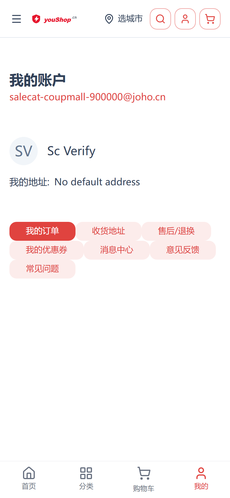
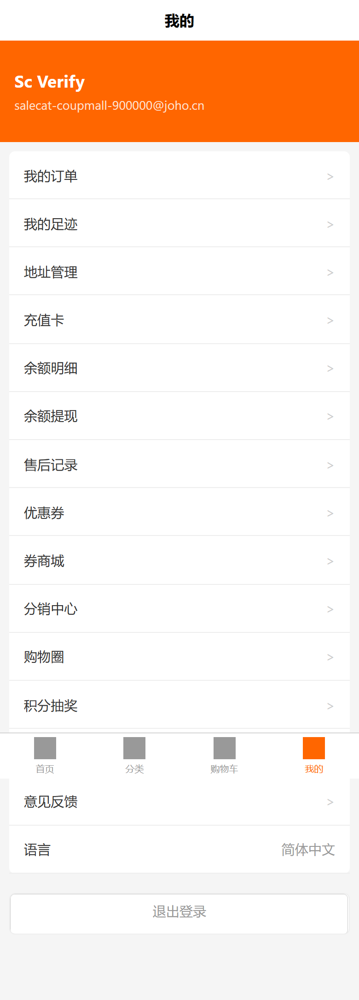
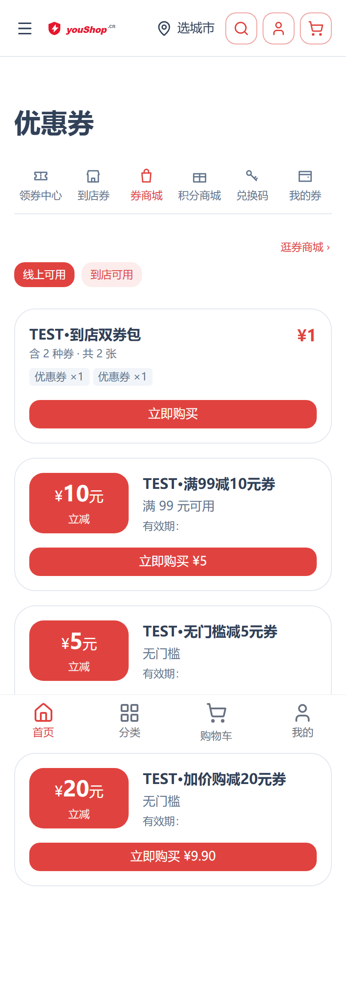
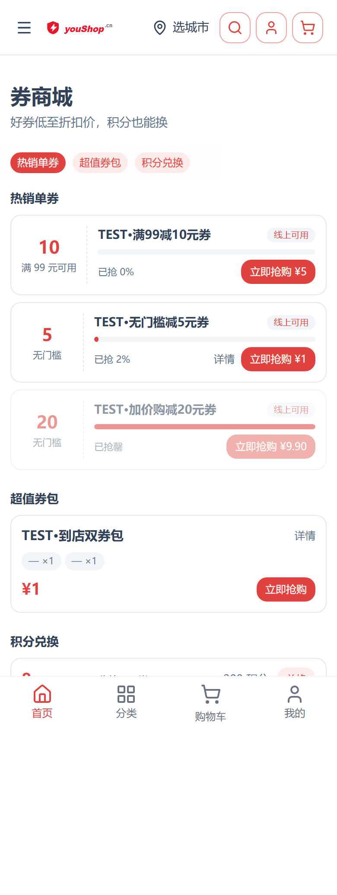
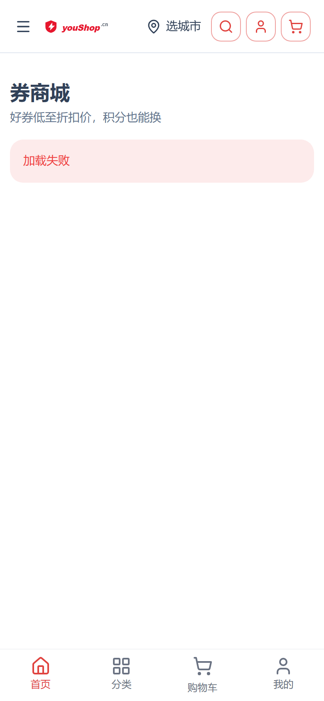
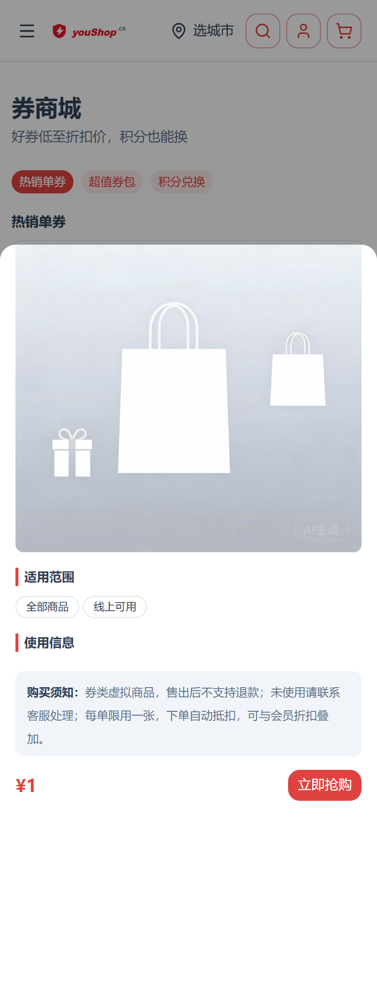
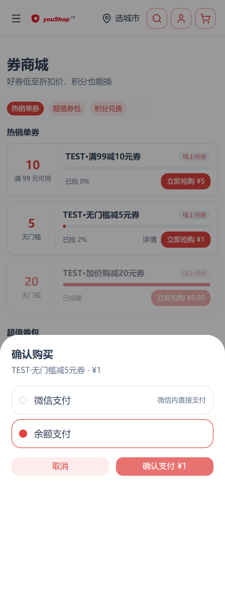
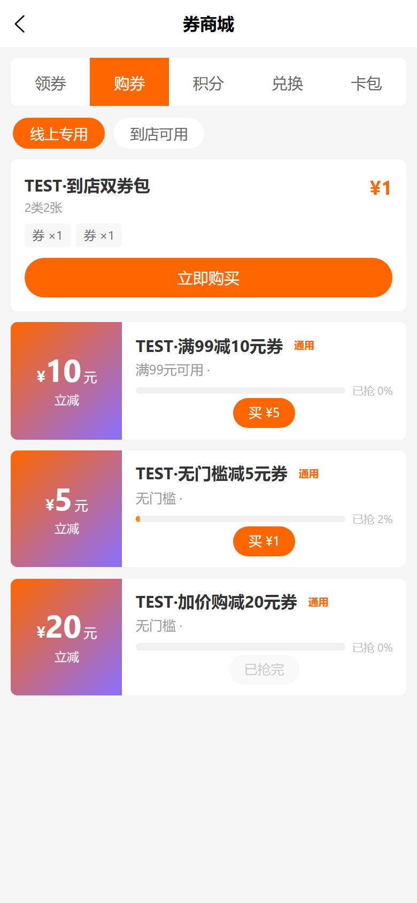
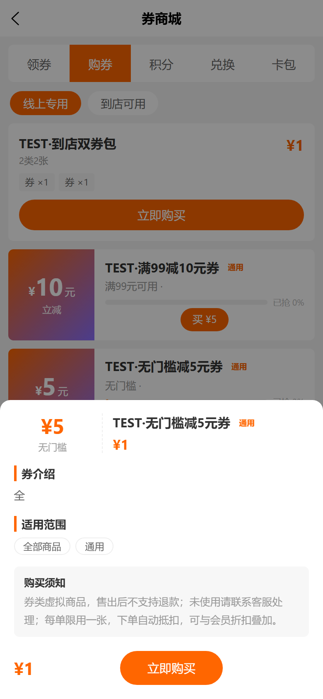
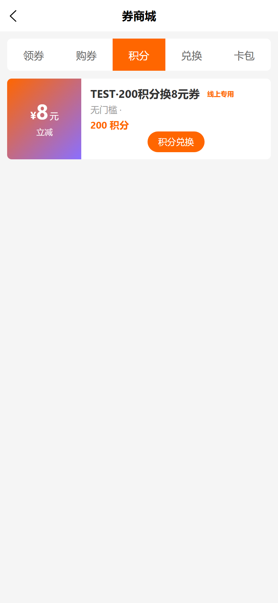

# 券商城独立页 操作手册

- 上线日期：2026-10-17
- 版本：nshop `5214013`、vshop `d05c7a9`（含 web-admin `462046c`）
- 设计文档：`d:\zhao\docs\superpowers\specs\2026-10-17-coupon-mall-design.md`
- 实施计划：`d:\zhao\docs\superpowers\plans\2026-10-17-coupon-mall.md`

## 1. 功能概述

券商城是**独立的优惠券售卖页**，与既有券中心（六 Tab 页）并存互为导流：

- **楼层导购版式**：热销单券 / 超值券包 / 积分兑换三楼层平铺，吸顶锚点快速跳转；空楼层自动隐藏
- **付费券详情**：券卡「详情」弹层展示券介绍（支持图文混排）、适用范围、使用信息、购买须知
- **详情可选增强**：后台填写了介绍内容的券才显示「详情」入口；未填写的券只展示卡片公共信息
- **库存进度**：限量券显示「已抢 x%」进度条，抢罄自动置灰
- **积分换券**：积分兑换楼层直连积分商城链路
- 后端零改动（券模板 `description` 多语言字段既有能力启用）

## 2. 访问入口

| 入口 | nshop（www.youshop.cn） | vshop（e.joho.cn） |
|---|---|---|
| 直接地址 | `/coupon-mall` | `/#/pkg-promotion/pages/coupon-mall` |
| 我的页菜单 | /account 兜底菜单「券商城」 | 个人中心「券商城」 |
| 券页推广条 | /coupon 券商城、积分商城 Tab 顶部「逛券商城 ›」 | 领券中心页 mall 入口（既有） |
| 首页宫格 | 装修配置添加（见 §5） | 装修配置添加（NavSection items） |

nshop 我的页菜单说明：菜单优先走装修配置（web-admin「我的页」profile.menus）；**租户若配置了菜单，硬编码兜底不生效**，需在配置里加一项 url 为 `/coupon-mall` 的菜单。

## 3. C 端使用

### 3.1 浏览与购买

1. 进入券商城，匿名访问显示登录引导卡，登录后进入页面
2. 热销单券楼层：卡片含面额、门槛、场景标签、已抢进度、售价与「立即抢购」按钮
3. 点券卡或「详情」打开详情弹层（券介绍图文混排 / 适用范围 / 使用信息 / 购买须知），弹层内可直接抢购
4. 抢购后弹出支付面板（微信 JSAPI / 余额），支付成功券入卡包；关闭面板未支付会自动取消订单
5. 抢罄券置灰显示「已抢罄」，不可购买

### 3.2 积分兑换

积分兑换楼层点「兑换」直接扣积分发券，与积分商城同链路。

## 4. 后台配置（web-admin）

### 4.1 券详情内容（图文混排）

1. 券管理 → 编辑券模板，定位「多语言描述」区（中文描述 / 英文描述）
2. 每个语言输入框下有**图库选择器**：选图后自动在介绍末尾追加一行 ``（可多张，逐张插入）
3. 文本行与图片行按行混排；保存后 C 端该券即出现「详情」入口
4. 券列表对已配置详情的券显示「有详情」标记，便于运营识别覆盖情况

### 4.2 售卖设置

- `claimable=false` 或限量抢罄 → C 端售罄态
- 目录渠道隔离已上线：各店铺只展示本店可售券（修复 commit `0b4dceca3`）

## 5. 首页宫格入口（装修配置）

两端首页宫格均为装修配置驱动：

- **nshop**：首页装修 → 导航区块（NavSection）添加项：文案「券商城」、链接 `/coupon-mall`
- **vshop**：首页配置 NavSection items 添加：icon + 文案「券商城」、link `/pkg-promotion/pages/coupon-mall`

## 6. 已知问题与后续优化

| 级别 | 问题 | 说明 |
|---|---|---|
| P2 | nshop 硬刷新场景 typed SDK 请求未带 Authorization | `gql:auth:init` 钩子既有链路问题（非本次引入），真实 SSO 登录流程可用；useCoupon 自建请求正常 |
| P3 | vshop 详情弹层无「使用信息」段 | 仅在券配置了有效期/限购时出现，与 nshop 四段结构存在差异，后续对齐 |
| 提示 | 租户配置了 profile.menus 时需配置入口 | 见 §2 表格说明 |

## 7. 回归与数据记录

- 单测：nshop coupon-mall 13 用例；vshop coupon-detail 3 用例（含字符串兼容）
- 登录态四态回归 13/14 PASS（Playwright 390×844 dpr=2，见上方截图）；发现并修复 3 项（vshop 字符串兼容 `d05c7a9`、/account 入口 `0566fd0`、匿名登录引导 `5214013`）
- 验证期间临时数据（模板 74 description / 模板 76 claimable）已还原原值；临时测试账号已清理；全表无 PENDING 残留出售单（含顺手清理 2026-10-03 历史残留 id=5）
- 验证脚本沉淀：`d:\zhao\scripts\_verify_coupon_mall_shots.mjs`
