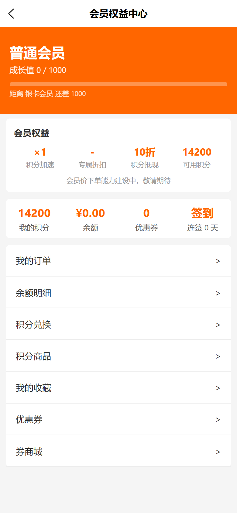
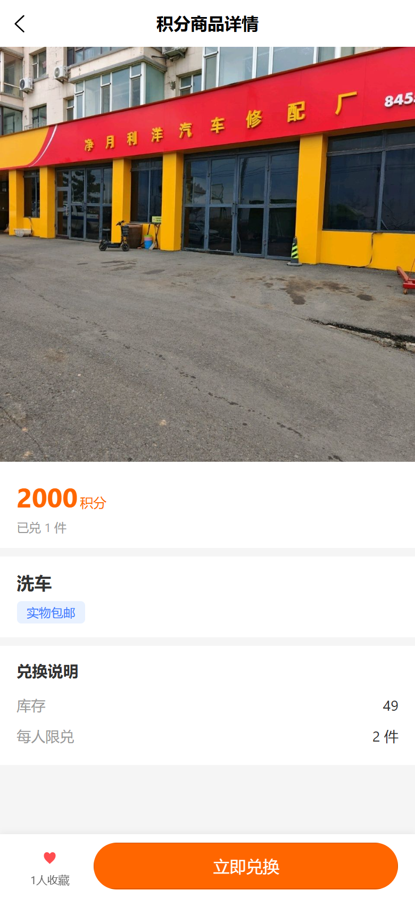
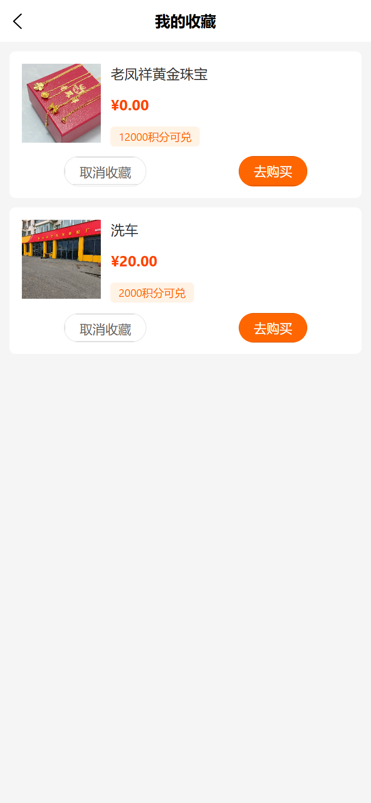
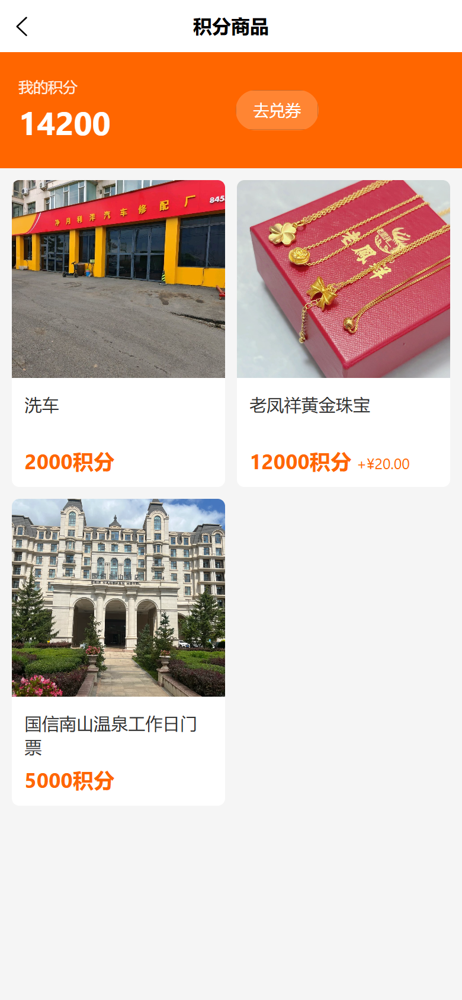
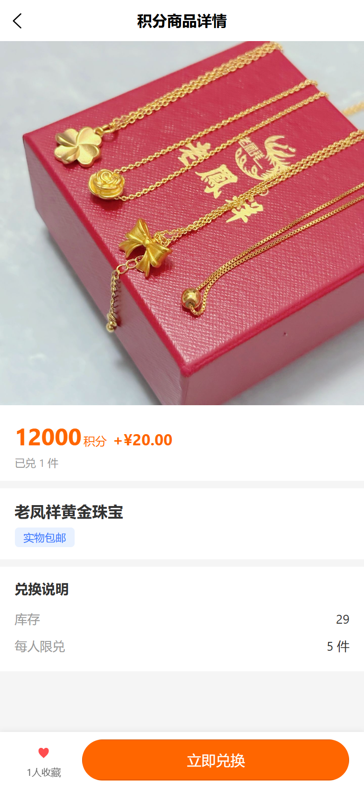
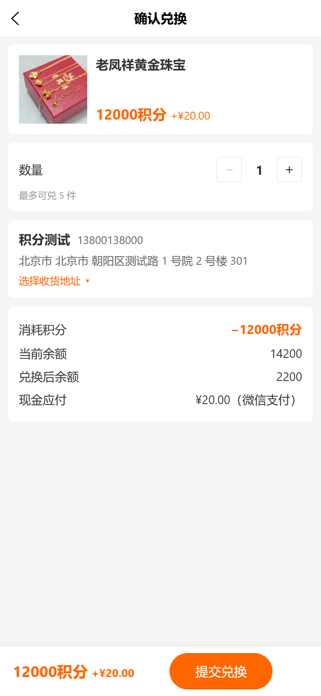
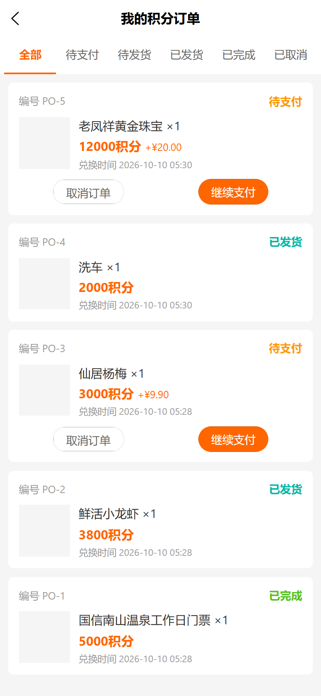

# usemall→vshop 对齐：商品收藏 + 积分商城（操作手册与截图）

> 生成日期：2026-10-10 ｜ 视口规范：Playwright 移动端 **390×844、deviceScaleFactor=2**（实际 780×1688 像素）
> 截图环境：**线上 `https://e.joho.cn`** 真实取数（测试客户 points-probe@joho.cn，造数后截图；截图脚本 `web-admin/scripts/_vshop_points_mall_shots.mjs` 只做浏览不触发写操作）。

---

## 一、范围总览

| # | 交付物 | 端 | 入口 / 位置 | 对应提交 |
|---|--------|----|-------------|----------|
| F01 | 商品收藏（详情页 ♥ 切换、我的收藏列表、收藏人数） | vendure + C 端 | C 端商品详情页底部「♥ 收藏」；「我的→我的收藏」 | vendure `d1979b2f4` 等；vshop `e5c6f4b` |
| F02 | 积分商城（积分商品列表 / 详情 / 兑换确认 / 积分订单） | vendure + C 端 + web-admin | C 端「我的→会员中心→积分商品」；后台 营销组→「积分商品 / 积分订单」 | vendure `d1979b2f4`/`352d17d0c`/`468ac4737`/`3a762c516`；vshop `e5c6f4b`/`9506894` |

**业务链路要点**：

- **商品收藏**：`ProductFavorite` 实体（productId + customerId + channelId 唯一），toggle 幂等往返；游客点收藏要求登录；收藏列表按渠道隔离、id 倒序；商品已删除显示「已删除商品」占位；详情页展示「N 人收藏」。
- **积分商城**：`PointsProduct` 挂在原商品上（一个商品一个积分价），支持**纯积分**与**积分+现金混合价**；下单 = 先扣积分（SPEND 流水）→ 原子扣库存（防并发超卖）→ 建单 → 混合价建支付单。
- **订单状态机**：混合价（cashTotal>0）→ `pending_payment` 待支付；纯积分实物 → `pending_ship` 待发货；纯积分虚拟（virtual）→ `completed` 直接完成。后台可流转：待支付→（标记已收款）→待发货→（标记发货）→已发货→（标记完成）→已完成。
- **图片绝对 URL**：插件返回给 C 端的图片经 `assetStorageStrategy.toAbsoluteUrl` 补全为绝对地址（vendure `3a762c516`），避免 H5 路由基目录下相对路径 404。

---

## 二、C 端使用流程

### 2.1 入口

「我的→会员中心」页面提供「积分兑换」（券兑换，原有功能）与「积分商品」（本次新增积分商城）两个入口。

### 2.2 商品收藏

1. 商品详情页底部操作条「♥ 收藏」按钮：未收藏点击即收藏（心形变红 +「N 人收藏」+1），已收藏点击取消；游客点击弹出登录。
2. 「我的→我的收藏」列表：条目含商品图、名称、现价、积分价标签（如「12000积分可兑」）、取消收藏 / 去购买按钮。

### 2.3 积分商品列表

「积分商品」页：顶部「我的积分」余额卡（含去兑券入口），下方商品卡片网格（商品图、名称、积分价、混合价时附现金加价副标如「+¥20.00」）。

### 2.4 商品详情与兑换

1. 详情页：主图轮播、积分价（混合价时双展示）、已兑件数、商品名、配送方式标签（实物包邮 / 虚拟）、兑换说明（库存 / 每人限兑）、底部「立即兑换」。
2. 兑换确认页：收货地址选择（实物）、积分抵扣明细、兑换后余额预览，提交即下单。

### 2.5 积分订单

「我的→积分订单」：按状态展示（待支付 / 待发货 / 已发货 / 已完成 / 已取消），待支付订单可**去支付**（现金部分拉起微信支付）或**取消订单**（自动退回积分并回补库存）；已发货订单可查看物流单号。

---

## 三、web-admin 使用流程

登录（生产 `https://e.joho.cn/guanli/`）→ 选择店铺 → 工作台右上 ☰ 菜单抽屉 → **营销组** →「积分商品」/「积分订单」。

### 3.1 积分商品管理（营销组 →「积分商品」）

- 列表展示全部积分商品（图、名称、积分价、现金价、库存、已兑、状态），顶部搜索框支持按商品名 / 商品ID 搜索。
- **新增 / 编辑**：选择原商品（搜索）、积分价（必填）、现金价（选填，>0 即混合价）、配送类型（实物 / 虚拟）、库存、每人限兑（0 = 不限）、有效期（validFrom/validTo，选填）、上下架状态、排序。
- **删除**：二次确认后删除（已有订单不受影响，订单保留快照）。

### 3.2 积分订单管理（营销组 →「积分订单」）

- 状态 tab 筛选 + 分页列表（单号、客户、积分/现金金额、状态、物流单号、下单时间），顶部搜索框支持按单号 / 客户ID 搜索。
- 操作按钮随状态出现：
  - **待支付 →「标记已收款」**：线下收款兜底（客户微信支付未完成、商家线下确认收款后使用），订单进入待发货。
  - **待发货 →「标记发货」**：可填物流单号，订单进入已发货。
  - **已发货 →「标记完成」**：订单完结。
- **退款状态标签**：存在支付行且 `refundStatus ≠ none` 时，订单卡右上角（状态标签旁）展示退款标签——**退款中**（amber）/ **已退款**（green）/ **退款失败**（red）。状态机：`none → refunding → refunded / failed`（failed 由后端重试任务自动拉回 refunding 重试）。退款失败**点击标签**弹窗查看失败原因（refundError）；已退款在卡内展示退款完成时间（refundedAt 按本地时区格式化）。`refundStatus = none` 或无支付行不显示任何退款元素。
- 客户积分余额调整在会员体系：客户列表 → 调整积分（增减 + 备注，写积分流水）。

---

## 四、下单校验规则（后端硬校验）

| 校验 | 错误码 | 说明 |
|------|--------|------|
| 积分不足 | spendPoints 抛错 | 下单先扣积分，不足即中止 |
| 库存不足 | `OUT_OF_STOCK` | 原子扣减（`stock >= quantity` 条件更新），防并发超卖 |
| 超出每人限兑 | `PER_USER_LIMIT_EXCEEDED` | `perUserLimit > 0` 时按非取消订单**总件数**（SUM(quantity)）计数，与 C 端「剩余可兑额度」口径一致 |
| 不在有效期 | `NOT_IN_VALIDITY` | validFrom/validTo 窗口外不可兑 |
| 商品未上架 | 下单校验 | 仅 enabled 积分商品可兑换 |

---

## 五、已知边界

1. **待支付订单 30 分钟超时自动关单**：`pending_payment` 订单超时自动关闭（退分 + 回补库存，`pointsOrderTimeoutMinutes` 可配置，设 0 关闭）；用户也可在订单页手动「取消订单」（自动退分 + 回补库存）。
2. **手动取消退分**：仅 `pending_payment` 可取消；取消即退回全部积分、回补库存、支付单置 cancelled，不可逆。
3. **线下收款兜底**：混合价现金部分若微信支付未完成，商家可后台「标记已收款」跳过在线支付（信任场景兜底），订单照常进入发货流程。
4. **现金部分走微信支付**：混合价仅支持微信支付（复用 wechatpay 网关裸支付参数），无其他在线支付渠道。
5. **积分无过期**：积分余额与流水由会员等级插件管理，本插件只消费（SPEND）与退回（EARN），不处理过期。
6. **混合价现金自动退款**：用户已拉起微信支付但回调晚于 30 分钟关单时（订单已取消、积分已退、库存已回补），支付回调触发**现金自动原路退回**，无需人工介入（详见「五之一」）。

---

## 五之一、混合价现金自动退款（2026-10-11 新增）

**触发场景**：混合价订单现金部分，用户已支付成功，但微信回调晚于 30 分钟超时关单——此时订单已 cancelled（积分已退、库存已回补），现金若无处理将滞留。本机制保证该场景**自动原路退款，无需人工介入**。

**机制**（vendure `e4ac7a6ca` / wechatpay `e6c56891a`）：

1. 微信支付回调到达时，若发现订单已被取消：不再报错，改为在事务内**原子认领**支付行（`refundStatus: none → refunding`，退款号固定 `PO-RF-<paymentId>`，微信同号幂等），提交后事务外调微信申请退款（`POST /v3/refund/domestic/refunds`）。
2. 退款成功 → 支付行落 `refunded` + `refundedAt`；失败 → 落 `failed` + `refundError`，交由重试任务处理。
3. **退款重试任务**（`points-order-refund-retry.task.ts`，每 5 分钟）：扫描 `failed` 行与卡在 `refunding` 超 10 分钟的行（`refundAttempts < 8`，指数退避 5min×2^n）。卡单行先调微信退款查询**对账**——微信侧已成功直接落 `refunded`，否则用同一退款号幂等重发。
4. 相同回调重复到达自动幂等（认领条件不满足即直接返回），不会重复退款。

**支付单退款状态机**：`none → refunding → refunded / failed`（failed 由重试任务拉回 refunding）。

**配置开关**：`pointsRefundRetryEnabled`（默认开启）。排查后台积压时可查 `points_order_payment` 表的 `refundStatus / refundError / refundAttempts` 三列。

**C 端展示**（vendure `59c31714d` / vshop 同轮）：shop 端 `myPointsOrders` 的 `PointsOrder` 暴露聚合字段 `refundStatus`（按 orderId 取最新一条支付行，无支付行默认 `none`，不暴露 refundNo/externalRef 等内部字段）；C 端「我的积分订单」混合价订单卡金额旁展示退款小标签——退款中（amber）/ 已退款（green）/ 退款异常（red，点击 toast 提示联系客服），`none` 不显示。见 `assets/points-c-orders-refund.png`。

---

## 五之二、C 端多语言本地化机制（chrome 层，2026-10-11 新增）

**范围**：C 端多语言 = 页面文案（55 个 i18n 命名空间，五语言包 `src/i18n/locales/*.json`）+ 导航标题（54 页）+ 原生 tabbar 标签（4 项）。本节说明后两者的集中机制与验证/维护方法。

**实现**（`src/i18n/nav-titles.ts`，App.vue 挂载）：

1. **导航标题**：`NAV_TITLE_KEYS` 集中映射 route path → `nav.*` 词条（排除 pages/admin 内部工具页；pages.json 不改，中文为 fallback）。四类导航（navigateTo/redirectTo/reLaunch/switchTab）经 `uni.addInterceptor` 拦截，目标 url 在 `invoke` 钩子捕获（success 回调只有 errMsg），`applyNavTitle()` 查表 → `uni.setNavigationBarTitle`，页面 meta 未挂载时 fail 短重试。
2. **tabbar 直载坑**：uni-app H5 对 tabbar 页直载是「先起首页再内部切 tab」，内部切换不走 uni.switchTab、拦截器拦不到 → `startNavTitleWatch()` 启动期 5 秒轮询栈顶路由，变化即应用标题。
3. **tabbar 标签**：`applyTabbarLabels()` 复用 `nav.home/category/cart/profile` 词条 + `uni.setTabBarItem`（0-3 固定序）。**tabbar 挂载晚于 App onShow，首次 set 静默 fail** → success/fail 标记 `tabbarApplied`，观察循环内重试直至成功。
4. **语言存储**：localStorage `vshop-locale`（i18n/index.ts 持久化）；当前无应用内切换器，直载生效。切换器落地后在切换处重调 `applyNavTitleForCurrentPage()` + `applyTabbarLabels()` 即可即时刷新。

**验证方法**（Playwright 或手测）：

- 预置 localStorage `vshop-locale=en` 后直载 `https://e.joho.cn/#/pages/cart/index`，断言 `document.title === 'Cart'` 且 `.uni-tabbar__label` 文本为 Home/Categories/Cart/My Account；zh-CN 复原对照。截图见 `assets/tabbar-i18n-en.png`。
- 注意首页/分类页用自定义频道头（无原生标题栏），验证原生标题应选 cart/flash-sale 等页。

**维护指引**：新增页面 → pages.json 注册后往 `NAV_TITLE_KEYS` 加一行 path→key，五语言包 `nav` 命名空间同步补词条（key 顺序五文件一致）；新增 tabbar 项 → `applyTabbarLabels()` 的 items 数组加一行（index 按顺序）。

**已知边界**：tabbar 图标不参与本地化（静态 PNG）；`agreement.vue` 法律长文保留中文待内容本地化决策；pages/admin 3 页（商家上架/平台上架审批/分销结算）为内部工具不本地化。

---

## 附：截图清单与复现

截图均由 `web-admin/scripts/_vshop_points_mall_shots.mjs` 生成（Playwright 390×844@2x，SPA 导航，登录态经 localStorage 注入）：

| 文件 | 内容 |
|------|------|
| `assets/points-member-center-entry.png` | 会员中心入口（积分商品 / 积分兑换） |
| `assets/points-goods-list.png` | 积分商品列表（余额卡 + 混合价副标） |
| `assets/points-goods-detail-favorited.png` | 详情页收藏激活态 |
| `assets/points-goods-detail-mixed-price.png` | 详情页混合价 |
| `assets/points-goods-confirm.png` | 兑换确认页（地址 + 明细） |
| `assets/points-goods-confirm-limit.png` | 兑换确认页（每人限兑剩余额度：限兑 5 已兑 1 → 最多可兑 4 件） |
| `assets/points-orders.png` / `assets/points-orders-bottom.png` | 积分订单列表（三态） |
| `assets/points-goods-list-v2.png` | 积分商品列表（登录态余额数字正常展示） |
| `assets/favorites-list.png` | 我的收藏列表 |
| `assets/points-mall-entry-i18n.png` | 积分兑换商城入口页（全部文案 i18n 化后渲染） |
| `assets/points-orders-localtime.png` | 积分订单列表（兑换时间已按本地时区格式化） |
| `assets/points-goods-list-error-retry.png` | 积分商品列表加载失败错误态（拦截 /shop-api 返回 500，展示「加载失败 + 重试」） |
| `assets/points-admin-orders-refund-column.png` | 后台积分订单列表（desktop 1440×900，`payments` 退款字段查询与渲染无回归；线上当前无退款单，退款标签不显示属预期） |
| `assets/points-c-orders-refund.png` | C 端积分订单列表（390×844@2x，混合价单金额旁退款状态标签位；线上当前无退款单，标签不显示属预期，截图证明页面无回归） |
| `assets/member-center-i18n.png` | 会员权益中心（i18n 专项后登录态渲染：等级/成长值/权益卡/快捷入口） |
| `assets/distribution-i18n.png` | 分销中心（i18n 专项后未申请引导态：标题/描述/申请按钮） |
| `assets/nav-title-en.png` | 导航标题 i18n：购物车页 en 直载（localStorage `vshop-locale=en`，导航栏标题 Cart——tabbar 页直载为本轮修复覆盖场景） |
| `assets/tabbar-i18n-en.png` | tabbar 标签 i18n：en 直载购物车页（导航标题 Cart + tabbar Home/Categories/Cart/My Account + 页体英文提示，chrome 层全量本地化证据） |
| `assets/batch5-i18n-en.png` | i18n 批次 5 收尾：券商城 en 直载（localStorage `vshop-locale=en`）——标题/Tabs/按钮/门槛与标签全英文；券名与描述为后端 API 动态数据保留中文 |

复现：`node web-admin/scripts/_vshop_points_mall_shots.mjs`（可选 `--only list,detail`；环境变量 `SITE_URL` / `SHOT_USER` / `SHOT_PWD`）。前置需测试客户 + 积分商品 + 订单造数。本轮三张验证截图由 `node web-admin/scripts/_vshop_points_fix2_shots.mjs` 生成；C 端退款标签截图由 `node web-admin/scripts/_vshop_points_refund_shots.mjs` 生成。

---

## 六、变更记录

### 2026-10-11 i18n 专项批次 3-5 收尾

- **批次 3（主包+商品子包，commit `f031831`）**：cart / category / home / landing-invite / register 主包 5 页 + pkg-product 商品详情 / 评价 / 列表 3 页硬编码中文五语言化。
- **批次 4（订单+售后子包，commit `ac96094`）**：pkg-order 结算 / 申请发票 / 我的发票 / 订单详情 / 订单列表 / 支付结果 / 支付 7 页 + pkg-after-sale 售后申请 / 列表 / 详情 3 页。
- **批次 5（营销+社区子包，commit `2397575`，专项收尾）**：pkg-promotion 券码(81处)/券商城(118)/优惠券(65)/直播间(34)/直播列表(11)/限时秒杀(6)/拼团(5) + pkg-circle 发布(16)/帖子详情(12)/信息流(7) 共 10 页；新增 couponCode(31)/couponMall(69)/coupons(41)/liveRoom(29)/liveList(11)/flashSale(6)/circlePublish(15)/circleDetail(7)/circleFeed(3) 九个命名空间共 212 key，group-buy 复用既有 `promotion.*`，PERCENT 券「折」沿用 `promotion.percentOff` 双参模式（zh「{zhe}折」/ en·ja·ko「{off}% off」）；直播间弹幕/评论的用户昵称与内容、社区页正文与昵称为 API 动态数据保留原样。
- **顺手修（同提交）**：`profile/index.vue` 接入既有 profile 词条（13 个菜单项 + 姓名兜底）；`pkg-user/faq.vue` 整页五语言化（新增 faq 命名空间 7 key，v-for 变量改名避免遮蔽 i18n t）；`points-mall.vue` / `my-reviews.vue` 加载失败 toast 兜底改 `common.loadFailed`（新增词条）。合计新增 220 key，五语言包 55 个顶级命名空间、子 key 顺序完全对齐。
- **终验与部署**：临时 node 校验脚本（五包 JSON 合法、55 顶级命名空间集合与全部子 key 顺序一致、percentOff 参数齐全）ALL PASS 后删除；全量残留扫描（src/pages 排除 admin 3 页 + pkg-product/order/after-sale/circle/promotion/user）UI 硬编码清零，仅剩行尾注释、`endsWith('区')` 数据逻辑等预期项；`agreement.vue` 隐私政策/用户协议整页法律长文不做机翻，保留中文原文待单独处理。已部署 https://e.joho.cn/，截图 `assets/batch5-i18n-en.png`。

### 2026-10-11 tabbar 标签 i18n（补齐 chrome 层最后一块）

- 原生 tabbar（首页/分类/购物车/我的）不在导航标题机制覆盖内：`nav-titles.ts` 新增 `applyTabbarLabels()`（复用 nav.* 词条 + uni.setTabBarItem），随启动观察循环应用；**tabbar 挂载晚于 App onShow，首次 setTabBarItem 会静默 fail** → 以 success/fail 标记 `tabbarApplied`，观察循环内重试直至成功。Playwright 实测 en 直载：tabbar Home/Categories/Cart/My Account + 标题 Cart；zh 复原。语言切换后如需即时刷新可在切换处重调 `applyTabbarLabels()`（当前无应用内切换器，预留）。

### 2026-10-11 导航标题集中式 i18n（54 页五语言）

- **直载缺口修复（同日追加）**：实测发现 uni-app H5 对 tabbar 页直载是「先起首页再内部切 tab」，内部切换不走 uni.switchTab、拦截器拦不到，onLaunch 单次 apply 只会落在首页 → 购物车等 tabbar 页直载标题回退中文。修复：新增 `startNavTitleWatch()`（App onShow 启动，仅前 5 秒轮询栈顶路由、变化即应用，之后交由拦截器）+ navigateBack 拦截器（语言切换等返回后对新栈顶页应用）。Playwright 实测 en 直载 cart 标题 "Cart"、flash-sale "Flash Sale"、zh 复原，截图更新为 cart 直载对照。已知边界：主包页面（home/category/cart/profile/login 等）页体文案不在 13 页 i18n 批次内，待下一批次。

- **集中映射 + 导航拦截器**：新增 `src/i18n/nav-titles.ts`——`NAV_TITLE_KEYS` 收录 pages.json 全部用户侧页面 54 个 route path → `nav.*` 语义化 key（排除 pages/admin/ 下 3 个内部工具页与 globalStyle 的 Youshop 品牌名；pages.json 本身不改，中文仍是默认 fallback）；`setupNavTitleInterceptor()` 在 App onLaunch 对 navigateTo/redirectTo/reLaunch/switchTab 挂拦截器（uni 拦截器 success 回调只带结果，目标 url 在 invoke 钩子捕获），`applyNavTitle()` 查表 → i18n t() → `uni.setNavigationBarTitle`，页面 meta 未挂载时 fail 短重试、H5 下以 document.title 达成与否校验防默认标题回写；启动时对当前页也应用一次。纯全局机制不依赖页面实例，setup 写法页面零改动。
- **语言持久化**：`src/i18n/index.ts` 初始化时从 uni storage（H5 落 localStorage，key `vshop-locale`）读取语言；五语言包同步新增 `nav` 命名空间 54 key（顶级 key 位置五文件一致）。
- **验证与部署**：临时 node 校验（54 个 path 全存在于 pages.json、五包 nav 齐全且 key 序一致）通过后删除；Playwright 线上验证：zh 首页 → 存储切 en + reload 标题 Home、switchTab 分类页 Categories、切回 zh-CN 分类/首页复原；截图 `assets/nav-title-en.png` / `assets/nav-title-zh.png`。commit `7372e28`，已部署 https://e.joho.cn/。

### 2026-10-11 i18n 专项（C 端存量页）

- **13 页约 230 处硬编码中文文案五语言化**（zh-CN/zh-TW/en/ja/ko，两批提交，五语言包 key 集合与顺序一致）：
  - **批次 1（会员账户簇 5 页，commit `c2b8492`）**：member-center / profile / addresses / invoice-titles / change-password，新增 `memberCenter` / `addresses` / `invoiceTitles` / `changePassword` / `profile` 五个命名空间。
  - **批次 2（分散簇 8 页，commit `2339c2c`）**：distribution / withdraw / recharge / feedback / logistics / lottery / balance-history / points-history，新增 `distribution`(62) / `withdraw`(24) / `recharge`(13) / `feedback`(17) / `logistics`(14) / `lottery`(17) / `balanceHistory`(10) / `pointsHistory`(8) 八个命名空间共 165 key。模板中文、placeholder、toast/modal、状态映射值全部转为函数内动态 `t()`（插值 `{n}`/`{code}`/`{amount}`/`{time}` 等），时间格式化函数与业务逻辑未动；lottery 奖品格「积分」单位复用共享词条 `pointsGoods.pointsUnit`。
- **member-center 旧图不变**：手册截图清单内既有的 member-center 旧截图保持原样（默认中文渲染不变，zh-CN 词条值与原文案一致），仅新增两张验证截图。
- 新增截图：`assets/member-center-i18n.png`（会员权益中心登录态渲染：等级/成长值/权益卡/快捷入口）、`assets/distribution-i18n.png`（分销中心未申请引导态：标题/描述/申请按钮）。

### 2026-10-11 时间本地化扫尾轮（前端）

- **C 端 6 页时间显示本地化**：balance-history / points-history / distribution / logistics / lottery / withdraw 六页沿用「UTC 串直接截取」旧写法（显示慢 8 小时），统一替换为与 points-orders 相同的 Date 本地格式化（无效串回退原样）。线上空态截图证页面无回归（该渠道无存量流水/订单）。
- **web-admin 积分商品有效期回显修正**：编辑卡 validFrom/validTo 由 UTC 串 `slice(0,10)` 改 `toLocalDate()` 本地日期，修掉本地零点时间戳回显差一天的偏差（配合此前 validTo 当日 23:59:59 语义修复）。见 `assets/points-orders-local-time-v2.png`（积分订单页无回归）。
- **全库收尾（本轮扩展至 11 处）**：同一修法推广至全库——C 端社区帖子时间、分销结算时间、加购券「有效期至」、券商城与我的券日期区间；web-admin 优惠券/拼团/秒杀编辑 picker 回显、盘点任务时间、拣货批次创建/操作时间（文件内共用 toLocalMinute）、对账默认日期（`toISOString` 早上 8 点前会落到昨天）、平台模板时间。券商城线上登录态截图：一屏含日期区间券（「至 2027-01-01」）渲染正常无回归，见 `assets/coupon-mall-local-date.png`。

### 2026-10-11 C 端退款状态展示

9. **C 端积分订单退款标签**：shop 端 `myPointsOrders` 暴露聚合 `refundStatus`（vendure `59c31714d`，e2e 22/22）；vshop `points-mall.ts` 查询字段同步、`points-orders.vue` 混合价订单卡金额旁按态显示小标签（refunding 退款中 amber / refunded 已退款 green / failed 退款异常 red，点击 toast 联系客服语义），zh-CN/zh-TW/en/ja/ko 五语言补 `pointsGoods.refundTag*` 词条。见「五之一·C 端展示」与 `assets/points-c-orders-refund.png`。

### 2026-10-11 web-admin 退款状态展示

8. **积分订单页退款状态展示**：`pointsOrdersAdmin` 查询补 `payments { id amount status externalRef transactionId refundStatus refundNo refundedAt refundError refundAttempts }`（amount 单位分）；订单卡状态标签旁新增退款标签（refunding 退款中 amber / refunded 已退款 green / failed 退款失败 red），failed 点击弹窗看 `refundError`，refunded 展示 `refundedAt` 本地时间；zh-Hans/en 词条补 `pointsOrders.refunding/refunded/refundFailed/refundError`。见「3.2」与 `assets/points-admin-orders-refund-column.png`。

### 2026-10-11 自动退款轮（后端）

7. **混合价现金自动退款**：微信回调晚于超时关单时自动原路退现金（settle 取消分支：原子认领支付行 → 事务外调微信退款 → 落 refunded/failed），`PointsOrderPayment` 新增 refundStatus/refundNo/refundedAt/refundError/refundAttempts 五列；新增退款重试任务（每 5 分钟，对账+幂等重发，`pointsRefundRetryEnabled` 开关）。e2e 19/19（新增退款成功 / 重复回调幂等 / 失败进重试 3 例）。详见「五之一」。

### 2026-10-11 前端修复轮（6 处）

**C 端（vshop）**

1. **积分订单时间本地化**：`points-orders.vue` 原直接截取 ISO 字符串（UTC，差 8 小时），改 `new Date()` 本地格式化 `YYYY-MM-DD HH:mm`（见 `assets/points-orders-localtime.png`）。
2. **列表加载失败可重试**：`usePagination.ts` 新增导出 `error` ref（catch 赋值、成功清空）；积分商品列表 / 积分订单 / 我的收藏三页加错误态 UI（「加载失败 + 重试」按钮调 `refresh`，见 `assets/points-goods-list-error-retry.png`）。
3. **积分兑换商城入口页 i18n**：`points-mall.vue` 硬编码中文（我的积分/兑换/无门槛使用/满¥x可用/确认兑换弹窗等）全部走 `pointsMall.*` 词条，zh-CN/zh-TW/en/ja/ko 五语言补齐，带 `{n}`/`{points}`/`{name}` 参数插值（见 `assets/points-mall-entry-i18n.png`）。

**web-admin**

4. **积分商品列表分页**：原 `take: 100` 硬截断，改为分页条（上一页/下一页 + 页码 `i/n` + 每页条数 10/20/50，默认 20，展示总数），搜索/切页自动回第一页。
5. **启用开关不再丢编辑**：`onToggleEnabled` 持久化成功后不再整行 `toRow(saved)` 覆盖，仅回写 `enabled` 与 `redeemedCount`，保留该行未保存的编辑。
6. **有效期当日语义**：`validTo` 选当天按本地时区 **23:59:59.999** 转 ISO（当日有效），`validFrom` 按本地 **00:00:00**。
